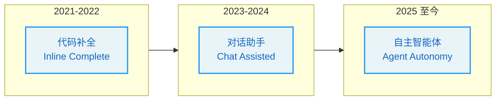
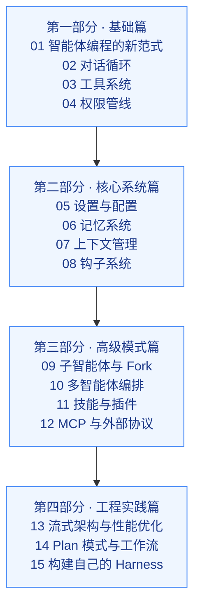

# 前言

> 模型提出工具调用，运行时负责校验、执行并返回结果。本书讨论这套运行时怎样组织。

假设你让 AI 编程助手修一个 bug，它回答“已修复”，测试却有三个用例失败。检查改动后才发现，它还修改了另一个文件；对话记录没有说清这次修改的原因。遇到这种情况，除了检查模型的回答，还要查运行时：它允许读取和修改哪些文件，何时要求确认，又保存了哪些执行记录。

**学习目标：** 读完这一节，你能：

- 用自己的话说清 Agent Harness 指的是哪一层，并列出它管的三件事；
- 在下面四类读者里认出自己，定下一条阅读路径，说得出它绕开了什么、代价是什么；
- 拿着后面的知识地图，说出第 1 到第 4 章各自解决什么问题，以及为什么按这个顺序排。

**难度定位：**本节不涉及代码，用过任意一款 AI 编程助手就能读。

## 御舆——从造车到造 Agent

> *"一器而工聚焉者，车为多。"* ——《周礼·考工记》

《考工记》把造车拆成木、金、皮、漆、轮几个工种，各有各的规矩。

造一辆马车需要多少工种？木工造**舆**（车厢），金工铸**軎辖**（车轴固定件），皮工制**鞁**（挽具），漆工饰表面，轮人造**辐**（车轮辐条）……《考工记》所言"天有时，地有气，材有美，工有巧"，四者合一，方成良车。

<!-- block: front.b-e3677d71 -->
这些构件与 Agent Harness 的几层结构可以对上：

<!-- block: front.b-f61131f3 -->
| 古代马车 | 含义 | Agent Harness |
|:--------:|------|:-------------:|
| **舆** | 车厢，承载乘者的核心结构 | **Harness 运行时**：承载 LLM 的工程框架 |
| **辕** | 车辕，定方向、传动力 | **对话循环**：驱动 Agent 前行的主循环 |
| **辐** | 车轮辐条，连接轴心与外圈 | **工具系统**：连接 LLM 与外部世界的桥梁 |
| **軎辖** | 固定车轴的销钉，防止车轮脱落 | **权限管线**：约束 Agent 行为的安全机制 |
| **轼** | 车前横木，乘者扶轼以致敬 | **钩子系统**：生命周期中的礼仪性扩展点 |
| **御** | 驾驭马车的车夫技艺 | **架构认知**：理解并掌控 Agent 系统的能力 |

孔子以车喻信："大车无輗，小车无軏，其何以行之哉？"——车少了固定的销钉就无法行驶，正如 Agent 少了权限护栏就不可信赖。《考工记》又载"辀欲颀典，辀深则折，浅则负"。车辕的弯曲度必须恰到好处，过深则断、过浅则不堪重负，正如 Agent 的自主性设计必须在能力与安全之间拿捏分寸。

<!-- block: front.b-d36778ea -->
甲骨文中的"舆"字，罗振玉释为"象众手造车之形"。本书借造车来理解 Agent 系统的分工：工具、权限、上下文、状态、流式通信和错误恢复需要配合，具体采用哪些机制，则取决于任务要求。

书名取自这里。读者后来管它叫「舆书」。

---

## 为什么写这本书

### AI 编程范式的三次浪潮

过去几年，AI 辅助编程走过三次浪潮，每一次都改写了开发者与代码的关系：

**2021-2022：行内补全。** Copilot 把建议放进了编辑器。模型只看光标前后的几十行，预测下一行或下一段，Tab 接受。它不跨文件推理，也不执行任何东西。

**2023-2024：对话框。** 上下文窗口变大，Cursor、Windsurf、Continue 这类工具能跨文件改代码。边界仍在编辑器：它能写，不能跑；能建议测试，不能执行；能发现问题，不能改完再验证。人还是在编辑器和终端之间搬结果。

**2025 至今：终端里的 Agent。** 模型开始直接执行：跑 Shell、读写文件、跑测试、操作 Git，出错后自己改策略。工作单位从"一次补全"变成"一个任务"，模型外面那圈代码开始决定它能做什么、不能做什么。

三个阶段画在一起：

### Agent Harness：一个新架构概念的诞生

<!-- block: front.b-35db98a2 -->
这圈代码有个名字：**Agent Harness**。它围绕 LLM 搭运行时，管工具的注册与调度、权限、状态、流式输出和错误恢复。

<!-- block: front.b-499dd26b -->
车马的比喻用来说明分工。落实到代码，模型根据上下文提出下一步，Harness 校验工具请求、执行获准的操作，再把结果送回模型。权限、上下文和状态管理共同影响这条循环怎样继续。

阅读 Harness 时，可以沿着一次工具调用检查：请求在哪里校验，权限由谁判断，失败后如何恢复。这些问题会贯穿后面的章节。

### Claude Code 的诞生与意外公开

2025 年初，Anthropic 发布 Claude Code。它跑在终端里，不挂编辑器，也没有图形界面。

2026 年 3 月 31 日，一个意外事件将 Claude Code 推上了技术社区的风口浪尖：安全研究员 [Chaofan Shou (@Fried_rice)](https://x.com/Fried_rice) 发现 Anthropic 发布在 npm registry 中的 `@anthropic-ai/claude-code` 包包含一个 source map 文件。披露推文获得超过 1700 万次浏览，Agent 架构随之成为技术社区焦点。Anthropic 随后修补了该配置问题。

讨论很多，但大多各写一段：工具调用一篇，权限模型一篇，流式架构一篇。把它们放回同一个运行时、讲清彼此怎么牵制的不多，这本书做这件事。

### 为什么是现在

现在写，有三个由头：

1. **架构在收敛。** 对话循环、工具类型系统、分层权限、流式状态，主流框架的做法已经趋同。这里总结的模式不绑某一家。

<!-- block: front.b-897855dd -->
2. **工程问题暴露了。** 上下文窗口、工具的安全与并发、长跑的状态一致性、重试策略，两年实践把这些都摆上了台面。模型变强不会让它们消失；任务越复杂，它们越尖。

3. **读的人在往深里走。** 调 API 写个聊天机器人已经不够，下一步是自己搭一套。

## Claude Code 为什么值得深入学习

选 Claude Code 当样本，有几条现成的理由：

**子系统齐。** 工具类型系统、权限管线、状态管理、上下文压缩、MCP、子智能体调度，一个运行时该有的它都有。读完一套，换别的框架也知道该看哪几处。

**决策能追。** 它的设计里留着可查的取舍：

<!-- block: front.b-ad2a9cf3 -->
- 为什么对话主循环采用流式异步生成器而非回调或 Promise 链？（答案涉及背压控制、取消传播和可组合性——详见第 2 章）
- 为什么权限系统采用四阶段管线而非简单的黑白名单？（答案涉及纵深防御和关注点分离——详见第 4 章）
- 为什么工具类型设计中包含并发安全和中断行为这样的细粒度控制接口？（答案涉及并行调度策略和用户体验——详见第 3 章）

每个答案都落在具体取舍上，不是纸面推演。

<!-- block: front.b-cf15e3d9 -->
**技术栈是当下的。** Bun 做运行时，React + Ink 渲染终端，Zod v4 做运行时验证，Commander.js 处理 CLI。不看 Agent，单看这份 TypeScript 工程也够参考。

**规模够大。** 51 万行 TypeScript，模块化、可测试性和扩展性都在这套代码里跑过。工具类型、权限、状态管理的方案可以搬到自己的项目。

## 本书特点

本书围绕架构分析展开：

<!-- block: front.b-165ad92a -->
**追踪运行过程。** 从 Claude Code 的产品行为和公开信息出发，分析对话循环如何驱动工具、权限如何分层检查、上下文如何压缩，并说明这些部分怎样配合。

<!-- block: front.b-29f84b0e -->
**解释设计取舍。** 书中讨论异步流式优先、安全边界内嵌、缓存感知设计、渐进式能力扩展、不可变状态流转五条原则，结合类型、函数和状态变化说明它们如何影响实现。

**讨论怎样用于自己的项目。** 每章提炼可复用的设计模式，供使用 LangChain、AutoGen 或自行构建 Agent 的读者参考。采用之前，仍需对照自己项目的任务、权限与运行环境。

## 读者画像与阅读路径

### 四类核心读者

本书适合以下四类读者：

**架构师和技术负责人**，正在评估或构建 AI Agent 系统，需要理解 Agent Harness 的设计空间和工程权衡。本书给的是一张完整的架构决策地图，帮你在"自建还是采用框架"、"哪些子系统需要优先投入"这类问题上做出判断。

**高级工程师**，已经具备 TypeScript/Node.js 经验，希望深入理解如何在 LLM 之上构建可靠的工程系统。书中的设计模式（异步生成器循环、分层权限管线、不可变状态管理）可以直接搬进日常工程实践，即便你当前并不构建 Agent 系统。

**AI 应用开发者**，不满足于调用 API 的浅层使用，希望掌握工具调用、流式处理、权限管控等核心技术。从"为什么"讲到"怎么做"，你跟着走一遍，也就从 API 调用者变成了系统构建者。

**对 Agent 技术有好奇心的研究者**，希望从工程实现的角度理解 Agent 系统的运作方式。从宏观架构到微观实现，本书都铺到了，正好补上学术论文与工程实践之间那段空白。

### 前置知识

读这本书不必写过 Agent，但需要三样底子：能在终端里跑命令，看得懂 TypeScript 的对象和函数签名，知道大模型接口大致是「发消息、收消息」这件事。缺其中一样也不挡路：第 1 章会用最短的篇幅补齐四步状态链；卡在模型本身为什么这样回答时，转去 omp 分册第 2 章《大模型的最小必要知识》。

书里的代码是用来读的，不是用来抄的。碰上大段源码，先弄清它在回答哪个问题，再看答案怎样落到类型、函数和状态上；跟丢某一支时，翻到该章的「关键要点」把线头接回来。

### 阅读路径建议

本书分为四个部分，按照从宏观到微观、从概念到实现的组织方式：

**如果你是研究者，或时间有限、只想先看清全局（快速路径）：** 至少阅读第 1 章（建立心智模型）和第 2 章（理解核心循环），然后用 15 分钟浏览第 3-4 章的关键要点部分。这两章是理解后续所有内容的基础。

**如果你是有经验的工程师（深度路径）：** 可以直接从第二部分开始，遇到概念缺口时再回溯第一部分的对应章节。重点关注每章的"设计决策分析"小节，这些是对你日常工程实践最有启发的部分。

**如果你是 AI 应用开发者（完整路径）：** 建议按顺序阅读，每章的实战练习都值得动手完成。这些练习层层递进。第 1 章的安装诊断是第 2 章追踪工具调用流的前提，第 3 章的自定义工具练习为第 4 章的权限配置打下基础。

**如果你是架构师（评估路径）：** 重点阅读第 1 章（架构总览）、第 2 章（核心循环设计）和第 4 章（权限管线），然后直接跳到第四部分。这种路径帮助你在最短时间内评估 Agent Harness 的设计空间和工程复杂度。

路径之外，读书这件事最常见的翻车其实是下面三种：

| 常见翻车 | 正确做法 |
|:--------:|------|
| 从第 1 章顺读到第 15 章，读到第 7 章弃书 | 先只读第 1、2 两章打底，其余章节按需回溯 |
| 直接跳到第 15 章动手造 Harness，卡在权限四阶段回不来 | 动手前先补第 3 章的工具契约与第 4 章的权限管线 |
| 每段源码都逐行读完才肯翻页 | 先读每章的章首说明和结尾的关键要点，源码只挑一条线跟到底 |

### 知识地图与章节关联

前四章的依赖关系如下，跳读时可以据此补上缺少的概念：

- **第 1 章**提出的五大设计原则（异步流式优先、安全边界内嵌、缓存感知设计、渐进式能力扩展、不可变状态流转）是贯穿全书的红线，后续每一章都是这些原则在具体子系统中的展开。
- **第 2 章**的对话主循环是全书的"枢纽"。它连接了工具系统（第 3 章）、权限管线（第 4 章）、上下文管理（第二部分）和子智能体调度（第三部分）。
- **第 3 章**的工具类型系统定义了第 4 章权限管线检查的接口契约，而第 3 章的编排引擎又依赖于第 2 章的异步生成器模式。
- **第 4 章**的权限管线嵌入第 2 章的对话主循环和第 3 章的工具执行流程，体现了"安全边界内嵌"的设计原则。

> **交叉引用：** 想先补上"模型本身为什么会这样回答"那一层，参见 omp 分册第 2 章《大模型的最小必要知识》。

## 关于本书

<!-- block: front.b-2c94930a -->
本书从 Claude Code 的可观测行为出发，结合 Anthropic 官方文档和社区公开讨论分析架构。阅读时请区分可由资料确认的行为、作者的架构推演和教学示例；书中的分析不代表官方实现承诺。

---

## 致谢

本书的写作离不开 Claude Code 开发团队的工程实践。他们打磨出的产品架构，是这份技术分析得以成立的基础。本书的分析只取材于 Claude Code 的公开文档和产品行为，仅用于教育和学术目的。

---

*2026 年。愿这本「舆书」能帮助你读懂一次工具调用背后的运行过程，并为自己的 Agent 项目作出有依据的设计选择。*
