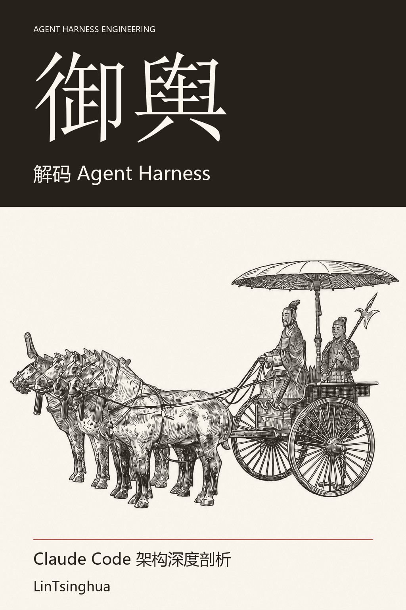

<div align="center">


# 御舆：解码 Agent Harness

<a href="https://zhuguang-zfg.github.io/claude-code-book/beginner-reader.html"></a>

**中文** · [English](en/README.md)

[](LICENSE)
[](https://github.com/zhuguang-ZFG/claude-code-book/actions/workflows/book.yml)
[](https://zhuguang-zfg.github.io/claude-code-book/)

<table align="center">
<tr><td></td></tr>
<tr><td align="center">📖 <a href="docs/beginner-reader.html">入门分册 · 看图读懂</a>（人人可读，由浅入深，下载后用浏览器打开）｜ 🎨 <a href="docs/illustration-gallery.html">插画一览 · 看图说话</a> ｜ <a href="docs/illustration-prompts.md">再生提示词手册</a></td></tr>
</table>

</div>

从对话循环、工具调用和权限检查，到记忆、上下文管理与多智能体编排，理解一个 Agent 运行时如何协同工作。全书 15 章、4 篇附录，结合架构图、设计权衡与动手练习，逐步构建自己的 Agent Harness。

> *“一器而工聚焉者，车为多。”* ——《考工记》
>
> 两千年前，造车已是一项汇聚众工的系统工程：**舆**承载乘者，辕、辐、軎辖各司其职。部件相合，车方能行。
>
> 今天，构建一个 AI Agent 亦是如此：对话循环推进任务，工具系统执行动作，权限管线约束边界。而将这些能力承载、组织起来，使智能体持续运转的运行时框架——**Agent Harness**——恰如车之有**舆**。
>
> 古人造车，合众工之巧；今人构建智能体，亦需理解各部分如何协作。所谓“御舆”，既是驾驭，也是知其构造、明其机理。
>
> 本书因此以 **“御舆”** 为名，亦称 **舆书**。

## 开始阅读

- **初次阅读：** 从[前言](00-前言.md)开始，再读 01 → 02 → 04 → 15。
- **动手构建：** 先读基础篇与工程实践篇，增加记忆和扩展能力时查阅第二、三部分。
- **按需查阅：** 使用下方四篇附录定位模块、工具、功能标志和术语。
- **网站阅读：** [在线阅读入口](https://lintsinghua.github.io/)；也可直接点击本仓库的章节链接。

## 第二分册 · Omp（施工中）

同仓新增开源终端 agent 教程分册《Omp 从入门到精通：原理与实战》（非官方）。书稿在 [omp/](omp/README.md)；产物前缀 `yuyu-omp-*`。写作钉 **omp/18.15.0**，本机核对见 [omp/VERIFY.md](omp/VERIFY.md)（含 18.16.0）。

两条命令各编各的书，不再是「尚未接入」：`make book` / `make book-pdf` 仍只构建御舆（双语），`make book-omp` / `make book-omp-pdf` 构建 omp 中文版（后者多出 A4 PDF），等价命令是 `python scripts/bookctl.py build --product omp --lang zh [--pdf]`。两边产物同名不同前缀，都落在 `yuyu-book/dist/`，编一本不会盖掉另一本。构建口径与本机实测的体积/页数见 [omp/BUILD.md](omp/BUILD.md)，双产品的机制与边界见 [STRUCTURE.md](STRUCTURE.md) 的 §3.6。

`make check` / `make check-full`（即 `bookctl check --fast` / `--full`）负责御舆装配、共享测试与全仓内容检查。Omp 的结构和交付门禁由 `omp/overhaul/audit_structure.py --check`、`audit_delivery.py` 单独检查；内容 CI 还会装配 Omp 中文源稿，Book CI 的独立 `omp` job 则构建中文 HTML/PDF。Windows 本地可运行 `powershell -File omp/overhaul/ci-local.ps1`，同时验证御舆中文 HTML 与 Omp 中文 HTML/PDF。

概念可以互查，实现与钉版不能混用：御舆侧入口见 [docs/COMPARE-OMP.md](docs/COMPARE-OMP.md)，Omp 侧入口见 [omp/COMPARE-YUYU.md](omp/COMPARE-YUYU.md)，逐词共享表见 [docs/yuyu-overhaul/SHARED-TERMS.md](docs/yuyu-overhaul/SHARED-TERMS.md)。Omp 英文版目前只有 [预留说明](en/omp/README.md)，尚未开启构建。

插画策略：Mermaid 架构图 + 手绘概念图双轨。与御舆概念可对照，实现与钉版勿混用。

## 阅读说明

阅读时需区分源码可确认的行为、架构推演和教学示例。功能标志与工具可用性取决于构建和运行时配置；数量和耗时示例不代表当前发行版承诺。

Claude Code 为 Anthropic 产品，本书是独立的技术分析作品，并非官方出版物。本书的许可不覆盖第三方源码。

## 目录

### Part 1. 基础篇 — 建立心智模型

> 理解 Agent 编程的范式转移，建立对 Agent Harness 的整体认知框架。

| # | 章节 | 核心内容 |
|:-:|------|---------|
| 01 | [智能体编程的新范式](第一部分-基础篇/01-智能体编程的新范式.md) | Copilot → Claude Code 演进；Agent Harness 五大设计原则；Bun + React/Ink + Zod v4 技术栈 |
| 02 | [对话循环 — Agent 的心跳](第一部分-基础篇/02-对话循环-Agent的心跳.md) | `while(true)` 异步生成器主循环；五种 yield 事件；十种终止原因；`QueryDeps` 依赖注入 |
| 03 | [工具系统 — Agent 的双手](第一部分-基础篇/03-工具系统-Agent的双手.md) | `Tool<I,O,P>` 五要素协议；`buildTool` 故障安全工厂；55 工具 × 12 类；并发分区贪心算法 |
| 04 | [权限管线 — Agent 的护栏](第一部分-基础篇/04-权限管线-Agent的护栏.md) | 四阶段管线；五种权限模式谱系；Bash 规则匹配；推测性分类器 2 秒 Promise.race |

### Part 2. 核心系统篇 — 深入子系统

> 拆解 Agent Harness 的四大核心子系统——配置、记忆、上下文、钩子。

| # | 章节 | 核心内容 |
|:-:|------|---------|
| 05 | [设置与配置 — Agent 的基因](第二部分-核心系统篇/05-设置与配置-Agent的基因.md) | 六层配置优先级链；合并规则；安全边界与供应链攻击防御；双层功能门控 |
| 06 | [记忆系统 — Agent 的长期记忆](第二部分-核心系统篇/06-记忆系统-Agent的长期记忆.md) | 四种封闭式记忆类型；"只保存无法推导的信息"；MEMORY.md 索引；Fork 记忆机制 |
| 07 | [上下文管理 — Agent 的工作记忆](第二部分-核心系统篇/07-上下文管理-Agent的工作记忆.md) | 有效窗口公式；四级渐进压缩（Snip→MicroCompact→Collapse→AutoCompact）；断路器模式 |
| 08 | [钩子系统 — Agent 的生命周期扩展点](第二部分-核心系统篇/08-钩子系统-Agent的生命周期扩展点.md) | 五种 Hook 类型；22 个生命周期事件；JSON 响应协议；六层优先级；三层安全机制 |

### Part 3. 高级模式篇 — Agent 的组合与扩展

> 探索 Agent 如何组合、编排和扩展——从子智能体到 MCP 协议桥接。

| # | 章节 | 核心内容 |
|:-:|------|---------|
| 09 | [子智能体与 Fork 模式](第三部分-高级模式篇/09-子智能体与Fork模式.md) | 三种 Agent 来源；智能体职责与可用性门控；Fork 字节级上下文继承；递归 Fork 防护 |
| 10 | [协调器模式 — 多智能体编排](第三部分-高级模式篇/10-协调器模式-多智能体编排.md) | Coordinator-Worker 双重门控；"只编排不执行"约束；四种寻址模式；四阶段工作流 |
| 11 | [技能系统与插件架构](第三部分-高级模式篇/11-技能系统与插件架构.md) | 11 个核心技能；SKILL.md frontmatter；三级参数替换；分层加载；插件缓存 |
| 12 | [MCP 集成与外部协议](第三部分-高级模式篇/12-MCP集成与外部协议.md) | 8 类连接配置；五态连接管理；三段式工具命名；Bridge 双向通信系统 |

### Part 4. 工程实践篇 — 从原理到构建

> 性能优化的工程细节，以及从零构建一个完整 Harness 的实战路线图。

| # | 章节 | 核心内容 |
|:-:|------|---------|
| 13 | [流式架构与性能优化](第四部分-工程实践篇/13-流式架构与性能优化.md) | QueryEngine 生命周期管理；并发控制；并行预取与启动耗时估算；惰性加载策略 |
| 14 | [Plan 模式与结构化工作流](第四部分-工程实践篇/14-Plan模式与结构化工作流.md) | "先想后做"哲学；计划文件三层恢复策略；本地调度与远程触发 |
| 15 | [构建你自己的 Agent Harness](第四部分-工程实践篇/15-构建你自己的Agent-Harness.md) | 六步实现路线图；循环依赖解决方案；四层可观测性体系；安全威胁模型 |

### Appendix — 参考资料速查

| | 内容 |
|:-:|------|
| [A](附录/A-源码导航地图.md) | **架构导航地图** — 16 个核心模块、依赖树、6 条数据流路径、四层架构、10 种设计模式 |
| [B](附录/B-工具完整清单.md) | **工具完整清单** — 50+ 工具 × 12 类，readOnly/destructive/concurrencySafe 属性 |
| [C](附录/C-功能标志速查表.md) | **功能标志速查表** — 89 个 Flag × 13 类，编译时/运行时类型，依赖关系图 |
| [D](附录/D-术语表.md) | **术语表** — 122 条中英对照术语，含交叉引用和章节定位 |


## 离线整书

`yuyu-book/` 把 20 个单元装配成**一本可离线阅读的书**：单文件 HTML（中文版 6.3 MB / 英文版 6.4 MB）与 A4 排版的 PDF（中文版 520 页 / 34.8 MB，英文版 559 页 / 23.7 MB），中英各一份，产物在 `yuyu-book/dist/`。PDF 页数与体积随构建机的中文字体变化；上述数字来自 CI 的 Noto CJK 排版，不代替 Windows 本机实测。构建日志会报告每份 PDF 的实际页数与体积。

上述数字取自[合并后的 Full 运行](https://github.com/zhuguang-ZFG/claude-code-book/actions/runs/42473136200)：实际构建的 10 步检查通过；最终手绘稿比候选版更小，英文 HTML 的 CI 实测舍入值从 6.5 MB 变为 6.4 MB，README 未同步而在对账处失败。本次只回填实测数字，不改变 `scripts/check_artifact_claims.py` 的检查规则。已发布的 `v0.3.6` 标签与资产保持不变。

| 文件 | 语言 |
|------|------|
| `yuyu-agent-harness-zh.html` / `.pdf` | 中文 |
| `yuyu-agent-harness-en.html` / `.pdf` | English |

整书包含封面、版本与许可页、修订史、阅读路线、带页码的目录和**全书线路图**。线路图在目录后独占一页：前言是路头的辐轮，十五章沿四段蛇形道路排站，附录走虚线岔线。每章的「本章问题 / 读完交付 / 本章边界」罗盘与来源锚点，帮助读者先判断这一章能解决什么。每版 160 张（中英合计 320）Mermaid 图与 17 张解释性手绘组成 177 张编号图版，全部随书内联。书中另有代码块语言角标、脚注、来源与许可页、主题索引；中文版索引在 A–Z 后另列中文词条。

插图采用混合格式：章徽、驿卒与解释图保留自绘动画 SVG，第一、二篇题刻使用生成后审阅的透明墨版 PNG；封面与其余篇题仍是 SVG。章眉手绘走线按单元 id 生成，章末车辙与分部道路呼应阅读路线。宽屏（≥1360px）提供常驻侧栏目录。全部图像随离线文件打包，深色屏幕反色不影响纸面的黑墨。

PDF 另有侧边书签、页脚页码、奇偶页眉，以及带目标页码的主题索引；正文中的「参见第 N 章」可点击跳转。章节不另留只有页眉、页码的空页；竖版放不下的宽图使用独立横向页，图中文字仍可选中、检索。`KAIROS_GITHUB_WEBHOOKS`、`skipDangerousModePermissionPrompt`、`~/.claude/settings.json` 等长名字在 `_`、`/` 与大小写交界处获得断点，普通英文词不切开，减少字距空洞与表格越界。HTML 断网双击即可阅读，不加载外部字体、图片或脚本。

第一次读这一类书的工程师，可以先沿**通俗层**进入正文：每章开头是一句白话与一个比方；术语首现处的虚线可展开「是什么 / 为什么 / 像什么」浮窗。术语若只以行内代码出现，虚线就落在代码上，`AbortController` 等名字也能查。窄屏或宽表格中的浮窗钉在屏幕底部，避免被裁切；打印时则由章末术语面板与书末「原理札记」接住。44 个主干术语的原理按正文论证分章归档，小节旁的「起步 / 主干 / 进阶」徽记对应前言三条阅读路线。

每章末的驿卒用一行按语回看这一段路，20 行内容存在 `yuyu-book/notes.json`，书末按阅读顺序收齐并链回原章。按语受术语锁约束：必须含有本章正文真正使用的注册词形；中文不超过 36 字，英文不超过 130 字符且不夹汉字。它不是另一份正文。

全书另有 43 份手写线描图——扉页一幅四马古车、20 枚章徽配在章名右侧、4 幅题刻，另有 1 位驿卒与 17 幅解释图，SVG 源稿完整保留。解释图分别承担关系或状态的读图任务，例如暂停与取消的差别、权限门、记忆漏斗、Fork 四格、状态表盘与并发闸。除已采用墨版的两幅篇题外，这些图继续使用 `currentColor` SVG，保留暗色、减动效与打印下的同一含义。通俗层可用 `--no-plain` 整块关闭。

```bash
npm ci                                              # 图版渲染需要 Mermaid 11.17.2
python -m pip install -r yuyu-book/requirements.txt
python scripts/bookctl.py doctor                    # 一次列全环境缺失与修复命令
python scripts/bookctl.py check --fast              # Fast 全套：依赖/源码装配 + 两套单测 + 内容/图语法/视频/产品幂等
python scripts/bookctl.py build --product book --lang zh
python scripts/bookctl.py build --product book --lang both --pdf
```

`requirements.txt` 由 `uv.lock` 导出，版本精确固定；升级依赖时改 `pyproject.toml`，依次运行 `uv lock` 与 `uv export --format requirements-txt --no-hashes --no-emit-project --no-annotate > yuyu-book/requirements.txt`，不要手改。

PDF 与图版渲染需要一个本机 Chromium 或 Edge（自动探测 `msedge`/`chrome`，也可用 `--browser <路径>` 指定）。正文 Markdown 是唯一事实来源，构建过程不回写、不改写任何章节文件。

## 构建与发布

`scripts/bookctl.py` 是仓库唯一的命令入口，`make` 只是它的薄包装；底层构建器也可以直接以 `python -m yuyu_book` 运行（在 `yuyu-book/` 下，或设 `PYTHONPATH=yuyu-book`）。检查分三层：**Fast**（PR 层：依赖固定、源码模式装配、两套单测、内容检查、Mermaid 语法、视频配置、产品幂等）、**Full**（主分支或手动：Fast 加渲染装配与双语 PDF）、**Release**（标签或手动：Full 加产物声明核对，再由发布装配生成校验和与发布目录）。CI 对应 `.github/workflows/book.yml` 的 `Fast` / `Full` / `Omp` / `Bootstrap` 四个 job 与 `.github/workflows/release.yml`；旧的 `check-book.yml` 已并入 `Fast`，不再单独存在。

发布目录由下面这条命令原子生成（版本必须等于 `yuyu-book/manifest.json` 的 `version`；`--epub` 可选）：

```bash
python scripts/bookctl.py release --version 0.3.6 --out-dir ../book-release --epub
```

目录里有中英双语 HTML/PDF、Omp 中文 HTML/PDF、可选 EPUB、`site.zip`、15 章视频清单、`release-notes.json` 与 `release-notes.md`（后者是 `gh release` 的正文）、`SHA256SUMS` 以及记录命令、提交、浏览器/字体与产物哈希的 `build-report.json` / `artifact-manifest.json`。任一步失败都不会留下半成品发布目录。

**状态（2026-11-08）：** `v0.3.6` 已由 `release.yml` 在标签推送运行（[run 42423483244](https://github.com/zhuguang-ZFG/claude-code-book/actions/runs/42423483244)）中装配并发布到 [GitHub Release](https://github.com/zhuguang-ZFG/claude-code-book/releases/tag/v0.3.6)：三册 HTML/PDF/EPUB、`site.zip`、15 章视频清单、`SHA256SUMS` 与两份构建报告共 15 个资产；已发布的 14 个文件逐一与 `SHA256SUMS` 对上。P3/P5 门禁仍待独立审阅，`task_verify` 仍为 unverified。改造边界与证据见 [架构决策记录](docs/architecture-decisions.md)、[P3 结构对照](docs/migrations/legacy-v2-structure.md)、[产品页视觉审计](docs/migrations/product-visual-audit.md) 与 [发布迁移说明](docs/migrations/release-migration.md)。

## 参与修订

欢迎通过 Issue 或 PR 修正技术错误、补充案例和改进表达。请提供章节、小节、建议修改和参考来源；显示问题请注明阅读平台和复现步骤。涉及双语内容时，请同步检查英文版；英文书稿不得夹带汉字，附录 D 术语表的中文译名列是唯一例外，构建器会逐行检查。

提交前运行 `python3 scripts/bookctl.py check --fast`；它依次跑依赖对账、源码模式装配、两套 unittest、`scripts/check_book.py`、`npm run check:diagrams`、视频配置与产品幂等检查。涉及图版或 PDF 时改用 `check --full`。Mermaid 检查需要 Node.js 22 或更高版本，先执行 `npm ci`。仓库结构与构建契约见 [STRUCTURE.md](STRUCTURE.md)，贡献流程见 [CONTRIBUTING.md](CONTRIBUTING.md)。

## 许可与致谢

本书文字采用 [CC BY-NC-SA 4.0](https://creativecommons.org/licenses/by-nc-sa/4.0/)：须署名、非商业使用，并以相同协议共享改编内容。第三方资料保留其原有权利与许可条件。

正文的技术叙述以 Claude Code `2.1.310` 与官方文档、Anthropic 研究博客、MCP 规范和社区讨论为核对基线。全部外部来源、钉到的 tag/commit、访问日期与许可姿态登记在 [CREDITS.md](CREDITS.md) 与 `yuyu-book/sources.json`（55 条，其中 22 条是 GitHub 开源仓库），也可从整书的「来源与许可」页逐条跳转。这些仓库条目按用途分两类：一类是**依据**（Claude Code 本体、官方 SDK、MCP 规范、Anthropic 研究博客），另一类是**对照面**（同一层边界在别人手里长成什么形状——可换的模型路由、另一种上下文路线、第二份协议、无人值守时的权限退化、能力封装单位能长多大）。对照面不支撑任何技术论断，只用来检验本书给出的边界是否真的存在。感谢 [Linux.Do](https://linux.do/) 社区，本书的讨论与修订主要发生在 [【开源千星】《御舆：解码 Agent Harness》](https://linux.do/t/topic/1870593) 一帖。

## Star History

<a href="https://star-history.com/#lintsinghua/claude-code-book&Date">
 <picture>
   <source media="(prefers-color-scheme: dark)" srcset="docs/images/star-history-dark.svg" />
   <source media="(prefers-color-scheme: light)" srcset="docs/images/star-history-light.svg" />
   
 </picture>
</a>
