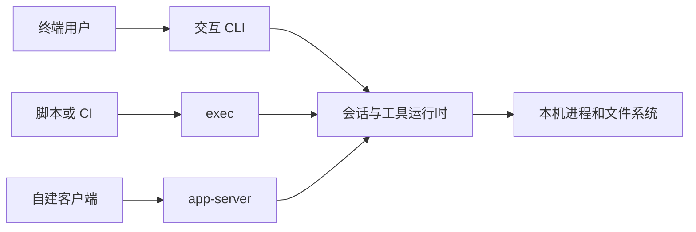

# 第 1 章：安装之后，先确认正在运行谁

<!-- block: codex-ch01.b-opening -->
确认版本、入口、工作目录和运行身份，是使用 Codex CLI 的第一步；这些信息决定后面的配置与文件操作。

终端输入 `codex` 后，PATH 可能命中旧安装，npm 入口还可能转到平台二进制；IDE 则可能通过自己的服务启动会话。若帮助里找不到预期参数，先确认实际启动了哪个程序。

本章先核对 CLI，再说明不用模型的检查。若目前只有 Python，可以先到本章末尾运行离线练习驱动，再按第 3 章准备运费副本；安装和模型配置不影响这部分练习。

## 1.1 安装包与真正执行的程序

本书使用的 npm 包是 `@openai/codex@0.167.0`。npm 分发的 JavaScript 入口根据平台与 CPU 架构寻找对应平台包，再启动原生可执行文件。Windows x64 的包内路径包含 `x86_64-pc-windows-msvc/bin/codex.exe`。因此 Node 是这条安装路径的启动器环境，代理的主要实现仍在 Rust 工程里。

准备独立安装时，在书籍仓库根目录使用明确版本，将包放到该目录的 .scratch 下：

```powershell
npm.cmd install --prefix .scratch/codex-cli --ignore-scripts @openai/codex@0.167.0
& .scratch/codex-cli/node_modules/.bin/codex.cmd --version
```

这条命令需要下载依赖；本书实验使用已安装的同版本程序，未复验 npm 首次在线安装。若 PowerShell 阻止执行 `codex.ps1`，可先试同目录的 `codex.cmd`，系统执行策略的影响见本章后文。

这种安装方式不会让其他目录自动找到新程序。后文使用短命令名时，前提是 PATH 已指向你核对过的安装；否则使用对应程序的完整路径。传给检查驱动的则必须是平台包里的原生程序，不能用 npm 包装器替代。

输出必须是 `codex-cli 0.167.0` 才与本书实验对应。把输出写进问题报告时，同时记操作系统与架构。`0.167.0` 的 Windows 结果不能证明 Linux 的沙箱行为，更不能证明你安装的另一个版本支持同样的 Hook 字段。

## 1.2 三种入口，三个完成条件

| 入口 | 谁在消费结果 | 你要观察什么 |
| --- | --- | --- |
| 交互 CLI | 终端里的用户 | 工具过程、审批、最终答复与文件差异 |
| `codex exec` | 脚本或 CI | 进程退出码、JSONL 事件、最终输出、独立检查 |
| `codex app-server` | 外部客户端 | 请求 ID、通知顺序、审批回应、回合终态 |

桌面应用、云端任务和正在帮助你写代码的某个平台助手，不能直接替代这里的 CLI。它们可能共享协议或核心库，但运行机器、凭据、文件范围和审批接口都可能不同。讨论问题时先说清入口，就能避免把平台的额外限制当成 CLI 本身的规则。



图 1-1：入口改变的是交互方式，执行仍发生在具体运行环境中。图不表示三个入口拥有相同默认策略。

## 1.3 工作目录比一句“只改这个项目”更具体

在启动前进入项目目录，或使用 `-C` 指定目录。工作目录影响项目指令发现、路径解析和工具执行。下面的命令在你要检查的项目内运行；跟做本书时，可等第 3 章准备好运费副本后再用。提示词里的“项目”只是语义描述，操作系统需要的仍是一个路径。

```powershell
git status --short
git branch --show-current
codex.cmd -C . --sandbox read-only --ask-for-approval on-request
```

这是一条供有合法模型配置的读者运行的交互命令，本书没有在真实模型上执行它。第一次可以只要求解释测试布局，不批准写入或依赖安装。看它引用的文件是否确实属于当前仓库，再逐步扩大任务。

工作目录也不等于唯一可读路径。具体访问能力由平台与沙箱配置共同决定。当前目录只是判断边界的一个输入，不能从 `-C` 推断“整个进程只看得见这个文件夹”。第 8 章会把工作根、可写根和外部目录分开。

## 1.4 用不用模型也能做的检查

本书先运行版本、帮助、规则检查和静态协议生成。它们不需要模型账号，也不会为了验证安装去执行一次外部推理。`check-local-cli.py` 接收原生二进制路径，确认版本后对固定规则输入做判断，最后生成 app-server JSON Schema。

固定输入方便比较升级前后的变化。例如，同一个规则文件原来返回 `prompt`，升级后返回 `allow`，或者生成的协议中少了某个字段，都可以在启动开发任务前发现。

不过，帮助输出只能证明参数解析器公布了选项。它不证明认证有效、模型可用、代理能完成任务。把这两种检查分开后，报错就更容易定位：安装层、配置层、连接层、任务层各自有不同证据。

## 1.5 第一份运行记录应当很短

记录 CLI 版本、平台、工作目录的项目相对描述、基线提交、启动方式，以及是否调用外部模型。不要把整个环境变量、认证文件或完整个人配置贴进公开 issue。需要展示配置时，构造能重现问题的最小配置，凭据用明确占位值。

一次普通使用的完成条件也应具体：哪些文件被改、哪条检查通过、有没有尚未处理的失败。这个习惯后面会直接复用到非交互执行和多工作树任务，不需要等项目复杂了再补。

## 1.6 把安装确认写成可重复的检查

Windows 上先区分 npm 包装入口与原生程序。本机 `codex.cmd --version` 和原生 `codex.exe --version` 都报告 0.167.0；PowerShell 直接执行 codex 时可能先找到 `.ps1` 包装器，受脚本执行策略影响。遇到这种情况，应确认实际入口，再选用已安装的 `.cmd` 或原生二进制，而不是为了一个帮助命令修改整台机器的策略。

```powershell
where.exe codex
codex.cmd --version
codex.cmd --help
codex.cmd exec --help
codex.cmd execpolicy check --help
```

按顺序看输出：where 显示命令搜索结果，version 确认版本，顶层 help 列出入口，exec help 列出非交互参数，execpolicy help 列出策略检查选项。旧包装器可能仍指向旧包，安装完成后用这组命令确认实际入口。

发布程序还可以计算文件摘要，用来识别这次实际运行的二进制。摘要相同说明文件字节相同，不证明它来自正确发布者；来源核验与文件身份是两件事。本册将版本、固定源码提交和二进制 SHA-256 一起放入 facts，方便以后对照升级。

## 1.7 先跑不用模型的检查，再进入任务

本节命令都在书籍仓库根目录运行。若已有固定版本 CLI，向随书驱动传入明确的原生程序路径：

```powershell
python -B codex/examples/check-local-cli.py --binary PATH_TO_PINNED_CODEX_EXE
```

程序核对 `codex-cli 0.167.0` 后，运行规则检查、错误规则加载和静态协议生成。它创建自己的证据目录，显式传入规则文件，子进程只保留必要环境项，不把模型凭据带进去。最后输出 JSON 报告和证据目录路径。

若版本不一致，驱动会停止，以免将新版本结果记到旧基线下。研究新版本时，另存运行记录、更新预期，并重新阅读发生变化的接口；旧版断言继续保留。

还没有 Codex 时，可以直接运行 `python -B codex/examples/check_workshop.py`。它只用 Python 标准库，在自己创建的临时副本里复现并修复运费错误，再检查 Hook 子进程与 JSONL 数据。报告中的 parcel-before 与 parcel-after 分别保留修复前后的退出码；前者非零正是本次练习需要看到的失败，整份报告通过才表示各项预期都满足。

这个驱动会自行完成一遍练习，不会留下供你继续修改的项目。接下来到第 3 章复制自己的运费副本，亲自运行失败测试；第 11 章再解释公式为什么这样改。真实会话另需自己的账号和模型配置。

## 来源

实现入口：[npm 启动器](https://github.com/openai/codex/blob/086ccc833bc9cf01024ad2dd6af7dbd421b6bf9a/codex-cli/bin/codex.js)、[Rust CLI](https://github.com/openai/codex/blob/086ccc833bc9cf01024ad2dd6af7dbd421b6bf9a/codex-rs/cli/src/main.rs)。本机版本与命令检查见[验证记录](appendix-c.md)。
