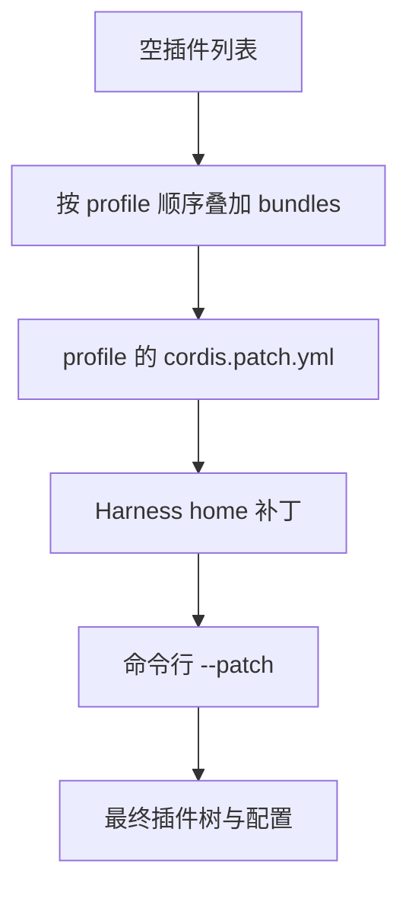

# 第 1 章：项目入口与第一次运行

<!-- block: deepseek-ch01.b-opening -->
第一次启动 dsh，先分清三个目录：程序装在哪里、从哪里启动、从哪里读取配置。它们会影响插件安装、项目切换和会话恢复，排查问题时也要分别查看。

如果还没有安装 dsh，可以先到第 1.5 节运行随书组件实验。第 1.1–1.4 节说明完整应用的启动条件，假定已有相应 CLI；组件实验则直接加载 Cordis 源码，不经过 dsh，也不调用模型。先完成这条较短的路径，后面讨论插件状态时就有实际输出可对照。

## 1.1 先辨认安装、工作区与 Harness home

CLI 安装目录放程序与安装级依赖；启动时的工作目录默认成为工作区；Harness home 保存 profile、用户补丁和应用数据。源码快照把应用启动统一到 `dsh`，Web、headless、SDK、ACP 通过 profile 选择。不要看到仓库里某个可执行测试文件，就把它当成另一个稳定的应用入口。

建议第一次使用时，在一个专门的临时项目中启动。先创建一份只含几行文本的 fixture，再记录 Node 与 dsh 版本；不要直接选一个有大量未提交修改的日常仓库。这个做法的作用是让第一次工具结果可解释：读到什么、写了什么、停止后剩下什么，都能与已知初态比较。

```powershell
node --version
dsh --version
$env:DSH_HOME = Join-Path $PWD '.dsh-book-home'
dsh --profile web --dump-config
```

这里的 DSH_HOME 只修改当前终端的子进程环境，退出终端后不会成为系统默认值。dump-config 用来查看将要组合的插件树，不需要发送模型任务。若调用的是源码安装，请先按照该提交的 package.json 准备依赖并构建；不能把未构建的仓库目录等同于已安装 CLI。

## 1.2 一份 profile 是怎样拼出来的

profile 是有名字的运行组合，例如面向浏览器的 web；bundle 把插件代码和配置行一起分发；row 则是组合树中的一条配置，用来标识和配置某个节点。选 profile 决定组合入口，bundle 提供内容，后面的补丁再修改具体 row。

本快照内置 web、headless、sdk、sdk-minimal、acp 模板。通常先装共享 base，再加对应应用；sdk-minimal 是例外，它自己的 bundle 声明完整树，不依赖 base。



图 1-1：补丁层的先后关系。某一层命中配置行时，需要确认它替换的是完整 config，不能默认所有字段都会深度合并。

这解释了一个常见现象：修改 bundle 内文件没有效果，却修改 profile 补丁就有效。后层可能已经覆盖了同一个 row。排错时保留 dump-config，搜索该 row 的 id，再与声明层比较。只看“我改过哪个文件”无法说明运行时最后用了哪个值。

## 1.3 选择启动方式

| 入口 | 适用任务 | 需要另外确认的结果 |
| --- | --- | --- |
| `dsh web --no-open` | 本机浏览器交互 | 服务地址、认证和浏览器连接 |
| `dsh --profile headless "任务"` | 一次性自动任务 | 退出码、最终答案、持久会话 |
| `dsh --profile sdk` | 程序控制代理 | JSON-RPC 协议和关闭流程 |
| `dsh --profile sdk-minimal` | 较小 SDK 组合 | 缺少哪些 base 能力 |
| `dsh --profile acp` | 自动化客户端 | stdio 连接和断开语义 |

启动器只解析自己的参数，后面的应用参数交给选定的 profile。例如 `dsh --help` 与 `dsh --profile web --help` 问的是不同层。把一个 mode 的参数放到另一个 mode 上，不应期待它被悄悄兼容。

本书不使用浮动的 `npx @deepseek-ai/dsh` 证明固定快照行为。日常尝鲜可以采用官网命令，复现实验则应保留实际解析版本和 lockfile。仓库根 Node 要求是 `>=24.9.0`；本机组件实验使用 Node 24.14.0。运行时满足最低版本，仍不表示全部原生依赖已就绪。

## 1.4 第一项任务只要求读懂文件

准备一个 fixture.txt，写入唯一标记，例如 BOOK_REVIEW_ALPHA。任务写成“读取 fixture.txt，报告首行和行数，不修改任何文件”。第一次检查的是工具链是否连接，不是模型能否完成复杂推理。查看任务的会话标识、模型路由、工具调用与结果，并比较前后文件内容。

如果模型回答了标记，却没有对应工具结果，不能据此断言读文件已发生：标记可能来自提示词、历史或者测试替身。更可靠的证据是工具执行记录包含目标路径，并且返回正文进入后续请求。第 7 章会解释怎样从日志区分用户输入与工具回喂。

第一次运行只装这项任务需要的能力，后续再逐个加入插件，便于区分配置覆盖、服务依赖、模型选择与 UI 连接的问题。本册没有实跑完整 Web 首次启动，附录 C 保留了这一项。下面先准备不需要账号的真实 Cordis 组件实验。

<!-- deepened: 01 -->

## 1.5 本书实验目录怎样准备

这里需要 Node.js 24.9.0 或更新版本、npm、Python 3 和能访问 GitHub 的 gh。工作目录是本书仓库根目录，也就是同时包含 deepseek 与 yuyu-book 的目录，不是下载的 Harness 源码目录。

书仓的 deepseek/examples 保存实验工具，.scratch/deepseek-runtime 保存下载的框架与 npm 依赖。前者随书维护，后者可以重新准备，也不纳入书稿的 Git 差异。

```text
deepseek/
  examples/review-lab.mjs          业务服务与插件
  examples/check-review-lab.mjs   连续实例断言
  examples/check-cordis.mjs       七个基础场景
  facts/                         版本、摘要与结果
.scratch/deepseek-runtime/
  pinned-cordis/src/              固定提交源码
  node_modules/                  tsx 与运行依赖
```

环境准备入口是 deepseek/examples/prepare-cordis.ps1，调用方法见附录 C 和 examples/README.md。脚本从完整提交地址取得九个源码文件，恢复 API 提供的原始字节、核对摘要，再安装固定版本依赖。它在本机只通过了静态语法检查：本机策略阻止执行 ps1，两组实验使用的是此前已取得并核对 Git blob 身份的源码。

源码字节需要单独核对，因为直接复制终端输出可能改变编码。本轮准备时，logger.ts 的非 ASCII 内容就曾被错误解码；与 Git blob 比较后才确认文件内容。

如果机器策略禁止运行 PowerShell 脚本，准备工具就会停在入口，Cordis 还没有初始化。可以使用已准备且通过摘要检查的目录，或在允许脚本的开发环境完成准备，无需更改系统策略。hash 验证和固定源码仍需保留，否则实验可能加载到另一份同名包。

准备好目录后，在书仓根目录依次执行下面三条命令。第一条核对来源和示例摘要，第二条运行七项基础场景，第三条运行十三项连续实例。它们来自随书 examples/README.md，也是本册已执行的检查入口。

```powershell
python deepseek/examples/verify-evidence.py --source-root .scratch/deepseek-runtime/pinned-cordis/src
node --import ./.scratch/deepseek-runtime/node_modules/tsx/dist/loader.mjs deepseek/examples/check-cordis.mjs --source .scratch/deepseek-runtime/pinned-cordis/src/index.ts
node --import ./.scratch/deepseek-runtime/node_modules/tsx/dist/loader.mjs deepseek/examples/check-review-lab.mjs --source .scratch/deepseek-runtime/pinned-cordis/src/index.ts --trace
```

先看两组实验是否分别以退出码 0 结束，并在汇总中给出 passed:true。初始化失败本就是测试场景之一，途中出现预期错误诊断不代表整组失败。第三条命令的 --trace 还会列出首个正常场景：文本统计得到两行、七个 code point，todo 为 true，随后完成插件清理。第 2 章会逐条解释这份记录；现在无需先读懂每个状态名。

## 1.6 从命令输出判断停在哪一层

`node --version` 检查运行时可执行文件；tsx loader 负责把 TypeScript 源码交给 Node；--source 决定加载哪个 index.ts；Context 构造之后才进入插件实验。报错堆栈里如果还没有 Context、Fiber 或业务插件，通常仍在模块解析与环境准备层。

相反，脚本已经打印前几项 PASS，后面 assert.equal 失败，说明框架能加载，某个行为与断言不符。应该保留失败场景名与实际值，核对固定源码和示例是否被改过。把这种错误当成安装故障而重新装全局包，既浪费时间，又可能引入新版本。

完整 dsh 的启动又多了一层 profile 组合。dump-config 回答准备装什么，readiness 回答需要的能力是否活跃，第一项任务回答模型与工具能否合作。它们的成功条件各不相同。读者先在组件实验里看到实际状态，再进入完整宿主时，就能把同类故障定位到更小范围。

## 1.7 给第一次运行留下有用的记录

不必截取整个终端。保存源码提交、Node 版本、准确命令、退出码与最终 JSON 就足够重跑；发生错误时再附对应堆栈。绝对用户名路径、临时端口和凭据不应成为公开教材必需部分。facts 采用这种形式，所以别人可以换目录运行，同样比较语义结果。

练习时可以复制业务插件，在副本里尝试错误写法，原示例与摘要留作环境基线。决定采用改动之后，再同步更新来源、断言和运行记录。

## 固定版本来源

- [apps/cli/README.md](https://github.com/deepseek-ai/deepseek-harness/blob/fcc0ad462172522aaf5c93a7b2e01f6b9f0b0159/apps/cli/README.md)
- [packages/boot/app-boot/README.md](https://github.com/deepseek-ai/deepseek-harness/blob/fcc0ad462172522aaf5c93a7b2e01f6b9f0b0159/packages/boot/app-boot/README.md)
- [docs/architecture.md](https://github.com/deepseek-ai/deepseek-harness/blob/fcc0ad462172522aaf5c93a7b2e01f6b9f0b0159/docs/architecture.md)
