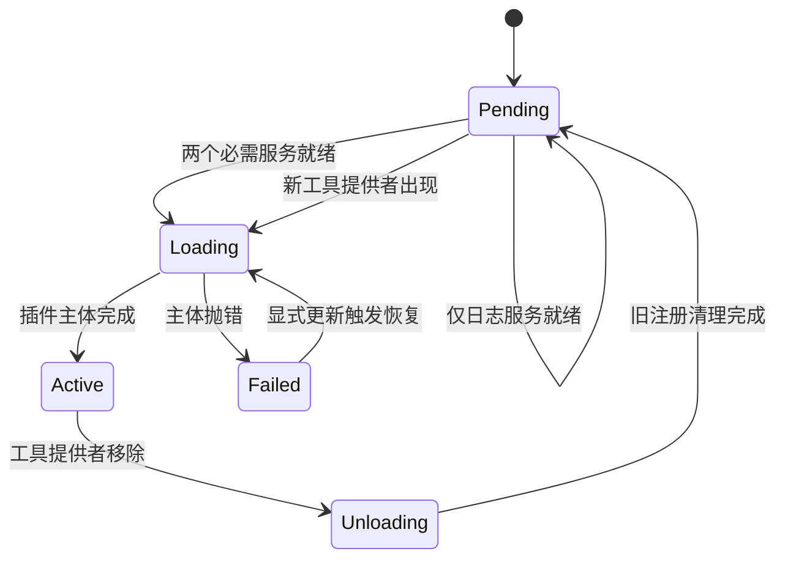

# 第 2 章：Cordis 上下文与服务注入

<!-- block: deepseek-ch02.b-opening -->
一个插件需要工具注册表，但它比注册表先被挂载。你可以手动调整启动顺序，也可以让插件声明“没有 tools，我就不能工作”。Cordis 选择后者：依赖是运行时的一部分，服务消失时也会影响依赖它的插件。

## 2.1 Context 是按名字寻找服务的地方

先把服务理解成“供其他插件调用的对象”。本章由 Counter 创建的计数器就提供 next 方法；这里的服务不要求另起一个服务器进程。Context 是插件取得这些对象的入口，ctx 是代码中常用的变量名。例如 ctx.bookCounter.next()，就是先按 bookCounter 找到计数服务，再调用它的方法。

在完整 Harness 中，同样会读到 ctx.tools、ctx.sessions。Context 的外观像 JavaScript 对象，内部却经过代理和服务解析：提供者按稳定名称注册，使用者按名称取得能力。读取文件的工具因此可以依赖文件系统接口，而不必硬编码某个本地实现。

本章前半沿七项基础实验的计数器与观察插件展开，第 2.6 节再换成十三项连续实例的工具表与日志。这是两份完整程序，运行入口都已列在第 1.5 节；下列短片段用于读代码，不需要拼接成第三个脚本。

计数服务继承 Cordis 的 Service 基类，只有一个业务方法：

```javascript
class Counter extends Service {
  value = 0;
  constructor(ctx) { super(ctx, 'bookCounter'); }
  next() { return ++this.value; }
}
```

构造函数中的 super 把实例注册为 bookCounter。计数器的 value 属于这个服务实例；换掉服务实例后，它不会自动继承旧值。若确实需要跨重载延续计数，就应该把状态交给有明确持久契约的服务，不能依赖模块恰好没有被回收。

## 2.2 inject 不是 TypeScript 装饰

review-observer 把 inject 声明附在函数上。插件主体使用 ctx.bookCounter，依赖还没出现时主体不应执行。

```javascript
const observer = Object.assign(function bookReviewObserver(ctx) {
  ctx.on('book/review', file => {
    console.log(ctx.bookCounter.next(), file);
  });
}, { inject: ['bookCounter'] });

const root = new Context();
const waiting = root.plugin(observer);
await waiting.await();
```

root.plugin(observer) 把插件交给当前运行树管理，这个动作称为挂载。返回的 waiting 是一个 fiber：它记录这一次挂载的状态，并提供等待与卸载方法。插件函数描述要做什么，fiber 则对应本次加载；后面说“卸载插件”，操作的就是这样的挂载句柄。

这一步的 await 只等当前生命周期工作稳定，不保证未来依赖会到齐。实跑中 waiting 仍为 PENDING，表示计数服务尚未出现，观察器也没有输出加载事件。随后挂载 Counter，等待服务和观察器各自的 fiber 稳定，观察器才变成 ACTIVE。

interface Context 中的属性声明供类型检查使用，服务仍需在运行时注册。使用者也要声明依赖，框架才能在提供者消失或恢复时暂停、重新激活相应插件。

## 2.3 生命周期状态比一条“loaded”更有用

| 状态 | 当前含义 | 排查方向 |
| --- | --- | --- |
| PENDING | 必需服务尚未就绪 | 检查 inject、服务名称和隔离域 |
| LOADING | 插件主体或初始化仍在执行 | 查是否在等待外部资源 |
| ACTIVE | 初始化完成 | 再检查对应事件是否实际触发 |
| FAILED | 配置或插件启动抛错 | 查看原始错误，检查清理结果 |
| UNLOADING | 正在释放资源 | 查异步 disposer 是否结束 |
| DISPOSED | 这个 fiber 已移除 | 要重装应创建新挂载 |

本书读取的是公开枚举名称，不建议把数字值写进监控条件。枚举顺序只是当前实现细节，名称才便于表达诊断意义。

实验将 observer 先挂载，再提供服务，是为了排除“只是刚好按正确顺序启动”的解释。另一个场景移除 provider，观察器回到 PENDING，并执行资源清理；重新提供 Counter 后，它重新激活，计数从 1 开始。这组现象把依赖关系从启动时的一次检查变成了整个运行期间的约束。

## 2.4 一个名字可以对应多个实现

同一进程内两个 Agent 不一定要共享同一个服务实现。Context.isolate 为指定服务名创建独立的查找域，源码中称为 realm。下面 left 和 right 都使用 bookCounter 这个名字，却各自找到一份 Counter，所以右边不会接着左边的数字往下数。isolate 改变名字解析与注册位置，不会启动新进程。

```javascript
const left = root.isolate('bookCounter');
const right = root.isolate('bookCounter');
await left.plugin(Counter).await();
await right.plugin(Counter).await();
left.bookCounter.next();  // 1
left.bookCounter.next();  // 2
right.bookCounter.next(); // 1
```

实跑结果如上。这里没有沙箱，两个插件仍然可以调用同一进程可访问的 Node API。隔离服务域解决的是“调用应该路由给哪个实现”，不能替代操作系统限制。

把这套机制放回 Harness，模型适配器、存储提供者和工具执行后端就不必互相 import 具体类。使用者只需要能力契约，部署者通过组合选择实现。当依赖名字写错、服务挂在另一个 realm 或提供者启动失败时，PENDING 是值得保留的信号，不要用强制调用绕过它。

以上场景在 examples/check-cordis.mjs 中。若已按第 1.5 节通过七项检查，此处可直接对照对应场景阅读；还没有准备环境时，先按该节或附录 C 核对固定来源。

## 2.5 顺着一次消失的依赖排错

假设审查观察器昨天能工作，今天启动后没有输出，也没有报错。先看它的 fiber 状态。如果是 PENDING，就从依赖名入手：观察器声明的是 bookCounter，提供者是否真的以这个名字注册；双方是否在同一个服务查找域；提供者自己的初始化有没有失败。此时反复向 book/review 发送事件没有帮助，因为监听器可能根本没安装。

如果状态已经 ACTIVE，问题才转向事件发送路径。发送者是否使用预期 Context，事件名是否一致，回调有没有很早返回。给加载动作和业务回调分别加记录，能把“插件没起来”和“起来但没收到消息”分开。不要只在回调里打印一句 loaded，这会把两种状态混成一个症状。

再看服务替换后的情况。新 Counter 从零开始，观察器也重新初始化，这是本册实验中的预期行为。真实项目若要求累计审查总数，就不能把总数仅放在 Counter 字段里。可以让 Counter 负责当前实例的临时计数，让另一个存储服务持有持久总量；依赖恢复时重新取得存储句柄。这样服务替换重建的是访问能力，业务历史仍有自己的归属。

服务名、当前状态和实例身份可以帮助追踪这类故障。下游停用可能源于上游连接失败；沿依赖往上找第一个 FAILED 或缺失的提供者，比逐个重启下游更容易定位原因。

<!-- deepened: 02 -->

## 2.6 从同一个审查插件开始

后面的章节围绕一个小程序展开：输入一段文本，返回行数、字符数及是否含 TODO，同时记录调用经过哪些阶段。它不读工程文件，所以第一次运行就能确定结果。输入 `TODO\n校对` 应得到两行、七个 code point，todo 为 true。这个结果很小，方便我们把注意力放在插件何时有资格执行、出错后谁负责收尾。

完整代码在 `examples/review-lab.mjs`。ReviewTools 与 ReviewJournal 是运行在真实 Cordis 上的原创业务服务，分别用于讲解工具与日志，尚未接入 Harness 的 tools 或 Session。book 前缀用于区分这些教学服务；第 10 章会把它们与官方工具管线逐项对应。

程序分成三个拥有者。ReviewJournal 提供内存事件记录，ReviewTools 保存可调用定义，reviewPlugin 创建具体的 review_text 工具和 note 监听。后两者并不是继承关系：工具服务负责容纳很多定义，审查插件只拥有其中一份定义。插件移除时容器可以继续存在，其他插件提供的工具也应该继续工作。

```javascript
const { ReviewJournal, ReviewTools, reviewPlugin } = createReviewLab(cordis);
const root = new cordis.Context();
const reviewer = root.plugin(reviewPlugin());
await reviewer.await(); // PENDING：两个依赖都没有
await root.plugin(ReviewJournal).await();
await reviewer.await(); // 仍是 PENDING：只有日志服务
await root.plugin(ReviewTools).await();
await reviewer.await(); // ACTIVE：两个依赖都可用
```

这段代码对应连续实例的第一项场景，先把所需对象装好。ReviewJournal 与 ReviewTools 是服务类，bookJournal 与 bookTools 是读取它们时使用的名称；reviewPlugin() 生成插件函数，reviewer 则是本次挂载的 fiber。book 前缀并不表示又多了一组对象。

只装日志服务后，插件仍为 PENDING，日志中也没有 plugin:load；直到两个依赖都可用，主体才进入。inject 数组要求两个名字同时满足。随后驱动才会调用 review_text，并记录业务结果；第 2.9 节解释日志，第 3 章继续看这些对象怎样卸载。

主体开始后立即保存 `const journal = ctx.bookJournal` 与 `const tools = ctx.bookTools`。这两个局部变量指向本轮激活所取得的服务。将来提供者消失，清理动作仍要撤销当初注册在那份工具表里的条目，不能在清理时重新读取 ctx.bookTools，再误删后来替换提供者中的内容。依赖注入与资源所有权在这里接上了。

## 2.7 Context 属性为什么能找到服务

打开固定源码 context.ts，构造函数先建立 isolate 和 intercept 两张映射，随后用 ReflectService.handler 包装自身。返回给调用者的是代理。它还创建根 fiber、reflect、registry、events 与 logger，最后清理引导阶段的受管列表。这解释了为什么 new Context 就能挂插件和发事件：这些基础服务在根上下文创建时已经装入。

普通对象的 `obj.x` 是取一个属性值；Context 上的服务读取还要结合调用者的上下文。Service 构造函数保存 ctx 和服务名，调用 `ctx.reflect.provide(name, self, check)`。名称、提供者上下文和可用性判断一起进入反射层。服务是否存在，取决于这个注册及其生命周期，而不取决于 TypeScript 声明里有没有该字段。

直接给 ctx 增加同名普通属性，或把全局服务对象放进插件闭包，可能暂时让方法可调用，却未必建立了框架需要的依赖关系。提供者卸载时，下游可能因此没有停止，直到第二次加载才暴露问题。

extend 创建继承父上下文的对象，并把给定元数据定义成子对象自己的属性。isolate 则先创建继承旧隔离映射的新映射，再为指定服务名分配 symbol 标签。它们都保留其他服务的查找关系。只隔离 bookJournal，不会顺带隔离 bookTools；如果需要两种能力都分开，应分别为两个名字建立所需域。

共享标签实验中，两次 isolate 显式传入同一个 symbol，因此加入同一个服务域。left 追加一条记录，right 再追加一条，left 读到的是同一份两条记录。决定隔离身份的是 symbol 本身，字符串描述只是便于观察；两个 `Symbol('review')` 仍然不同。

```javascript
const shared = Symbol('shared-review');
const left = root.isolate('bookJournal', shared);
const right = root.isolate('bookJournal', shared);
await left.plugin(ReviewJournal).await();
left.bookJournal.append('left');
right.bookJournal.append('right');
// 同一份日志中依次出现 left、right。
```

## 2.8 依赖变化怎样变成一次重新激活

fiber.ts 里的 `_checkImpl(name)` 尝试解析实现，必要时运行提供者的 check。不存在或 check 不通过，就从候选 `_store` 移除该项。`_refresh()` 再把当前修订号与每个依赖实现的 uid 组合成 epoch；任意必需实现缺失，目标 epoch 就变成 INACTIVE。

epoch 并不是暴露给业务的会话 ID。它用来识别“这一轮插件激活依赖了哪几份实现”。名字仍叫 bookTools，而提供者已经换了一份，uid 会改变，目标 epoch 随之变化。框架因此能够区分相同名字下的能力替换，而不只是检查 `ctx.bookTools !== undefined`。

`_setEpoch()` 比较新旧 epoch。原先停用、现在可用时进入加载；原先活跃而依赖或修订变化时进入卸载。`_reload()` 把候选实现保存成 committed，并把当前 fiber 加入提供者的 dependents 集合。清理结束后这些依赖关系再释放。committed 记录本轮实际使用过谁，候选 `_store` 则反映接下来能使用谁，两者不能混为一张可随时覆盖的表。



图 2-2：审查插件的两次激活。循环箭头表示同一个挂载仍在等待；FAILED 分支的恢复需要显式更新，不会因为服务恰好再次通知就自动重试。

最后这点来自 `_setEpoch()` 对 `_error` 的检查。失败 fiber 不会在每个依赖事件到来时再执行一次坏初始化。否则一个持续配置错误会随着其他插件启动被重复触发，日志不断刷屏，外部副作用也可能重复发生。`update()` 会清掉启动错误并推进新的生命周期，这是另一种有明确意图的操作。

## 2.9 用状态和记录一起读结果

第一项实验通过时，最终日志是 plugin:load、tool:start、tool:result、tool:settled、note、plugin:stop、plugin:closed。每个名字对应代码中的一行，而不是框架自动生成的一套审计协议。读者可以直接搜索 append 调用，把观察结果定位回源文件。

状态和日志回答的问题不同。ACTIVE 表示初始化完成，不保证某个具体工具已经成功。tool:result 表示业务计算产生结果，不保证插件已经结束。plugin:closed 表示本例受管的调用已经收敛，不代表进程所有服务都关闭。把它们都压成一个 success，会丢掉本次实验最有用的区分。

当结果不符时，从最早缺失的一条记录倒查。没有 plugin:load，先查依赖和状态；有 load 没有 start，查工具名、输入校验和策略；有 start 没有 result，查 checkpoint 与取消；有 result 没有 settled，查 close；有 stop 没有 closed，则看仍在等待哪个任务。这样每一步都能落到一个确定对象，排错不必从头猜一遍。

## 固定版本来源

- [vendor/cordis/src/context.ts](https://github.com/deepseek-ai/deepseek-harness/blob/fcc0ad462172522aaf5c93a7b2e01f6b9f0b0159/vendor/cordis/src/context.ts)
- [vendor/cordis/src/service.ts](https://github.com/deepseek-ai/deepseek-harness/blob/fcc0ad462172522aaf5c93a7b2e01f6b9f0b0159/vendor/cordis/src/service.ts)
- [vendor/cordis/src/fiber.ts](https://github.com/deepseek-ai/deepseek-harness/blob/fcc0ad462172522aaf5c93a7b2e01f6b9f0b0159/vendor/cordis/src/fiber.ts)
- [docs/cordis-primer.md](https://github.com/deepseek-ai/deepseek-harness/blob/fcc0ad462172522aaf5c93a7b2e01f6b9f0b0159/docs/cordis-primer.md)
