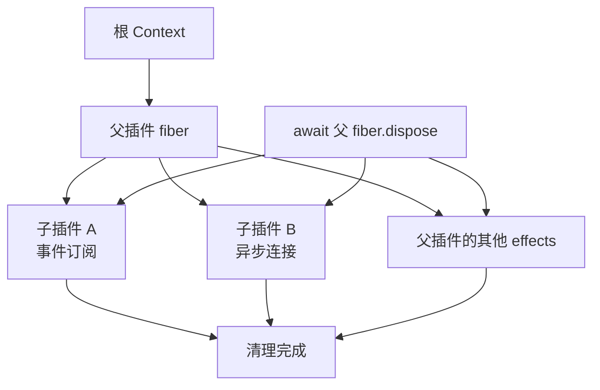
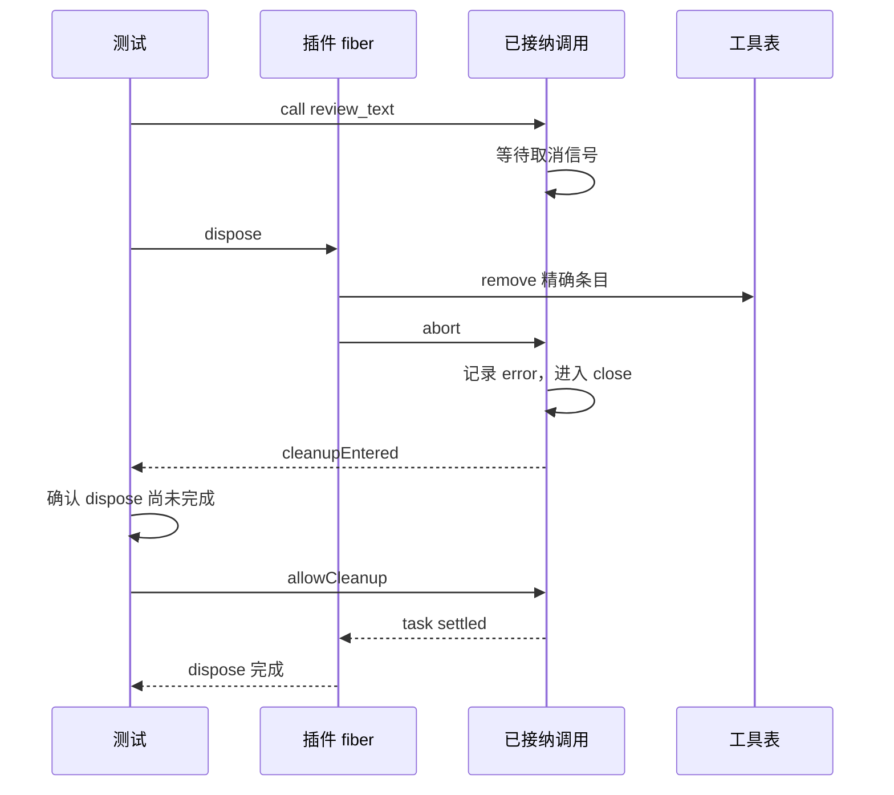

# 第 3 章：插件注册、卸载与资源清理

<!-- block: deepseek-ch03.b-opening -->
插件最难写的往往不是加载，而是第二次加载。第一次创建的监听器还活着，第二次又注册一个，同一条事件就执行两遍；第一次开出的连接没人关闭，重载几次后程序开始卡住。Cordis 的 effect 机制把这些资源交给拥有它们的 fiber 管理。

## 3.1 谁创建资源，谁声明撤销动作

上一章的 fiber 保存一次插件挂载的状态，本章要给它登记具体的清理工作。ctx.on 注册的监听器已经受框架管理；连接、定时器或文件观察器等其他资源，则可交给 ctx.effect。传给 effect 的函数负责取得资源，再返回一个负责撤销的函数。后者称为 disposer，fiber 清理时会调用它。

下面的 record 只写实验记录：外层函数记下 open，返回的异步函数记下 closed。读代码时沿这两个函数区分取得资源与释放资源的时刻。

```javascript
ctx.effect(() => {
  record('resource:open');
  return async () => {
    await Promise.resolve();
    record('resource:closed');
  };
});
```

这是本书实验中的资源替身，用来验证真实 Cordis 的异步清理协议。没有真的连接数据库，因此结果证明的是“宿主等待异步 disposer”，不是某个数据库驱动的关闭保证。把它换成 socket 时，还需要确认 close 事件、待发数据和超时是否按驱动契约完成。

若资源在创建到一半就失败，还没来得及返回撤销函数，框架不可能凭空知道句柄在哪。插件应把局部 try/finally 放在资源取得过程附近，或者先注册一个能处理部分初始化状态的清理动作。effect 管理已有的撤销约定，不会猜测外部库的副作用。

## 3.2 挂载句柄指向这一次实例

ctx.plugin 返回 fiber。保留它，才能明确卸载的是哪一次挂载。以插件函数名字去全局搜索再删除，容易在快速重载时删错新实例。

```javascript
const fiber = root.plugin(reviewObserver(record));
await fiber.await();
root.emit('book/review', 'a.ts');
await fiber.dispose();
root.emit('book/review', 'b.ts');
```

组件实跑先记录 `review:1:a.ts`，dispose 完成后出现 `resource:closed`，再发 b.ts 没有新增审查事件。它同时验证监听器消失与自定义资源关闭，避免只盯着 dispose 是否被调用。

disposer 回收资源，但不自动撤销已经发生的操作。邮件、数据库事务和文件写入需要各自的补偿设计。失败实验中，插件写入外部数组的记录仍然存在，回收的只是受管监听和 effect。

## 3.3 父插件消失时，子插件怎么办

组合插件常会挂载多个子插件。父 fiber 拥有这些挂载，清理沿所有权向下传播。



图 3-1：所有权决定清理范围。图不承诺兄弟资源严格按绘图顺序关闭。

子插件返回异步清理函数。实验在父 dispose 返回后确认 child:closed 已出现，再次 dispose 也没有重复关闭，从而检查父清理是否等到了子资源结束。

如果 A 的 disposer 需要继续使用 B，不能从“都属于同一个父插件”推导出 B 一定最后关闭。应让 A 的资源所有权包含依赖，或使用框架支持的组合 effect 来明确顺序。把清理顺序寄托在代码书写位置上，是热重载中很难重现的故障来源。

## 3.4 重载不是一种动作

需要分清更新配置、重新执行插件主体、重新导入模块和重启应用。fiber.restart 描述重新加载当前插件，配置 update 还会经过更新事件；源代码 HMR 则涉及加载器、模块依赖和应用协调。进程重启又会清空另一层模块状态。

因此本章只把实际观察到的重新激活写进结果：移除 Counter 后依赖它的观察器停止，提供新 Counter 后重新工作。它没有证明浏览器插件热更新、TypeScript 文件保存监听或所有传输连接都无缝恢复。第 4 章继续讨论配置失败，第 16 章再把这些边界带到插件包升级。

开发阶段最实用的习惯是给资源分配可关联标识，记录 open 与 close，并在卸载后主动再触发一次事件。如果计数器还在增长、回调还会写文件，说明你留下了未受管资源。与其只做一次正常启动，不如先确认第二次、第三次挂载仍只产生一份效果。

## 3.5 把清理失败做成可定位的问题

真实资源比实验中的 Promise 更麻烦。假设插件启动一个文件观察器，回调把变更追加到队列，再由定时器批量处理。它至少拥有观察器、定时器和正在执行的批处理三种资源。只清掉定时器不够：观察器仍可能继续入队；只关闭观察器也不够：已经排队的批处理可能稍后写文件。

可以先画出关闭协议：停止接收新事件，停止产生新批次，给当前批次发取消信号，等待它结束，最后释放底层句柄。这个顺序属于插件的业务契约，应该在一个受管 disposer 中表达，而不是指望框架猜测三个独立 effect 的依赖。若外部库提供整体 close 方法，先查清它究竟等待哪些动作，再决定是否还需要自己的收敛步骤。

异步清理也会挂起。例如一个连接的 close 等待服务器回应，而网络已经断了。给关闭动作设定有限等待，并保留超时记录，能避免重载永远停在 UNLOADING。超时以后是否强制销毁句柄，由驱动能力决定；不能只让等待函数返回，就宣称底层连接已经关闭。

检查这类问题时，把卸载完成后的观察窗口也纳入实验：继续发送原来的事件，确认没有新写入；检查子任务集合是否为空；再次挂载后确认只有新实例的标识出现。测试日志应保留旧实例标识，这样偶发的晚到回调会直接暴露，而不会被新一轮正常输出掩盖。

<!-- deepened: 03 -->

## 3.6 把工具的寿命交给一个 effect

回到第 2.6 节的连续实例。reviewPlugin 从本轮上下文取得工具表和日志后，在 ctx.effect 中调用 tools.register，再把返回的 remove 留在清理闭包中。remove 只撤销工具表里的定义；已经开始的调用，需要通过 active 中的记录另行取消并等待。

先认出片段里的三个名字：accepting 表示本轮插件是否仍接纳调用，active 保存已经开始的调用，journal 是本轮取得的日志服务。effect 主体成功返回后，框架便持有下面这个异步清理函数：

```javascript
ctx.effect(() => {
  const remove = tools.register('review_text', executeReview);
  return async () => {
    accepting = false;
    remove();
    const pending = [...active.values()];
    journal.append('plugin:stop', { active: pending.length });
    for (const item of pending) {
      item.controller.abort(new Error('PLUGIN_UNLOADED'));
    }
    await Promise.allSettled(pending.map(item => item.task));
    journal.append('plugin:closed');
  };
});
```

这个顺序是样例自己定义的停止协议。先将 accepting 设为 false，再 remove，关闭新工作入口；再复制 active，得到此刻已经接纳的任务；给它们发取消信号；最后等待全部结算。若先等待再 remove，等待期间仍可能有新调用进来，清理就没有稳定的终点。若只 remove，旧调用仍可能继续运行，调用方会误以为卸载已经完成。

accepting 还要在 execute 入口检查。一次 call 可能已经取得旧 entry，却正停在异步策略中；这时只从工具表删除条目，不会让闭包里那份 entry 消失。新增的延迟策略实验先卡住 next，卸载插件，再放行。入口检查应抛 PLUGIN_UNLOADED，日志里不能出现 tool:start。这个标记属于每一轮插件激活，不能与下一轮共享。

active 使用调用 id 作键，值是 `{ controller, task }`。controller 用于请求停止，task 用于等待调用结束。卸载需要两者：发出取消信号之后，仍要等任务完成清理。

新实验故意让工具停在 waitForAbort。这个函数只等待 AbortSignal，不启动定时器，也不访问网络。卸载开始后它收到 PLUGIN_UNLOADED，工具进入 catch 记录 error，随后进入 finally。finally 又被测试提供的 close 卡住，让我们有机会确认插件 dispose 还没有返回。

## 3.7 不靠睡眠猜测清理时序

很多异步测试写成“等一百毫秒，再看 finished”。机器慢一点就失败，机器快一点又可能错过关键中间状态。本例用两个 deferred 控制点：cleanupEntered 告诉测试已经进入 close，allowCleanup 决定何时放它离开。时间长短不参与正确性判断。

```javascript
const cleanupEntered = deferred();
const allowCleanup = deferred();
const close = async () => {
  cleanupEntered.resolve();
  await allowCleanup.promise;
};
```

测试开始调用后立刻附上 assert.rejects，避免预期拒绝先变成未处理 Promise。然后调用 plugin.dispose，把 disposed 设为只有 Promise 完成后才会变成 true。等 cleanupEntered 到达，断言 disposed 仍为 false，工具表已经没有 review_text，而且日志中没有 tool:result。

这三个观察组合起来说明了不同事实：新调用入口已撤销；旧业务没有算出成功结果；清理仍在等待旧工作退出。随后 allowCleanup.resolve 放行，测试同时等待原调用拒绝和 dispose 完成。尾部日志必须是 tool:error、tool:settled、plugin:closed。顺序错了，就能直接定位清理过早宣布完成的地方。



图 3-2：卸载实验的可控交错。实线表示调用或信号，返回箭头表示等待条件满足；测试没有使用固定延时。

## 3.8 清理函数必须指向自己的那一份注册

ReviewTools.register 创建一个 entry 对象，存进 definitions。它返回的 remove 比较 `definitions.get(name) === entry`，只有仍指向自己时才删除。这个检查看似多余，因为重复注册已经被拒绝，但它表达了重要的所有权：撤销函数拥有一个具体插入，不拥有这个名字今后的所有使用者。

同名冲突实验先成功挂载一个审查插件，再挂载另一份。第二次 register 抛 DUPLICATE_TOOL，第二个 fiber 进入 FAILED。第一份工具仍能计算五个字符。若错误清理只按名字无条件删除，第二个失败插件反而会抹掉第一个成功插件的能力。

这里还要留意 effect 的取得时机。第二个插件在 register 抛错之前没有取得 remove，所以不存在“撤销第二次成功注册”的动作；第二次注册根本没成功。资源创建函数应先完成必要检查，再提交自己拥有的条目。把旧条目先删掉、然后发现新定义不合法，会把更新变成破坏。

官方 scope/store.ts 的 NamedEntries 也体现了精确插入的思路。insert 捕获当前 Map，返回带 active 标记的撤销函数；空表清空时还会切换表代际，避免旧迭代器跟上后来新插入的条目。样例没有复刻这些完整功能，但它要求的所有权方向一致。第 12 章会继续解释为什么同名和同实例不是一回事。

## 3.9 初始化失败发生在注册之后

failAfterRegister 让审查插件先完成工具注册和 note 监听，再抛 FAIL_AFTER_REGISTER。测试等待 broken.await 拒绝，随后检查 definitions.size 为零，发送 book/note 也不会增加日志。留下的三条记录是 plugin:load、plugin:stop、plugin:closed。

日志中的 load 保留下来，说明插件进入过主体，并在发布可用状态之前失败。框架撤销工具条目和监听器，没有删除外部日志，所以仍能从记录中追查这次初始化。

如果把工具注册移到 ctx.effect 外面，框架便不知道该调用 remove。测试会在 definitions.size 的断言失败。若只忘了把 note 监听交给 ctx.on，而改为另一个库的裸监听，最后发送 late 消息的断言就能暴露泄漏。失败注入的位置比随机制造异常更重要：必须放在资源取得之后，才真正考验回收。

## 3.10 从 fiber 的卸载实现理解保证范围

固定版本 `_unload()` 先等待该 fiber 提供的能力不再有 dependents。下游插件在自己的清理期间，仍可能需要提供者帮助完成关闭，因此提供者不能一离开 ACTIVE 就立即销毁全部底层资源。下游释放 committed 依赖后，会唤醒等待中的提供者。

随后 `_unload()` 清空 disposer 集合，启动清理并等待 Promise.all；单项清理的异常会被记录，不阻止其他受管动作尝试执行。因此不能从集合的顺序推导所有异步关闭严格串行完成。代码中的某个 disposer 先被调用，和它先完成，是两个不同观察。

本例把 remove、abort、await tasks、closed 放在同一个 disposer 中，用 JavaScript 控制流保证顺序。框架负责跨插件的所有权关系，这个 disposer 则负责插件内部的关闭步骤。

还有一个场景保留已卸载插件的 ctx，再注册监听时得到 INACTIVE_EFFECT。这个错误能指出晚到回调试图向死上下文安装资源，却无法阻止它直接使用 Node API；异步工作仍需通过前面的取消协议在卸载期间结束。

## 固定版本来源

- [vendor/cordis/src/fiber.ts](https://github.com/deepseek-ai/deepseek-harness/blob/fcc0ad462172522aaf5c93a7b2e01f6b9f0b0159/vendor/cordis/src/fiber.ts)
- [vendor/cordis/src/events.ts](https://github.com/deepseek-ai/deepseek-harness/blob/fcc0ad462172522aaf5c93a7b2e01f6b9f0b0159/vendor/cordis/src/events.ts)
- [docs/cordis-tutorial/06-composition-and-hmr.md](https://github.com/deepseek-ai/deepseek-harness/blob/fcc0ad462172522aaf5c93a7b2e01f6b9f0b0159/docs/cordis-tutorial/06-composition-and-hmr.md)
