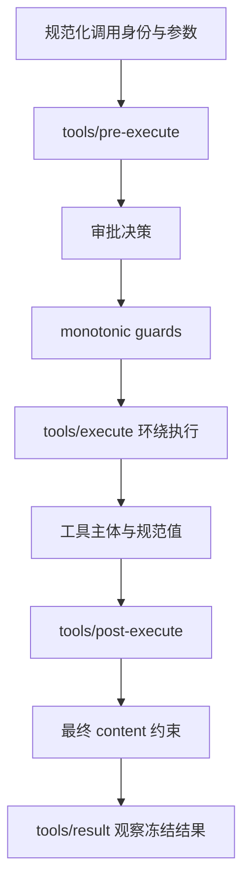
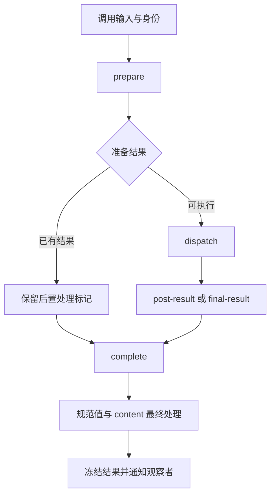

# 第 10 章：工具注册与执行管线

<!-- block: deepseek-ch10.b-opening -->
模型提出“读这个文件”，到磁盘真的被读取，中间至少要完成参数校验、权限判断、执行和结果规范化。DeepSeek Harness 把这些工作拆成可组合的管线，工具作者不必为每个工具重写一套部署策略。

第 2、3 章已经跑过 review_text，但它用的是教材自己的 ReviewTools 容器。本章先看同类统计功能如何声明成官方工具，再回到第 10.7 节对照原实例。下面的 book_text_stats 是用于解释官方接口的另一个片段，只统计行数与字符数；它没有替换已运行的 review_text，也未完成 dsh 集成实验。

## 10.1 工具定义有三个出口

先区分输入描述和三个结果出口。schema 说明参数或结果应有怎样的形状；execute 计算后返回结构化值，例如包含行数、字符数的对象。管线对它校验、规范化后，得到供程序读取的规范值；render 再把它变成给模型阅读的 content，例如“2 行，7 个字符”。UI 卡片是另一个展示出口，程序仍可读取对象里的数字，不必从展示句子中重新解析。

下面是一个只做字符串统计的原创教学定义。它没有文件访问，也不需要凭据，适合先理解输入与返回值约定。

```typescript
import { defineTool } from '@deepseek-ai/dsh-tools';
export const name = 'book-text-stats';
export const inject = ['tools'];
export function apply(ctx) {
  ctx.tools.register(defineTool({
    name: 'book_text_stats',
    description: '统计给定文本的行数和字符数。',
    parameters: { text: { type: 'string', required: true } },
    output: {
      schema: {
        type: 'object', additionalProperties: false,
        properties: {
          lines: { type: 'number', required: true },
          characters: { type: 'number', required: true },
        },
      },
      render: (_args, value) => [{
        type: 'text',
        text: `${value.lines} 行，${value.characters} 个字符`,
      }],
    },
    async execute({ text }, exec) {
      exec.signal.throwIfAborted();
      return { lines: text === '' ? 0 : text.split('\n').length,
               characters: [...text].length };
    },
  }));
}
```

这个片段采用固定版本的统一 schema 形状，未作为完整 dsh 工具集成实跑。字符数按 Unicode code point 计算，不按字形簇计算；组合音标和 emoji 仍可能占多个 code point。

## 10.2 定义校验保护什么

defineTool 编译参数与输出 schema，包装 execute 以验证模型参数，并把输出契约交给共用执行管线。管线再验证规范值、冻结结果并调用 renderer。类型不对、缺字段、不能无损转成 JSON 或 renderer 抛错，都需要被规范成错误结果。直接调用定义里的 execute 并不等于走完这条管线。原生 JSON Schema 直接注册的路径则由工具承担自己的输入验证。

schema 能表达 string、number、required，并不能替你判断“路径必须在项目内”“限制必须为正数”“两个参数不能同时出现”。工具作者仍要处理 DSL 无法表示的业务约束。反过来，不要在 execute 内重新解析同一份 JSON 字符串，制造与注册时 schema 不一致的第二套入口。

## 10.3 策略的次序关系



图 10-1：共用调用管线的责任顺序。拒绝和抛错会走错误归一化分支，不必进入工具主体。

pre-execute 用于可扩展策略；需要后续监听器无法撤销的最终拒绝，使用 guard。around-dispatch 适合计时和期限；post-execute 可以改变结果或附加上下文；tools/result 是观察最终结果的出口。日志插件若只想计数，应放在观察点，而不是随手截断一个决策 waterfall。

## 10.4 隐藏文本未必隐藏数据

Native 模式下模型看 content；程序化工具调用还可能取得 canonical value。若保密策略只把 content 换成“结果已隐藏”，value 仍可能保留原文。正确做法是依据威胁模型阻断整个结果，或者同时替换规范值与呈现，不能把显示处理当成数据权限。

同样，工具的 presentationMeta 和 UI presenter 不能执行 I/O。重放会反复运行展示逻辑，如果 presenter 每次都读当前文件，旧会话显示的就不再是当时结果。应该把需要重放的有限事实写进持久结果 metadata，再纯粹地渲染。

## 10.5 取消与批次不是可选细节

execute 收到的 signal 应传给底层操作。文件读取、网络请求和子进程各有不同的取消接口，不能仅在函数开头检查一次就算支持取消。批次并发与 exclusive barrier 由选定执行器负责；工具作者应该正确声明自己的并发能力，不要为了快把共享写操作标成可并行。

同一批次的结果保持模型顺序，不表示所有工具串行执行。调试性能时要分别记录开始和完成时间，再与最终结果顺序比较。遇到未知结果也不能自动重跑副作用；第 13 章会把这件事放到恢复路径里。

## 10.6 用一组输入辨认边界

对本章字符串统计工具，先输入空字符串，期望行数和字符数都是零；再输入两个汉字，期望一个逻辑行、两个 code point；最后输入末尾带换行的文本，确认是否把末尾空行计入。这个定义使用 split，所以结尾换行会产生一个空段。若产品要统计“非空行”，应修改工具描述与实现，而不能只在测试里换一个看起来更合理的期望。

再让模型参数缺少 text，或把它写成数字。期望执行主体没有运行，并且调用方取得可解释的参数错误。还要试一个额外字段：固定版本的 parameters 根是隐式开放对象，不能因为示例输出声明 additionalProperties: false，就推断输入也会拒绝额外字段。输入根和嵌套输出对象采用不同的 schema 形状，阅读时要分开。

输出错误可以通过有意返回字符串行数来触发。它应被输出契约拦住，不能先把无效数据交给 presenter。随后让 renderer 抛错，检查最终结果是否记录展示失败，同时保留可诊断的调用身份。这些检查必须走真实工具执行入口；直接调用用户写的 execute 只能观察统计函数，触不到输出校验与结果规范化。

把统计工具改为读文件时，还要加入路径解析、访问策略、文件大小上限、编码约定和取消传播。原有测试继续检查统计行为，文件访问则需要另行验证。

<!-- deepened: 10 -->

## 10.7 先运行一条完全看得见的工具链

连续实例的 review_text 不访问磁盘，输入只含 text，输出含 lines、characters 和 todo。ReviewTools.call 先找定义，再生成 request id 和参数副本；策略通过 waterfall 包住执行；reviewPlugin 的 execute 负责检查、计算、记录和清理。完整文件与断言都在 examples，读者可以从输入一直跟到返回值。

实际正常输入 `TODO\n校对` 返回 `{ lines: 2, characters: 7, todo: true }`。字符数包含四个英文字母、一个换行和两个汉字。行数依据 split，所以 `x\n` 是两行；空字符串单独算零行。这个业务约定在输入和输出两端都明确，避免“代码正确但大家理解的行数不同”。

输入 text=42 时，工具在创建 controller 和记录 tool:start 之前抛 TEXT_REQUIRED。策略拒绝时更早：工具主体完全没进入，日志仍只有 plugin:load。失败位置决定可以期待哪些记录；不要让测试无论失败发生在哪都只断言“rejects”，那会放过重要的执行顺序错误。

样例使用自己的两个服务，验证参数后进入业务主体。官方 defineTool 还接有标准 schema 转换、规范值校验和模型呈现；样例的通过结果不覆盖这些集成步骤。

## 10.8 schema.ts 中的输入与输出形状

DefineToolOptions 的 parameters 是隐式参数属性映射，属性上的 required:true 被编译为 JSON Schema required 列表。输出 schema 则是一个完整值节点，可以直接是 string、number、array 或 object。显式对象节点必须给 additionalProperties，防止嵌套输出意外获得开放对象的默认语义。

```typescript
parameters: {
  text: { type: 'string', required: true },
},
output: {
  schema: {
    type: 'object',
    additionalProperties: false,
    properties: {
      lines: { type: 'integer', required: true },
      characters: { type: 'integer', required: true },
      todo: { type: 'boolean', required: true },
    },
  },
  render: (_args, value) => [{
    type: 'text',
    text: `${value.lines} 行，TODO：${value.todo ? '有' : '无'}`,
  }],
}
```

这是把业务结果映射到官方定义的片段。不要把 properties 放到 parameters 外面再多包一层 type:object：那会把 DSL 和原生 JSON Schema 入口混用。读取 schema.ts 的 ParameterSchemaSpec、ValueSchemaSpec 与两种编译函数，比靠名称相似猜形状更可靠。

defineTool 的 execute 包装先调用 validateJsonSchemaValue，发现 violations 后抛 ToolArgsError。输出契约保留在 ToolDefinition 上，真正的执行管线随后验证返回值。若测试直接调用原始业务函数，它既不会检查参数 DSL，也不会检查输出；若调用包装后的 execute，可以覆盖输入，但仍未完整覆盖最终结果路径。

## 10.9 prepare、dispatch、complete 三段分别拥有什么

ToolExecutionPipeline 不是一个巨大的 execute 方法。prepare 创建本次执行身份，处理可见性、前置策略与审批等准备；dispatch 推进真正的执行或取得阶段结果；complete 负责后置策略与最终结算。调度器可以对多个调用安排先后，同时复用同一套管线规则。

createExecution 为调用建立 token、callId、rootCallId、工具名、作用域与 parent 等信息。嵌套调用需要保留根调用关系，不然程序化工具里再调用其他工具时，审计只能看到一串没有因果关系的名字。token 还帮助管线识别某个规范结果确实属于这次执行。

原始调用者的取消状态、内容 finalizer、内容 projector 和延后上下文分别保存在 WeakMap 中，没有全部暴露给 around-wrapper。这样包装器修改可见字段时，仍能保留原始取消状态和执行身份。



图 10-2：管线保留“这个结果是否还应经过 post-execute”的身份。不是每条提前结束路径都能套用相同后处理。

ScheduledToolDispatch 用 post-result 与 final-result 区分这件事。一个已经完成最终处理的结果再次进入后置策略，可能重复脱敏、重复包装错误或重复添加上下文。阶段类型比一个可随意修改的 finished 布尔值更能帮助调用者维持顺序。

## 10.10 规范值为什么不能借用可变对象

createSuccessResult 处理业务返回的 candidate，结果要能无损表示为 JSON，并按输出 schema 验证。规范化过程需要取得独立快照与冻结值，不能长期借用工具继续持有的可变对象。否则工具返回之后再改数组，日志和模型收到的内容就可能不一致。

render 从经过验证的值生成模型 ContentBlock。presentationMeta 生成可持久展示资料，presentResult 再把结果转换成 UI 意图。三个出口都不应再次读取一个会变化的业务源。你希望旧会话显示当时的统计，就把统计值保存在结果中；不能在打开旧会话时重新运行统计函数。

政策替换也要遵守输出契约。若某个后置策略把对象结果替换成字符串“已隐藏”，但工具输出 schema 仍要求 lines、characters、todo，这种替换不是合法成功值。应选择符合契约的拒绝或错误表达，或者定义明确的新结果语义，而不是只让界面看起来像已处理。

## 10.11 取消不能被中间件换掉

around-wrapper 可能提供自己的 signal，例如加一个更短的期限。管线仍保留原始 callerSignal，并把两个信号合成用于 dispatch 的信号。这样外层取消不会因为内层包装器换了一个 controller 就失效；任一来源取消都能向实际工具传播，相关监听在执行结束后解除。

本书连续实例只展示单一插件 owner 的取消，所以 controller 属于 plugin active 集合。它在 checkpoint 后调用 throwIfAborted，确保解除等待后不会继续计算成功值；finally 则始终执行 close。把 throwIfAborted 放在 await 前面只能检查过去，不能覆盖等待期间到达的取消。

真实网络请求还取决于客户端是否支持 signal。不支持取消的库只能停止后续工作，并等待当前调用返回。若工具可能已经写入外部系统，仍需保留结果未知等状态，不能将取消视为写入回滚。

## 10.12 用同一失败定位表检查两条链

连续实例的可观察位置是 lookup、policy、validation、start、result、settled、closed；官方管线对应查找、pre-execute/审批、参数验证、around dispatch、结果规范化、complete 与 result 观察。它们不逐行相同，但可以用同样问题定位：主体进入了吗，是否产生规范值，后置处理完成了吗，外层等待结束了吗。

模型收到空正文时，查 content 转换；程序化消费者仍取得敏感值时，查 canonical value；UI 显示旧字段时，查 metadata 与 presenter；卸载卡住时，则看活动调用与清理。症状所在的出口可以帮助缩小检查范围。

新增代码时还应保留一个最小已知输入。连续实例的七字符文本就是这种基准：它不依赖目录、网络或模型选择。先用它验证扩展管线仍传递正确值，再换真实文件工具。这样一旦集成失败，能够区分业务数据变化和基础调用协议变化。

## 固定版本来源

- [docs/cookbook/adding-a-tool.md](https://github.com/deepseek-ai/deepseek-harness/blob/fcc0ad462172522aaf5c93a7b2e01f6b9f0b0159/docs/cookbook/adding-a-tool.md)
- [docs/tool-execution-pipeline.md](https://github.com/deepseek-ai/deepseek-harness/blob/fcc0ad462172522aaf5c93a7b2e01f6b9f0b0159/docs/tool-execution-pipeline.md)
- [packages/core/tools/src/pipeline.ts](https://github.com/deepseek-ai/deepseek-harness/blob/fcc0ad462172522aaf5c93a7b2e01f6b9f0b0159/packages/core/tools/src/pipeline.ts)
- [packages/core/tools/src/schema.ts](https://github.com/deepseek-ai/deepseek-harness/blob/fcc0ad462172522aaf5c93a7b2e01f6b9f0b0159/packages/core/tools/src/schema.ts)
