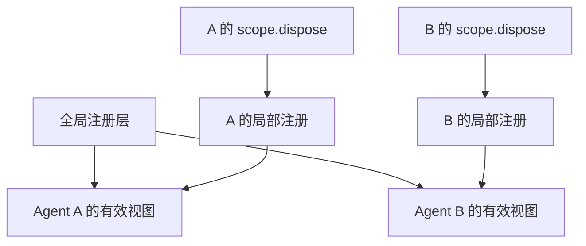
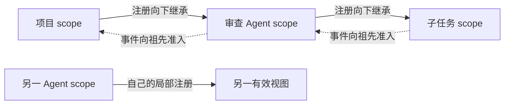

# 第 12 章：作用域与并发

<!-- block: deepseek-ch12.b-opening -->
一个审查 Agent 只读文件，另一个修复 Agent 可以修改文件。它们在同一宿主里工作，不能因为都看得见 ctx.tools，就默认拥有同一组能力。DeepSeek Harness 用作用域区分注册可见性，同时让注册的寿命跟着拥有者结束。

## 12.1 两种隔离不要混用

第 2 章已经见过一种隔离：left 和 right 都读 bookCounter，但取得不同的计数服务。这是 Cordis isolate 建立的服务解析域。换成工具表来看，它决定插件拿到哪一张表。

Harness 的 ScopeKey 处理另一件事：使用同一个服务的多个 Agent，各自能看到哪些局部注册、收到哪些事件。它是不透明的身份键，使用者无需从中解析会话信息。前者适合替换服务实现，后者适合让某一条工具或提示词只对一个 Agent 生效。

ScopeKey 按对象身份比较，不是把 sessionId 拼进字符串。默认循环使用活跃 Agent 对象作为键。这样旧实例与后来同 id 的新实例仍可区分，不会因为显示名称相同就共享局部注册。

## 12.2 注册上下文同时承担两件事

一个作用域上下文既决定“谁看得见”，也决定“谁结束时撤掉”。在 agent.ctx 上注册工具、提示词和监听器，比在全局注册后再写一堆 if(sessionId) 更可靠。后者容易漏掉一种事件，或者在会话重用时把旧状态带进来。

图 12-1：局部层影响可见内容，也提供清理所有权。全局能力仍可能被两个 Agent 共享。

## 12.3 局部同名项与全局项

ScopedLayers 维护全局层和按精确 scope 建立的层。读取不会凭空创建空局部层；合并时保留全局命名项顺序，再让局部同名项形成遮蔽。局部项撤销后，全局项可以重新显现，这与删除全局注册不是同一操作。

例如全局审查提示词要求通用输出，A 的局部层用同一名称换成面向安全审查的版本。A 结束只清理自己的层，B 仍读到全局版本。若作者为了“覆盖”直接改全局对象，所有并发任务都会受到影响。

同层重名通常需要诊断，因为两份策略可能本应互斥。随机后缀虽然能绕过名称冲突，却可能让两份策略同时进入请求；确实需要多份匿名贡献时，应使用相应的注册入口。

## 12.4 服务隔离实验说明什么

本册已运行两个 bookCounter realm：左边调用两次得到 1、2，右边第一次仍为 1。这证明服务查找域分开。它没有证明两个 Agent 的工具集隔离，因为实验没有创建 Harness Agent，也没有调用 scope 的工具注册层。

完整作用域练习可用两个并发 Agent，各自注册一个返回 A 或 B 的同名工具，再检查各自请求 schema 与工具结果。随后清理 A，继续调用 B，确认 B 没受影响；再创建新的 A，确认不会复用旧 A 的 closure。测试应把模型协议替换为固定调用序列，避免模型恰好没选择工具而产生假通过。

## 12.5 清理要等到工作安静下来

Scope.dispose 是共享的收敛边界：直接调用和竞态调用都应等待同一次完成。默认循环还要先停止、排空驱动，再撤局部注册、关闭写句柄和移除对象。只从注册表删除 Agent，不足以说明它的网络请求和子进程已经停了。

并发 bugs 常表现为旧 disposer 晚到，把新对象移除。因此源码强调按实际进入的对象解绑，而不只按名字查找。插件作者也应保存自己取得的 exact handle，不要在清理时重新查询“当前那个连接”然后关闭它。

作用域不是安全沙箱。全局可变单例、模块顶层数组、Node 文件访问仍然可能跨任务共享。设计上应把业务状态放进明确的实例或存储，限制不可信插件的执行环境，而不是看到 Scope 一词就认为内存和权限都已完全隔离。

## 12.6 两个并发任务的反例

假设插件在模块顶层保存 currentSession，每次任务开始时把它改成自己的会话 id。A 的工具启动后等待文件读取，B 随后开始并改写 currentSession，A 的读取完成时就可能把结果记到 B 名下。即使工具本身注册在正确作用域，这个全局变量仍能把两个任务串起来。

修复时应让身份随调用传递，或放在每个任务的独立实例中。不能简单给文件读取加锁，因为锁只是让时序暂时不重叠，模块级身份仍缺少正确的所有者。测试也不要只用同步返回值；刻意让 A 停在一个受控 Promise 上，启动 B 后再释放 A，才能稳定暴露串线。

另一个反例是按 id 清理：A1 尚未结束，A2 已在同一业务名称下启动；A1 的异步 disposer 随后按名称删除，便误删了 A2。保存具体对象或挂载句柄，清理时就能确认撤销的仍是自己取得的那份注册。

这两类故障需要重叠的任务才容易暴露。检查跨 await 保存的状态、延迟清理持有的对象，再用受控 Promise 安排交错，就能验证它们是否属于正确实例。

<!-- deepened: 12 -->

## 12.7 服务 realm 与注册 scope 分开看

继续看源码时，可以用工具表区分两层：Cordis isolate 决定取得哪张表，Harness scope 决定在表中看见哪些定义。两种机制可以同时使用。

前面的两个 bookCounter 属于不同 realm，各自保存 value；共享标签实验则让两个上下文取得同一个 ReviewJournal。两项实验都在服务解析层，尚未使用 Harness ScopeKey 或局部工具叠加。

scope/index.ts 将 ScopeKey 定义为按身份比较的 opaque object。createScope 在现有 ctx 下挂一个空 scope 插件，再用其 fiber.ctx.extend 添加内部 scope 标签。于是它既获得独立清理所有权，也保留创建上下文已有的依赖能力。这个上下文随后交给 tools、systemPrompt 等支持 scope 的服务。

## 12.8 父子作用域有两个方向

scopeParents 用 WeakMap 保存 key 到 parent 的关系，bindScopeParent 检查重复绑定与环。scopeChainOf 返回最近作用域到根的数组。注册视图沿父链向下继承，事件准入则允许父作用域监听者观察后代事件。两个方向解决不同问题。

例如项目级审查策略属于父 scope，子 Agent 应继承这份策略；子 Agent 的专用临时工具则不应该反向成为父 scope 和其他子任务都可见的全局工具。同时，项目级观察器可以接收这个子 Agent 的工具事件，方便汇总；一个更深子任务的监听器不会因此接收父级所有事件。

图 12-2：父子关系影响两种读取。实线说明子级可使用祖先贡献，虚线说明祖先监听者可以观察后代事件；兄弟作用域不会因此互相继承。

scopeTarget 构造的 carrier 只承担路由，不暴露原主体的全部属性。真实 Agent 或工具对象通过事件参数传递。它还保留 base 的原过滤器，再加 scope 检查，避免新路由层意外绕过原服务域过滤。事件接收者的 this 与 payload 因此不一定是同一对象，写监听器时不要猜。

## 12.9 NamedEntries 为什么要换 Map 代际

NamedEntries 使用 Map 保留插入顺序。insert 拒绝同层重复名字，并返回只对本次插入生效的 undo。undo 捕获当时的 data Map，第一次调用后把 active 置为 false；表被清空时，存储会换成一个新的 Map。

若一直复用同一个 Map，旧迭代器在清空后可能又读到新插入的条目，混合两代注册。换 Map 后，旧迭代器仍指向旧表，后续注册进入新表。

ReviewTools 没有公开迭代器，只用 entry 身份保护删除。官方注册表还要照顾持有迭代器的消费者，因此多了表代际处理。

AnonymousEntries 则为每次 append 分配独立 symbol。两份值即使相等，也代表两次不同注册，清理其中一份不应抹掉另一份。适合匿名贡献的接口不能用“值相等就去重”代替注册身份；否则两个插件贡献相同短语时，其中一个卸载会让另一个的贡献也消失。

## 12.10 ScopedLayers 的读取不会偷偷创建资源

ScopedLayers 在构造时建立全局层，局部层放在 Map。peek 只读精确 scope，不存在就返回 undefined；chainLayers 才沿祖先链收集已有层。区分这两个入口，是为了让“读取本层限制”不会无意借到祖先同名资料，也不会因为查询一百个已结束任务就留下九十九张空表。

merge 先复制全局具名条目，再按最远祖先到最近 scope 的顺序 set 局部条目。相同名字的最近贡献取得值，原 Map 已有键的插入位置仍被保留。因此“本地覆盖了内容”和“本地把该项移到最后”不是同一保证。需要独立排序的消费者还会使用自己的 order 等字段。

举例：全局有 read、review，父 scope 覆盖 review，子 scope 增加 summarize。子视图包含全局 read、父级 review 和本地 summarize。撤销父级 review 后，全局 review 重新显现；删除的是局部覆盖项，未破坏全局定义。这种覆盖可以回收，比直接修改全局对象更适合并发任务。

## 12.11 先拥有 undo，再通知变化

ScopedLayers.effect 接收 ctx、同步 action 和通知选项。action 修改选中的层并返回 undo。源码先 yield 一个包含 undo、空层回收与通知的清理函数，然后才发出注册完成的 onChange。这个次序很关键：通知者若抛错或导致后续初始化失败，框架已经拿到了撤销动作。

若先通知、再交出 undo，通知阶段的异常可能留下无法回收的注册。这类故障可能只在某个观察插件存在时出现；先交出清理函数，便能覆盖这个失败窗口。

action 若在新建空局部层后抛错，代码会在层仍为空时删掉它；若原本就有其他注册，则不能清空整层来“恢复”。回滚范围必须精确到本次动作。连续实例的重复工具实验就是这个思想的缩小版：第二个失败插件没有权利删除第一个插件的工作。

## 12.12 dispose 的调用次数与完成次数

Scope 提供 rawDispose 与 dispose 两个入口。rawDispose 保留原始 Cordis disposer 身份，方便嵌进有顺序要求的组合 effect；dispose 则缓存 disposing Promise，让竞态调用都等待同一次完成。quiesceFiber 还在调用原始 disposer 后继续等待 fiber.inertia，直到生命周期工作安静下来。

为什么需要这样做？一个调用者可能已经领取了单次 disposer，另一个调用者随后也要求“等到 scope 真正清完”。第二个不应重复启动清理，也不应因为清理动作已被领取就立刻返回。单次执行与多方等待是可以同时成立的两个契约。

父子清理和延迟 close 实验分别检查重复效果与等待边界：同一连接只关闭一次，后来的调用者也要等到清理完成。它们对应的是单次执行与多方等待两个约定。

## 固定版本来源

- [packages/core/scope/src/index.ts](https://github.com/deepseek-ai/deepseek-harness/blob/fcc0ad462172522aaf5c93a7b2e01f6b9f0b0159/packages/core/scope/src/index.ts)
- [packages/core/scope/src/store.ts](https://github.com/deepseek-ai/deepseek-harness/blob/fcc0ad462172522aaf5c93a7b2e01f6b9f0b0159/packages/core/scope/src/store.ts)
- [docs/subsystems/scope.md](https://github.com/deepseek-ai/deepseek-harness/blob/fcc0ad462172522aaf5c93a7b2e01f6b9f0b0159/docs/subsystems/scope.md)
- [packages/core/agent-loop/README.md](https://github.com/deepseek-ai/deepseek-harness/blob/fcc0ad462172522aaf5c93a7b2e01f6b9f0b0159/packages/core/agent-loop/README.md)
