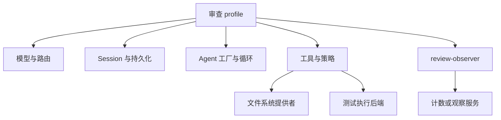

# 第 17 章：组装自己的 Harness

<!-- block: deepseek-ch17.b-opening -->
第 16 章已经把 review-lab 打成了可加载的本地包，但它仍只统计传入的文本。本章考虑怎样在此基础上做本地代码审查助手：读取变更、运行有限检查、解释问题，并保留可复核的结果。

第 17.1–17.5 节是完整 Harness 的集成设计，模型与持久化路径尚未实跑。想边读边运行，可以先从第 17.6 节重跑现有十三项场景，再看第 17.9、17.10 节怎样依次替换工具容器与日志。这样每接入一项能力，都有原来可运行的程序供比较。

## 17.1 从任务反推能力

审查助手至少需要模型适配器、会话日志、默认循环、提示词组装与工具注册；文件读取和测试执行再依赖各自提供者。若只做静态审查，可以先不启用写文件工具。需要浏览器交互时再加 Web 应用，CI 则可以选 headless 或 SDK。



图 17-1：一次审查所需的能力组合。实际 row 名称应以固定版本 dump-config 为准。

先把每项需求映射到服务，而不是先挑一长串插件包。比如“所有审查结果都有依据”需要保留工具结果和引用；仅在提示词里写“请给依据”并没有建立记录机制。“不能修改文件”需要执行能力与策略约束，不能只删除一个自然语言动词。

## 17.2 第一个可交付版本

第一版任务只读一个已知 fixture，输出检查结论和引用位置。确认会话创建、工具声明、调用结果和最终答复都存在；然后再把输入换成一个小仓库的 diff。工具返回文件位置时保留原始路径身份，展示时才做相对路径转换。

观察器应记录调用 id、工具名、耗时与结局，不记录完整机密正文。把日志失败设计为可解释的降级：审查能否继续、是否提示观察数据不完整、是否有界缓存。不要无限堆积一份迟迟发不出去的日志队列。

这一版仍不需要自动发布 PR 评论。对外发送改变了授权与重试的边界，应独立加上发送前检查、目标身份和幂等键。把发送隐藏在日志插件里，会让原本看似只读的审查具有意外副作用。

## 17.3 用失败场景驱动第二版

准备四种输入：文件不存在、测试超时、模型流断开、插件初始化失败。每种情况先定义期望：是否产生工具结果、Turn 如何结束、是否还能接受下一条消息、哪些资源应释放。

模型断线与工具失败不应混成一条“出错了”。前者影响请求尝试，后者可能已经完成外部操作。初始化失败又发生在任务开始之前。把它们放在同一错误码下，后续恢复只能整套重启，无法知道究竟该重做哪一步。

在本地模型替身里返回固定工具调用，可以把模型选择的不确定性暂时拿掉。仍然需要真实 Harness 工具管线与持久化参与，才能验证这一版本的集成行为。仅直接调用 execute 函数会绕过 schema、策略和日志，适合单元排错，不足以证明完整组合。

## 17.4 再加入有限写入

当只读路径稳定后，可以在新的临时工作树测试一个明确的代码修复。任务包括失败测试、允许修改的文件、成功命令和停止条件。先看 diff，再运行测试，再由人决定是否提交。会话恢复不负责 Git 回退，工作树本身才承担版本隔离。

同一个修复任务重复两次时，应先检查现有状态，避免第二次重复追加配置。工具层可以通过内容版本或预期旧文本拒绝过期修改；模型答复“已经改过”不能替代这种校验。审查助手若只需要解释，就不必获得这项能力。

## 17.5 保留一份可维护的运行说明

运行说明写清固定版本、profile 来源、补丁层、环境变量名称、持久目录、启动与停止方式，以及哪些实验实际通过。不要把真实凭据值放进去。给每个原创插件标出拥有的资源和 disposer，就能在升级时有针对性地复测。

底层插件生命周期已有可重复实验，完整审查 Harness 的模型与持久化路径仍待集成实跑。运行说明应与这些结果一起维护，让使用者能启动、停止程序，并定位失败步骤。

<!-- deepened: 17 -->

## 17.6 从完整源码跑起，而不是拼贴片段

review-lab.mjs 提供业务实现，check-review-lab.mjs 加载命令行指定的真实 Cordis 源码入口并执行断言。这里重跑的是第 1.5 节那组组件场景，尚未接入前半章的完整审查助手。保持第 1.5 节准备好的环境，在书仓根目录运行下面两条命令。业务输出由运行产生，不读取事实文件；事实文件只保存已有实验记录。

```powershell
python deepseek/examples/verify-evidence.py --source-root .scratch/deepseek-runtime/pinned-cordis/src
node --import ./.scratch/deepseek-runtime/node_modules/tsx/dist/loader.mjs deepseek/examples/check-review-lab.mjs --source .scratch/deepseek-runtime/pinned-cordis/src/index.ts --trace
```

环境准备与原七项实验相同。第一行先核对上游来源及记录中的示例摘要，第二行实际运行新十三项场景。--trace 额外打印首个正常场景的七条业务事件；去掉它仍运行全部断言。脚本退出零之后才算整组通过，某一项提前抛错会阻止最终成功汇总。

程序把 Cordis 模块作为 createReviewLab 参数，是为了让来源控制集中在驱动入口。工具服务与插件都使用同一个 Service 类，不会一半从固定源码 import、一半碰巧从 npm 的另一个版本解析。排查依赖问题时，可以直接检查 --source 和已验证文件，而不用猜运行时到底拾到了哪份库。

## 17.7 先读最外层，再读业务闭包

建议按调用关系阅读文件。最外层工厂定义两个服务类和两个插件构造器，最后返回它们；reviewPlugin 每次调用创建一个新的插件函数，因此两次挂载拥有不同闭包。插件主体取得服务后建立 active Map，注册受管工具，再安装 note 监听。

execute 进入时先检查本轮是否还接纳工作，再校验 text，然后为本次调用创建 controller 和 task。task 的 try 等待 checkpoint，重新检查取消，再计算结果；catch 记录错误并原样抛出；finally 等 close、删除 active 条目并记录 settled。这个布局把计算、失败和收敛放在一处，读者不用跨多个事件去猜谁关闭任务。

active 放在插件主体里，每次重新激活都会得到新 Map。若放在模块级，两份挂载会混用状态；放在服务级，则可能让一个插件清理掉另一个插件的任务。

## 17.8 十三个场景如何互相补充

第一项覆盖整个正常寿命，之后的场景每次改变一个条件。输入校验场景只改变 text 类型；策略场景只增加 veto；初始化失败只在资源取得后抛错；卸载场景只把 checkpoint 和 close 换成受控等待。原来的正常计算保持不变，因此失败更容易归因。

提供者替换场景保留同一个审查 fiber，移除工具服务后它回到 PENDING，新工具服务出现后重新激活。重复注册场景则同时拥有两个不同审查 fiber，第二个因同名定义失败，第一份仍可调用。这两个测试不能互相替代：前者看依赖变化，后者看注册冲突时的所有权。

其余场景检查共享 realm 标签、once 递归、serial 的零值、parallel 的聚合失败与卸载后的注册拒绝。修改业务功能后，可以分别重跑这些框架场景和业务场景，判断变化出现在哪一层。

| 先失败的断言 | 优先查看的代码 |
| --- | --- |
| 只有一个服务时就 ACTIVE | inject 声明与 provider 名称 |
| 拒绝后出现 tool:start | policy 是否继续调用 next |
| 初始化失败仍有定义 | 注册是否交给 ctx.effect |
| dispose 提前完成 | 是否等待 active 中的 task |
| 卸载后晚到 next 仍出现 tool:start | execute 是否检查本轮 accepting 标记 |
| 第二插件失败后第一工具也没了 | remove 是否检查精确 entry |
| 替换提供者后调用旧表 | 清理闭包与重新激活时的服务捕获 |

表中每项都对应已运行的场景，可据此定位代码，并在修改后重跑相关断言。

## 17.9 改成读取文件之前，先换掉一个接缝

连续实例把输入文本直接传入，是为了排除路径与权限。若改为读 fixture，先添加一个独立的文件提供者接口，例如 `readText(relativePath, signal)`，再让工具依赖它。不要把 fs import 隐藏在 ReviewJournal 或策略插件里，否则可执行能力的来源会变得难以看见。

路径检查应在提供者或正式工具边界有明确实现，包含基目录、解析后目标和允许范围。文件读取结果仍返回结构化值，日志只记录必要身份与状态。原来 text 类型测试继续保留，新路径再增加不存在、目录越界、编码和取消场景。这样新能力的测试不会挤掉旧生命周期证据。

接入真正 dsh-tools 时，替换的是 ReviewTools 的容器与调用入口，业务统计可以继续复用。把输入描述迁到 defineTool，输出迁到 canonical schema/render，策略迁到对应管线阶段，调用身份使用宿主提供的 execution 信息。不要同时替换工具、存储、模型和 UI，否则第一个失败就会跨越所有边界。

## 17.10 再把日志换成 Session，模型放在最后

ReviewJournal 的数组适合解释记录，但进程结束就丢失。接入 Session 时，应为业务事件定义合法形状，明确哪些进入模型历史、哪些仅供诊断。插件 load/closed 不一定应该出现在模型消息中；工具 result 则必须与宿主调用身份对应。不能把数组每一项都翻译成一条 user/message。

随后用固定模型协议触发一条工具调用，检查宿主 schema、审批、tool/call、tool/result 和下一轮请求。只有这些路径一致，才换真实模型评价是否选择对工具、是否理解结果。模型能力与宿主机制分别测量，能避免模型恰好没调用工具，却让集成测试看起来“没有错误”。

工作区与测试执行能力也可以按此顺序加入。为每项能力保留提供者、依赖关系、调用身份、结果和清理记录，便能继续使用连续实例中的方法追踪生命周期。

## 固定版本来源

- [docs/architecture.md](https://github.com/deepseek-ai/deepseek-harness/blob/fcc0ad462172522aaf5c93a7b2e01f6b9f0b0159/docs/architecture.md)
- [docs/cookbook/adding-a-tool.md](https://github.com/deepseek-ai/deepseek-harness/blob/fcc0ad462172522aaf5c93a7b2e01f6b9f0b0159/docs/cookbook/adding-a-tool.md)
- [packages/core/agent-loop/README.md](https://github.com/deepseek-ai/deepseek-harness/blob/fcc0ad462172522aaf5c93a7b2e01f6b9f0b0159/packages/core/agent-loop/README.md)
- [packages/boot/app-boot/README.md](https://github.com/deepseek-ai/deepseek-harness/blob/fcc0ad462172522aaf5c93a7b2e01f6b9f0b0159/packages/boot/app-boot/README.md)
