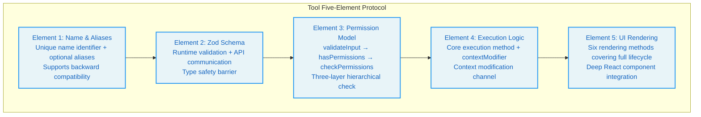
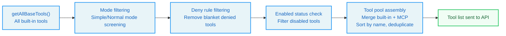
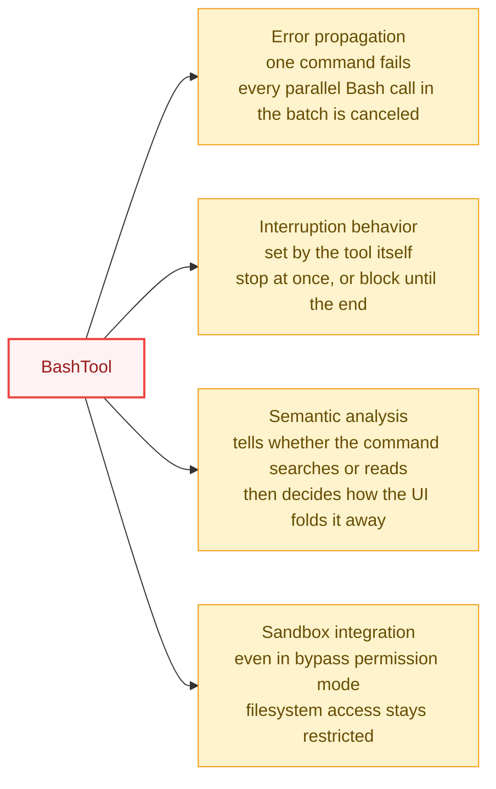
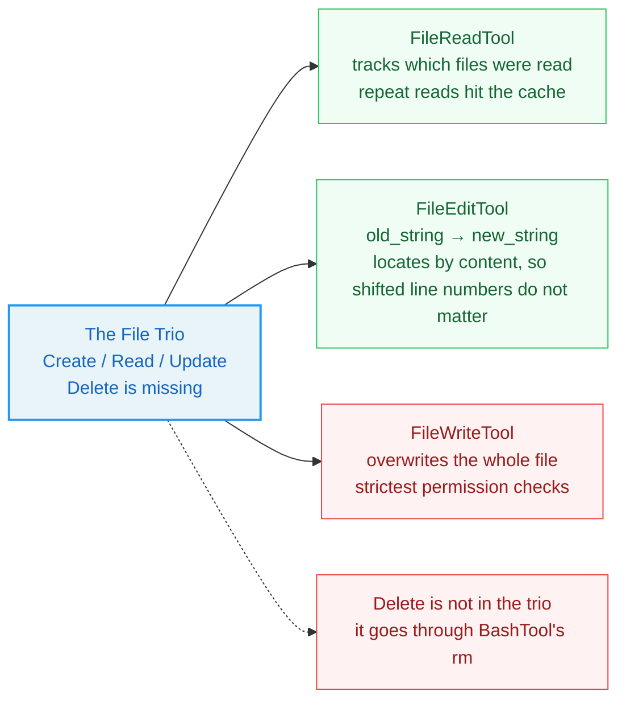
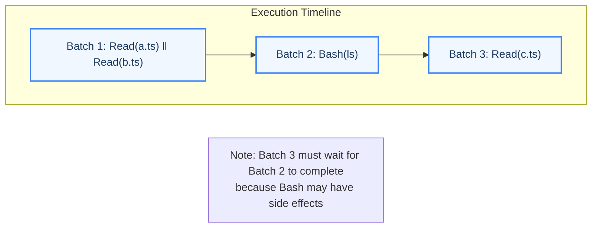
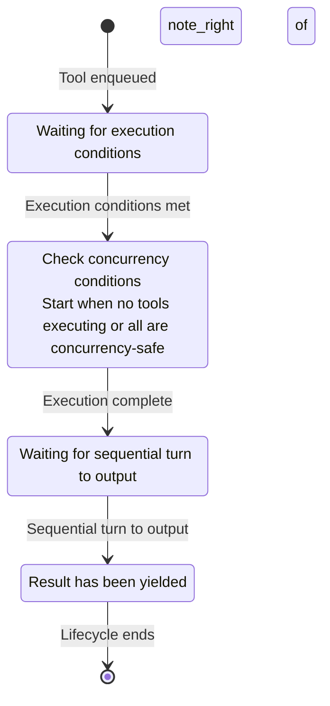

# Chapter 3: The Tool System -- The Agent's Hands

> **In one line:** Fifty-five tallies hang from the agent's hands, and each passes a JSON Schema shape check before it may strike.

> "If all you have is a hammer, everything looks like a nail."
> -- Abraham Maslow

**Learning Objectives:** By the end of this chapter, you can:

- Open any of the 55 registered tools, point at each of the five elements in the code, and say what breaks when one is missing
- Add a tool of your own with `buildTool` -- schema, permission, execution and rendering each in its place -- and get one call through
- Split a batch of tool calls into concurrency partitions, say which run together and which must wait, and name what each of the four StreamingToolExecutor stages holds back

**Difficulty:** A Core chapter: 3.1 is Start level (the five-element protocol); 3.2 and 3.4 carry the trunk. 3.3 takes the core tools apart one by one -- the longest stretch, tagged Advanced; on a first read, pick the tools you actually use and leave the rest, together with the exercises, for a second pass.

---

One more crash scene before the source. You ask the agent to read three files, then edit one of them. It runs the three reads one after another and you wait three times as long; the edit and a later read land in the same batch, so the read hands back stale content; you hit interrupt, the running tool stops, and the queued ones start anyway. All three faults sit in one layer: how a tool gets defined, how it gets queued, how it gets wound down. That is the layer this chapter opens up.

Maslow's quote could not be more fitting when applied to Agent tool systems. If an Agent only has a Bash tool, every task becomes a Shell command -- reading files with `cat`, searching code with `grep`, editing files with `sed`. This works, but it violates the engineering principle of "using the right tool for the right problem." Claude Code's tool system registers 55 specialized tools (Appendix B lists them all), each optimized for a specific type of operation -- like equipping different professional tools for different tasks, rather than solving every problem with a single hammer.

## 3.1 The Tool Definition Protocol

Every tool in Claude Code follows a unified type contract -- `Tool<Input, Output, Progress>`. The tool type core module defines this contract as the cornerstone of the entire tool system. Understanding it means understanding the anatomical structure of the Agent's "hands."

The design philosophy of this protocol comes down to "interface as architecture": strict type interfaces let the compiler police every architectural constraint of the tool system -- permission checks, concurrency control, progress reporting, UI rendering. Developers cannot "forget" to implement a method, because the type checker will immediately raise an error.

### Core Types: Tool, Tools, ToolDef, buildTool

<!-- block: ch03.b-9a6c53ca -->
The `Tool` type is a generic interface that accepts three type parameters:

- `Input extends AnyObject`: The tool's input type defined using a Zod schema, ensuring each tool's input is a structured object.
- `Output`: The tool's output type, freely defined.
- `P extends ToolProgressData`: The tool's progress data type, used for streaming feedback.

<!-- block: ch03.tool-generics -->
The separation of the three generic parameters is a deliberate design decision. Merge input and output into one type and the tool's signature gets harder to read; drop the progress type and the tool cannot report progress while it runs. Separating the three gives each concern its own type space, and the compiler can check them independently.

<!-- block: ch03.b-41046090 -->
The five elements that every tool must implement are as follows:



**Element 1: Name and Aliases**

Each tool has a unique name identifier, along with optional aliases for backward compatibility. Rename a tool and the old name keeps matching through an alias. The tool lookup function checks both the primary name and aliases.

The existence of the alias mechanism reveals an engineering practice principle: **in public APIs, renaming is an "add-only" operation.** Even when a tool's name is no longer accurate (e.g., renaming from `SearchTool` to `GrepTool`), the old name must remain available through an alias, otherwise configurations, scripts, and user habits that depend on the old name would all break.

**Element 2: Zod Schema**

Each tool uses Zod to define the schema for its input parameters. The Zod schema serves a dual purpose:

<!-- block: ch03.b-8fe1f4d3 -->
1. **Runtime validation**: Before tool execution, Zod parses the parameters generated by the LLM, ensuring type and constraint correctness. This embodies the "don't trust external input" principle -- the LLM's output is uncontrollable, and tools must protect themselves.
2. **API communication**: A transformation layer converts the Zod schema into a JSON Schema and sends it to the API so the model knows the meaning and constraints of each parameter. The parameter descriptions the model sees come from the `describe()` calls in the Zod schema.

> **Cross-Reference:** Zod schema validation occurs in the first stage of the Chapter 4 permission pipeline (validateInput), which is a concrete manifestation of the "embedded security boundaries" design principle.

**Element 3: Permission Model**

The three permission-related methods form a layered permission check pipeline:

1. **Layer 1: Input validation (validateInput)**: Runs before permission checks, used to reject invalid inputs. This is a "data legitimacy" check, unrelated to permissions.
2. **Layer 2: Permission checks (hasPermissionsToUseTool + checkPermissions)**: Contains tool-specific permission logic. Different tools have different permission check granularity -- the Read tool may only check whether a path is in an allow list, while the Bash tool needs to parse commands and assess risk levels.
3. **Layer 3: Runtime property determination**: Affects the tool's concurrency scheduling strategy. For example, `isConcurrencySafe()` marks whether a tool can run in parallel.

<!-- block: ch03.b-8ef64ba0 -->
The design philosophy behind the three-layer separation is "separation of concerns": data validation doesn't care about permission policies, permission policies don't care about concurrency scheduling. Each layer does one thing, but the three layers work together to provide complete protection.

**Element 4: Execution Logic**

This is the tool's core execution method. It receives parsed input parameters, the tool use context, a permission check function, a parent message reference, and an optional progress callback. The returned result carries output data and an optional context modifier.

The context modifier (contextModifier) lets a tool change the context after it runs (e.g., updating the file cache), which is the key channel for tools to influence subsequent behavior. For example, FileWriteTool updates the file state cache through contextModifier after writing a file, so that subsequent FileReadTool invocations can see the latest file contents.

**Element 5: UI Rendering**

Tools have a rich set of rendering methods that cover the complete UI lifecycle:

- `renderToolUseMessage`: Displayed when a tool call starts (e.g., "Reading src/foo.ts")
- `renderToolUseProgressMessage`: Progress display during tool execution
- `renderToolResultMessage`: Tool result display
- `renderToolUseRejectedMessage`: Display on permission rejection
- `renderToolUseErrorMessage`: Display when execution encounters an error
- `renderGroupedToolUse`: Grouped display for multiple parallel tools

Every render method returns `React.ReactNode`, so the tool system plugs straight into the React rendering pipeline. A tool's UI can then be as flexible as any React component -- you can write progress bars, color highlighting, collapsible panels, and table layouts as components.

The coverage of these six rendering methods is noteworthy: it spans the entire "life cycle" of a tool call -- from start (renderToolUseMessage), to in-progress (renderToolUseProgressMessage), to success (renderToolResultMessage), rejected (renderToolUseRejectedMessage), error (renderToolUseErrorMessage), and grouped display for parallel execution (renderGroupedToolUse). This complete lifecycle coverage ensures that users always see clear, meaningful UI feedback regardless of the state.

<!-- block: ch03.b-86cde3f6 -->
### The buildTool Factory Function

`buildTool` is the standard factory function for creating tools. It accepts a partial tool definition and automatically fills in safe default values. These defaults follow the "fail-closed" principle: security-related methods (such as concurrency safety determination, read-only determination) default to false, and tools must explicitly declare themselves safe to enjoy optimizations like concurrency.

An analogy captures this design philosophy: in airport security, the default assumption is that all luggage needs inspection (fail-closed), and only specially certified passengers (such as diplomats) can use the fast track. If it were the other way around -- defaulting to pass-through and only intercepting when problems turn up (fail-open) -- then any missed check could cause a security incident.

The type system, through type computation, allows developers to provide only the necessary fields, while the factory function's return type guarantees a complete tool interface. If a developer provides a particular method in the definition, the type system uses the developer-provided signature; leave one out and it falls back to the default signature. This "optional override, safe default" pattern is highly effective in engineering practice -- simple tools need only a few lines of code, while complex tools support full customization.

---

## 3.2 Tool Registration and Dynamic Discovery

### getAllBaseTools() -- The Complete Tool Inventory

Think of the built-in tools as one workbench: every tool on the wall does exactly one job.

```ill
ch03-tool-bench
```

`getAllBaseTools()` is the registration center for all built-in tools. It returns a flat array containing all available tools in Claude Code. Through this function, we can enumerate the core tool inventory and categorize them by function:

<!-- block: ch03.b-ebfdd1a8 -->
| Category | Tool | Responsibility | Concurrency Safe |
|----------|------|---------------|-----------------|
| Execution | BashTool | Run Shell commands | No (side effects) |
| File | FileReadTool, FileEditTool, FileWriteTool | Read, edit, write files | Read: yes, Edit/Write: no |
| Search | GlobTool, GrepTool | Filename pattern matching, content search | Yes |
| Notebook | NotebookEditTool | Jupyter Notebook editing | No |
| Web | WebFetchTool, WebSearchTool | Fetch URL content, web search | Yes |
| Agent | AgentTool | Sub-agent entry point | No |
| Task | TodoWriteTool, TaskCreateTool, etc. | Task management | Varies by tool |
| Planning | EnterPlanModeTool, ExitPlanModeV2Tool | Plan mode switching | No |
| Interaction | AskUserQuestionTool | Ask user questions | No (requires user response) |
| Skill | SkillTool | Invoke slash command skills | No |
| Configuration | ConfigTool | Modify configuration | No |
| MCP | ListMcpResourcesTool, ReadMcpResourceTool | MCP resource access | Yes |
| Worktree | EnterWorktreeTool, ExitWorktreeTool | Git worktree management | No |
| Notification | BriefTool | Message sending | No |
| Search Discovery | ToolSearchTool | Deferred tool discovery | Yes |

> **Design Insight:** Note the "Concurrency Safe" column -- more than half of the tools carry a concurrency-unsafe mark. This reflects a profound engineering reality: in Agent systems, most operations have side effects (modifying files, executing commands, changing state), and operations that truly run safely in parallel (pure reads, pure searches) are the minority. The core challenge of the concurrency partitioning algorithm (Section 3.4) is to maximize parallelism within this constraint.

### Dead Code Elimination in Tool Registration

<!-- block: ch03.b-5f9c7000 -->
Claude Code's tool registration leans heavily on conditional imports to eliminate dead code at compile time. When specific conditions are not met, that tool's whole module never reaches the final build. The same applies to tools controlled by feature flags.

<!-- block: ch03.b-6357d0b6 -->
The build toolchain hands feature flags to the bundler, which evaluates them at compile time. Turn a flag off and tree-shaking drops the tool's implementation code. External builds (for third-party users) carry no internal tool code.

This design has significant security implications: put internal tools (REPL tools, debugging tools) into an external build and they could leak internal architecture information even when nothing can call them. Dead code elimination eliminates this information leakage risk at the source.

In the tool registration function, conditional registration uses the spread operator, deciding whether to include specific tools based on the runtime environment and feature flags.

### ToolSearchTool Deferred Discovery Mechanism

<!-- block: ch03.b-7b59e257 -->
When the number of tools exceeds a certain threshold, Claude Code enables deferred tool discovery. The core idea is: instead of sending the complete schema of all tools in the initial system prompt, send only the tool name list and let the model load detailed schemas on demand through ToolSearchTool.

To understand this with an analogy: the traditional approach is like placing the entire encyclopedia in front of the model -- even though most of the content won't be used in the current conversation. Deferred discovery is like giving the model a table of contents index -- the model knows which tools are available and opens only the page it needs to see the detailed parameters.

ToolSearchTool's implementation follows the standard factory function pattern. The deferral rule reads: mark a tool always-loaded and it never defers; MCP tools always defer; and the tool search tool never defers itself.

<!-- block: ch03.b-98a42927 -->
The core value of this mechanism is saving prompt space: when MCP servers register dozens of tools, sending all of them to the API consumes a large number of tokens. Deferred discovery allows the model to load complete tool schemas only when needed, significantly reducing the initial prompt size.

> **Best Practice:** If you are building your own Agent system and connecting external tools through the MCP protocol, pay attention to the token consumption of tool schemas. Each tool's schema includes its name, description, and parameter definitions, which can consume thousands of tokens when the number of tools reaches 50+. Deferred discovery is an effective optimization strategy.

### Tool Filtering Pipeline

From `getAllBaseTools()` to the final list of tools sent to the API, the candidates run through several filters:



1. **Mode filtering**: Filters tools based on the mode. Simple mode only retains Bash, Read, and Edit; normal mode excludes special tools. This modularized tool filtering ensures that in constrained environments, the Agent can only use the most basic tool set.
2. **Deny rule filtering**: Removes tools matched by blanket deny rules.
3. **Enabled status check**: Filters out disabled tools.
4. **Tool pool assembly**: Merges built-in tools with MCP tools, sorts by name and deduplicates. The purpose of sorting is to ensure prompt cache stability -- changes in tool order would cause cache invalidation.

> **Cross-Reference:** Mode filtering and deny rule filtering are closely related to the permission pipeline in Chapter 4. Tool filtering is the first line of defense in the permission system (tool visibility filtering), ensuring that the model cannot even "see" tools it should not use.

---

## 3.3 Deep Dive into Core Tools

### BashTool: The Swiss Army Knife of Command Execution

BashTool is the most complex tool in Claude Code. It is not a simple Shell executor -- it integrates multiple layers of security protection. If the tool system is the Agent's hands, BashTool is the strongest of them -- and the one that most needs constraining.

Four things set BashTool apart -- the map first, then each one:



- **Error propagation**: When BashTool execution fails, it cancels all parallel Bash tool calls. This is because Bash commands often have implicit dependency chains (e.g., after `mkdir` fails, subsequent commands are meaningless). The rule here is fail fast -- rather than letting subsequent commands continue executing in a corrupted environment and producing more errors, it is better to immediately stop the entire batch.

- **Interruption behavior**: BashTool can customize its behavior when the user interrupts. Some long-running commands (such as test suites) may choose to block rather than cancel. This design reflects a nuanced understanding of user intent: interrupting a running `npm install` should stop the command immediately (the user changed their mind), but interrupting a test suite might just mean the user wants to see current progress (the results are still valuable once tests complete).

- **Semantic analysis**: BashTool parses each command's AST and analyzes its semantics, determining whether it is a search/read operation (`isSearchOrReadCommand`), used for UI collapsible display. The tool here is more than a pipe handing the command to the shell: it reads what the command does, then decides how the interface folds it away.

- **Sandbox integration**: Through the `--dangerouslyDisableSandbox` parameter and sandbox configuration, it controls the security boundary of command execution. The sandbox is BashTool's "safety net" -- even in bypass permission mode, the sandbox can still restrict a command's filesystem access scope.

### The File Trio: FileReadTool, FileEditTool, FileWriteTool

These three tools constitute Claude Code's complete file operation capability set. Their division of labor reflects the classic CRUD pattern of database operations (Create/Read/Update), except for the absence of Delete -- this is a deliberate safety decision, because "deleting files" is an irreversible operation that normally goes through BashTool's `rm` command, which triggers stricter permission checks.

**FileReadTool** is responsible for reading file contents. It maintains a file state cache for tracking which files it has read, avoiding duplicate memory attachment injection. This caching mechanism is key to performance optimization -- if tools read the same file multiple times (in different tool call rounds), the cache triggers actual file I/O only on the first read, and subsequent reads use cached results directly.

**FileEditTool** is responsible for precise file editing. It uses an `old_string -> new_string` exact replacement pattern rather than line number ranges, ensuring that edit operations remain correct even when the file changes. This choice deserves deeper analysis:

<!-- block: ch03.b-8e7aae3f -->
- **Why not line numbers?** Line numbers are fragile -- if another tool (or the user) modifies the file between reading and editing, the line numbers may have shifted, causing edits to land in the wrong location.
- **Why exact string matching?** String matching is idempotent -- as long as the target string exists in the file, the edit lands in the right place. Even if part of the file has changed, as long as the target fragment remains untouched, the edit is safe.

<!-- block: ch03.b-b25493f3 -->
FileEditTool's `isDestructive` method determines whether an edit is a destructive operation based on the edit content (e.g., deleting a large amount of code). This context-aware destructiveness determination is more precise than a simple "write equals destructive" label.

**FileWriteTool** is responsible for creating or completely overwriting files. This is the "heaviest" file operation with the strictest permission checks. The difference between FileWriteTool and FileEditTool lies in scope -- Edit only modifies specific fragments within a file, while Write can completely overwrite file contents. Therefore, Write has higher permission check standards.

All three tools carry a `contextModifier`, which updates the file state cache after execution, so later tool calls and memory attachment injections see the latest state.



<!-- block: ch03.b-26a13c1d -->
> **Best Practice:** When designing your own Agent tools, follow the "least privilege" principle -- prefer Edit over Write, prefer Read over Bash. The rule is about efficiency as well as safety: a precise Edit is faster than writing an entire file and less error-prone.

### The Search Duo: GlobTool and GrepTool

**GlobTool** uses filename pattern matching to find files, powered by the `fast-glob` library under the hood. It returns a list of matching file paths, supporting ignore patterns and maximum result count limits.

<!-- block: ch03.b-4c4ec6d0 -->
**GrepTool** uses regular expressions to search file contents, powered by `ripgrep` under the hood. It supports multiple output modes (filenames, content lines, counts) and rich filtering options (file types, glob patterns, etc.).

BashTool gets neither search. BashTool can get close with `find` and `grep`, but a dedicated search tool has several advantages:

1. **Structured output**: Search tools return structured result lists rather than the text output of Shell commands. The model can parse structured data more accurately.
2. **Permission control**: Search tools default to read-only, with more lenient permission checks. If every search had to go through BashTool, users would face more permission confirmation prompts.
3. **Performance optimization**: Dedicated search tools can target specific scenarios for optimization (e.g., limiting result counts, parallel searching), while Shell commands have limited room for optimization.

When Ant native builds embed dedicated fast search tools, Claude Code switches GlobTool and GrepTool off, because the Shell's `find` and `grep` now alias to those fast tools and BashTool can call them directly.

### AgentTool: The Sub-Agent Entry Point

<!-- block: ch03.b-4d66b369 -->
AgentTool is the core tool for Claude Code's multi-agent collaboration. It allows the primary agent to spawn sub-agents to handle subtasks. Sub-agents have their own independent context windows and tool sets, and hand their results back to the primary agent when they finish.

AgentTool has several special properties within the tool system:
<!-- block: ch03.b-97a85be0 -->
- It may carry the `alwaysLoad` mark, ensuring it remains visible in the first round even with ToolSearch on. This is because sub-agents are a critical capability for handling complex tasks and should not be hidden by the deferred discovery mechanism.
- `createSubagentContext` creates sub-agents with independent `ToolUseContext` instances, which inherit some state from the parent context (such as permission rules) but have independent message lists. This "inherit but don't share" pattern ensures that sub-agents don't accidentally modify the parent agent's state.
- `TaskOutputTool` exposes sub-agent results to the primary agent.

> **Cross-Reference:** Part 3, Extensions, analyzes the complete architectural design of sub-agents in depth, including context isolation strategies, permission bubbling mechanisms, and result passing protocols.

---

## 3.4 The Tool Orchestration Engine

The tool orchestration engine is the "command center" of the tool system -- it decides how several tool calls line up, run, and hand their results back. A good orchestration engine must balance three objectives: **parallelism** (execute in parallel as much as possible to improve speed), **safety** (avoid data races caused by concurrent execution), and **ordering** (ensure that results come out in the same order as requests).

### The runTools() Function and Concurrency Partitioning

The core logic of tool orchestration resides in the tool orchestration module. The `runTools` function is an async generator responsible for scheduling the execution of a batch of tool calls.

<!-- block: ch03.b-e730c68f -->
It schedules by **concurrency partitioning**:

1. First, it sequentially divides all tool calls into batches.
2. Each batch is either a group of consecutive concurrency-safe tools, or a single unsafe tool.
3. Concurrency-safe batches run in parallel.
4. Unsafe batches run serially.

The core logic of the partitioning algorithm: iterate through all tool calls, checking each tool's concurrency safety property. If the current tool is safe and the previous batch is also safe, merge into the same batch; otherwise, start a new batch.

Picture an assembly line: a factory with several workstations. Some processes are independent (like simultaneously inspecting the quality of multiple parts) and can proceed in parallel; other processes must strictly follow sequence (like assembly before testing) and allow no skipping. The concurrency partitioning algorithm is the scheduler that automatically identifies which processes can run in parallel and which must run in series. The strip below runs it frame by frame: the calls line up, the line splits by safety, the safe batch works at once, and the results come back in request order.

```ill
ch03-tool-pipeline
```

For example, if the model requests four tool calls: `[Read(a.ts), Read(b.ts), Bash(ls), Read(c.ts)]`, the partitioning result is:

```mermaid
flowchart LR
    subgraph input["Input Sequence"]
        direction LR
        t1["Read(a.ts)<br/>Safe=Yes"] ~~~ t2["Read(b.ts)<br/>Safe=Yes"] ~~~ t3["Bash(ls)<br/>Safe=No"] ~~~ t4["Read(c.ts)<br/>Safe=Yes"]
    end

    subgraph b1["Batch 1: Concurrency Safe = true -- Parallel Execution"]
        direction LR
        b1a["Read(a.ts)"] ~~~ b1b["Read(b.ts)"]
    end

    subgraph b2["Batch 2: Concurrency Safe = false -- Serial Execution"]
        b2a["Bash(ls)"]
    end

    subgraph b3["Batch 3: Concurrency Safe = true -- Parallel Execution"]
        b3a["Read(c.ts)"]
    end

    input --> b1 --> b2 --> b3

    classDef safe fill:#f0fdf4,stroke:#22c55e,stroke-width:2px,color:#166534
    classDef unsafe fill:#fef2f2,stroke:#ef4444,stroke-width:2px,color:#991b1b
    class t1,t2,t4,b1,b1a,b1b,b3,b3a safe
    class t3,b2,b2a unsafe
```





An environment variable sets the concurrency limit, which defaults to 10.

> **Design Insight:** Why can't Read(c.ts) go in the same batch as Bash(ls)? Because Bash commands may have side effects -- they might create new files, modify file contents, or change directory structures. If the read runs while Bash is executing, Read might get either the old data from before execution or the new data from after execution, leading to unpredictable behavior. Serial execution ensures that Read(c.ts) sees the deterministic state after Bash(ls) has completed.

### StreamingToolExecutor Streaming Execution

<!-- block: ch03.b-a24e494e -->
`StreamingToolExecutor` is an enhanced version of `runTools` that does not wait for the model's response to fully complete before starting tool execution -- instead, it immediately initiates execution as each tool call block arrives in the stream.

The impact of this design is significant. Suppose the model requests five tool calls in one response, and each tool takes 1 second to execute. In the traditional mode, the model takes 2 seconds to generate the complete response (streaming output time), then batch tool execution takes 5 seconds, for a total of 7 seconds. In streaming execution mode, the first tool starts executing about 0.4 seconds after the model begins outputting (the time to generate the first tool_use block), and subsequent tools start one after another, for a total of about 3 seconds -- a speed improvement of over 50%.

Each tracked tool has a four-stage state machine:



- **queued**: The tool has entered the queue, waiting for execution conditions to be met.
- **executing**: Currently executing. Before execution, the engine checks concurrency conditions: execution starts only when no tools are executing, or all executing tools are concurrency-safe.
- **completed**: Execution is complete and the results are in. But not yet yielded to the upper layer (order must hold).
- **yielded**: The result has gone out to the upper layer, and the tool's lifecycle ends.

Key design decisions of StreamingToolExecutor:

<!-- block: ch03.b-68e9855b -->
1. **Order guarantee**: Even though tools can complete in parallel during streaming execution, the yielding of results still maintains the same order as the requests. The result collection function, when traversing the tool list, stops when it encounters an incomplete non-safe tool, ensuring the ordering constraint is not violated. Tools run in parallel for speed, yet results still come out in request order, which keeps the upper-layer logic simple.

2. **Error propagation**: BashTool execution failure cancels all parallel sibling tools. Non-Bash tool errors do not propagate -- because read/search operations are typically independent. This distinction is important: Bash command failures usually mean something is wrong with the environment (e.g., disk full, network down), and continuing to execute other commands at that point will likely also fail. File read or search operation failures typically stay local (e.g., file doesn't exist, pattern doesn't match) and don't affect other operations.

3. **Immediate progress yielding**: Progress messages during tool execution bypass the ordering constraint and go straight to the upper layer. The UI shows progress as it happens, without waiting on the tools ahead of it. The ordering follows the kind of message: progress messages are "informational" and don't need strict ordering guarantees; result messages are "factual" and must maintain order.

4. **Discard mechanism**: When a streaming fallback occurs (the model switches to a fallback model), the system marks all pending and executing tools as discarded, preventing stale results from leaking. This is equivalent to an "emergency brake" -- when the model decides to change strategy, every tool call result based on the old strategy must go.

5. **Signal propagation**: Each tool execution uses an independent sub-cancellation controller, forming a hierarchical cancellation signal chain. Errors from sibling tools or the user's Ctrl+C propagate to the correct tools through signal propagation. This hierarchical signal propagation ensures precision of cancellation operations -- canceling one tool won't accidentally affect unrelated other tools.

> **Anti-Pattern Warning:** If you are building your own tool orchestration system, avoid using a single AbortController to manage all tool cancellations. When tool A fails and needs to cancel tool B, it should not simultaneously cancel the completely unrelated tool C. Hierarchical cancellation signals are the correct design.

Tool code fails in a handful of fixed places. The left column holds the usual writing; the right column holds what this chapter recommends, with the section to reread:

| Common way to fail | What works instead |
|:--------:|------|
| Parsing the model's arguments by hand inside the tool function | Let the Zod schema check them before execution (3.1, element two) |
| One Bash tool does everything: `cat`, `grep`, `sed` | Split by operation type -- Read, Glob, Grep and Edit each own a lane (3.3) |
| Reaching for Write whenever a file needs a change | Prefer a precise Edit; keep Write for content you truly replace whole (3.3) |
| Sending every tool in every request, paying the token bill | Register what applies now and defer the rest behind ToolSearchTool (3.2) |
| One AbortController for the whole tool family | Layer the signals so tool A's failure spares unrelated tool C (3.4) |

> **Cross-Reference:** to see the same hands at work in another harness, see Chapter 8 of the omp volume, "Reading and Finding".

### Tool State Machine Integration in the Dialog Main Loop

Returning to the dialog main loop, tool execution state ties tightly into the dialog loop state:

1. **Streaming execution path**: With the streaming tool execution feature on, the system creates a StreamingToolExecutor. While receiving tool call blocks in the stream, it adds tools to the execution queue immediately and checks whether any completed results can go out right away. This is a "receive-while-executing" pipeline.

2. **Batch execution path**: When streaming execution is unavailable, the traditional batch execution function runs all tools after the model's response has fully completed. This is the fallback for streaming execution, ensuring the system still works normally when streaming functionality is off or encounters errors.

3. **Context propagation**: After tool execution, the context may change (e.g., file cache updates). These changes propagate back to the dialog loop, affecting the execution environment of subsequent tools. Context propagation is key to "consistency" -- if tool A writes to a file but the cache isn't updated, subsequent tool B might make incorrect decisions based on stale cache data.

> **Cross-Reference:** The streaming execution path ties tightly into phases 3 and 4 of the dialog main loop from Chapter 2. Understanding streaming execution requires grasping it within the context of the overall dialog main loop flowchart.

---

## Practical Exercises

**Exercise 1: Implement a Custom Tool**

Use the `buildTool` factory function to create a simple tool. Requirements:
- Define a Zod schema containing a `path` field (string type)
- Implement the `call` method that returns file information for the specified path
- Correctly mark `isReadOnly` and `isConcurrencySafe`
- Implement `renderToolUseMessage` and `renderToolResultMessage`

Compare your implementation with FileReadTool to understand the role of `buildTool` default values.

**Discussion Question:** Should you set your custom tool's `isConcurrencySafe` to true or false? If you set it wrong (a read-only tool set to false, or a write tool set to true), what problems would each case cause?

**Exercise 2: Analyze Concurrency Partitioning Strategy**

Given the following tool call sequence:
```
[GlobTool(*.ts), GrepTool(pattern), BashTool(npm test), FileReadTool(a.ts), FileEditTool(a.ts), GlobTool(*.json)]
```

Manually execute the logic of `partitionToolCalls`, and draw the batch partitioning result. Then consider: why can't FileEditTool and GlobTool go in the same concurrent batch?

**Detailed Analysis:** Draw the safety marking for each tool, then step through the partitioning algorithm's decision process. The final answer should be:

```
Batch 1 (Concurrency Safe): [GlobTool(*.ts), GrepTool(pattern)]   -- Parallel execution
Batch 2 (Not Safe):         [BashTool(npm test)]                   -- Serial execution
Batch 3 (Not Safe):         [FileReadTool(a.ts)]                   -- Serial execution (affected by Batch 2, cannot merge into Batch 1)
Batch 4 (Not Safe):         [FileEditTool(a.ts)]                   -- Serial execution
Batch 5 (Concurrency Safe): [GlobTool(*.json)]                     -- Can be parallel (but only one tool)
```

**Exercise 3: Trace the StreamingToolExecutor Lifecycle**

Set breakpoints at the tool enqueue, tool execution, and result retrieval stages of the StreamingToolExecutor. Send a request that triggers multiple parallel tool calls (e.g., "search for all TODO comments and read the related files"), and observe how tool states transition from queued to executing to completed to yielded, and how progress messages go out immediately.

**Extended Observation:** During tool execution, press Ctrl+C and observe how the cancellation signal propagates from the user to each tool. Note how the hierarchical cancellation controllers ensure that cancellation lands only on the currently executing tools, while the results of already completed tools stay unaffected.

**Exercise 4: Evaluate the Performance Impact of Deferred Discovery**

If your environment has an MCP server connected, observe the difference in API call token consumption under the following two conditions:
- Deferred discovery disabled (all tool schemas in the initial prompt)
- Deferred discovery enabled (only tool name list in the initial prompt)

Record the input token count difference in both cases, and calculate how many tokens deferred discovery saves you.

**Minimal runnable case:** Replay registration and dispatch with a required-argument table (Python 3.12 standard library, no third-party dependencies; this is a teaching model, not Claude Code source). Save the code as `case.py` and run `python case.py`.

**Version lock:** Python 3.12 standard library, no third-party dependencies.
**Expected result:** two lines: `ok: Read` and `reject: Write missing content`
**Prerequisite:** Chapter 2's loop; **Backlink:** Chapter 2's `tool_use` event

```python
# exercise: ch03
# expected:
# ok: Read
# reject: Write missing content
TOOLS = {"Read": ["path"], "Write": ["path", "content"]}
def dispatch(name, args):
    missing = [key for key in TOOLS[name] if key not in args]
    return f"reject: {name} missing {','.join(missing)}" if missing else f"ok: {name}"
print(dispatch("Read", {"path": "a.txt"}))
print(dispatch("Write", {"path": "a.txt"}))
```

---

## Key Takeaways

1. **The five-element protocol is the DNA of the tool system**: name, schema, permissions, execution, and rendering. Each tool defines itself along these five dimensions, and `buildTool`'s default value mechanism lets simple tools focus only on core logic. The design philosophy of this protocol is "explicit declaration, safe defaults" -- tools must proactively declare themselves safe; otherwise, they default to unsafe.

2. **Dead code elimination ensures build security**: Environment variables and feature flags decide which modules get imported, so internal tools never reach an external build. This is an important engineering practice for Agent systems in multi-tenant environments. Combined with the "progressive capability extension" principle from Chapter 1, dead code elimination is what lets different product forms share the same codebase.

<!-- block: ch03.b-5770a19f -->
3. **Concurrency partitioning is key to performance**: The `isConcurrencySafe` determination decides whether tools can execute in parallel. Correctly marking read-only tools as concurrency-safe allows the Agent to simultaneously execute multiple search/read operations in a single turn, dramatically reducing response time. But the cost of incorrect marking is data races and unpredictable behavior -- this is a design decision that requires careful consideration.

<!-- block: ch03.b-30fb6a7b -->
4. **StreamingToolExecutor is a zero-wait tool scheduler**: It starts executing tools while the model is still generating tool_use blocks, and a four-stage state machine plus ordering guarantees let it run tools in parallel without losing order. It is where the "async streaming first" design principle lands in the tool system.

5. **Tool system extensibility comes from the type contract**: The generic design of `Tool<Input, Output, Progress>` gives each tool its own type space, while `ToolUseContext` provides a unified execution environment. Adding new tools requires no modifications to the orchestration engine's code -- the "progressive capability extension" principle from Chapter 1 pays off right here.

> **Three sentences to keep:** ①Name, schema, permissions, execution, rendering -- the five-element protocol is the shared DNA of all 55 tools, and the generic contract gives each tool its own type space. ②Once the contract stands, registration, dead-code elimination, concurrency partitioning, and streaming execution all have one thing to hold; mislabel isConcurrencySafe and the price is a data race. ③You add a tool without touching the orchestration engine -- get the five elements right and let the defaults carry the rest.

In the next chapter, we will dive into the Agent's safety guardrails -- the permission pipeline. The tool system lets the Agent act; the permission pipeline defines where those actions stop. Understanding the design of the permission pipeline, you will see how Claude Code walks the line between "autonomous execution" and "safety assurance."
