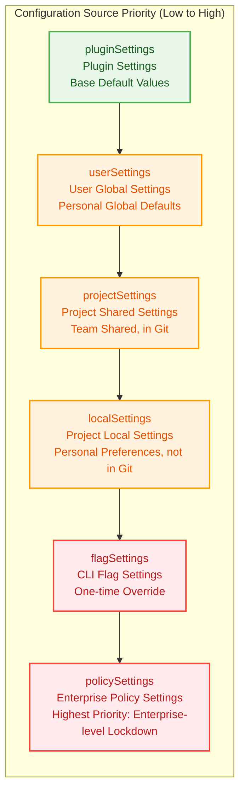
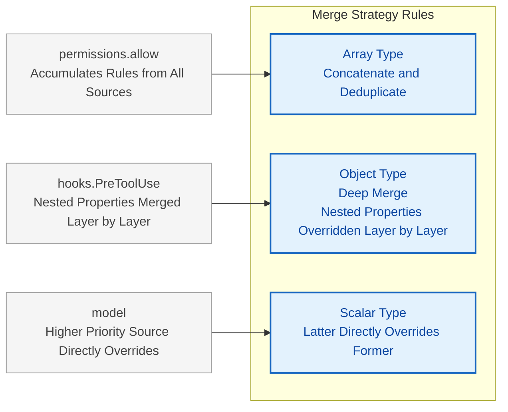
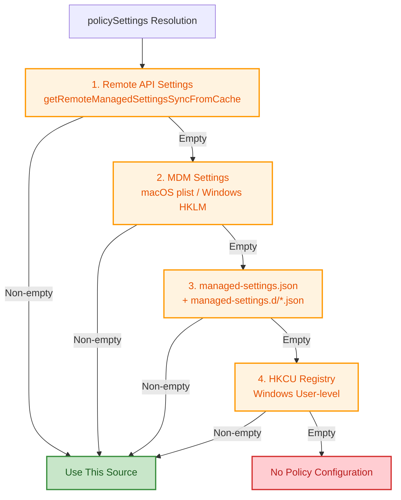
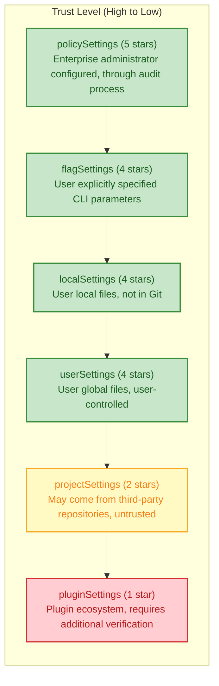
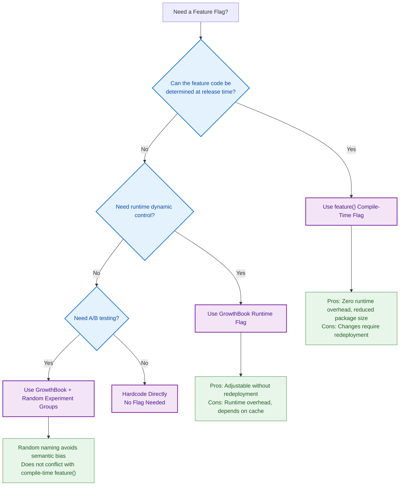
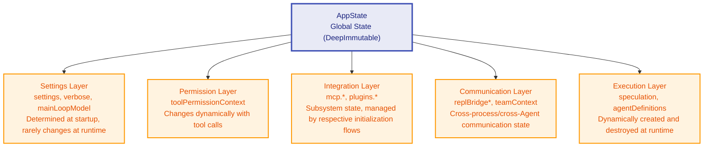

# Chapter 5: Settings and Configuration -- Agent DNA

> **In one line:** Six configuration layers settle like strata: an upper layer only masks what lies below and never deletes it -- read the order before you rewrite the Agent's DNA.

> **Learning Objectives:** The order the six configuration layers merge in and where their boundaries sit; how the feature flag system prunes branches it will never take, at compile time; why a Zustand-like immutable store suits configuration. By the end of this chapter you can set a configuration policy for a team of any size, and explain how the configuration system became the first line of defense for Agent security.

**Difficulty:** 5.1 is the starting rung -- own the priority chain. 5.2's security boundaries and 5.3's feature flags are the backbone. 5.4's state management runs at the Advanced tier: on a first pass, read the Store in 5.4.1 and leave the type-level details for a second.

---

You set the rules for your team: `.claude/settings.json` pins the model and the permission baseline, committed to Git. The next day someone clones the repo, and Claude Code ignores your file -- the model switches to a pricier one and permissions loosen. You wrote it; why didn't it take effect?

The answer lies in the layer order. Claude Code's behavior is not decided by any single file; it is the result of six configuration sources merged in sequence. Write in the wrong layer and a higher one "shadows" your settings. Read the layer order before you rewrite the Agent's DNA.

> **What you can do after this chapter:**
> - Set what each of the six layers holds for a 20-person team: which layer locks security, which holds personal preference
> - Tell whether a setting actually takes effect: which layer shadows it, which merges it, why arrays only grow
> - Recognize why `projectSettings` is the odd one out on the security boundary, and how a malicious repo gets shut out

> **Cross-reference:** How the same layer order is laid out in another harness -- see omp volume, Chapter 23, "Configuration and Profiles".

## 5.1 The Priority System of Six Configuration Sources

### 5.1.1 Configuration Source Definition and Order

The configuration constants module lists Claude Code's configuration sources as one ordered array of five origins: user global settings (userSettings), project shared settings (projectSettings), project local settings (localSettings, gitignored), CLI flag settings (flagSettings), and enterprise policy settings (policySettings).

The configuration loading function `loadSettingsFromDisk()` follows a key principle: **later-loaded sources override earlier ones**. The merge is not a wholesale replacement: it deep-merges by field and layers custom rules on top.

<!-- block: ch05.b-1f629318 -->
In practice a sixth layer hides at the bottom: **pluginSettings** (plugin settings). The loader reads plugin settings first and treats them as the merge base, then stacks every other configuration layer on top.

Therefore, the complete priority chain from low to high is:

<!-- block: ch05.b-336ab860 -->
**pluginSettings -> userSettings -> projectSettings -> localSettings -> flagSettings -> policySettings**

To better understand the relationship between these six configuration sources, we can use a "geological strata" model as an analogy:



> Each layer can override the configuration of lower layers, but will not delete them -- they are simply "shadowed." Any one layer can then be understood and maintained on its own.

### 5.1.2 Merge Rules



The merge logic comes down to one custom strategy function, `settingsMergeCustomizer`: it concatenates and dedupes arrays, and leaves every other type to the default deep merge.

The key characteristics of these rules are:

<!-- block: ch05.b-2fc6d68a -->
- **Array type**: Concatenate and deduplicate (rather than replace). For example, the `permissions.allow` field accumulates rules from all sources.
- **Object type**: Deep merge. Nested properties are overridden layer by layer.
- **Scalar type**: The latter directly overrides the former.

If `userSettings` sets `model: "claude-sonnet-4"` and `policySettings` sets `model: "claude-opus-4"`, the latter wins; if both set `permissions.allow: ["Bash(*)"]`, the result is one merged, deduplicated array.

**Why do arrays use concatenation instead of replacement?** This is a deliberate design decision. In the permission system, each rule is a "defense line" -- if a higher-priority source's array replaced a lower-priority source's array, the higher-priority source would have to completely enumerate all needed permission rules, and any omission would become a security vulnerability. The concatenation strategy allows each layer to only care about the rules it wants to "add," and the system automatically merges all layers' security policies.

> Anti-Pattern Warning: Do not use array concatenation to "revoke" rules from lower layers. For example, you cannot clear lower-layer permissions by setting an empty array in an upper layer -- after concatenation, the lower-layer rules still exist. If you need to revoke, you should use the `permissions.deny` field to explicitly deny.

The merge rules look simple, but these are the spots where configurations usually go wrong:

| Common mistake | Correct approach |
|:--------------:|-----------------|
| Write an empty array in an upper layer to "clear" lower-layer permissions | Arrays only append, never delete -- to revoke, write `permissions.deny` explicitly (5.1.2) |
| Stuff personal preference into `.claude/settings.json` and commit it to Git | Put personal preference in `~/.claude/settings.json` or `.claude/settings.local.json` (5.1.5) |
| Expect `projectSettings` to lock security items | Security-sensitive checks deliberately exclude `projectSettings`; to lock, use `policySettings` (5.2) |
| Assume `policySettings` deep-merges with other layers | It is "first non-empty source wins" -- no merging; enterprise policy ships whole (5.1.3) |

Let's demonstrate the merge process with a complete example:

```
Scenario: A Frontend Team's Project Configuration

// ~/.claude/settings.json (userSettings - Developer Xiao Zhang's personal global settings)
{
  "model": "claude-sonnet-4",
  "permissions": {
    "allow": ["Bash(npm *)", "Bash(node *)"]
  },
  "verbose": true
}

// .claude/settings.json (projectSettings - Team shared settings, committed to Git)
{
  "permissions": {
    "allow": ["Bash(npm run lint)", "Bash(npm test)", "Read(*)"]
  },
  "hooks": {
    "PreToolUse": [{ "matcher": "Bash(*)", "hooks": [{ "type": "command", "command": "audit-log.sh" }] }]
  }
}

// .claude/settings.local.json (localSettings - Xiao Zhang's local override)
{
  "model": "claude-opus-4",
  "permissions": {
    "allow": ["Bash(git *)"]
  }
}

Merge Result:
{
  "model": "claude-opus-4",          // localSettings overrides userSettings
  "verbose": true,                    // Only set by userSettings, remains unchanged
  "permissions": {
    "allow": [
      "Bash(npm *)",                  // From userSettings
      "Bash(node *)",                 // From userSettings
      "Bash(npm run lint)",           // From projectSettings
      "Bash(npm test)",              // From projectSettings
      "Read(*)",                      // From projectSettings
      "Bash(git *)"                   // From localSettings
    ]                                  // Array concatenated and deduplicated
  },
  "hooks": {
    "PreToolUse": [{ ... }]           // Only set by projectSettings
  }
}
```

### 5.1.3 Actual Paths of Configuration Files

Each configuration source corresponds to a specific file path, determined by the configuration path mapping function:

<!-- block: ch05.b-f146aab9 -->
| Configuration Source | File Path | Description | In Git? |
|---------------------|-----------|-------------|---------|
| userSettings | `~/.claude/settings.json` | Global user settings | N/A (User directory) |
| projectSettings | `<project>/.claude/settings.json` | Project shared settings (committed to Git) | Yes |
| localSettings | `<project>/.claude/settings.local.json` | Project local settings (added to .gitignore) | No |
| flagSettings | CLI `--settings` parameter specified path | One-time override | N/A |
| policySettings | Platform-specific managed-settings.json | Enterprise managed | N/A |

The resolution of `policySettings` is the most complex. It follows a **"first source wins"** (first non-empty source wins) strategy, with priority from high to low:



Note that policySettings uses "first non-empty source wins" rather than "deep merge." The difference is the point: enterprise management policies are typically a complete, audited configuration scheme, and policies from different sources should not "leak" into each other. For example, a policy delivered via remote API already contains complete security rules, and partial configurations from a local managed-settings.json file should not dilute it.

### 5.1.4 The Special Status of the Policy Layer

Unlike other configuration sources that use deep merge, `policySettings` employs a completely different resolution logic. Instead of reading from files and merging, it searches for the first non-empty source by priority (remote API settings > MDM settings > managed-settings.json file > HKCU registry).

An enterprise administrator therefore writes the policy once: the system takes the highest-priority source instead of merging them.

**Design Decision Analysis: Why is the merge logic for policySettings different from other configuration sources?**

This stems from two different trust models. The five configuration layers from userSettings to flagSettings follow an "incremental accumulation" model -- each layer adds its preferences on top of trusting the lower layers. policySettings, on the other hand, follows a "single authority" model -- a single authoritative source delivers enterprise policies in full, and merging between different sources would introduce unpredictable behavior.

Imagine if two MDM systems respectively delivered different model restrictions and permissions rules. After merging, semantic conflicts could arise: one restricts the available model list, another restricts the permission scope, but the merged result might allow users to use a restricted model to bypass permission restrictions. The "first non-empty source wins" strategy ensures the determinism and auditability of the policy source.

### 5.1.5 Real-World Project Practices for Configuration Loading

In real-world projects, the proper use of the six-layer configuration system can greatly enhance team collaboration efficiency and security. Here are several common configuration strategy patterns:

**Pattern 1: Personal-Team Separation**

This is the most common pattern. Developers place personal preferences in `userSettings` and `localSettings`, and team-shared rules in `projectSettings`:

```
~/.claude/settings.json      -> Personal model preferences, commonly used personal permission rules
.claude/settings.json         -> Team-wide lint rules, permission baselines, shared hooks
.claude/settings.local.json   -> Personal overrides (debug mode, special permissions)
```

**Pattern 2: CI/CD-Specific Configuration**

In automated pipelines, use `flagSettings` to inject one-time configuration via CLI parameters, avoiding modifications to any persistent configuration files:

```
claude --settings /path/to/ci-settings.json
```

This approach ensures that CI environment configuration is temporary and traceable, without polluting developers' local environments.

**Pattern 3: Enterprise Unified Control**

Large organizations uniformly deliver policySettings through MDM or remote APIs, locking down security-related configuration items (allowed tools, hooks whitelist, etc.) while allowing teams to customize non-security-related behaviors in projectSettings:

```
policySettings    -> Locked: model, permissions.deny, allowManagedHooksOnly
projectSettings   -> Customized: hooks (non-security), MCP server configuration
userSettings      -> Personalized: verbose, theme and other UI preferences
```

## 5.2 Security Boundary Design

<!-- block: ch05.b-99fdb01b -->
The configuration system's core security problem is this: `projectSettings` (`.claude/settings.json`) ships inside Git repositories, so anyone who clones a malicious one may load the attacker's configuration without noticing. Claude Code answers it by **leaving `projectSettings` out of every security-sensitive check**.

Think of a building's access control: a project keycard opens meeting rooms and break rooms (projectSettings), but never the server room or the vault (security-sensitive operations). Your trust level decides what you may open.

### 5.2.1 Threat Model of Supply Chain Attacks

Before understanding the security boundary design, we need to clarify the threat model. The particularity of supply chain attacks in the Agent scenario is:

**Traditional Supply Chain Attacks vs. Agent Configuration Supply Chain Attacks**

| Dimension | Traditional Software Supply Chain | Agent Configuration Supply Chain |
|-----------|----------------------------------|--------------------------------|
| Attack Vector | Malicious dependency packages, tampered build artifacts | Malicious configuration files, hooks injection |
| Victim | System running the software | Developer using the Agent |
| Attack Surface | Build pipeline, runtime environment | File system, code execution, data access |
| Stealth | Medium (requires bypassing security detection) | Very High (configuration files appear normal) |
| Impact Scope | Software users | Developer's entire work environment |

A concrete attack scenario: An attacker creates a seemingly normal open-source project with a `PreToolUse` hook configured in `.claude/settings.json` that sends the user's sensitive information (API keys, environment variables) to the attacker's server on every tool call. When a developer clones the project and starts Claude Code, the malicious hook executes without their knowledge.

**Why is projectSettings the highest-risk configuration source?**

Unlike other configuration sources, projectSettings has three unique properties that make it the primary risk point:

1. **Untrusted Source**: projectSettings comes from cloned third-party repositories, not written by the user themselves
2. **Automatic Loading**: Configuration takes effect automatically upon entering the project directory, without user confirmation
3. **Executable Code**: Hooks configuration can execute arbitrary shell commands

userSettings and localSettings lack the first property (they sit on the user's own filesystem), flagSettings requires the user to spell it out on the command line (it lacks the second property), and policySettings answers to administrators (it lacks the first property). `projectSettings` is therefore the only configuration source that carries all three high-risk properties at once.

### 5.2.2 shouldAllowManagedHooksOnly

In the hooks configuration snapshot module, the `shouldAllowManagedHooksOnly` function decides whether only managed hooks may run. It looks up `allowManagedHooksOnly` in the policy settings and returns true when the flag is on.

When this function returns `true`, hooks execution takes hooks only from `policySettings` and drops every hook from the user, project, and local sources. This is an enterprise security feature: administrators can make sure that only audited hooks run inside the organization.

**Real-World Scenario: Financial Institution Compliance Requirements**

Suppose a financial institution requires an internal audit system to log all code changes. An administrator can configure the following in managed-settings.json:

- Set `allowManagedHooksOnly: true` to block all non-managed hooks
- Configure an audit logging hook in policySettings' hooks
- This way, regardless of what hooks are in developers' local projectSettings, only the administrator's audit hook will run

This "managed-only" mode ensures that hooks execution within the organization is predictable and auditable -- developers cannot bypass auditing by modifying local configurations.

### 5.2.3 pluginOnlyPolicy

The plugin policy module implements the `strictPluginOnlyCustomization` strategy, which defines four lockable "customization surfaces": skills, agents, hooks, and mcp.

The core decision function `isRestrictedToPluginOnly` reads the policy configuration: `true` locks every surface, and an array locks only the surfaces it names.

Inside a locked surface, the runner trusts only these sources:

- **plugin** -- separately managed through `strictKnownMarketplaces`
- **policySettings** -- set by administrators, inherently trusted
- **built-in / bundled** -- shipped with the CLI, not user-written

This policy completely blocks user-level (`~/.claude/*`) and project-level (`.claude/*`) customizations.

The key here is "selective locking." Enterprise administrators don't need to bluntly prohibit all customization but can finely control which customization surfaces to lock. For example:

- Lock `mcp`: Prevent developers from connecting to unapproved MCP servers (preventing data leaks)
- Lock `hooks`: Prevent developers from executing unaudited custom scripts
- Don't lock `skills`: Allow developers to create custom skills (enhancing productivity)

### 5.2.4 Systematic Exclusion of projectSettings

Security-sensitive functions consistently exclude `projectSettings`. The following functions demonstrate the same pattern: when checking `skipDangerousModePermissionPrompt`, they only read from userSettings, localSettings, flagSettings, and policySettings, **intentionally excluding projectSettings**.

The same exclusion pattern appears in `hasAutoModeOptIn()`, `getUseAutoModeDuringPlan()`, and `getAutoModeConfig()`. The comments consistently point to the same reason: **projectSettings is intentionally excluded -- a malicious project could otherwise auto-bypass the dialog (RCE risk)**.

This defense rests on an assumption: the user's own settings (`userSettings`/`localSettings`) earn trust because they live on the user's filesystem and only the user edits them, whereas `projectSettings` can arrive from a cloned third-party repository, which is a supply chain attack risk.

**Design Principle Summary: Decreasing Trust Radius**

Claude Code's security boundaries follow a clear "decreasing trust radius" principle:



> In security-sensitive checks, the system only reads from configuration sources with a trust level of 4+ stars. This principle runs throughout the security design of the entire configuration system.

> Cross-Reference: The `projectSettings` exclusion mechanism discussed in this chapter is closely related to the security model in Chapter 8 (Hooks System). The loading of hooks similarly follows this trust model -- when `allowManagedHooksOnly` is on, the system completely blocks hooks from projectSettings.

```ill
ch05-trust-ladder
```

## 5.3 Feature Flag System

Claude Code splits its feature flag system into two layers: the **compile-time** `feature()` function and the **runtime** GrowthBook experimentation framework. This dual-layer design reflects a classic tradeoff in software release engineering: compile-time flags control features at no runtime cost, while runtime flags let you iterate quickly without redeploying.

### 5.3.1 Compile-Time Dead Code Elimination

The bundler injects the `feature()` function. When `feature('FEATURE_NAME')` returns `false`, the bundler drops that code branch outright -- a form of compile-time dead code elimination.

The pattern recurs throughout the codebase: feature flags decide whether a piece of functionality gets compiled at all, so a flag you leave off keeps its code out of the build artifacts entirely.

**Why choose compile-time elimination over runtime conditional checks?**

Consider two approaches:

```
Approach A (Runtime Check):
if (featureFlags.isEnabled('KAIROS')) { ... }

Approach B (Compile-Time Elimination):
if (feature('KAIROS')) { ... }  // Bundler completely removes this branch when false
```

The problems with Approach A are: (1) unenabled feature code still occupies package size, affecting load times; (2) conditional branches produce minor performance overhead on hot paths; (3) code for unenabled features may contain uncovered bugs or security vulnerabilities. Approach B solves all three problems through compile-time elimination -- unenabled features simply do not exist in the build artifacts.

The main feature flags include:

| Feature Flag | Scope | Description | Architectural Significance |
|-------------|-------|-------------|--------------------------|
| `KAIROS` | Core Architecture | Assistant mode (persistent sessions) | Core interaction mode switching |
| `EXTRACT_MEMORIES` | Memory System | Background memory extraction | Directly related to Chapter 6 Memory System |
| `TRANSCRIPT_CLASSIFIER` | Permission System | Automatic mode classifier | Foundation for automated permission decisions |
| `TEAMMEM` | Collaboration System | Team memory | Key capability for multi-person collaboration scenarios |
| `CHICAGO_MCP` | Tool System | Computer Use MCP | Interface for extending the tool ecosystem |
| `TEMPLATES` | Task System | Templates and workflows | Infrastructure for reusable workflows |
| `BUDDY` | UI System | Companion sprite | Enhancement of user interaction experience |
| `DAEMON` | Architecture | Background daemon | Capability for persistent background operation |
| `BRIDGE_MODE` | Architecture | Bridge mode | Bridge for cross-process communication |

From these feature flags, we can discern the evolutionary direction of Claude Code's architecture: KAIROS (persistent sessions) and DAEMON (background daemon) point to the evolution path from "on-demand invocation" to "continuous operation"; TEAMMEM (team memory) and TEMPLATES (template workflows) point to the evolution path from "personal tool" to "team infrastructure."

### 5.3.2 GrowthBook Experimentation Framework

For features that need dynamic control at runtime, Claude Code uses the GrowthBook A/B testing framework. The main entry function `getFeatureValue_CACHED_MAY_BE_STALE` accepts a feature name and default value, and synchronously reads the experiment configuration from cache.

The "CACHED_MAY_BE_STALE" in the function name plainly states its semantics: the value comes from cache and may be stale in cross-process scenarios. This is to avoid asynchronous waiting on the startup critical path -- synchronously reading from cache is preferable to blocking while waiting for remote configuration.

**This naming convention is worth stealing.** In API design, encoding non-obvious behavioral constraints directly into function names "reminds" callers of this constraint every time they use it. In contrast, a function named `getFeatureValue` would give the false expectation of "returning the latest value."

In the memory system, we can see the usage of GrowthBook feature flags -- checking randomly named feature flags to determine whether to enable certain memory features.

These feature flags named with random animal names (e.g., `tengu_passport_quail`, `tengu_coral_fern`, `tengu_moth_copse`) are standard practice for GrowthBook experiments -- random names avoid semantic bias and do not conflict with the compile-time `feature()` function.

**Decision Tree for Compile-Time vs. Runtime Flags:**



> Cross-Reference: The compile-time feature flag `EXTRACT_MEMORIES` directly controls whether the build compiles the background memory extraction feature from Chapter 6 (Memory System) into the final artifact. This is a classic case of the configuration system influencing core functionality.

## 5.4 State Management System

State management is the "nervous system" of an Agent system -- configuration is the DNA that determines the Agent's potential; state is the nervous system that transmits and coordinates the Agent's runtime behavior in real time. Claude Code's state management is minimal, and its design philosophy deserves a closer look.

### 5.4.1 Store: A Minimalist Immutable State Container

<!-- block: ch05.b-765d1606 -->
The heart of the state management module is a generic Store in just 34 lines, inspired by Zustand. The Store provides three core methods: `getState` retrieves the current state, `setState` updates state through an updater function, and `subscribe` subscribes to state changes.

Three key design decisions:

1. **Immutable Updates**: `setState` accepts an updater function `(prev: T) => T`, requiring callers to return an entirely new state object. It compares old and new references using `Object.is` -- only when the reference changes are listeners notified.
2. **Generic `onChange` Callback**: Passed in at Store creation, every state change calls it with both the old and new states. `AppStateProvider` uses it to respond to external setting changes.
3. **Set-based Listener Management**: Uses `Set` instead of arrays for automatic deduplication; `subscribe` returns an unsubscribe function, following React's cleanup pattern.

**Why Only 34 Lines? -- The "Less Is More" Philosophy of State Management**

Redux, MobX, Recoil, Jotai, Valtio... frontend state management libraries keep coming, each solving a different problem. Claude Code's Store takes a minimalist path -- not laziness, but a precise reading of its requirements.

The state management needs of an Agent CLI tool are fundamentally different from those of a complex Web application:

| Dimension | Web Application | Agent CLI |
|-----------|----------------|-----------|
| State Change Frequency | Very High (millisecond-level UI interactions) | Medium (second-level tool calls) |
| Concurrent Updates | Common (multiple users operating simultaneously) | Rare (single user, single session) |
| Time-Travel Debugging | Valuable (tracing complex interactions) | Unnecessary |
| Middleware Needs | High (async operations, side effects) | Low (primarily synchronous) |
| Learning Curve Tolerance | Low (team collaboration) | Low (but for a different reason: keeping code concise) |

A 34-line Store means: no reducer boilerplate, no action type definitions, no middleware configuration, no DevTools integration -- only the core get/set/subscribe. Every removed feature is a deliberate "no."

**The Deeper Implications of Immutable Updates**

The `Object.is` reference comparison has subtle semantics. It means:

```javascript
// Will NOT trigger notification -- returns the same reference
setState(prev => prev)

// Will trigger notification -- returns a new reference
setState(prev => ({ ...prev, count: prev.count + 1 }))

// Will NOT trigger notification -- same value, but this is correct behavior
setState(prev => ({ ...prev, count: prev.count }))
// Note: In this case, a new object is created but nothing actually changed
// Production code should check whether the value truly changed before creating a new object
```

This design delegates the judgment of "whether a change occurred" to the caller -- the caller expresses the semantics of "whether the state changed" through whether they return a new reference. This is a "convention over configuration" design style: the convention is "return new reference = state changed," rather than providing an explicit `hasChanged` callback.

### 5.4.2 AppState: Global State Type Definition

The global state type `AppState` carries a DeepImmutable marker, with more than 50 state fields covering:

- **Settings Layer**: `settings` (merged SettingsJson), `verbose`, `mainLoopModel`
- **UI Layer**: `expandedView`, `footerSelection`, `statusLineText`
- **Tool Permission Layer**: `toolPermissionContext` (current permission mode, allowed tools list, etc.)
- **MCP Layer**: `mcp.clients`, `mcp.tools`, `mcp.commands`
- **Plugin Layer**: `plugins.enabled`, `plugins.disabled`, `plugins.errors`
- **Bridge Layer**: `replBridgeEnabled`, `replBridgeConnected`, and ten other bridge-related states
- **Agent Layer**: `agentDefinitions`, `agentNameRegistry`, `teamContext`
- **Speculative Execution Layer**: `speculation` (idle/active state machine)

`getDefaultAppState()` builds the default state: it loads the merged settings at startup and brings every subsystem up at a safe default value.

**DeepImmutable's Type-Level Guarantee**

`AppState` uses the `DeepImmutable<T>` type marker, which means the TypeScript compiler rejects any attempt to write a state field directly at compile time. Here the type system itself enforces the "make the right thing easy and the wrong thing impossible" design philosophy.

The categorization of state fields maps to the architectural layers of the Agent system:



> This layered structure implies a core architectural principle of the Agent system: state ownership. Each layer's state changes are driven by the corresponding layer's logic, while other layers only read.

### 5.4.3 AppStateProvider: React Context Wrapper

`AppStateProvider` wraps the Store as a React Context. `useState` lazy initialization creates the Store once, and state changes never re-render the Provider itself. Consumers reach state through two hooks:

- **`useAppState(selector)`**: Uses `useSyncExternalStore` to subscribe to a state slice. It only triggers a re-render when the selector's return value changes by `Object.is`. This is a fine-grained subscription mechanism that avoids the problem of "subscribing to the entire state tree causing the entire component tree to re-render."
- **`useSetAppState()`**: Only retrieves the `setState` function without subscribing to any state. The returned reference never changes, so components using this hook do not re-render due to state changes.

There is also a safe variant `useAppStateMaybeOutsideOfProvider` for components that may render outside of `AppStateProvider` -- it returns `undefined` instead of throwing an exception when there is no Provider.

**The Significance of Choosing `useSyncExternalStore`**

Claude Code chose React 18's `useSyncExternalStore` over a custom subscription implementation (like useEffect + useState). This choice is worth analyzing. `useSyncExternalStore` is React's official hook designed for "external state sources," providing three key guarantees:

1. **Consistency**: In concurrent mode, the state snapshot during rendering is consistent (no torn reads)
2. **Batched Updates**: Multiple `setState` calls trigger only one re-render
3. **Server Compatibility**: Supports SSR snapshot mode

An Agent system can turn a state change into side effects such as tool calls and file operations, so consistency guarantees matter more here than in most systems. Picture a permission state that flips halfway through a render: one component reads it as granted while another reads it as denied, and the two then behave in contradiction.

**Performance Optimization Pattern Comparison**

```
Pattern A: Subscribe to Entire State (Anti-Pattern)
const state = useAppState(s => s);
// Any field change triggers re-render

Pattern B: Precisely Subscribe to Individual Fields (Recommended)
const model = useAppState(s => s.mainLoopModel);
const verbose = useAppState(s => s.verbose);
// Only triggers re-render when corresponding fields change

Pattern C: Write-Only, No Read (Recommended)
const setState = useSetAppState();
// Never re-renders due to state changes
// Suitable for components that only need to modify state but don't need to read it
```

> Best Practice:
>
> 1. Follow the "principle of minimum subscription" -- components should only subscribe to the portion of state they actually use
> 2. Use `useSetAppState()` instead of `useAppState(s => s.setState)` -- the former does not subscribe to any state
> 3. Avoid creating new objects in selectors -- `useAppState(s => ({ a: s.a, b: s.b }))` returns a new reference on every call, causing infinite re-renders. Instead, subscribe separately or use shallow comparison

> Cross-Reference: The `mcp.*` fields in AppState are directly related to Chapter 9 (MCP Tool System); `toolPermissionContext` is related to the permission system; `speculation` state machine is related to the speculative execution architecture. Understanding AppState's structure is key to understanding how subsystems collaborate.

---

## Practical Exercises

### Exercise 1: Configuration Merge Prediction

Assume the following configurations exist:

- `~/.claude/settings.json`: `{ "permissions": { "allow": ["Bash(ls)"] }, "model": "sonnet" }`
- `.claude/settings.json`: `{ "permissions": { "allow": ["Read(*)"] }, "hooks": { "Stop": [...] } }`
- `.claude/settings.local.json`: `{ "permissions": { "allow": ["Bash(git *)"] } }`

Predict the merged `permissions.allow` and `model` values.

**Reference Answer**: `permissions.allow` is `["Bash(ls)", "Read(*)", "Bash(git *)"]` (array concatenation with deduplication), `model` is `"sonnet"` (no higher-priority override).

**Extended Thinking**: If you now pass `{ "model": "opus" }` via CLI parameter `--settings`, what would the `model` value become? If the enterprise policy sets `"model": "haiku"`, what would the final value be?

### Exercise 2: Security Boundary Analysis

If you are an enterprise administrator and want to ensure: (1) All users can only use administrator-approved hooks; (2) Users cannot self-install MCP servers. Which fields should you set in `managed-settings.json`?

**Reference Answer**: Set `allowManagedHooksOnly: true` and `strictPluginOnlyCustomization: ["mcp"]`.

**Extended Thinking**: If, in addition to the above requirements, you also want to ensure team members cannot override the model setting, how should you configure it? Hint: Consider whether policySettings can directly lock the `model` field.

### Exercise 3: State Subscription Optimization

A component needs to display the current model name and the verbose flag. Which of the following two approaches is better?

- **Approach A**: Subscribe to the entire state object via `useAppState`
- **Approach B**: Precisely subscribe to `mainLoopModel` and `verbose` fields separately via `useAppState`

**Reference Answer**: Approach B is better. Approach A subscribes to the entire state tree, and any state change will trigger a re-render. Approach B precisely subscribes to two fields, only triggering re-render when those two fields change.

**Extended Thinking**: If a component needs to display the boolean value "whether the current model is Opus," which of the following approaches is better?

- Approach C: `useAppState(s => s.mainLoopModel)` and then determine in the component
- Approach D: `useAppState(s => s.mainLoopModel?.includes('opus'))`

### Exercise 4: Configuration Strategy Design

Design a configuration strategy for a 20-person development team with the following requirements:

- The team uniformly uses a specified model and permission baseline
- Each developer can customize UI preferences and local permission extensions
- The CI/CD environment follows the principle of least privilege

Say what content belongs in each configuration source, and explain why.

**Minimal runnable case:** Replay the merge order of user and project settings (Python 3.12 standard library, no third-party dependencies; this is a teaching model, not Claude Code source). Save the code as `case.py` and run `python case.py`.

**Version lock:** Python 3.12 standard library, no third-party dependencies.
**Expected result:** `{"model": "sonnet", "permissions": {"allow": ["Read", "Bash(ls)"]}}`
**Prerequisite:** Chapter 4's permission rules; **Backlink:** Chapter 4's source of permission rules

```python
# exercise: ch05
# expected: {"model": "sonnet", "permissions": {"allow": ["Read", "Bash(ls)"]}}
import json
user = {"model": "opus", "permissions": {"allow": ["Read"]}}
project = {"model": "sonnet", "permissions": {"allow": ["Bash(ls)"]}}
merged = {"model": project["model"],
          "permissions": {"allow": user["permissions"]["allow"] + project["permissions"]["allow"]}}
print(json.dumps(merged, sort_keys=True))
```

---

## Key Takeaways

1. **Six-Layer Priority Chain**: pluginSettings -> userSettings -> projectSettings -> localSettings -> flagSettings -> policySettings, where the latter overrides the former. Understanding the role of each layer is the foundation for designing sound configuration strategies.
2. **Merge Strategy**: Arrays merge by concatenation and deduplication, objects merge deeply, and scalars override directly. The array concatenation design ensures permission rules only ever increase; merging never accidentally removes them.
3. **Security Boundaries**: All security-sensitive checks exclude `projectSettings` to prevent supply chain attacks from malicious repositories. This is a direct manifestation of the "decreasing trust radius" principle.
4. **Special Merge for the Policy Layer**: policySettings uses "first non-empty source wins" instead of deep merge, ensuring the determinism and auditability of enterprise policies.
5. **Dual Feature Flags**: `feature()` provides compile-time dead code elimination (zero runtime overhead), while GrowthBook provides runtime experiment control (flexible but cache-dependent). The choice between the two depends on whether the feature needs dynamic adjustment after release.
6. **Immutable State**: The Store uses `Object.is` reference comparison to enforce immutable update patterns, combined with React's `useSyncExternalStore` for fine-grained subscription rendering. 34 lines of code cover everything state management needs.
7. **DeepImmutable Types**: Makes the type system refuse direct state modification, keeping the right thing easy and the wrong thing impossible.

> **Three sentences to keep:** ①The six layers never delete one another; they merge by type -- arrays only grow, scalars let the later writer win. ②Because the merge rules stay predictable, the security checks can shut projectSettings out wholesale and block repository-level supply-chain attacks. ③When you set policy for a team, hold one line: each layer carries only what belongs to it; change one configuration entry, and the whole station changes its ways.
