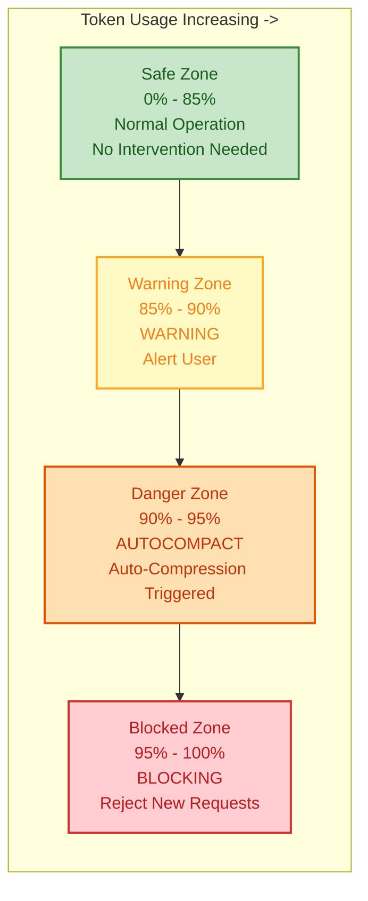
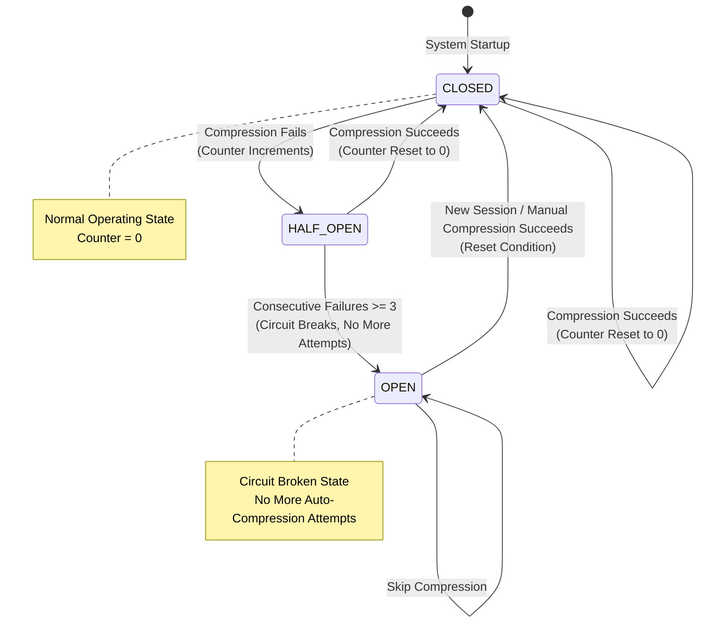
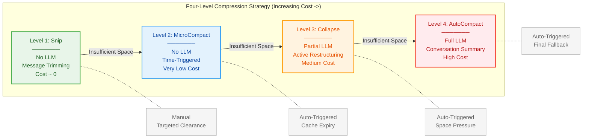
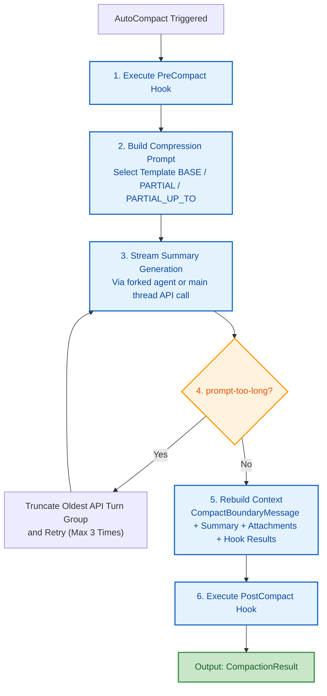
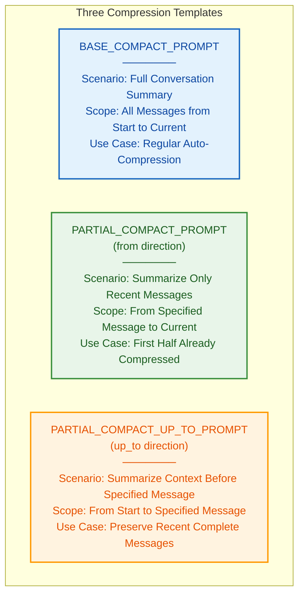
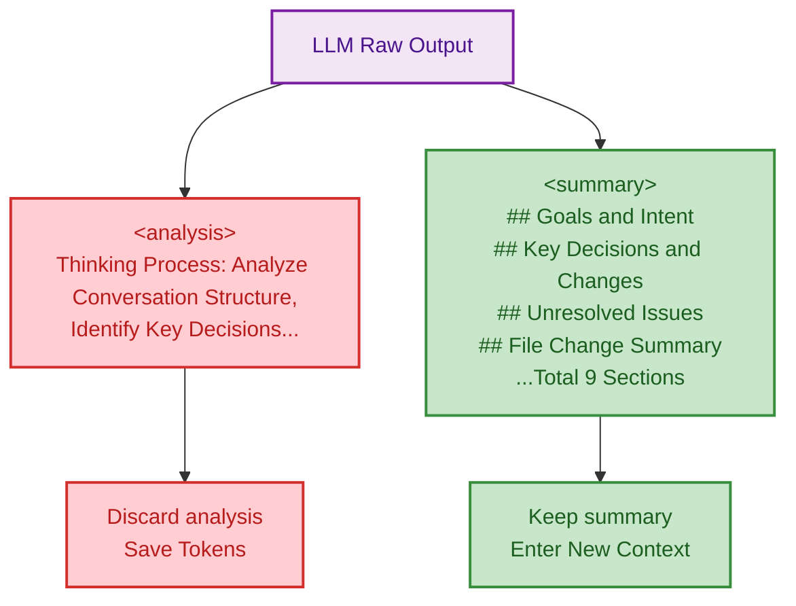
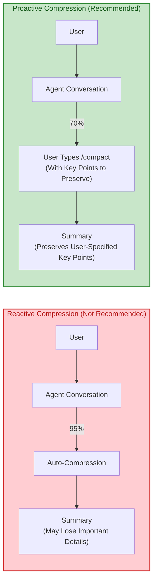

# Chapter 7: Context Management -- The Agent's Working Memory

> **In one line:** The context window has a ceiling: when history swells, compression escalates through four levels, and after three straight failures the circuit breaker pulls the plug.

<!-- block: ch07.b-7b06443a -->
> **Learning Objectives:**
> 1. Work out the hard ceiling on the context window and the space you can still write in
> 2. Put the four compression levels (Snip -> MicroCompact -> Collapse -> AutoCompact) in order and say when each one fires
> 3. Explain how the circuit breaker pulls the plug when compression failures cascade
> 4. Take the compression prompt two-phase output apart
> 5. Pick a compression strategy that fits how you actually use the Agent

**Difficulty:** 7.1's window constraints are the starting rung; 7.2's four compression levels and 7.3's prompt engineering are the backbone; 7.5's strategies close the backbone and pay off fastest. 7.4's token-budget tracking sits at the Advanced tier -- skip it on a first pass and return when you need exact numbers.

---

## 7.1 Context Window Constraints

<!-- block: ch07.b-25a30e96 -->
You have been talking to the Agent for two hours -- dozens of files read, a pile of code changed. Right at the critical point, it suddenly "forgets" the interface contract you settled half an hour ago and starts writing to its own understanding. You scroll back and find that stretch of conversation already compressed into a summary, the details gone. This is not a bug; it is the context window hitting its ceiling: system prompts, conversation history, and tool results only grow, and when the model can no longer hold them, the window drops old content. What to erase, what to keep, and how to erase -- that is the four-level compression this chapter takes apart.

> **What you can do after this chapter:**
> - Work out how much of your effective context window you have left, and at what token percentage to run `/compact` manually
> - Put the four compression levels (Snip -> MicroCompact -> Collapse -> AutoCompact) in order and say when each fires and what it costs
> - After three straight failures, tell whether the circuit breaker has tripped -- and what to do once it has

> **Cross-reference:** How the same compression strategy is laid out in another harness -- see omp volume, Chapter 15, "Compaction and Long Tasks".

<!-- block: ch07.b-b643df6f -->
You can think of the context window as a **whiteboard of limited size**. All of the Agent's working memory -- conversation history, tool results, intermediate reasoning -- goes on this whiteboard. When the whiteboard runs out of space, you must erase old content before writing new content. The key question is: **what to erase, what to keep, and how to erase it**?

This is not Claude Code's problem alone; every long-conversation Agent system has to solve it. Many Agent frameworks solve this problem with "brute-force truncation" -- simply discarding the oldest messages. Claude Code's approach is far more refined.

### The Effective Window Formula

Claude Code uses a precise formula to characterize the space truly available for conversation:

```
Effective Window = Model Window - Reserved Output Tokens
```

<!-- block: ch07.b-5e71da7b -->
In the auto-compaction module, the `getEffectiveContextWindowSize` function works out the effective window size: it reserves the lesser of the model's maximum output tokens and 20,000 tokens as reserved space for the compression summary. The remainder is the effective carrying capacity of the context.

<!-- block: ch07.b-0f31563d -->
> **Why reserve 20,000 tokens?** Because AutoCompact (Level 4 compression) needs to call the LLM to generate a summary, and the summary itself consumes output tokens. If you reserve no space, the compression operation itself may fail due to insufficient output space -- a classic "compression paradox."

Let's use concrete numbers: suppose the model context window is 200,000 tokens and the maximum output tokens are 16,384:
- Reserved space = min(16,384, 20,000) = 16,384 tokens
- Effective window = 200,000 - 16,384 = **183,616 tokens**

These 183,616 tokens are the space truly available for carrying conversation history.

### Buffers and Thresholds

Based on the effective window, Claude Code defines multiple key threshold constants, forming a **progressively tightening safety net**:



| Constant | Value | Meaning | Design Intent |
|----------|-------|---------|---------------|
| `AUTOCOMPACT_BUFFER_TOKENS` | 13,000 | Auto-compression trigger buffer | Reserves a safety margin before space is exhausted, avoiding "edge cases" |
| `WARNING_THRESHOLD_BUFFER_TOKENS` | 20,000 | Warning threshold buffer | Early warning that leaves time to react |
| `ERROR_THRESHOLD_BUFFER_TOKENS` | 20,000 | Error threshold buffer | Marks the danger zone, triggering more aggressive compression strategies |
| `MANUAL_COMPACT_BUFFER_TOKENS` | 3,000 | Manual compression buffer | Minimum safety margin when users manually trigger compression |

> **Best Practice:** When you see token usage exceed 80%, you should consider manually triggering compression (by typing `/compact`) rather than waiting for auto-compression to trigger. Proactive compression typically preserves more valuable content because you can provide advance guidance on which information is most important.

### Circuit Breaker Design

Auto-compression does not always succeed. Network fluctuations, API errors, or structural issues in the context itself can all cause compression to fail. If the system retries blindly, it will make doomed API calls on every turn, wasting significant resources.

<!-- block: ch07.b-78eb0f40 -->
Claude Code introduces a Circuit Breaker mechanism: when the number of consecutive failures reaches 3 (`MAX_CONSECUTIVE_AUTOCOMPACT_FAILURES`), the system directly skips subsequent compression attempts.



<!-- block: ch07.b-54f765a2 -->
On success, the failure counter resets to zero; on failure, the counter increments and propagates to the upper-level caller. This is a classic circuit breaker pattern -- once consecutive failures reach the threshold, the circuit breaks, preventing avalanche effects.

<!-- block: ch07.b-55ef5c51 -->
**Real-world data from the circuit breaker:** According to engineering analysis, before the circuit breaker came in, 1,279 sessions showed over 50 consecutive compression failures (up to 3,272), wasting approximately 250K API calls per day. After its introduction, such cascading failures disappeared completely.

> **Anti-Pattern Warning:** If you are building your own Agent system, do not ignore circuit breakers. A system without circuit breakers will fall into a "compression failure -> retry -> fail again" death spiral when the API is unstable, wasting resources and potentially further degrading the user experience due to increased latency.

> **Cross-Reference:** The circuit breaker pattern is also discussed as a key design pattern in Chapter 15 on building your own Agent Harness. Similar state protection mechanisms also appear in the conversation loop in Chapter 2 (the `max_output_tokens_recovery` path).

---

## 7.2 The Four-Level Compression Strategy

Claude Code's context management employs a four-level progressive compression strategy, escalating from low cost to high cost. Each level activates only when the previous level fails to free up enough space.

<!-- block: ch07.b-7fa64c7d -->
This design philosophy can be understood through an analogy: **compression strategies are like organizing clothing storage**. You don't start by throwing away all your clothes (brute-force truncation); instead, you first put away clothes you no longer wear (Snip), then compress seasonal clothing (MicroCompact), then vacuum-seal bulky items (Collapse), and only finally do a comprehensive sort-and-discard (AutoCompact).



The four levels run from light to heavy; used in the wrong place they still go wrong:

| Common mistake | Correct approach |
|:--------------:|-----------------|
| Wait until tokens hit 95% and take the passive hit; the summary loses key detail | Run `/compact` manually at 80%, with the highlights you want kept (7.5) |
| Treat Snip and MicroCompact as the same thing and mix them up | Snip trims whole message sequences; MicroCompact clears old tool-result bodies -- two different things (7.2) |
| After compressing, immediately reload every file you read before | Reload only what the current task needs, or the compression was wasted (7.4) |
| After three straight failures the breaker trips and you keep waiting for it to recover | Only a new session or a successful manual compact resets it; stop hammering while it is open (7.1) |

### Level 1: Snip

Snip cuts history out of the **whole message sequence**, rather than merely clearing text inside old tool results. When `HISTORY_SNIP` is on, the query loop calls `snipCompactIfNeeded(messagesForQuery)` and uses its returned message sequence for the next request. The result also reports freed tokens and may include a boundary message.

This differs from MicroCompact: the marker `[Old tool result content cleared]` belongs to the time-based MicroCompact path, which replaces eligible tool-result bodies while retaining their message structure. It is not the definition of Snip.

**The design trade-off:** Removing old messages can reclaim more than tool-output tokens, but requires careful handling of retained context and tool-call/result relationships. A shorter model-facing history also need not mean the UI has discarded its scrollback. Message trimming and tool-result replacement solve related problems at different levels.

Snip's freed-token count feeds into the auto-compaction decision so that it can account for the reduced history. Snip and MicroCompact may both run in the same preprocessing pass; they are not mutually exclusive.

**Typical usage scenario:** An earlier investigation produced many messages and tool calls, and the current task has moved beyond that phase. History trimming reduces the old message sequence; clearing the contents of individual file-read results is instead a MicroCompact example. This mechanism does not imply that every installation exposes a user-callable Snip tool.

### Level 2: MicroCompact

MicroCompact is a time-triggered, large-scale tool result cleanup. When the system detects that the time interval since the last assistant message exceeds a configured threshold, it means the server-side cache has expired. At that point, regardless of how important the content is, a full rewrite is unavoidable -- so it is better to proactively clear old tool results before the request, reducing the rewrite payload.

> **Why is this related to cache expiry?** Claude's API supports Prompt Caching -- if consecutive requests share the same prefix, cached portions can significantly reduce cost and latency. However, over time, caches expire. When a cache expires, the full content must be resent regardless. At that point, keeping old tool results only adds unnecessary payload.

The core logic for time-based triggering resides in the time evaluation function: it checks whether the feature flag is on, whether the message source is the main thread, and then calculates the time interval since the last assistant message. If the interval exceeds the configured threshold, it triggers micro-compaction.

Once triggered, the system retains the most recent N compressible tool results (`config.keepRecent`, minimum value of 1) and replaces all other tool result content with the clearance marker text. Compressible tool types include Read, Bash, Grep, Glob, WebSearch, WebFetch, Edit, and Write.

Additionally, MicroCompact has a cache editing-based path that uses the `cache_edits` mechanism at the API layer to delete tool results without breaking the cache prefix -- a more advanced lossless optimization.

**Core trade-offs of MicroCompact:**

| Dimension | Description |
|-----------|-------------|
| **Trigger Condition** | Time since last assistant message exceeds threshold |
| **Retention Policy** | Keep the most recent N tool results, clear the rest |
| **Cost** | Zero LLM calls, string replacement only |
| **Information Loss** | Old tool result content is lost, but message structure is preserved |
| **Applicable Scenario** | "Natural breakpoints" in long conversations (user returns after a pause) |

### Level 3: Collapse

Collapse is context restructuring-level compression. When the Context Collapse feature is on, the system begins committing (commit) compression operations at 90% context utilization and blocks new spawns at 95%. The design philosophy of this level is to shift context management from "reactive compression" to "proactive restructuring."

Collapse mode suppresses the triggering of auto-compression because the two would compete at the 93% critical point. Collapse, as a more refined context management system, has higher priority.

> **Design Philosophy:** Collapse represents a different mindset -- not "compress when space runs out," but "proactively restructure before space pressure appears." This is similar to an operating system's memory prefetching strategy, which starts defragmenting before memory runs out.

**Key differences between Collapse and AutoCompact:**

| Feature | Collapse | AutoCompact |
|---------|----------|-------------|
| Trigger Timing | 90% utilization (proactive) | Exceeds threshold (reactive) |
| Compression Granularity | Selectively restructures message groups | Full conversation summary |
| Information Retention | More original details preserved | Only summary retained |
| Relationship with Fork | Blocks new spawns (95%) | Does not affect spawns |

### Level 4: AutoCompact

<!-- block: ch07.b-7695033d -->
AutoCompact is the most thorough compression level -- it invokes the LLM to compress the whole conversation into a summary. When the above three levels cannot effectively free space and token usage exceeds the auto-compression threshold, the system initiates AutoCompact.

This is the final fallback and also the most "expensive" -- it requires an additional API call to generate the summary.

The compression process is driven by the `compactConversation` function, whose core steps are:



The `CompactionResult` interface describes the complete structure of the compression output, including: boundary marker (boundaryMarker), summary messages (summaryMessages), re-injected attachments (attachments), hook results (hookResults), messages retained during partial compression (messagesToKeep), and token counts before and after compression.

The `buildPostCompactMessages` function ensures consistent output message ordering across all compression paths: boundary marker, summary messages, retained messages, attachments, hook results.

> **Cross-Reference:** AutoCompact's forked agent execution method is closely related to the Fork pattern discussed in Chapter 9. The compression operation executes in a restricted sub-Agent that runs for at most 1 turn (generating only a summary, no tool calls), ensuring compression does not produce side effects.

> **Cross-Reference:** PreCompact and PostCompact hooks are important application scenarios of the hook system covered in Chapter 8. Users can inject custom compression instructions through PreCompact hooks (e.g., "specifically preserve all discussions related to the database").

The four levels run light to heavy: snip, squeeze, fold, then rewrite the whole span.

```ill
ch07-four-levels
```

---

## 7.3 Compression Prompt Engineering

The quality of compression directly depends on prompt design. Claude Code's compression prompt engineering is a carefully designed system with multiple variants and strict output format constraints.

You can think of compression prompts as instructions to a stenographer: you need to clearly tell them "what to record, what not to record, and what format to use." If the instructions are not precise enough, the summary will either lose critical information or stuff itself with unnecessary details.

### Compression-Specific Prompt Templates

The compression prompt module defines three compression prompt templates, corresponding to three different compression scenarios:



Each prompt includes a critical anti-tool-call preamble: it instructs the model to respond only in text form and not to invoke any tools (including Read, Bash, Grep, etc.). This directive ensures the summary generation process does not trigger tool calls, because compression runs in a restricted forked agent environment (maximum 1 turn), and a rejected tool call would directly result in empty output.

> **Design Philosophy:** Why must compression execute in a restricted environment? Because compression is a "rewriting" operation on conversation history -- if the rewrite itself produces new conversation history, it recurses. Restricting it to a single turn with no tool calls ensures compression is a pure "read-summarize-output" process.

### Dual-Phase Output Structure

The compression prompt requires the model to output two XML blocks:

- `<analysis>` block: A thinking scratchpad used to organize thoughts and ensure comprehensive coverage. The final result discards this block.
- `<summary>` block: The formal summary content, containing a structured set of 9 sections.

<!-- block: ch07.b-2d35fafb -->
The `formatCompactSummary` function handles post-processing: it first discards the `<analysis>` block (thinking scratchpad), then extracts the content of the `<summary>` block as the formal summary.

This design pattern is noteworthy: the `<analysis>` block serves as a Chain-of-Thought carrier that improves summary quality, but it does not enter the final context window, avoiding token waste.



**Why is the dual-phase design so important?** If you directly ask the model to output a summary (without an analysis phase), the model will often miss important information -- because it lacks "thinking" space. But if you keep the analysis in the context, you waste valuable tokens. The dual-phase design splits the contradiction in two: **thinking is the process, the summary is the result**. The process is not counted; only the result enters the context.

> **Best Practice:** If you need to customize compression behavior in a PreCompact hook, you can adjust the priority of the 9 sections within `<summary>`. For example, if your work focuses on API design, you can inject an instruction in the hook: "In the summary, specifically preserve all API endpoint definitions and their rationale for changes."

### CompactBoundaryMessage

After each compression completes, the system inserts a `CompactBoundaryMessage` into the message stream as a dividing line between pre-compression and post-compression. This marker carries compression metadata: trigger type (manual/automatic), pre-compression token count, and number of messages involved in the compression. The `logicalParentUuid` field associates the boundary marker with the last message before compression, constructing logical continuity of the message chain.

The boundary marker tells later compression runs "which messages already went through compression," so they do not get compressed twice.

> **Cross-Reference:** `CompactBoundaryMessage` is directly related to the message chain mechanism in the conversation loop from Chapter 2. When building API requests, the conversation loop needs to correctly handle boundary markers -- summaries have replaced the messages before the boundary marker, and the loop should not send them again.

---

## 7.4 Token Budget Tracking

Token management runs on two tracks: reactive compression triggering, and proactive budget planning with early warning.

### Multi-Level Warning States

The `calculateTokenWarningState` function calculates the current token usage state and returns multiple boolean flags:

| Flag | Trigger Condition | UI Behavior |
|------|-------------------|-------------|
| `isAboveWarningThreshold` | Token usage >= threshold - 20,000 | Display yellow warning |
| `isAboveErrorThreshold` | Token usage >= threshold - 20,000 | Display red warning |
| `isAboveAutoCompactThreshold` | Token usage >= auto-compression threshold | Trigger auto-compression |
| `isAtBlockingLimit` | Token usage >= effective window - 3,000 | Block new requests |

Once these flags flip, the UI shows warnings and compression starts firing. The `percentLeft` field shows the user the percentage of remaining space.

### Post-Compression Token Budget

After compression is complete, the system does not simply release all space. The compression module defines strict token budget constants:

| Constant | Value | Purpose |
|----------|-------|---------|
| `POST_COMPACT_MAX_FILES_TO_RESTORE` | 5 | Maximum number of files to restore |
| `POST_COMPACT_TOKEN_BUDGET` | 50,000 | Total token budget cap |
| `POST_COMPACT_MAX_TOKENS_PER_FILE` | 5,000 | Token cap per file |
| `POST_COMPACT_MAX_TOKENS_PER_SKILL` | 5,000 | Token cap per skill |
| `POST_COMPACT_SKILLS_TOKEN_BUDGET` | 25,000 | Independent skill budget |

These budgets limit the amount of content re-injected into the context after compression, ensuring that compression does not immediately trigger another compression due to excessive attachment injection.

> **Anti-Pattern Warning:** A common mistake is to immediately reload all previously read files after compression. Doing so rapidly depletes the token budget, causing compression to trigger again after just a few conversation turns, creating a vicious "compress-expand-recompress" cycle. The correct approach is to only reload files needed for the current task.

### True Token Estimation

<!-- block: ch07.b-730d6c00 -->
`truePostCompactTokenCount` is an estimate of the actual post-compression context size, including the sum of tokens for the boundary marker, summary messages, attachments, and hook results. This value is used to determine whether compression would immediately trigger another compression in the next turn, providing critical diagnostic information for telemetry.

If the post-compression token count still exceeds the auto-compression threshold, the system knows the compression "went to waste" -- this situation typically occurs when the conversation structure is extremely complex or the summary itself is too long.

---

## 7.5 Context Management Strategies for Long Conversations

Having understood the compression mechanisms, let's look at how to optimize context management in practice.

### Strategy 1: Proactive Compression Over Reactive Compression



When you sense that a conversation is becoming lengthy during extended work, proactively type `/compact` with a hint (e.g., "/compact preserve all database schema related content") to make the compression more targeted.

### Strategy 2: Phased Work

For large projects, divide work into multiple phases:
1. **Research Phase**: Read files, understand code structure -> compress when complete
2. **Planning Phase**: Formulate plans based on the summary -> compress when complete
3. **Implementation Phase**: Execute modifications based on the plan -> compress when complete

Compression at the end of each phase ensures ample context space for the next phase.

### Strategy 3: Use the Memory System to Supplement Context

> **Cross-Reference:** The memory system from Chapter 6 is an important supplement to context management. Compression loses conversation details, but if key information already lives in memory files, the Agent can still recover critical context by reading memories after compression.

Having the Agent save a memory after an important decision is what keeps that decision readable once the conversation gets compressed.

### Context Strategies for Multi-File Projects

When working with large projects, context management is especially critical:

| Scenario | Recommended Strategy |
|----------|---------------------|
| After reading 10+ files | Consider MicroCompact for old tool results; distinguish this from message-level Snip |
| Returning after a long pause | MicroCompact automatically clears expired cache |
| Implementing multiple features consecutively | Manually compress after completing each feature |
| Refactoring across multiple subsystems | Phased work + memory system support |

### Cross-check: compression as hand tools

> **Identity of this cross-check:** `CREDITS.md` registers oh-my-pi as a **cross-check**, the same standing the other open-source harnesses hold in Chapter 4 §4.3.6 -- it supports no technical claim in this chapter and exists to show what the same boundary grows into under someone else's hands.

Where Claude Code's four-level compression is an automatic defense wired into the conversation loop, oh-my-pi 18.15.0 turns several cuts of that same layer into explicit tools a user can swing directly: `--no-context-files` refuses context files such as AGENTS.md and CLAUDE.md outright, cutting injected context at the source; the `compress` subcommand rewrites text files into the dense prompt register and reports what it drops; the `find` subcommand takes a behavior description and returns the files and line ranges that implement it; the `toks` subcommand counts a file with every embedded offline tokenizer at once. Reporting what gets dropped is the same instinct as the two-phase output structure in §7.3: compression must not be a silent drop -- what got lost goes on the table.

---

## Practical Exercises

**Exercise 1: Token Budget Calculator**

Assume your model context window is 200,000 tokens and the maximum output tokens are 16,384. Please calculate:
- Effective context window size
- Auto-compression trigger threshold
- Warning threshold
- Blocking limit

> *Advanced Challenge:* If the conversation includes a system prompt that consumes 50,000 tokens, how much effective conversation space do you have left? What impact does this have on the choice of compression strategy?

**Exercise 2: Design a Custom Compression Strategy**

Design the most appropriate compression level combination for the following scenarios:
- Scenario A: Code review session, user works continuously for 2 hours, contains extensive file read results
- Scenario B: Automated CI/CD Agent, long-running task pipeline
- Scenario C: Interactive teaching session, needs to maintain precise quotations from early conversation

> *Advanced Challenge:* Design a PreCompact hook instruction for each scenario, guiding the summary on which key information to preserve.

**Exercise 3: Circuit Breaker Behavior Analysis**

Trace the circuit breaker state changes through the following event sequence:
1. Compression succeeds (consecutiveFailures = ?)
2. Compression fails (consecutiveFailures = ?)
3. Compression fails (consecutiveFailures = ?)
4. Compression fails (consecutiveFailures = ?)
5. Will the next turn attempt compression?

> *Advanced Challenge:* If you change the circuit breaker threshold from 3 to 5, with an API failure rate of 30%, how many additional API calls go to waste per day? (Hint: refer to the data from 1,279 sessions in the text)

**Exercise 4: Context Compression in Practice**

Start a long conversation session using Claude Code:
1. Have the Agent read 8-10 files consecutively
2. Observe changes in token usage
3. When usage reaches 60%, manually type `/compact` with the key points you want to preserve
4. Compare token counts before and after compression

> *Advanced Challenge:* Using a synthetic conversation, compare message-level trimming with replacement of old tool-result bodies. Check retained context, tool-call/result pairing, and token estimates; do not assume a Snip tool is available in the installed release.

**Exercise 5: Cross-Chapter Comprehensive Analysis**

Combining Chapter 2 (Conversation Loop) and Chapter 9 (Fork Pattern), analyze the following questions:
- In the conversation loop's preprocessing pipeline, at which step does context compression execute? Why at that position?
- When a Fork creates a sub-Agent, if the parent Agent's context already went through compression, what does the sub-Agent inherit? What impact does this have on the sub-Agent's behavior?

**Minimal runnable case:** Compute the effective window from 200,000 and a 16,384 output cap (Python 3.12 standard library, no third-party dependencies; this is a teaching model, not Claude Code source). Save the code as `case.py` and run `python case.py`.

**Version lock:** Python 3.12 standard library, no third-party dependencies.
**Expected result:** `effective=183616 reserved=16384`
**Prerequisite:** Chapter 6's memory files; **Backlink:** Chapter 6's cost of memory files

```python
# exercise: ch07
# expected: effective=183616 reserved=16384
WINDOW = 200_000
MAX_OUTPUT = 16_384
reserved = min(MAX_OUTPUT, 20_000)
print(f"effective={WINDOW - reserved} reserved={reserved}")
```

---

## Key Takeaways

1. **Effective Window = Model Window - Reserved Output Tokens**: Claude Code reserves up to 20,000 tokens for compression summary output space, ensuring the compression operation itself does not fail due to insufficient space.
2. **Four-Level Progressive Compression**: Snip -> MicroCompact -> Collapse -> AutoCompact, with costs escalating at each level. Each level is an "upgrade" of the previous one.
3. **Circuit Breaker Protection**: After 3 consecutive compression failures, the system stops further attempts, preventing avalanche effects from wasted API calls. This design stems from actual data analysis of 1,279 sessions.
4. **Dual-Phase Prompt Structure**: `<analysis>` thinking scratchpad + `<summary>` formal summary. The final context discards the former to save tokens -- "thinking is the process, the summary is the result."
5. **CompactBoundaryMessage**: The compression boundary marker carries metadata and maintains logical continuity of the message chain through `logicalParentUuid`, so later operations can identify exactly which content went through compression.
6. **Post-Compression Budget Control**: Re-injected content has strict token budget limits (50,000 total budget, 5,000 per file), preventing immediate re-triggering of compression.
7. **Time-Triggered Micro-Compression**: When server-side cache expires (timeout since last assistant message), the system proactively clears old tool results to reduce rewrite costs.
8. **Proactive Compression Over Reactive Compression**: Manually triggering compression at key work milestones with annotation of key points preserves more valuable information than waiting for auto-compression.
9. **Memory System as a Context Supplement**: You should save important decisions as memory files, so that even if the conversation gets compressed, critical information survives. See Chapter 6 for details.

> **Three sentences to keep:** ①Compression is no black box but a four-level escalation -- snip, micro-compact, collapse, auto-compact -- each level costlier than the last. ②Wait until history hits the ceiling and the work costs the most; three straight failures and the circuit breaker pulls the plug. ③Proactive compression beats reactive: trigger it yourself at key milestones with notes on what matters, and you keep more useful context than the automatic pass would.
