# Chapter 10: The Coordinator Pattern -- Multi-Agent Enterprise Orchestration

> **In one line:** Too many carts call for a dispatcher who never cracks the whip: it hauls no load itself, only assigns who takes which road.

> **Learning Objectives:**
> - Say why the coordinator holds only four tools, and why it must do the "understanding" itself
> - Lay out the Research → Synthesis → Implementation → Verification phases for a multi-step task, and mark which ones may run in parallel and which may not
> - Choose correctly between the Coordinator pattern and the Fork pattern, and name what that choice costs

**Difficulty:** 10.1 is Start, 10.3–10.5 and 10.7 are Core; 10.2 tool allocation and 10.6 fault recovery are Advanced — skip them on a first read and come back when you build.

You switch on Coordinator mode for a repository of tens of thousands of lines and ask it to finish a whole notification system. It sends out three researchers, collects three sets of notes, then writes the implementer a single line: "implement this based on their findings." Four hours later you barely recognise the delivery. The implementer had re-read all three modules from scratch, edited a file another worker was editing, and the token bill came in higher than the single-agent run would have cost.

Read the coordinator's system prompt again and you can see where the money went: it holds four tools, none of them an execution tool, and the prompt explicitly forbids writing "based on your findings." Whoever assigns the work has to read the findings itself and write a spec that names the files. How many workers to spawn, which step may run in parallel, and who covers for whoever drops out — that is the coordinator's actual job.

<!-- block: ch10.b-da6098f1 -->
When a single agent cannot handle complex engineering tasks, Claude Code provides the Coordinator pattern -- a centralized multi-agent orchestration solution. Unlike the Fork pattern's peer-to-peer parallelism, the Coordinator pattern employs a "coordinator-worker" architecture, where a dedicated coordinator manages the lifecycle and task allocation of multiple parallel workers.

This is like how a construction site operates: the project manager (Coordinator) doesn't need to lay bricks, run wiring, or install pipes personally, but they need to know which workers (Workers) are good at what, which tasks can run in parallel, which have dependencies, and how to coordinate shared resources (Scratchpad). When a worker encounters a problem, the project manager needs to decide whether to reassign the task or adjust the overall plan.

---

## 10.1 Coordinator Architecture

### The coordinatorMode Core Module

<!-- block: ch10.b-6d4ec9b2 -->
The core code of the Coordinator pattern resides in the coordinator module. Although this module is only about 370 lines long, it defines the entire interaction model for multi-agent collaboration. The conciseness of the code is not accidental -- the coordinator's responsibility is "orchestration" rather than "execution," and it needs to stay lean to avoid becoming a performance bottleneck or single point of failure in the system.

The module's entry point is the `isCoordinatorMode()` function, which reveals the Coordinator pattern's dual gating mechanism:

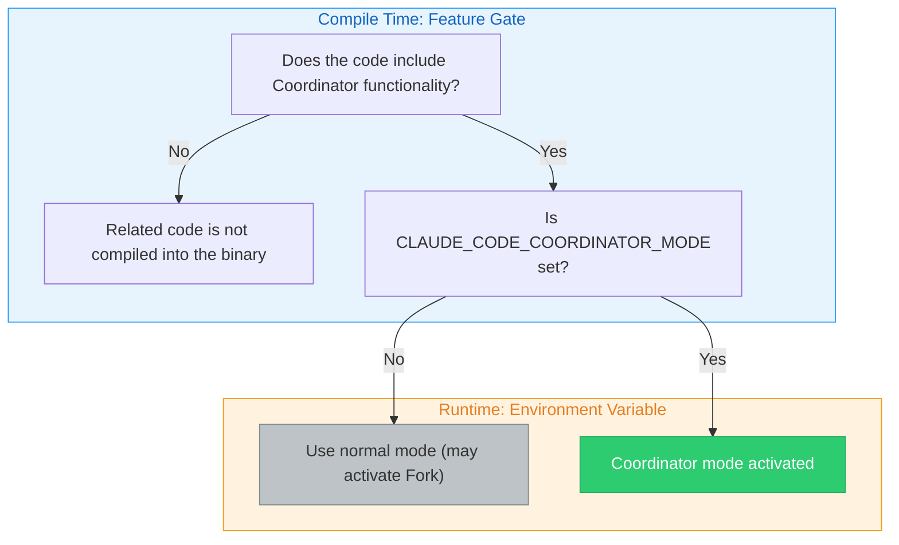

1. **Feature gate**: Determines at compile time whether to include the feature's code
2. **Environment variable**: `CLAUDE_CODE_COORDINATOR_MODE` controls activation at runtime

> **Design Insight: Why use dual gating instead of a single switch?**
>
> The feature gate is a compile-time optimization -- deployments that don't need Coordinator functionality (such as lightweight SDK embedding scenarios) can completely exclude the related code, reducing binary size and attack surface. The environment variable is a runtime control -- even in builds that include the feature, the user must explicitly enable it. This "compile-time exclusion + runtime explicit enable" pattern is common in enterprise software, satisfying both flexibility requirements and the principle of least privilege.

### Activation Conditions and Mutual Exclusion

The Coordinator pattern interacts with other patterns in multiple places. First is its mutual exclusion with the Fork pattern: when both satisfy their conditions simultaneously, the Coordinator pattern takes priority. This is because the Coordinator already has its own task delegation model and doesn't need the Fork pattern's implicit parallelism capabilities.

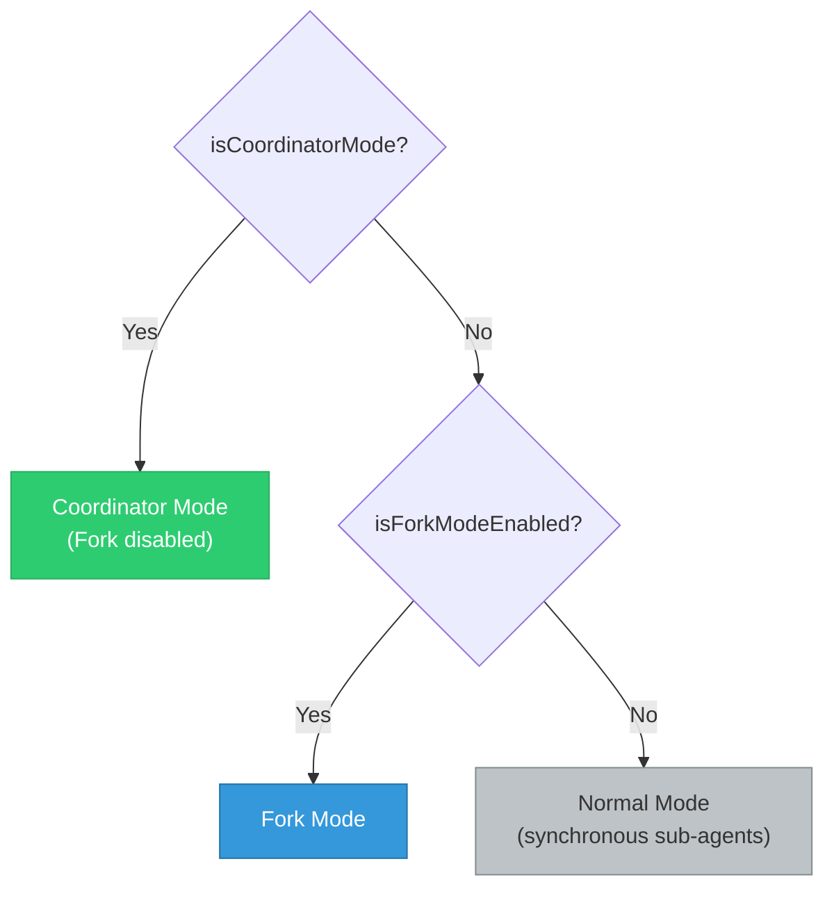

> **Cross-Reference:** Chapter 9 discusses the Fork pattern's cache sharing mechanism in detail. The core difference between the two is: Fork is "centerless parallelism" (all sub-agents are equal and share the same context), while Coordinator is "centered orchestration" (the coordinator controls the global view, and workers only see the tasks assigned to them).

<!-- block: ch10.b-7052aa53 -->
The Coordinator pattern also affects the agent registry. When Coordinator mode activates, the built-in agent registration function no longer returns the normal list of built-in agents but instead introduces Coordinator-specific worker agent definitions through lazy loading. This lazy loading approach is intentional, aimed at avoiding circular dependencies between the coordinator module and the tool module.

### Pattern Matching for Session Recovery

The `matchSessionMode()` function handles pattern consistency during session recovery: when the current mode doesn't match the session's recorded mode, the system automatically flips the environment variable to match the session's mode. So recovering a session created in Coordinator mode switches Coordinator mode on even when the startup configuration never set the variable.

This design solves a practical problem: a user might set the Coordinator environment variable during one launch and create a session, but forget to set it when recovering that session later. Without automatic mode matching, the session would resume in the wrong mode, leading to inconsistent behavior or even errors.

### The Coordinator's System Prompt

The system prompt generation function defines the Coordinator's role -- a carefully crafted system prompt that specifies the complete behavioral norms for the coordinator. Key points include:

**Role Definition**: The coordinator is not an executor but an orchestrator. It directly answers simple questions and delegates complex tasks to workers.

**Tool Set**: The coordinator has only four core tools -- the Agent tool for spawning workers, the TaskStop tool for stopping workers, the SendMessage tool for sending messages to workers, and the structured output tool.

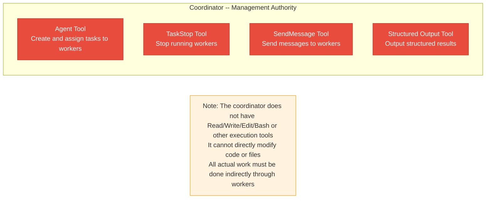

**Key Constraints**: The system prompt explicitly prohibits the coordinator from "using one worker to inspect another worker," "using a worker to simply report file contents," or "predicting or fabricating agent results." These constraints ensure that the coordinator manages all communication directly, preventing overly long information-passing chains.

> **Anti-Pattern Warning: Why is "worker inspecting worker" prohibited?**
>
> Allowing Worker A to inspect Worker B's results creates an "information chain": Worker B completes its task -> Worker A reads B's results -> Worker A reports to the coordinator. This chain has two serious problems:
>
> 1. **Information decay**: Each transmission loses details. Like a game of telephone, information after multiple rounds of relay may differ greatly from the original result.
>
> 2. **Debugging difficulty**: When the final result is wrong, you need to trace back layer by layer to find which link caused the problem.
>
> The correct pattern is: the coordinator directly receives each worker's results, understands them itself, and then writes the next set of instructions.

---

## 10.2 Worker Tool Allocation

### INTERNAL_WORKER_TOOLS

Under the Coordinator pattern, two sets control workers' tool allocation. The internal worker tools set defines the tools that workers **should not see** -- these are the coordinator's exclusive tools, including team creation, team deletion, message sending, and structured output.

This forms a clear boundary of authority:

```mermaid
graph LR
    subgraph Coordinator["Coordinator -- Management Authority"]
        C1["Agent Tool"]
        C2["TaskStop Tool"]
        C3["SendMessage Tool"]
        C4["Structured Output"]
    end
    subgraph Worker["Worker -- Execution Authority"]
        W1["Read / Write"]
        W2["Edit / Bash"]
        W3["Grep / Glob"]
        W4["WebSearch"]
        W5["Skill / MCP"]
    end

    Coordinator x-- Management vs Execution --x Worker

    style C1 fill:#e74c3c,stroke:#c0392b,color:#fff
    style C2 fill:#e74c3c,stroke:#c0392b,color:#fff
    style C3 fill:#e74c3c,stroke:#c0392b,color:#fff
    style C4 fill:#e74c3c,stroke:#c0392b,color:#fff
    style W1 fill:#3498db,stroke:#2471a3,color:#fff
    style W2 fill:#3498db,stroke:#2471a3,color:#fff
    style W3 fill:#3498db,stroke:#2471a3,color:#fff
    style W4 fill:#3498db,stroke:#2471a3,color:#fff
    style W5 fill:#3498db,stroke:#2471a3,color:#fff
```

### Simple Mode and Full Mode Tool Sets

The `getCoordinatorUserContext()` function returns different tool descriptions based on the mode:

- **Simple Mode**: Workers only have Bash, Read, and Edit tools, suitable for resource-constrained environments
- **Full Mode**: Workers have all whitelisted tools except internal tools, including Read, Write, Edit, Bash, Grep, Glob, WebSearch, WebFetch, NotebookEdit, Skill, ToolSearch, and more

| Mode | Tool Set | Applicable Scenarios |
|------|----------|---------------------|
| Simple | Bash, Read, Edit | CI/CD environments, resource-constrained containers, quick validation |
| Full | All whitelisted tools | Local development, full IDE integration, complex refactoring |

In Full mode, workers can also use MCP tools and Skill tools. The system prompt informs the coordinator of the available worker tool list through user context.

> **Practical Scenario: When to Use Simple Mode?**
>
> Simple mode is suitable for the following scenarios:
> - **Automated tasks in CI/CD pipelines**: Build servers don't need web search or file discovery
> - **Quick fix tasks**: Simple fixes that only require reading, editing, and running tests
> - **Security-restricted environments**: Minimizing the tool set reduces potential security risks
> - **Resource-constrained containers**: Reduces tool initialization overhead

### Independent Assembly of the Tool Pool

The system assembles workers' tool pools independently from the parent level, ensuring that workers always get the complete tool set, unaffected by parent-level tool restrictions. Workers default to the `acceptEdits` permission mode (automatically accept file edits), unless the agent definition specifies another mode.

This design decision reflects an important principle: **workers are executors, and permission issues should not hinder them**. If a worker needed user confirmation every time it edited a file, that would completely negate the advantages of multi-agent collaboration. Of course, this requires the coordinator to assign tasks correctly -- if given the wrong modification task, a worker will execute it without hesitation.

> **Best Practice: Pre-confirm Task Scope Under Coordinator Mode**
>
> Since workers automatically accept edits, users should review the overall plan before the Coordinator accepts a task. It's recommended to add a prompt in CLAUDE.md requiring the coordinator to present the complete task allocation plan before starting the Implementation phase.

---

## 10.3 Team Management

### TeamCreateTool / TeamDeleteTool

The Coordinator pattern shares team infrastructure with Agent Teams (multi-agent swarms). The team creation tool is responsible for creating teams, and its core process includes: checking whether the leader is already in a team (a leader can only manage one team), generating a unique team name, creating a team file (containing team name, leader ID, session ID, member list, etc.), then writing the team file, updating global state, and setting up the task list.

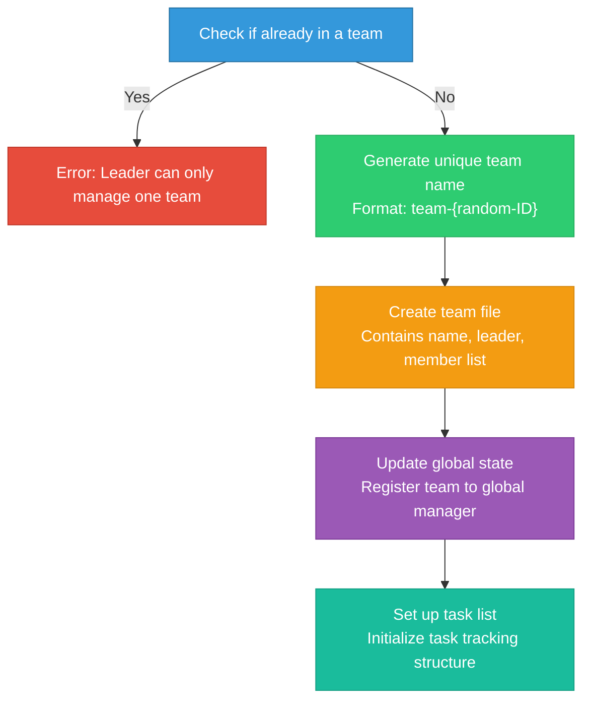

The team deletion tool handles cleanup: it first checks whether there are still active members, only allowing cleanup after all members have completed their work, then clears the team directory, worktree, and team context.

### Safety Guarantees for Team Deletion

Deleting a team runs several safety checks first:

1. **Active member check**: If workers are still running, the system refuses deletion and returns the list of still-running members
2. **Resource cleanup order**: Clean team directory (Scratchpad, etc.) first, then worktree, then team context
3. **Error tolerance**: Failure to clean up a single resource does not prevent cleanup of other resources

> **Anti-Pattern Warning: Do Not Delete a Team Before Work Is Complete**
>
> If the coordinator forcefully deletes a team while workers are still running, the workers will lose their association with the team, which may lead to:
> - Worker task notifications failing to reach the coordinator
> - Scratchpad files deleted mid-read, so a running worker gets empty data
> - Worktrees cleaned up mid-change, losing workers' file modifications
>
> This is why team deletion requires the precondition that "all members have completed."

### SendMessageTool Message Passing

The message sending tool is the core communication channel for team collaboration. Close requests, close responses, and plan approval responses all travel through it.

Addressing modes for message passing:

| Addressing Mode | Format | Use Case | Communication Scope |
|----------------|--------|----------|-------------------|
| Point-to-point | `to: "agent-name"` | Send specific instructions to a designated worker | Single worker |
| Broadcast | `to: "*"` | Publish public information to all workers | All workers |
| UDS | `to: "uds:<socket-path>"` | Cross-process communication (different CLI instances) | Cross-process |
| Bridge | `to: "bridge:<session-id>"` | Cross-session/cross-machine communication | Cross-session/remote |

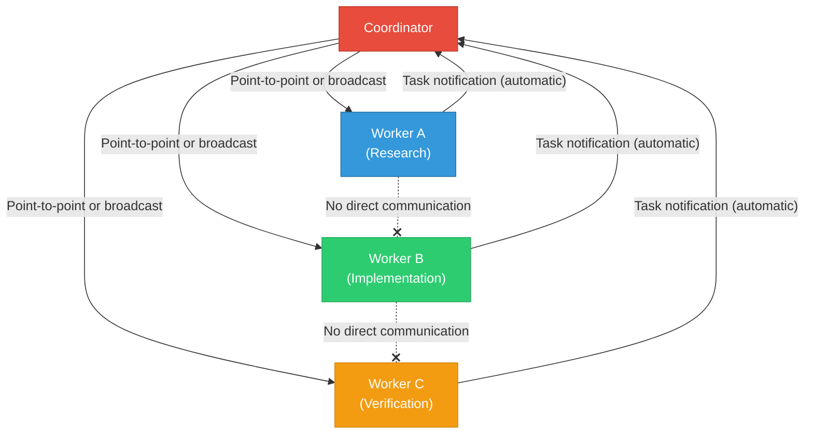

The message sending tool's intelligent routing mechanism is particularly noteworthy: when the coordinator sends a message to a running worker, the system queues the message for the next round of tool invocation; when sending to a stopped worker, the system automatically resumes that worker and delivers the message as a new prompt. This "stop-resume" pattern lets the coordinator manage workers' lifecycles without breaking stride.

> **Design Insight: The Economy of the Stop-Resume Pattern**
>
> Workers are not "always online." A research worker stops after completing its investigation, releasing API connections and memory resources. But the coordinator may later need to give this worker an additional task (e.g., "For module X you investigated earlier, look deeper into the dependency relationships"). The stop-resume pattern lets the coordinator reactivate workers when needed without rebuilding context from scratch. This both saves resources and preserves the previous analysis state.

---

## 10.4 Collaboration Space

### Scratchpad Collaboration Space Design

The Coordinator pattern introduces the Scratchpad concept -- a shared temporary file space across workers. In the system prompt, when the Scratchpad feature is on, the system appends descriptive information for the coordinator, informing it that workers can freely read and write to this directory without permission prompts, and suggesting its use for durable cross-worker knowledge storage.

The Scratchpad's physical location is in a session-specific subdirectory under the project's temporary directory, with the path format `/tmp/claude-{uid}/{sanitized-cwd}/{sessionId}/scratchpad/`. Each session has an independent scratchpad directory.

The Scratchpad's design principles are:

1. **No permission prompts**: Workers can freely read and write to the scratchpad directory without user confirmation
2. **Persistent cross-worker knowledge**: One worker can write findings to the scratchpad, and another worker can read them
3. **Session isolation**: Each session's scratchpad is independent, avoiding cross-session contamination
4. **Structural freedom**: The system does not prescribe a file structure; workers organize it as needed

In the Coordinator's system prompt, the scratchpad's description reads "durable cross-worker knowledge," hinting at its core purpose: serving as shared memory between workers.

#### Typical Scratchpad Usage Patterns

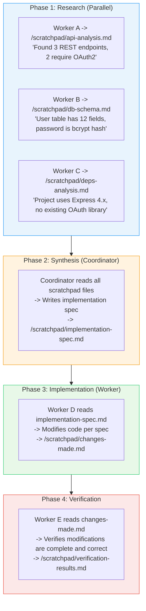

> **Why not let workers pass messages to each other directly?**
>
> Message passing is ephemeral -- consume it once and it's gone. The Scratchpad, on the other hand, is persistent, and any number of workers can read it repeatedly. During the research phase, not only the coordinator needs Worker A's findings; subsequent verification workers may need them too. With message passing, the coordinator would need to forward the findings to every worker that needs them; with Scratchpad, workers can read on demand.
>
> Additionally, the Scratchpad naturally supports "incremental building" -- Worker A writes a foundational analysis, and Worker B can append supplementary information on top of it, without needing to consolidate everything into a single message.

<!-- block: ch10.b-1d9cd4d7 -->
### The Coordinator's Task Workflow

The Coordinator system prompt defines four phases of the standard task workflow:

| Phase | Executor | Purpose | Typical Output |
|-------|----------|---------|---------------|
| Research | Workers (parallel) | Investigate the codebase, discover files, understand the problem | Scratchpad analysis documents |
| Synthesis | Coordinator | Read findings, understand the problem, write implementation spec | Implementation specification document |
| Implementation | Workers | Make precise edits per the spec | Code changes |
| Verification | Workers | Test whether modifications are correct | Test results and issue list |

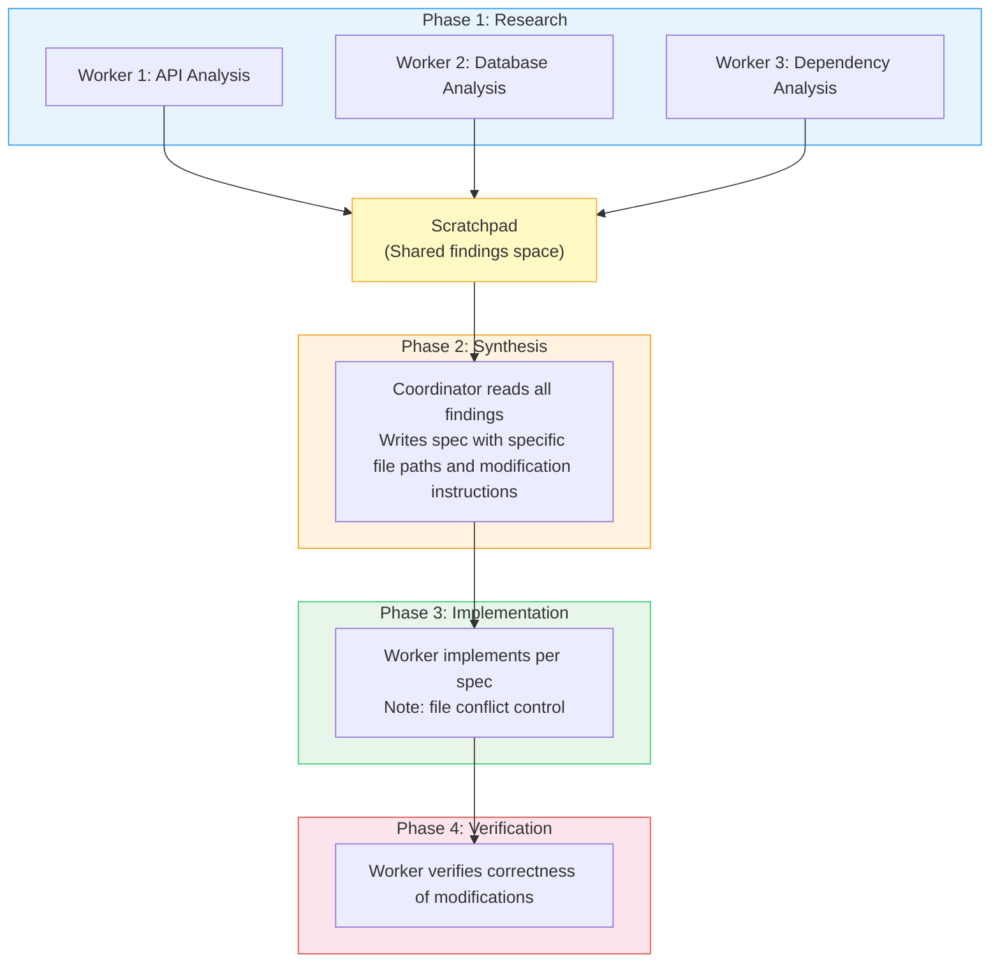

The key constraint of this workflow is that **the coordinator must understand the research findings before it can write the implementation spec**. The system prompt uses strong language to emphasize:

> "Never write 'based on your findings' or 'based on the research.' These phrases delegate understanding to the worker instead of doing it yourself. You never hand off understanding to another worker."

So the coordinator cannot simply forward a worker's findings to another worker -- it must first digest those findings, then write an implementation spec that includes specific file paths, line numbers, and modification instructions.

> **Design Philosophy: Why Can't "Understanding" Be Delegated?**
>
> This is one of the most core design principles of the Coordinator pattern. In traditional master-slave architectures, the master node can simply forward a slave node's results to another slave node. But in an AI agent system, this forwarding leads to severe context loss issues:
>
> - **Format inconsistency**: Different workers produce output in different formats; direct forwarding leaves the recipient unable to understand it
> - **Coexistence of information redundancy and gaps**: Worker A's report may contain many irrelevant details while missing critical information
> - **Lack of global perspective**: Each worker only sees the portion it investigated and cannot make globally optimal decisions
>
> Requiring the coordinator to "digest" all findings before writing the spec ensures that workers in the implementation phase receive unified, precise, and contextualized instructions.

### Concurrency Strategy

The Coordinator system prompt defines a clear concurrency strategy:

| Task Type | Concurrency Strategy | Reason |
|-----------|---------------------|--------|
| Read-only tasks (Research) | Free parallelism | No conflicts will arise |
| Write-heavy tasks (Implementation) | One at a time per file set | Prevent file write conflicts |
| Verification | Sometimes parallel with implementation | Safe when operating on different file regions |

```mermaid
---
config:
  gantt:
    leftPadding: 180
---
gantt
    title Concurrency Strategy Example (OAuth2 Integration Task)
    dateFormat X
    axisFormat %s

    section Research (All Parallel)
    Worker A: API Analysis     :a1, 0, 4
    Worker B: Database Analysis :a2, 0, 4
    Worker C: Auth Analysis    :a3, 0, 4

    section Implementation (Exclusive Files)
    Worker D: route/auth.ts :b1, 3, 6
    Worker E: db/migration.ts :b2, 6, 9

    section Verification (Parallel Verification)
    Worker F: Test auth     :c1, 9, 12
    Worker G: Test DB       :c2, 9, 12
```

The system prompt also encourages the coordinator to "fan out" -- initiating multiple parallel worker calls in a single message. This runs on Claude's parallel tool calls, so multiple workers can start simultaneously.

Spawning more is not the same as finishing sooner. Five wrong turns account for most of the waste:

| Wrong turn | What actually happens | The right move |
|---|---|---|
| Send ten workers into the Research phase, assuming parallelism scales linearly | A worker only sees the task assigned to it, so each one investigates from scratch, and the coordinator still has to read every result before writing a spec — the resource overhead is already higher than Fork | Cut the work by dimension — one worker each for API, database, dependencies — spawn three or four, and let the coordinator write the spec once |
| Ask worker A to check worker B's output, saving one assignment | Information passes down a chain and loses detail at every hop, and a wrong result has to be traced back layer by layer | The coordinator receives every worker's result directly, reads it, and writes the next instruction itself |
| Put "implement this based on your findings" in the spec | The system prompt forbids exactly that wording; it delegates understanding along with the work | Name the concrete file paths, line numbers and edits in the spec |
| Run two write-heavy tasks over the same set of files at once | The concurrency policy gives write-heavy work one worker per file set; two writers on the same files is a write conflict | Assign workers along file boundaries, and parallelise only across different file regions |
| Delete the team while workers are still running | Task notifications never reach the coordinator, the Scratchpad is cleared mid-read, and half the worktree changes are lost | Wait for every member to finish; clean up directory, then worktree, then team context |

### Task Notification Protocol

When workers complete, they deliver results to the coordinator in `<task-notification>` XML format:

```xml
<task-notification>
<task-id>{agentId}</task-id>
<status>completed|failed|killed</status>
<summary>{human-readable status summary}</summary>
<result>{agent's final text response}</result>
<usage>
  <total_tokens>N</total_tokens>
  <tool_uses>N</tool_uses>
  <duration_ms>N</duration_ms>
</usage>
</task-notification>
```

This format goes inside user-role messages. The coordinator identifies `<task-notification>` tags to distinguish genuine user messages from workers' result reports. This design choice means the coordinator needs explicit instructions to differentiate message types, which is why the system prompt repeatedly emphasizes "Worker results are internal signals, not conversation partners."

> **Why XML format instead of JSON?**
>
> XML tags have better recognizability in LLM contexts than JSON. Claude models parse XML tags very reliably (related to extensive XML usage in training data), while JSON requires strict quote and comma matching. Additionally, explicit tag names like `<task-notification>` allow the model to quickly identify message types through simple pattern matching without full JSON parsing.

---

## 10.5 Complete Case Study: From Requirements to Delivery

<!-- block: ch10.b-a893bbfb -->
Let's understand the Coordinator pattern's end-to-end workflow through a complete case study.

### Scenario: Adding a User Notification System to a Web Application

**Requirement Description:** "Add a notification system to our Express.js application that supports both email and in-app notification methods. Users should be able to manage notification preferences from the settings page."

#### Phase 1: Research

The coordinator dispatches three research workers simultaneously:

```
Coordinator Decision:
"This task involves three dimensions: backend API, database schema, and frontend UI.
 Launching three parallel researchers to investigate each."

  Worker "api-researcher":
    Task -> "Investigate the existing Express.js route structure, middleware chain, and API versioning strategy"
    Output -> /scratchpad/api-analysis.md
    Content -> "Found routes under src/routes/, using Express Router,
            middleware chain includes auth, rateLimit, validate.
            API versioning managed via URL prefix /api/v1/."

  Worker "db-researcher":
    Task -> "Investigate database schema, ORM models, and migration strategy"
    Output -> /scratchpad/db-analysis.md
    Content -> "Using Prisma ORM, schema in prisma/schema.prisma.
            Existing User model has id, email, name fields.
            Migrations managed via prisma migrate."

  Worker "frontend-researcher":
    Task -> "Investigate frontend framework, component structure, and state management approach"
    Output -> /scratchpad/frontend-analysis.md
    Content -> "Using React + TypeScript, components in src/components/.
            State management uses Zustand. Settings page in SettingsPage.tsx.
            UI component library uses shadcn/ui."
```

#### Phase 2: Synthesis

```
Coordinator Behavior:
  1. Read all three scratchpad files
  2. Understand the overall architecture and write implementation spec
  3. Write spec to /scratchpad/implementation-spec.md

  Spec Contents:
  - Database: Add Notification and NotificationPreference models
  - API: Add 5 endpoints (GET/POST/PUT/DELETE notifications + PUT preference settings)
  - Service layer: Add NotificationService for email and in-app notifications
  - Frontend: Modify SettingsPage to add notification preference component
  - Dependencies: Need to add nodemailer package
```

#### Phase 3: Implementation

```
Coordinator Decision:
"Based on the spec, database migration and service layer implementation
 can safely execute in parallel since they operate on different files.
 Frontend implementation must wait until the backend is complete."

  Worker "db-implementer":
    Task -> Modify Prisma schema per scratchpad spec and create migration
    Files -> prisma/schema.prisma (exclusive)

  Worker "service-implementer":  <- Parallel with db-implementer
    Task -> Implement notification service layer and API routes
    Files -> src/services/notificationService.ts, src/routes/notifications.ts

  (Wait for both above to complete)

  Worker "frontend-implementer":
    Task -> Implement frontend notification preference component
    Files -> src/components/NotificationSettings.tsx, modify SettingsPage.tsx
```

#### Phase 4: Verification

```
  Worker "verifier":
    Task -> Verify the complete functionality of the notification system
    Checklist:
    - Is the Prisma migration correct?
    - Do the API endpoints conform to RESTful conventions?
    - Does the frontend component correctly call the API?
    - Are there any missing error handling?
    - Are the default notification preference values reasonable?
```

---

<!-- block: ch10.b-787e6187 -->
## 10.6 Fault Recovery and Partial Completion

### Handling Strategies for Worker Failures

In multi-agent collaboration, worker failures are the norm rather than the exception. The Coordinator has to handle these failure scenarios:

| Failure Type | Manifestation | Coordinator's Response Strategy |
|-------------|---------------|-------------------------------|
| Tool execution failure | A Bash command returns a non-zero exit code | Analyze failure cause, retry or adjust strategy |
| Model output truncation | maxTurns exhausted, task incomplete | Evaluate completed portion, decide whether to reassign |
| MCP connection dropped | External tool unavailable | Degrade to a strategy that doesn't depend on that tool |
| Context too long | Conversation history exceeds token limit | Compress context or split task into smaller sub-tasks |

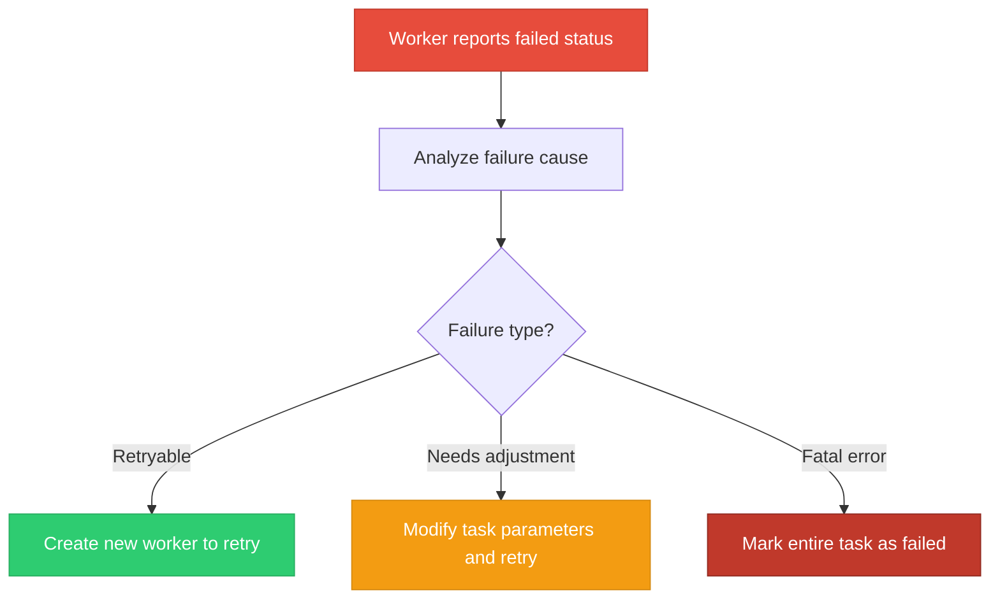

### Handling Partial Completion

When a research-phase worker only completes a partial investigation (e.g., analyzed the API layer but not the database layer), the coordinator faces a choice: proceed with available information, or wait for a complete analysis.

The guiding principle in the system prompt is: **the coordinator should make full use of completed work rather than waiting for perfect information**. If Worker A completed 80% of the code investigation, the coordinator should write the implementation spec based on that 80% of the information, flagging uncertain portions in the spec so the implementation worker can investigate the gaps itself when it encounters uncovered areas.

> **Best Practice: Use "Confidence Annotations" in the Scratchpad**
>
> It's recommended that the coordinator use confidence annotations in the implementation spec, for example:
> - [HIGH] Confirmed file paths and function signatures are correct
> - [MEDIUM] Inferred dependency relationships that need verification during implementation
> - [LOW] Areas not fully investigated; additional research needed before implementation
>
> These annotations let implementation workers know which parts they can execute directly and which need confirmation first.

---

<!-- block: ch10.b-4dbae2e4 -->
## 10.7 Coordinator Pattern vs. Fork Pattern Comparison

The two patterns are two parallelism strategies; pick the wrong one and the task stalls.

| Dimension | Coordinator Pattern | Fork Pattern |
|-----------|-------------------|-------------|
| **Architecture Model** | Centralized (coordinator-worker) | Decentralized (peer parallelism) |
| **Context Sharing** | Workers only see assigned tasks | All sub-agents inherit the full parent context |
| **Communication Method** | Coordinator relays, Scratchpad sharing | No direct communication, each operates independently |
| **Task Allocation** | Explicit allocation, precise control | Implicit parallelism, each executes independent sub-tasks |
| **Result Aggregation** | Coordinator synthesizes all results | Primary agent collects as needed |
| **Cache Efficiency** | No shared cache prefix | Byte-level sharing, efficient caching |
| **Applicable Scenarios** | Coordinated, complex multi-step tasks | Independent parallel investigation/search tasks |
| **Fault Recovery** | Coordinator can reassign tasks | Primary agent decides after receiving failure notification |
| **Resource Overhead** | Higher (coordinator is persistent) | Lower (shared cache) |
| **Mental Model** | Construction site (project manager + workers) | Scout team (multiple independent scouts) |

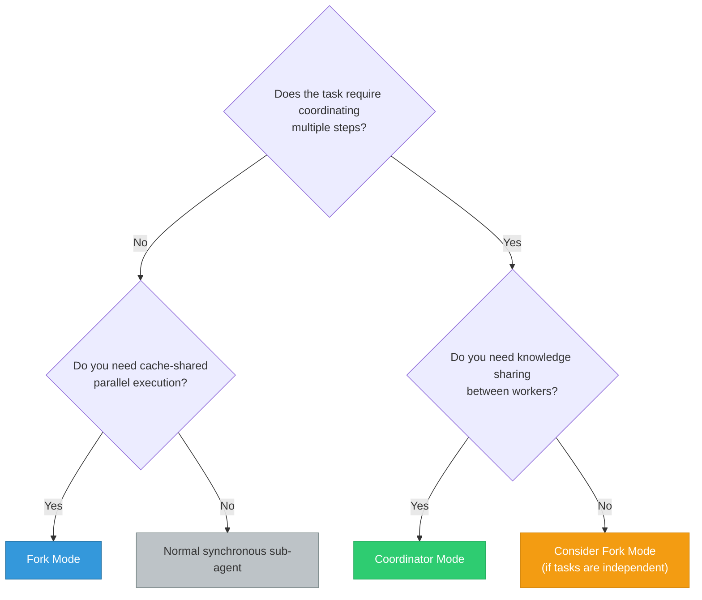

> **Cross-Reference:** Chapter 9 covers the detailed mechanism of the Fork pattern. Pay special attention to the mutual exclusion between the two -- when Coordinator mode activates, the system automatically disables Fork mode.

```ill
ch10-coordinator-fork
```

> **Cross-reference:** Plan first, then execute, and split lead from hand — another harness solves the same problem in omp volume Chapter 13, *Planning and Collaboration*.

---

## Hands-On Exercises

**Exercise 1: Design a Multi-Worker Workflow**

Suppose you have a large-scale refactoring task: splitting a monolithic Express.js application into microservices. Design the workflow under the Coordinator pattern:

1. **Research Phase**: Plan how many Research workers you need and what module each should investigate
   - Hint: Consider five dimensions -- routes, database, middleware, configuration, and tests
2. **Synthesis Phase**: How should the coordinator synthesize findings and write the microservice splitting specification
   - Hint: Consider service boundaries, shared databases, API Gateway, etc.
3. **Implementation Phase**: How to allocate workers to avoid file conflicts
   - Hint: Allocate by service boundary; the same worker should handle files for the same service
4. **Verification Phase**: What is the verification strategy?
   - Hint: verify each microservice independently, then run integration tests

**Exercise 2: Analyze Scratchpad Security Boundaries**

Consider the following questions about Scratchpad security design:
- What does the Scratchpad directory's permission setting (0o700) mean?
- Why isn't the Scratchpad placed inside the project directory?
- What happens if two workers write to the same Scratchpad file simultaneously?
- How should you design Scratchpad file naming conventions to avoid conflicts?

**Extended Thinking:** If you were to implement a "Scratchpad version control" feature (similar to Git), what metadata would you need to record? How would this change workers' write behavior?

**Exercise 3: Compare Coordinator Pattern vs. Fork Pattern**

Based on the content of this chapter and Chapter 9, fill in the table below and provide reasoning for each dimension's choice:

| Dimension | Coordinator Pattern | Fork Pattern |
|-----------|-------------------|-------------|
| Architecture Model | ? | ? |
| Context Sharing | ? | ? |
| Applicable Scenarios | ? | ? |
| Communication Method | ? | ? |
| Cache Efficiency | ? | ? |
| Fault Recovery | ? | ? |
| Resource Overhead | ? | ? |

**Exercise 4: Design a Fault Recovery Strategy**

Suppose in a Coordinator workflow, a worker in the Implementation phase fails while modifying the database schema (migration script execution error). Design:
1. How the Coordinator detects this failure
2. How the Coordinator decides whether to retry or adjust the strategy
3. How to handle already partially completed modifications
4. How the changes affect other workers executing in parallel

**Exercise 5: Simulate a Complete Coordinator Workflow**

Choose a project you're familiar with and design a Coordinator workflow for the following task:

Task: "Add internationalization (i18n) to the project; both Chinese and English have to work."

Requirements:
- List the investigation directions needed for the Research phase
- Write an outline of the implementation spec for the Synthesis phase
- Design the worker allocation for the Implementation phase
- Plan the verification checklist for the Verification phase

**Minimal runnable case:** Replay coordinator task assignment with round-robin (Python 3.12 standard library, no third-party dependencies; this is a teaching model, not Claude Code source). Save the code as `case.py` and run `python case.py`.

**Version lock:** Python 3.12 standard library, no third-party dependencies.
**Expected result:** `worker-1: research, review` and `worker-2: draft`
**Prerequisite:** Chapter 9's fork; **Backlink:** Chapter 9's fork prefix

```python
# exercise: ch10
# expected:
# worker-1: research, review
# worker-2: draft
tasks = ["research", "draft", "review"]
workers = {"worker-1": [], "worker-2": []}
for index, task in enumerate(tasks):
    workers[f"worker-{index % 2 + 1}"].append(task)
for worker, assigned in workers.items():
    print(f"{worker}: {', '.join(assigned)}")
```

---

## Key Takeaways

1. **The Coordinator pattern employs a "coordinator-worker" architecture**, where the coordinator only manages task allocation and result synthesis without implementing anything itself. With that layering, you can break complex engineering tasks down in order and work on the pieces in parallel.

2. **The dual gating mechanism** (feature gate + environment variable) and mutual exclusion with the Fork pattern ensure clarity in mode selection. `matchSessionMode()` guarantees pattern consistency during session recovery.

3. **Tool isolation strategy**: The coordinator has only four core orchestration tools, while workers have the full development toolset but exclude team management tools. Independent assembly of the tool pool ensures workers are not affected by parent-level restrictions. Simple mode and Full mode adapt to different resource environments.

4. **SendMessage's intelligent routing** supports point-to-point, broadcast, cross-process, and cross-session communication, and a stopped worker resumes on its own, so a "stop-continue" workflow holds.

5. **The Scratchpad collaboration space** provides a permission-prompt-free shared directory across workers, with each session being independent and structurally free. It serves as the bridge for persistent knowledge transfer between workers, compensating for the limitation that workers cannot communicate directly with each other.

6. **The four-phase workflow** (Research -> Synthesis -> Implementation -> Verification) provides a structured task execution pattern. The core constraint is that the coordinator must digest research findings before writing the implementation spec; delegating understanding is not allowed.

7. **Fault recovery** is a built-in capability of the Coordinator pattern. Through the status field in task notifications, partial results in the Scratchpad, and the coordinator's reassignment capability, the system can gracefully handle worker failures and partial completion.

8. **Pattern selection**: Coordinator is suitable for coordinated, complex multi-step tasks, while Fork is suitable for independent parallel search tasks. The two are mutually exclusive and cannot be used simultaneously. Understanding the strengths and limitations of each is key to making the right choice.

> **Three sentences to keep:** ①The coordinator holds not a single execution tool, only four orchestration tools — and it may not delegate understanding: it digests every finding and writes the implementation spec itself. ②Forwarded understanding loses context; a coordinator that has absorbed the research writes specs with concrete file paths and line numbers, so implementation workers receive unified, precise instructions. ③Bring coordinated multi-step work to the Coordinator and independent parallel searches to Fork — the dispatcher assigns but never hauls, and the two carts never run at once.
