# Chapter 14: Plan Mode & Structured Workflows

> **In one line:** Walk the route on paper before the packs move: Plan Mode splits thinking from doing, and redrawing a blueprint always beats tearing down a wall.

> "Plans are nothing; planning is everything." -- Dwight D. Eisenhower

**Difficulty:** Advanced. 14.1 and 14.2 are the backbone: read the mode-switching mechanism and plan-file recovery in full. Skip 14.4 scheduling and 14.5 background tasks on a first pass; return when you need timers or long-running jobs.

Picture a rework you've paid for. You ask the agent to add a pagination endpoint. It starts writing the moment it hears the requirement, and only when it's done do you notice it put the pagination parameters in the URL and queried the same list twice. Fixing it takes four hours — three times what the coding took.

Look back at its reasoning and the problem isn't a dumb model. It had no place to write the plan down first and let you see it.
<!-- block: ch14.b-aedb3b29 -->
This chapter covers that stretch of "think first, act second": how Plan Mode splits read-only exploration from writable execution, how a plan file comes back after an interruption, and how Cron, RemoteTrigger and background tasks bring in a time dimension.

> **What you can do after this chapter:**
> - Say when EnterPlanMode/ExitPlanMode flip, and why a sub-agent cannot enter Plan Mode
> - Given a plan file, name the three layers it recovers from: direct read, file snapshot, message history
> - Break a long task into Plan-Execute-Verify, and give a scheduled task an expiry

---

## 14.1 Plan Mode Architecture

### 14.1.1 Design Philosophy: Plan Before Execute

<!-- block: ch14.b-003b59e8 -->
Plan Mode is one of Claude Code's most unique designs. It separates Agent behavior into two phases: read-only exploration phase (planning) and writable execution phase (implementation). The core philosophy of this separation is: align intent before acting, avoiding rework from directional errors.

<!-- block: ch14.b-134950ba -->
This design philosophy mirrors the construction industry: no architect would start laying bricks immediately upon receiving requirements. They would first draw blueprints (plan), confirm design intent with the client, evaluate structural feasibility, then begin construction (execution). During the planning phase, architects can modify plans at zero cost -- revising a drawing is much cheaper than demolishing a wall. Similarly, in Plan Mode, Agent's exploration and thinking produce no side effects (no file modifications, no command execution), and the cost of correcting "directional errors" is almost zero.

<!-- block: ch14.b-fadb821c -->
The core problem Plan Mode solves is **"Premature Action"**. Without Plan Mode, an Agent faces a dilemma: when facing complex tasks, either blindly act in the first round (high risk), or repeatedly read code without making decisions in every round (inefficient). Plan Mode provides the Agent with a "legitimate thinking space" -- in this space, the Agent can freely explore without the expectation of producing actual results, until it's confident it understands the full picture of the problem.

EnterPlanModeTool is the entry point to planning mode. Its prompt system provides different guidance strategies for different user types (external users vs internal ant users).

For external users, the system tends to encourage using Plan Mode, suggesting the model preferentially use Plan Mode for implementation tasks. For internal ant users, the system is more restrained, suggesting starting work directly and clarifying through questions when in doubt, rather than entering a full planning phase.

This differentiated strategy reflects different usage scenarios: external users value safety and alignment more, while internal users value efficiency and fluency more.

**What would happen without Plan Mode?** Let's imagine several typical scenarios:

| Scenario | Without Plan Mode | With Plan Mode |
|----------|-------------------|----------------|
| Misunderstood requirements | Directly implemented wrong feature, needs rollback | Discovered misunderstanding in read-only phase, zero-cost correction |
| Ignored existing patterns | Wrote code inconsistent with project style | First explored project to discover existing patterns, then implemented |
| Solution choice failure | Implemented poor-performing solution, needs rewrite | Compared multiple solution trade-offs before acting |
| Missed edge cases | Finished code then discovered omissions, rework | Enumerated edge cases in plan and incorporated into solution |

Plan Mode in this chapter is one gear inside a permission state machine; oh-my-pi 18.15.0 moves the same idea onto the pricing layer: `--smol`, `--slow`, and `--plan` assign models for lightweight tasks, thorough analysis, and architectural planning respectively; `--prewalk` switches to a cheap model at the first file write after the plan's todo list exists; `--plan-yolo` locks the session into read-only planning at start, auto-approves the plan on the model's first resolve call, then switches to the model named by `--plan-yolo-into` to implement it. "Plan before execute" is, on this host, simultaneously a permission decision and a cost decision: the planning phase stays read-only, and the execution phase puts on a cheaper model.

Gemini CLI makes the same gear a default-on entrance: `--approval-mode=plan` pins it at launch, `Shift+Tab` cycles through Default, Auto-Edit, and Plan, and the `/plan` command or one sentence of natural language switches it on -- the former switches to Plan and immediately submits the prompt to the model, the latter calls the `enter_plan_mode` tool (YOLO mode does not carry that tool). It writes the read-only planning phase down as an explicit tool whitelist: file reads, directory listings, glob, grep, and search stay on the table while `web_fetch` asks for confirmation every time; the agreed plan lands as a Markdown file in a plans directory, opens in an external editor where steps can be rewritten and inline comments left, the CLI notices the edits, reviews the comments, and presents the refined plan for final approval -- approving it exits Plan Mode and starts the implementation.

> **Identity of this cross-check:** oh-my-pi and Gemini CLI are both registered in `CREDITS.md` as **cross-checks**, the same standing the other open-source harnesses hold in Chapter 4 §4.3.6 -- they support no technical claim in this chapter and exist to show what the same idea grows into under someone else's hands.

```ill
ch14-plan-gate
```

### 14.1.2 Mode Switching Mechanism

After user approves entering Plan Mode, EnterPlanModeTool's `call` method executes mode switching. Core logic includes: checking if it is in an Agent context (if so it throws an error), calling the permission transition handler to switch to plan mode, and through the state update function switching the permission context to plan mode configuration.

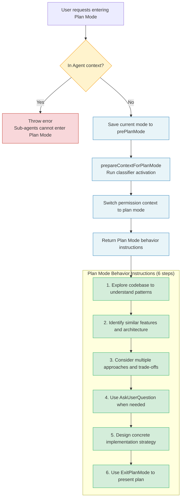

Key points:
- **Sub-agent context forbids entering Plan Mode**: Sub-agents should not enter planning mode; this is an architectural constraint. Imagine if a sub-agent entered Plan Mode, it would wait for user plan approval, but user might not even know the sub-agent exists. This would block the entire parent Agent's execution on an approval request users cannot understand.
- **prepareContextForPlanMode**: Runs classifier activation side effects, ensuring correct permission configuration in plan mode.
- **prePlanMode save**: The system saves the original mode to the `prePlanMode` field for ExitPlanMode recovery use.

After entering Plan Mode, Agent receives tool_result containing clear behavior instructions:

```
In plan mode, you should:
1. Thoroughly explore the codebase to understand existing patterns
2. Identify similar features and architectural approaches
3. Consider multiple approaches and their trade-offs
4. Use AskUserQuestion if you need to clarify the approach
5. Design a concrete implementation strategy
6. When ready, use ExitPlanMode to present your plan for approval

Remember: DO NOT write or edit any files yet.
This is a read-only exploration and planning phase.
```

The design of these six instructions implies a cognitive model: **Understand -> Discover -> Compare -> Clarify -> Design -> Present**. The order itself is a thinking process, from divergence (broad exploration) to convergence (concrete solution). Steps 1-2 are divergence phase, Agent collects information as broadly as possible; Steps 3-4 are convergence transition phase, Agent starts focusing but still open; Steps 5-6 are complete convergence, Agent produces a definite implementation plan.

### 14.1.3 Exiting Plan Mode

ExitPlanModeV2Tool is responsible for exiting Plan Mode and restoring original permission mode. Its design is much more complex than EnterPlanMode because it needs to handle multiple scenarios.

**Mode restoration** is the core logic. System reads saved original mode from `prePlanMode` and restores it. But there's a key "circuit breaker" defense: if `prePlanMode` is `auto`, but auto mode's gate has since closed (e.g., due to circuit breaker trigger), then fall back to `default` mode.

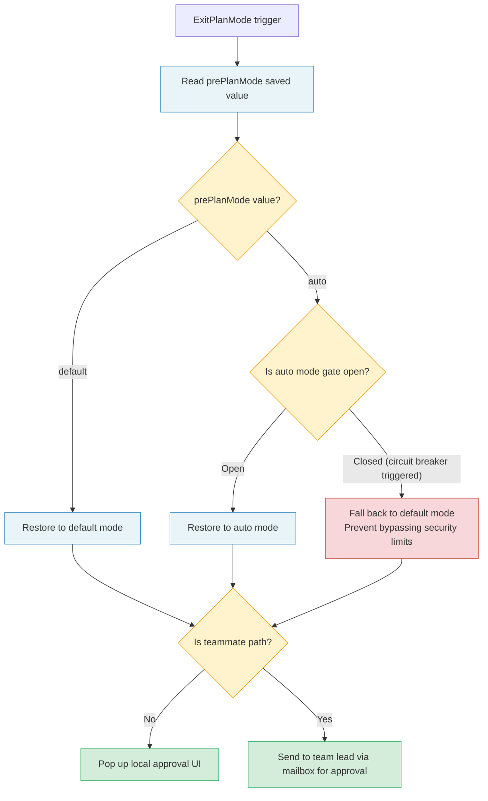

This circuit breaker defense reveals a subtle time window issue: when entering Plan Mode, auto mode was on, but during Plan Mode duration (possibly minutes or tens of minutes), something external (like system load or a security policy change) might have switched auto mode off. If ExitPlanMode doesn't check this condition, Agent exiting Plan Mode would immediately execute operations with auto mode permissions, potentially bypassing newly activated security limits.

**Teammate path**: When Agent runs as teammate and Plan Mode is mandatory, ExitPlanMode doesn't pop up local approval UI but sends plan to team lead for approval via mailbox mechanism. Approval request contains sender, timestamp, plan file path, plan content, and request ID.

> **Cross-reference:** Chapter 10 "The Coordinator Pattern -- Multi-Agent Orchestration" analyzes Teammate's mailbox mechanism in detail. Plan Mode's teammate path is a typical case of distributed Agent collaboration -- approval decision authority goes to the team lead rather than the local user.

### 14.1.4 Plan Mode Complete Case: From Requirement to Plan to Implementation

A complete case shows how Plan Mode actually operates.

**User requirement:** "Add pagination support for project's REST API"

**Step 1: Enter Plan Mode**

Agent judges this is a non-trivial task involving multiple file modifications and proactively triggers EnterPlanMode. System saves current mode as `default`, switches to plan mode permission configuration.

**Step 2: Read-only exploration (in Plan Mode)**

The Agent does the following, all read-only:

```
Tool call sequence (all read-only):
1. Glob("src/routes/*.ts")           -- Discover all route files
2. Glob("src/models/*.ts")           -- Discover all model files
3. Grep("limit|offset|page|cursor")  -- Search for existing pagination implementations
4. Read("src/routes/users.ts")       -- Read typical route implementation
5. Read("src/middleware/validate.ts") -- Understand validation middleware patterns
6. Grep("interface.*Response")       -- Search response type definitions
```

Agent discovers:
- Project uses Express + TypeScript
- Has 12 route files, none with pagination support
- Has a generic `ApiResponse` type
- Validation middleware uses Zod schema
- Database layer uses Prisma ORM

**Step 3: Solution Design and Trade-off Analysis**

Agent internally considers two solutions:

| Dimension | Offset Pagination | Cursor Pagination |
|-----------|------------------|-------------------|
| Implementation complexity | Low | Medium |
| Large dataset performance | Poor (OFFSET scan) | Excellent (index lookup) |
| Data consistency | Medium (inserts/deletes cause offset) | Excellent (cursor-based) |
| Client compatibility | Good (intuitive page numbers) | Needs adaptation |
| Prisma integration | Simple (skip/take) | Needs cursor encoding |

**Step 4: Present Plan**

Agent presents following plan through ExitPlanMode:

```
## Pagination Feature Implementation Plan

### Solution choice: Hybrid mode
- Default use offset pagination (simple, good compatibility)
- Provide cursor pagination option for high-frequency endpoints

### Implementation steps
1. Create src/types/pagination.ts -- Pagination type definitions
2. Create src/middleware/pagination.ts -- Pagination parameter parsing middleware
3. Modify src/routes/users.ts -- As first implementation example
4. Add Zod schema validation -- limit (1-100), offset (>=0)
5. Update ApiResponse type -- Add pagination metadata

### Expected impact
- New files: 2
- Modified files: 3
- Risk: Low (purely incremental, doesn't modify existing functionality)
```

**Step 5: Approval and Execution**

After user approves plan, ExitPlanMode restores original mode, Agent enters execution phase, gradually implementing according to plan.

> **Note:** In actual use, Plan Mode depth should match task complexity. For simple single-file modifications, direct execution might be more efficient than entering Plan Mode. Claude Code's prompt design has this judgment built in -- for external users, system only suggests Plan Mode for "implementation tasks", directly handling simple queries and modifications.

---

## 14.2 Plan Verification Mechanism

### 14.2.1 Verification Agent

`ExitPlanModeV2Tool` references `registerPlanVerificationHook`, and the comment beside it reveals an important design decision: verification hooks must register after context clear because context clear removes all hooks.

Verification hooks must register after context clear because context clear removes all hooks. So the verification agent is an independent background Agent running in the phase after "clear context and start implementation", checking whether implementation results match the plan.

**Design philosophy of verification agent.** Why do we need an independent verification agent instead of letting the execution agent check itself? This involves the cognitive bias of "self-review" -- executioners tend to judge their work using their own understanding rather than strictly comparing against the original plan text. The independent verification agent holds a snapshot of the original plan file and can review the result from a "bystander" perspective.

This is like code review in software engineering: having author review their own code is far less effective than having another engineer do it. Verification agent plays the role of this "other engineer".

Verification flow timing:

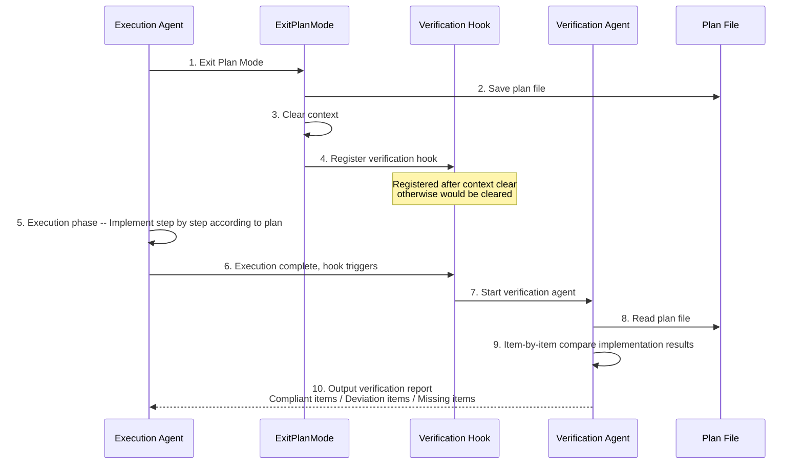

### 14.2.2 Plan File Persistence and Recovery

Plan file management is Plan Mode's infrastructure, provided by dedicated utility function module. The core challenge of this design is: **plans cannot be lost.** Users spent time approving plans, Agents spent tokens generating plans; if plans are lost due to session crash or unexpected interruption, all investment goes to waste.

**File path generation** uses slug-based naming strategy. Main sessions use simple `{slug}.md` format, sub-agents use `{slug}-agent-{agentId}.md` format to avoid file conflicts.

**Slug generation** is lazy: generated on first access, subsequent reads from cache. If file for generated slug already exists, retry up to 10 times.

**Recovery mechanism** is multi-layered. `copyPlanForResume` attempts to recover plan from three sources when resuming session:

<!-- block: ch14.b-847988f6 -->
1. **Direct read of plan file**: Simplest path, if file exists return directly.
2. **File snapshot recovery** (`findFileSnapshotEntry`): Recover from `file_snapshot` system messages in transcript, particularly important in remote sessions (CCR) because local files don't persist between sessions.
3. **Message history recovery** (`recoverPlanFromMessages`): Extract plan content from three message formats:
   - ExitPlanMode's `tool_use` input (plan content injected via `normalizeToolInput`)
   - User message's `planContent` field (set during clear context flow)
   - Attachment message's `plan_file_reference` (preserved during auto-compact)

This three-layer recovery strategy can be understood as "don't put all eggs in one basket". Each layer covers different failure scenarios:

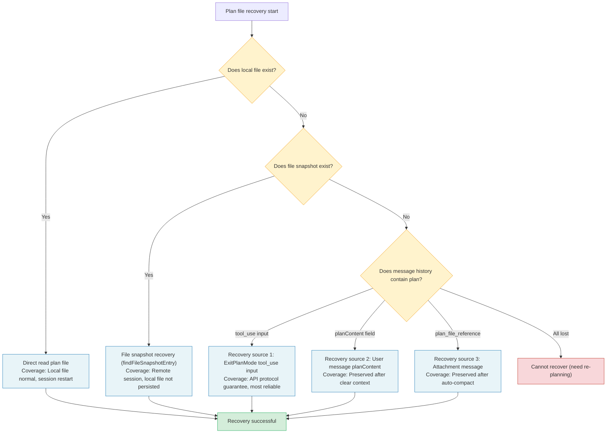

**Fork recovery** uses completely different strategy. `copyPlanForFork` generates new slug for forked session and copies original plan file to new path. This design prevents original session and fork session from overwriting each other's plan files.

Why can't fork directly share original plan file? Because after fork, two sessions might go down completely different execution paths. If fork modifies plan (like adjusting approach based on implementation feedback), directly modifying original file would affect parent session. By copying file to new path, fork has independent plan copy, not interfering with each other.

> **Cross-reference:** Chapter 9 "Sub-Agents and the Fork Pattern" analyzes Fork Agent creation and state isolation mechanisms in detail. Plan file fork strategy is a concrete manifestation of Agent state isolation.

### 14.2.3 Deep Analysis of Plan File Recovery

Let's analyze more deeply the three recovery sources of `recoverPlanFromMessages`, understanding each source's design intent and applicable scenarios.

**Source 1: ExitPlanMode's tool_use input.** When Agent exits Plan Mode, ExitPlanMode tool's input parameters contain plan content. `normalizeToolInput` injects this content into the tool call's input. During recovery, system finds ExitPlanMode's tool_use message from message history, extracts plan content. This is the most reliable recovery source because tool_use messages are part of API protocol, not modified by normal context management operations.

**Source 2: User message's planContent field.** During clear context flow (i.e., clearing context to restart implementation), system sets plan content to a special `planContent` field. This field's purpose is to preserve plan's "seed" after context clear, so newly started execution phase still knows what to do.

**Source 3: Attachment message's plan_file_reference.** auto-compact is an automatic context compression mechanism (detailed in Chapter 7). When compression runs, the system knows the plan file matters and keeps a reference to it in the attachment message. This ensures even after auto-compression, you can still locate and read the plan file through its reference.

The three sources rank by reliability: tool_use input most reliable (API protocol guarantee), planContent second (internal mechanism guarantee), plan_file_reference weakest (relies on auto-compact's correct recognition). Recovery logic attempts in this priority order, first successful source is final result.

---

## 14.3 Workflow System

### 14.3.1 WorkflowTool and Skill System

The Skill system provides most of Claude Code's workflow capabilities. Skills are essentially ready-made prompt templates, triggerable via slash commands. Skill execution's core preparation function handles three things:

1. **Prompt replacement**: Replace `$ARGUMENTS` placeholder with user-provided arguments.
2. **Permission extension**: Add allowed tools list to fork's execution context via `createGetAppStateWithAllowedTools`.
3. **Agent selection**: Prefer agent type specified by command, otherwise fall back to `general-purpose` agent.

**Design trade-offs of Skill system.** Why choose prompt templates over code-level plugins? This is the classic "flexibility vs reliability" trade-off. Code-level plugins can provide stronger functionality and better type safety, but their development and maintenance costs are higher, requiring developers to deeply understand system's internal APIs. Prompt templates allow anyone to define workflows in natural language, greatly lowering the extension barrier.

```
+-------------------+---------------------------+---------------------------+
| Extension method  | Flexibility               | Barrier                   |
+-------------------+---------------------------+---------------------------+
| Prompt template   | Medium (limited by prompt | Low (natural language)    |
| (Skill system)    | expressiveness)           |                           |
+-------------------+---------------------------+---------------------------+
| Hook commands     | High (arbitrary Shell     | Medium (programming       |
| (Hook system)     | commands)                 | ability required)         |
+-------------------+---------------------------+---------------------------+
| MCP servers       | Extremely high            | High (protocol            |
| (external tools)  | (independent process,     | implementation required)  |
|                   | any language)             |                           |
+-------------------+---------------------------+---------------------------+
```

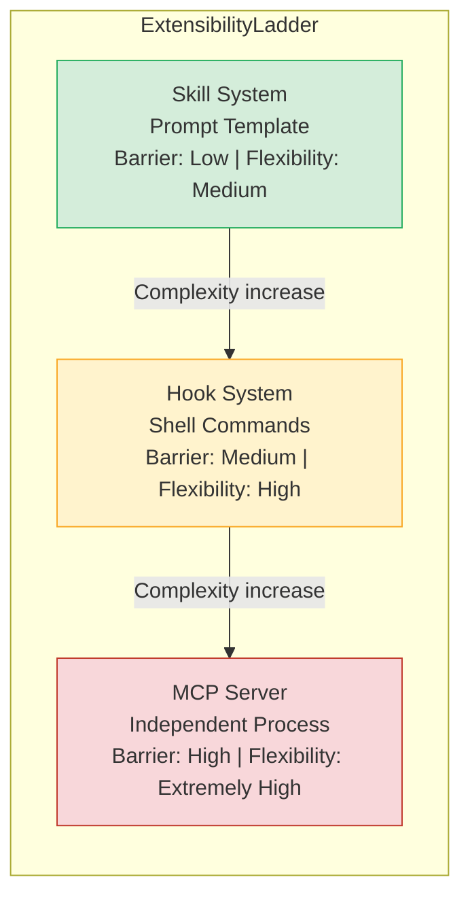

Claude Code's extensibility design follows the "ladder-style extension" principle: start with simplest prompt templates, as requirement complexity increases, progressively use more powerful extension mechanisms. Most users only need the Skill system, advanced users use hook commands, enterprise users integrate external tools via MCP.

> **Cross-reference:** Chapter 11 "The Skill System and Plugin Architecture" analyzes the Skill system's complete architecture in detail. Chapter 8 "The Hook System -- Agent's Lifecycle Extension Points" discusses the Hook system. Chapter 12 "MCP Integration & External Protocols" introduces MCP integration.

### 14.3.2 Fork Agent State Isolation

`createSubagentContext` creates a completely isolated ToolUseContext. By default it walls off every piece of mutable state:

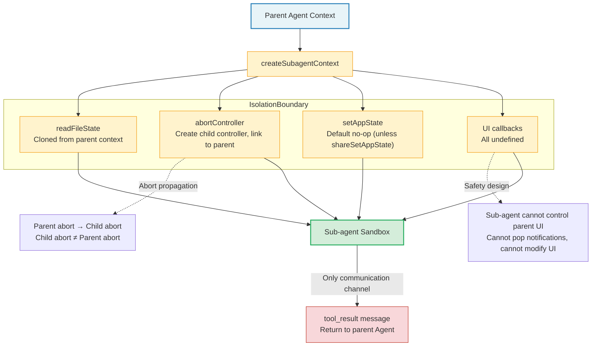

- **readFileState**: Cloned from parent context.
- **abortController**: Create child controller, linked to parent controller (parent abort propagates to child).
- **setAppState**: Default no-op, unless explicitly chosen to share (`shareSetAppState`).
- **UI callbacks** (addNotification, setToolJSX, etc.): All undefined, sub-agent cannot control parent UI.

**Why can't sub-agents control parent UI?** This is a critical safety design. If sub-agents could pop notifications or modify UI, notifications from multiple sub-agents might overwhelm users, leaving them unable to distinguish main Agent from sub-Agent output. More seriously, malicious tool output (via prompt injection) could exploit sub-agent UI capabilities to phish -- for example, popping a seemingly legitimate confirmation dialog.

Fork Agent's state isolation strategy resembles a "sandbox": sub-agent runs in sandbox, can see outside world (through cloned file state), but cannot affect outside world (cannot modify parent Agent state, cannot control UI). The only communication channel with outside world is tool results -- sub-agent's execution results return to parent Agent through structured `tool_result` messages.

> **Best practice:** When designing sub-agents, follow "principle of least privilege". Only pass the minimum context the sub-agent needs to complete the task; don't indiscriminately pass the entire parent Agent state. Passing less narrows what the sub-agent can do and cuts token consumption (the sub-agent's input tokens also count toward the cost).

---

<!-- block: ch14.b-44940e1e -->
## 14.4 Scheduling System

### 14.4.1 ScheduleCronTool: Local Scheduled Tasks

Claude Code's scheduling system handles two types of scheduled tasks:

- **One-shot** (`recurring: false`): Triggers once then automatically deletes.
- **Recurring** (`recurring: true`): Repeats according to schedule, rescheduling from current time.

The system stores tasks in `<project>/.claude/scheduled_tasks.json`, file format:

```json
{
  "tasks": [
    {
      "id": "a1b2c3d4",
      "cron": "0 * * * *",
      "prompt": "check the deploy status",
      "createdAt": 1710000000000,
      "recurring": true
    }
  ]
}
```

Each CronTask contains a `durable` runtime flag. Tasks with `durable: false` only exist in process memory, disappear when session ends. Tasks written to disk have this flag stripped.

**Design intent of durable flag.** Why not persist all tasks to disk? Consider these scenarios:

- User creates a one-time task "check deploy status in 5 minutes", a short-term task that no longer makes sense if session ends before triggering.
- User creates temporary polling task "check logs every minute" during debugging, this task only serves current debugging session.
- Persisting these temporary tasks to disk wastes storage and lets a later session fire a job that is already out of date.

Therefore, `durable` flag provides a "lightweight task" mechanism: tasks needing cross-session persistence set `durable: true`, tasks only serving current session set `durable: false`.

### 14.4.2 CronScheduler: Scheduler Core

`createCronScheduler` builds a full scheduler with these key features:

**File lock**: `tryAcquireSchedulerLock` ensures multiple Claude sessions in the same project directory don't repeatedly trigger the same on-disk task. Non-owner sessions probe the lock every 5 seconds, taking over if the owner crashes.

This file lock mechanism solves an actual distributed problem: developers might simultaneously open multiple terminal windows, each running a Claude Code instance. Without the file lock, each instance would fire the same scheduled task once, causing duplicate operations (like repeatedly sending notifications, repeatedly executing deploy checks).

<!-- block: ch14.b-a4230402 -->
File lock implementation is based on filesystem atomic operations (like `O_EXCL` create), reliable across all mainstream operating systems. Lock timeout and takeover mechanism ensures no deadlock when owner crashes -- other instances will detect and take over within reasonable time.

**Jitter mechanism**: To avoid large numbers of sessions triggering inference requests at the same moment (thundering herd), recurring tasks add a deterministic positive delay. The delay is proportional to the interval between triggers, default max 15 minutes. For hourly tasks, the actual trigger time randomly disperses between `:00` and `:06`.

One-shot tasks use reverse jitter (trigger early), controlled by `oneShotMinuteMod`: default value 30, meaning only `:00` and `:30` exact triggers add jitter.

**Thundering Herd** is a classic distributed systems problem. If all Claude Code instances trigger scheduled tasks at whole hours, API servers would suddenly receive massive concurrent requests, possibly causing latency spikes or even service degradation. Jitter mechanism disperses trigger times within a time window, smoothing peak load into uniform load.

```mermaid
flowchart LR
    subgraph NoJitter["No Jitter -- Thundering Herd"]
        direction TB
        N1A["Instance 1: ----X-----------X-----------X----"]
        N1B["Instance 2: ----X-----------X-----------X----"]
        N1C["Instance 3: ----X-----------X-----------X----"]
        N1D["API:       ^^^Peak       ^^^Peak      ^^^Peak"]
    end

    subgraph WithJitter["With Jitter -- Smoothed Load"]
        direction TB
        N2A["Instance 1: -----X----------X-----------X----"]
        N2B["Instance 2: -------X----------X---------X----"]
        N2C["Instance 3: ----X------------X-----------X---"]
        N2D["API:       ^Smooth        ^Smooth      ^Smooth"]
    end

    NoJitter -.->|"Add Jitter"| WithJitter

    classDef peakNode fill:#f8d7da,stroke:#c0392b,stroke-width:1px
    classDef smoothNode fill:#d4edda,stroke:#27ae60,stroke-width:1px

    class N1D peakNode
    class N2D smoothNode
```

**Missed task detection**: At startup, check if any task's next trigger time has passed, notify user if so.

**Auto-expiration**: Recurring tasks auto-expire after 7 days by default (`recurringMaxAgeMs`), preventing infinite recursion from causing memory leaks. Tasks with the `permanent` flag (like assistant mode's built-in tasks) are exempt from this limit.

7-day expiration policy is a pragmatic choice. If a recurring task runs continuously for 7 days without anyone noticing or modifying it, it's likely no longer needed. Tasks without expiration mechanism would continue consuming resources like "zombie processes": each trigger produces API call, consumes tokens, occupies scheduler memory.

### 14.4.3 RemoteTriggerTool: Remote Triggering

RemoteTriggerTool manages remote Agent triggers, with five operations: list, get, create, update, run.

It works through Anthropic API's triggers endpoint, using OAuth bearer token authentication, carrying organization identifier and beta flag headers.

Two conditions gate tool enablement: feature flag `tengu_surreal_dali` and policy limit `allow_remote_sessions`. RemoteTriggerTool only appears in tool list when both conditions hold.

**Remote trigger application scenarios:**

1. **CI/CD integration**: When the CI pipeline fails, automatically trigger an Agent to analyze the failure cause and generate fix suggestions.
2. **Monitoring alert response**: When the monitoring system detects abnormal metrics, trigger an Agent to trace the root cause.
3. **Code repository events**: Once a PR opens or updates, trigger an Agent to review the code automatically.
4. **Scheduled reports**: Regularly trigger Agent to generate project status reports.

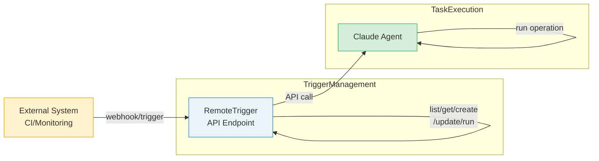

> **Best practice:** Combining remote triggers with Plan Mode can assemble a complete automation workflow. For example, when CI fails, trigger an Agent that automatically enters Plan Mode to analyze the failure causes, generate a fix plan, then automatically execute the fix. This "trigger -> plan -> execute" pattern is the core paradigm of Agent-driven automation.

### 14.4.4 Session-scoped Lifecycle of Scheduled Tasks

Session-scoped tasks (`durable: false`) have lifecycle bound to session. They're stored in bootstrap state, not written to disk.

`listAllCronTasks` merges file tasks and session tasks, returning unified task list.

In scheduler's `check()` method, session tasks and file tasks go through different processing paths. The scheduler operates on session tasks directly in memory (synchronous delete), and writes file tasks to disk asynchronously via `removeCronTasks`.

**Practical case: Auto-deploy monitoring workflow**

Below is an auto-deploy monitoring workflow built using scheduling system:

```
1. User: "Help me deploy to staging environment and monitor deploy status"

2. Agent creates deploy task:
   - one-shot cron task: Check if deploy complete after 30 minutes
   - prompt: "Check staging environment deploy status, analyze cause if failed"

3. Agent creates monitoring task:
   - recurring cron task: Check health status every 5 minutes
   - prompt: "Check staging environment health check endpoint, notify if abnormal return"
   - durable: false (only valid for current session)

4. After deploy succeeds:
   - Agent deletes monitoring task
   - Deploy check task auto-triggers then deletes (one-shot)

5. If session unexpectedly interrupts:
   - monitoring task disappears with session (durable: false)
   - deploy check task might trigger in next session (if persisted)
```

### 14.4.5 Workflow Design Patterns and Anti-patterns

Based on Claude Code's Plan Mode and scheduling system, we can summarize following workflow design patterns and anti-patterns:

**Pattern 1: Plan-Execute-Verify Cycle**

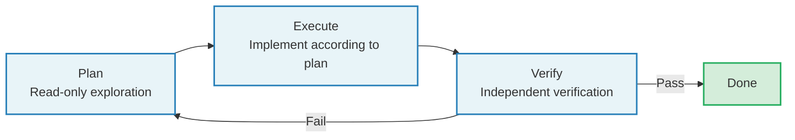

This is the most classic Agent workflow pattern. Plan phase ensures correct direction, Execute phase implements efficiently, Verify phase guarantees quality. Separating the three means you can tune and debug each phase on its own.

**Pattern 2: Event-Triggered Workflow**

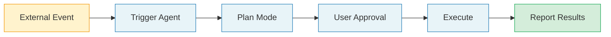

This pattern fits operations automation and CI/CD integration: an event rather than a user triggers the run, and Plan Mode is what keeps such an automation safe and controllable.

**Pattern 3: Polling Loop with Escalation**

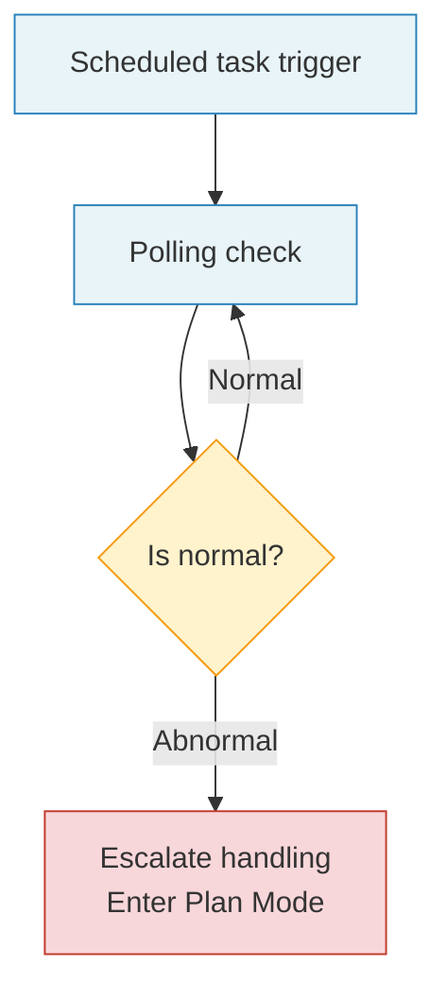

This pattern fits continuous monitoring: low-cost polling runs on a timer and only triggers high-cost Agent reasoning when it detects an anomaly.

**Anti-pattern 1: Unplanned complex tasks**

Directly let Agent execute complex tasks involving multiple file modifications without going through Plan Mode. Risk: Direction errors causing large-scale rework.

**Anti-pattern 2: Over-planning**

Enter Plan Mode even for simple tasks (like modifying a config value). Wastes time and tokens, degrades user experience.

**Anti-pattern 3: Never-cleanup scheduled tasks**

Create recurring tasks but don't set reasonable expiration times. Result: Zombie tasks continuously consume resources.

**Anti-pattern 4: Synchronously waiting for polling results**

Synchronously wait for scheduled task results in main conversation (via Sleep + polling). Correct approach is asynchronously pushing results through notification mechanism, main conversation not blocked.

---

<!-- block: ch14.b-716ec04a -->
## 14.5 Background Tasks and Active Mode

### 14.5.1 SleepTool

SleepTool sits in the background-task group. In Claude Code's tool registration, it registers alongside the other scheduling-related tools. SleepTool lets an Agent stop partway through a run and wait -- polling a deployment or waiting on an external system is exactly where a long-running background task needs it.

SleepTool's design seems simple (just wait a specified time), but it plays an important role in the Agent interaction model. Without SleepTool, an Agent facing "waiting" scenarios has only two choices: either return a result immediately (even if the external operation is not yet complete), or poll frequently in a loop (wasting tokens). SleepTool provides a third choice: the Agent can pause execution, wait a while before continuing, without producing token consumption during the wait.

**SleepTool usage scenarios:**

1. **Deploy polling**: After Agent triggers deploy, sleep 30 seconds, then check deploy status, if still in progress continue sleeping.
2. **Cache preheating wait**: After modifying cache config, sleep waiting for cache invalidation period to pass, then verify new cache is effective.
3. **Rate limit adaptation**: When calling rate-limited external API, sleep waiting for rate window reset.

> **Anti-pattern warning:** Don't use SleepTool in Plan Mode. Plan Mode should be efficient read-only exploration, shouldn't include waiting operations. If an operation in Plan Mode needs waiting, it means exploration strategy needs optimization -- should acquire all needed information at once, not poll and wait.

### 14.5.2 Background Session Management

`runForkedAgent` is the foundation of background Agent execution. It creates completely isolated context through `createSubagentContext`, runs independent query loop, and tracks complete usage metrics.

Key isolation designs include:

1. **File state cache cloning** (`cloneFileStateCache`): Sub-agent's file reads don't affect parent Agent's cache. This ensures sub-agent's intermediate operations don't pollute the parent Agent's file state view. For example, if the sub-agent reads a file and the file then changes, the parent Agent still holds the pre-modification cached version, not refreshed due to sub-agent's read.

2. **Independent AbortController**: You can abort a sub-agent independently without affecting the parent Agent. The parent Agent can therefore run several sub-agents at once and cancel one of them, leaving the others to finish.

3. **Permission prompt suppression**: Background Agent's `getAppState` wraps `shouldAvoidPermissionPrompts: true`, avoiding background operations popping UI prompts. This is because background Agents usually execute pre-authorized tasks (like Plan verification, session summary), don't need and shouldn't interrupt users.

<!-- block: ch14.b-552a5748 -->
4. **Transcript logging**: Logs sub-agent's messages to independent sidechain, separated from main session's messages. This keeps main session's message history clear, not flooded by sub-agent's internal operations.

`lastCacheSafeParams` is a global slot, used to save current turn's cache-safe params in post-turn hooks. Post-turn forks (like promptSuggestion, postTurnSummary) can therefore reuse the main loop's prompt cache directly, with no caller passing parameters by hand.

**lastCacheSafeParams takes the "implicit context passing" route.** Explicit approach would pass parameters from main loop wherever a caller needs cache-safe params, but this causes function signature bloat -- each new call point needs modifying parameter list. Through global slot, callers only need to read slot value at right timing without knowing where value comes from. This reduces coupling between components.

Of course, global state has its risks: if read timing is wrong (like delayed read in async operation), slot value might have been overwritten by subsequent turns. Claude Code avoids this by immediately reading slot value in post-turn hook's synchronous execution segment -- slot's write and read happen in same synchronous execution segment, no race condition.

### 14.5.3 Background Task Lifecycle Management

Background tasks go through following lifecycle phases from creation to completion:

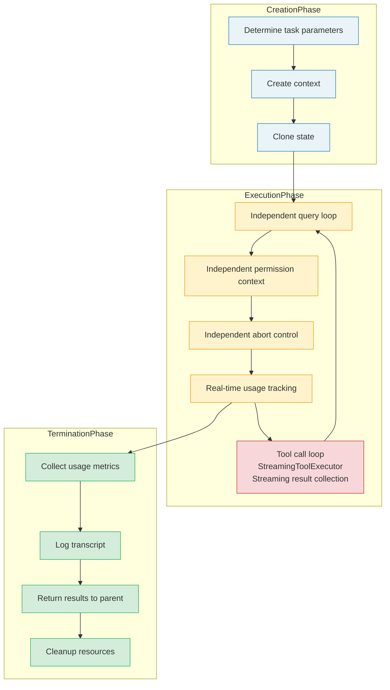

Each phase has corresponding resource management strategy. Creation phase allocates resources (context, controllers), execution phase uses resources (API calls, file access), termination phase releases resources (close controllers, write transcript). Each phase owns its own resources, so nothing leaks.

---

## Practical Exercises

### Exercise 1: Experience Plan Mode Complete Flow

In Claude Code REPL, input a non-trivial implementation task (like "Add a configuration validation module for the project"), observe:
1. EnterPlanMode trigger conditions (whether model proactively entered Plan Mode)
2. Model's behavior in Plan Mode (whether only used read-only tools)
3. Plan file's content and storage location
4. ExitPlanMode's approval flow and mode restoration

**Recording template:**

```
| Step | Observed behavior | Tools used | Time |
|------|-------------------|------------|------|
| Enter Plan Mode | ... | EnterPlanMode | ...s |
| Exploration phase #1 | ... | Read/Grep/Glob | ...s |
| Exploration phase #2 | ... | Read/Grep/Glob | ...s |
| Present plan | ... | ExitPlanMode | ...s |
| User approval | ... | - | ...s |
| Execution phase | ... | Edit/Write/Bash | ...s |
```

**Extended thinking:** Compare effect difference completing same task with and without Plan Mode. Particularly focus: Do implementation results meet expectations? Need rework? How about total time and token consumption?

### Exercise 2: Create Cron Scheduled Tasks

Use `/schedule` skill to create one one-shot and one recurring scheduled task. Check `.claude/scheduled_tasks.json` content changes. Terminate and restart Claude Code, observe missed task detection notification.

**Specific steps:**
1. Create one-shot task: "Report current git branch status in 5 minutes"
2. Create recurring task: "Check for uncommitted changes every hour"
3. View `.claude/scheduled_tasks.json`, understand each field's meaning
4. Wait for one-shot task to trigger, observe trigger behavior
5. Exit and restart Claude Code, observe missed task detection notification
6. Manually delete recurring task, confirm file content update

### Exercise 3: Analyze Plan File Recovery

In a remote session (CCR), enter Plan Mode and create a plan. Terminate session then resume (`--resume`), check if the plan file recovers correctly. Combined with `recoverPlanFromMessages`' three recovery sources, analyze which path your scenario took.

**Debug tip:** Start Claude Code with `CLAUDE_CODE_DEBUG=1` environment variable, search for `copyPlanForResume` and `recoverPlanFromMessages` keywords in logs, can observe which path recovery process took.

### Exercise 4: Design a Complete Event-Driven Workflow

Choose one of following scenarios, design a complete event-driven workflow (using Plan Mode + scheduled tasks + remote trigger):

**Scenario A: Automated Code Review**
- Trigger condition: PR create/update
- Plan phase: Read PR changes, analyze code quality
- Execute phase: Generate review comments
- Verify phase: Check if comments successfully posted

**Scenario B: Infrastructure Health Monitoring**
- Trigger condition: Hourly scheduled trigger
- Plan phase: Query key metrics, analyze anomalies
- Execute phase: Generate report, trigger alerts (if anomalies)
- Verify phase: Confirm alerts sent

For your chosen scenario, answer:
1. Should task be durable or session-scoped?
2. Need jitter? Why?
3. What is Plan Mode's exit condition?
4. How to handle task execution failure cases?

**Minimal runnable case:** Replay the read-only gate of Plan mode (Python 3.12 standard library, no third-party dependencies; this is a teaching model, not Claude Code source). Save the code as `case.py` and run `python case.py`.

**Version lock:** Python 3.12 standard library, no third-party dependencies.
**Expected result:** `Read -> allow` and `Write -> deny`
**Prerequisite:** Chapter 13's cost awareness; **Backlink:** Chapter 4's permission gate

```python
# exercise: ch14
# expected:
# Read -> allow
# Write -> deny
READ_ONLY = {"Read", "Grep"}
def decide(tool, planning):
    return "allow" if tool in READ_ONLY else ("deny" if planning else "ask")
for tool in ("Read", "Write"):
    print(f"{tool} -> {decide(tool, planning=True)}")
```

---

## Key Takeaways

1. **Plan Mode separates read-only exploration from writable execution** by switching permission modes. EnterPlanMode saves original mode and switches to plan, ExitPlanMode restores original mode and handles circuit breaker defense. This separation ensures Agent produces no side effects during "thinking" phase, greatly reducing directional error risk.

2. **Plan file management uses slug-based naming and lazy generation**, supports three-layer recovery strategy (direct read, file snapshot, message history), ensuring plans survive various failure scenarios. The recovery strategy runs in reliability-priority order, embodying "don't put all eggs in one basket" defensive design thinking.

3. **Fork Agent uses CacheSafeParams to share the prompt cache and createSubagentContext to keep state apart**, so the sub-agent can't disturb the main Agent's state. Sub-agent's "sandbox" design -- can read outside world but cannot modify parent state -- is Agent security's key boundary.

4. **Scheduling system supports both file-persisted and session-scoped tasks**: a file lock stops several sessions firing the same task twice, jitter spreads the thundering herd, and auto-expiration cuts off infinite recursion. These mechanisms together form a robust distributed task scheduling framework.

5. **Teammate's Plan approval goes through mailbox mechanism**, not local UI popup, which is infrastructure for distributed Agent collaboration. Delegation of approval authority (from local user to team lead) embodies permission delegation pattern in Agent systems.

6. **Workflow design should follow "Plan-Execute-Verify" pattern**, avoiding anti-patterns like "unplanned complex tasks" and "never-cleanup scheduled tasks". Good workflow design balances automation efficiency with human oversight.

7. **lastCacheSafeParams' global slot design** embodies "implicit context passing" pattern, reducing inter-component coupling while avoiding race conditions through synchronous read/write. This pattern is particularly useful when needing to pass context across multiple component layers.

> **Three sentences to keep:** ① Plan Mode separates read-only exploration from writable execution, so a wrong direction costs almost nothing. ② Align intent before you act: rework happens on the blueprint, and the plan file's three-layer recovery survives interruptions. ③ For complex work, run Plan-Execute-Verify: no plan, no ground broken.

---

## 14.6 Structured Workflows: Common Failures / The Right Move

Failures at this layer are usually not logic errors — they're mixing "thinking" and "doing" in one stretch. The left column lists the most common moves; the right column gives this chapter's answer:

| Common failure | The right move |
|---------|---------|
| Start coding the moment you hear the requirement and notice the wrong direction only at the end | Enter Plan Mode first, write the plan down, get a nod, then implement (14.1) |
| Call EnterPlanMode inside a sub-agent and get an error thrown | Plan Mode is open to the main conversation only; the coordinator writes the sub-agent's spec (14.1.2) |
| Lose the plan after one interruption and have to rethink from zero | Three-layer recovery: read the file, read the snapshot, rebuild from message history (14.2.3) |
| Name plan files arbitrarily and never find them again | slug-based naming + lazy generation: the file lands only when it's first really written (14.2.2) |
| Write a plan, turn your back, and nobody verifies it | Plan-Execute-Verify: a separate verification step after execution (14.4.5) |
| Run full planning for a trivial task like changing one config value | Over-planning is also an anti-pattern: do simple tasks directly (14.4.5) |
| Start a scheduled task and never delete it; zombies burn money forever | Give recurring tasks an expiry so they clean themselves up (14.4.4) |
| Wait synchronously in the main conversation for a scheduled result (Sleep + polling) | Hand the result to a notification mechanism and let the main conversation run on (14.4.5) |
| Use SleepTool in Plan Mode to poll an external state | Planning should gather everything in one pass; needing to wait means the exploration strategy needs work (14.5.1) |

> **Cross reference:** How plan-before-execute works on another harness — see omp volume, Chapter 13 "Planning and Collaboration" and Chapter 18 "Magic Keywords and Modes".

---
