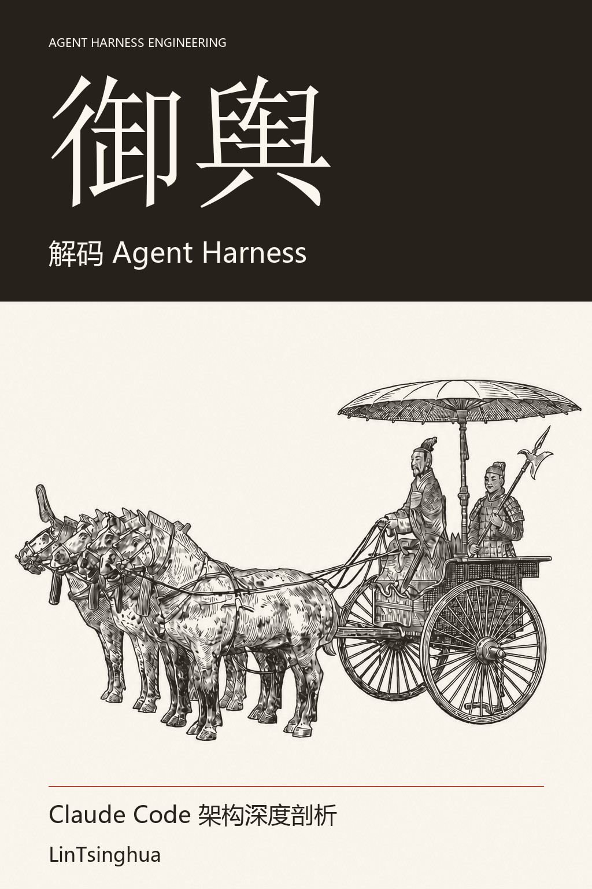

<div align="center">


# Yù Yú: Decoding Agent Harness

<a href="../docs/beginner-reader.en.html"></a>

[中文](../README.md) · **English**

[](../LICENSE)
[](https://github.com/zhuguang-ZFG/claude-code-book/actions/workflows/book.yml)
[](https://zhuguang-zfg.github.io/claude-code-book/)

<table align="center">
<tr><td></td></tr>
<tr><td align="center">📖 <a href="../docs/beginner-reader.en.html">Beginner reader · illustrated</a> (plain language, shallow-to-deep; download and open in a browser) ｜ 🎨 <a href="../docs/illustration-gallery.html">Illustration gallery</a> ｜ <a href="../docs/illustration-prompts.md">Prompt handbook</a></td></tr>
</table>

</div>

Explore how an agent runtime connects the conversation loop, tools, permissions, memory, and orchestration. Fifteen chapters and four appendices connect implementation details to design trade-offs and a hands-on harness project.

> *“Of all artifacts that bring many crafts together, the chariot calls upon the most.”* — *Kǎo Gōng Jì* (Book of Crafts)
>
> Two thousand years ago, building a chariot was already an exercise in systems engineering. The **yú** (舆, carriage body) carries the rider; shafts, spokes, and axle fittings each serve their purpose. Only together can the vehicle move.
>
> Building an AI Agent calls for similar coordination: the conversation loop advances the task, tools perform actions, and permissions set boundaries. The runtime framework that supports and organizes these capabilities—**Agent Harness**—plays the role of the **yú**.
>
> Chariot builders brought many crafts into one working whole. Agent builders, too, must understand how the parts work together. **Yù Yú** (御舆, “driving the chariot”) evokes both control and an understanding of the machinery that makes it possible.
>
> This is the idea behind the title **Yù Yú**, also known as **Yú Shū** (舆书, “The Chariot Book”).

## Start reading

- **First visit:** [Foreword](00-Foreword.md), then chapters 01 → 02 → 04 → 15.
- **Build an agent:** read Parts 1 and 4; use Parts 2 and 3 when adding memory and extensions.
- **Look up a concept:** use the four appendices below.
- **Website:** [Online reading](https://lintsinghua.github.io/). Repository chapters remain directly readable on GitHub.

## Second volume · Omp (in progress)

This repository now carries a second, separate volume: the Chinese-language 《Omp 从入门到精通：原理与实战》 — an unofficial tutorial for an open-source terminal agent. Its manuscript lives in [../omp/](../omp/README.md) and its artifacts use the `yuyu-omp-*` prefix. It is written against **omp/18.15.0**; [../omp/VERIFY.md](../omp/VERIFY.md) records what was checked against a real install (18.16.0 included).

Two commands, two books: `make book` / `make book-pdf` still build Yù Yú only (both languages), while `make book-omp` / `make book-omp-pdf` build the Chinese omp edition — the latter also prints an A4 PDF. The equivalent command is `python scripts/bookctl.py build --product omp --lang zh [--pdf]`. Both write into `yuyu-book/dist/` under different prefixes, so building one volume never overwrites the other. Build details, plus the sizes and page counts measured on this machine, are in [../omp/BUILD.md](../omp/BUILD.md); the mechanism and boundaries of the two-product setup are §3.6 of [../STRUCTURE.md](../STRUCTURE.md).

`make check` (`bookctl check --fast/--full`) covers Yù Yú assembly, shared tests and repository content checks. Omp has separate structure and delivery gates in `omp/overhaul/audit_structure.py --check` and `audit_delivery.py`. Content CI also assembles the Chinese Omp sources; Book CI has an independent `omp` job for HTML/PDF. On Windows, run `powershell -File omp/overhaul/ci-local.ps1` to build Yù Yú Chinese HTML and Omp Chinese HTML/PDF together.

Reading routes are available from the [Yù Yú side](../docs/COMPARE-OMP.md) and the [Omp side](../omp/COMPARE-YUYU.md), with a [shared terminology table](../docs/yuyu-overhaul/SHARED-TERMS.md). The Omp English edition has only a [reserved directory](omp/README.md); translation and English builds have not started.

Illustration strategy: Mermaid architecture diagrams and hand-drawn concept art on two tracks. Concepts can be read across the two volumes; implementations and pinned versions cannot be mixed.

## Reading notes

Readers should distinguish observed implementation, architectural interpretation, and teaching examples. Feature flags and tool availability depend on build and runtime configuration; counts and timing examples are not promises about current releases.

Claude Code belongs to Anthropic. This independent book is not an official Anthropic publication. The book’s license does not extend to third-party code.

## Contents

### Part 1. Foundations — Building Mental Models

> Understand the paradigm shift in Agent programming and establish a holistic cognitive framework.

| # | Chapter | Core Content |
|:-:|---------|-------------|
| 01 | [The New Paradigm of Agent Programming](Part-1-Foundations/01-The-New-Paradigm-of-Agent-Programming.md) | Copilot → Claude Code evolution; five design principles; Bun + React/Ink + Zod v4 stack |
| 02 | [The Dialog Loop — Agent's Heartbeat](Part-1-Foundations/02-The-Dialog-Loop-Heartbeat-of-an-Agent.md) | `while(true)` async generator loop; five yield events; ten termination reasons; `QueryDeps` DI |
| 03 | [The Tool System — Agent's Hands](Part-1-Foundations/03-The-Tool-System-Agent-Hands.md) | `Tool<I,O,P>` five-element protocol; fail-safe `buildTool` factory; 55 tools × 12 categories; concurrent partitioning |
| 04 | [The Permission Pipeline — Agent's Guardrails](Part-1-Foundations/04-The-Permission-Pipeline-Agent-Guardrails.md) | Four-stage pipeline; five permission modes; Bash rule matching; speculative classifier 2s Promise.race |

### Part 2. Core Systems — Deep Into Subsystems

> Dissect the four core subsystems — configuration, memory, context, and hooks.

| # | Chapter | Core Content |
|:-:|---------|-------------|
| 05 | [Settings & Configuration — Agent's DNA](Part-2-Core-Systems/05-Settings-and-Configuration-Agent-DNA.md) | Six-layer config priority chain; merge rules; security boundary & supply chain defense; dual-layer feature gating |
| 06 | [The Memory System — Agent's Long-Term Memory](Part-2-Core-Systems/06-The-Memory-System-Agent-Long-Term-Memory.md) | Four closed memory types; "only save non-derivable info"; MEMORY.md index; Fork memory mechanism |
| 07 | [Context Management — Agent's Working Memory](Part-2-Core-Systems/07-Context-Management-Agent-Working-Memory.md) | Effective window formula; four-level compression (Snip→MicroCompact→Collapse→AutoCompact); circuit breaker |
| 08 | [The Hook System — Agent's Lifecycle Extension Points](Part-2-Core-Systems/08-The-Hook-System-Agent-Lifecycle-Extension-Points.md) | Five hook types; 22 lifecycle events; JSON response protocol; six-layer priority; three-layer security |

### Part 3. Advanced Patterns — Composition & Extension

> Explore how Agents compose, orchestrate, and extend — from sub-agents to MCP protocol bridging.

| # | Chapter | Core Content |
|:-:|---------|-------------|
| 09 | [Sub-Agents and the Fork Pattern](Part-3-Advanced-Patterns/09-Sub-Agents-and-the-Fork-Pattern.md) | Three Agent sources; agent roles and availability gates; byte-level Fork context inheritance; recursive Fork protection |
| 10 | [The Coordinator Pattern — Multi-Agent Orchestration](Part-3-Advanced-Patterns/10-The-Coordinator-Pattern-Multi-Agent-Orchestration.md) | Coordinator-Worker dual gating; "orchestrate-only" constraint; four addressing modes; four-stage workflow |
| 11 | [The Skill System & Plugin Architecture](Part-3-Advanced-Patterns/11-The-Skill-System-and-Plugin-Architecture.md) | 11 core skills; SKILL.md frontmatter; three-level parameter substitution; layered loading; plugin cache |
| 12 | [MCP Integration & External Protocols](Part-3-Advanced-Patterns/12-MCP-Integration-and-External-Protocols.md) | 8 connection configuration variants; five-state connection management; three-part tool naming; Bridge bidirectional comms |

### Part 4. Engineering Practice — From Principles to Construction

> Performance optimization details and a practical roadmap for building a complete Harness from scratch.

| # | Chapter | Core Content |
|:-:|---------|-------------|
| 13 | [Streaming Architecture & Performance Optimization](Part-4-Engineering-Practice/13-Streaming-Architecture-and-Performance-Optimization.md) | QueryEngine lifecycle; concurrency control; parallel prefetching and startup estimates; lazy loading |
| 14 | [Plan Mode & Structured Workflows](Part-4-Engineering-Practice/14-Plan-Mode-and-Structured-Workflows.md) | "Think before you act" philosophy; plan file three-layer recovery; local scheduling & remote triggers |
| 15 | [Building Your Own Agent Harness](Part-4-Engineering-Practice/15-Building-Your-Own-Agent-Harness.md) | Six-step implementation roadmap; circular dependency solutions; four-layer observability; security threat model |

### Appendix — Reference Quick-Lookup

| | Content |
|:-:|---------|
| [A](Appendices/A-Architecture-Navigation-Map.md) | **Architecture Navigation Map** — 16 core modules, dependency tree, 6 data flow paths, 10 design patterns |
| [B](Appendices/B-Complete-Tool-Inventory.md) | **Complete Tool Inventory** — 50+ tools × 12 categories, readOnly/destructive/concurrencySafe attributes |
| [C](Appendices/C-Feature-Flag-Reference.md) | **Feature Flag Reference** — 89 flags × 13 categories, compile-time/runtime types, dependency graphs |
| [D](Appendices/D-Glossary.md) | **Glossary** — 122 bilingual term definitions with cross-references and chapter locations |


## The book as one file

`yuyu-book/` assembles the 20 units into **a single book you can read offline**: one self-contained HTML file (5.8 MB Chinese / 5.9 MB English) and an A4-typeset PDF (521 pages / 36.3 MB in Chinese, 557 pages / 24.2 MB in English). Artifacts land in `yuyu-book/dist/`. The page count follows the CJK face installed on the build machine: the numbers above are what CI typesets with Noto CJK, and a Windows box carrying Microsoft YaHei runs the Chinese edition to 518 pages / 25.1 MB and the English one to 569 pages / 12.6 MB. Each build log prints the size and page count of the PDF it just made, so anyone can compare them on their own machine.

The CI pair above comes from [Book CI after the P5 provenance changes](https://github.com/zhuguang-ZFG/claude-code-book/actions/runs/42350509018). `scripts/check_artifact_claims.py`, which runs in `book.yml`, reconciles these README numbers against the PDF of the current build and turns red on a mismatch — so after a push, read the page count CI typeset, update the two numbers above, and keep the local YaHei figures in `docs/yuyu-overhaul/PDF-PAGES.md`.

| File | Language |
|------|----------|
| `yuyu-agent-harness-zh.html` / `.pdf` | Chinese |
| `yuyu-agent-harness-en.html` / `.pdf` | English |

The book carries its own cover, imprint and license page, revision history, reading routes, a contents page with real page numbers, a route map of the whole book on a sheet of its own — the foreword the spoked wheel at the head of the road, one station ring per chapter along four serpentine legs, the appendices a dashed siding — part openers with their own engraved headpiece, and per-chapter compass cards — the question a chapter answers, what you can build after reading it, and where it stops — each anchored to the sources behind it. All 160 diagrams per edition (320 across both) are pre-rendered as SVG in the book's own palette, code blocks get language chips, and the back matter adds a sources-and-licensing page plus a subject index. The PDF goes further with sidebar bookmarks, foot folios, recto/verso running heads, a back index whose every row names the sheet its headword sits on, and clickable "see Chapter N" references; a plate too wide for a portrait column takes a landscape sheet of its own, and the text inside every plate stays selectable and searchable. Every chapter closes on the sheet it ends on, so no page carries nothing but a running head and a folio. Long names such as `KAIROS_GITHUB_WEBHOOKS`, `skipDangerousModePermissionPrompt` and `~/.claude/settings.json` are given break points at build time, so a justified Chinese line is no longer stretched into a channel of whitespace by one identifier that will not fit and, on paper, a table is no longer pushed past the page box; the cuts land only after `_`, after `/` and at camelCase seams, which leaves ordinary English words untouched. The HTML opens from `file://` with the network unplugged — no external fonts, images, or scripts.

For engineers meeting this material for the first time, the build also lays a **plain-language layer** over the text (it never rewrites it): a one-sentence lead band plus an everyday analogy at the head of every chapter; a dotted underline at each term's first appearance (on the code itself when a chapter only ever shows the term as an inline identifier — a reader meets `AbortController` in backticks and can hover it there), which opens a plain-English popover on screen carrying three lines — what the word means, why it has to work that way, and a picture to hold onto — and falls back on paper to a "new terms in this chapter" panel plus a back-matter page, *Why It Works This Way*, where the 44 core terms' reasons are filed under the chapter that argues for them (the bubble pins itself to the bottom of the window wherever a side-by-side one would be clipped — narrow screens, and terms inside a table that scrolls sideways); and a Start / Core / Advanced stamp on every section heading, which is what the three reading routes in the foreword are built from. The margins have a keeper too: one line of an old postman's marginalia at the foot of every unit, above its wheel ruts, collected in the back matter as *The Keeper's Notes* with each line linked back to the chapter it stands in. Marginalia is not allowed to become a second manuscript — a **term lock** requires every line to carry a registered term form that actually stands in that unit's own text (the keeper of Chapter 14 may say *plan mode*, but may not borrow a word another chapter uses), a line stays under 36 characters in Chinese and 130 in English, and the English edition takes no Han characters. 42 hand-drawn line illustrations — a four-horse chariot on the front page, one emblem per unit beside the chapter title, one engraving per part, a straw-hatted lantern-carrier at every chapter's end, and sixteen plates inside the prose (a five-column portico, a heartbeat loop, a tool bench, four permission gates, a trust ladder, a memory funnel, a scheduling filmstrip and four levels of compaction, a hook line, a fork filmstrip, a coordinator against a fork, a flight of skill stairs, a state dial, a concurrency gate, a plan gate and a harness wheel) — are inked entirely in `currentColor`, so a single drawing serves screen, dark mode and paper. So is the rest of the ornament: each chapter head closes on a hand-run trace seeded from its own unit id (no two alike) and its wheel ruts run out into short dashes at the end, each part opener lays out the road its chapters travel (one ring each), callouts open with drawn marks instead of font glyphs, and section breaks carry a coupling line between two pads. A sticky contents rail joins the page from 1360px up, and the route map has its own wheeled entry there. The whole plain-language layer turns off with `--no-plain`.

```bash
npm ci                                              # diagrams need Mermaid 11.17.2
python -m pip install -r yuyu-book/requirements.txt
python scripts/bookctl.py doctor                    # list every missing piece and its fix
python scripts/bookctl.py check --fast              # source-mode assembly + both test suites + content/diagram syntax
python scripts/bookctl.py build --product book --lang zh
python scripts/bookctl.py build --product book --lang both --pdf
```

`requirements.txt` is exported from `uv.lock` with exact pins. To upgrade, edit `pyproject.toml`, then run `uv lock` and `uv export --format requirements-txt --no-hashes --no-emit-project --no-annotate > yuyu-book/requirements.txt`; do not edit the export by hand.

Rendering diagrams and building PDFs needs a local Chromium or Edge (auto-detected, or pass `--browser <path>`). The Markdown chapters are the single source of truth: the build reads them and never rewrites a file.

## Contributing

Issues and pull requests are welcome. Include the chapter, section, expected correction, and a source link; for rendering problems, include the viewer and reproduction steps. Keep Chinese and English changes aligned. English manuscripts must contain no Han text except the Chinese-translation column in Appendix D; the build tests scan every line.

Before submitting, run `python3 scripts/bookctl.py check --fast`; it runs the source-mode assembly, both unittest suites, `scripts/check_book.py` and `npm run check:diagrams`. Use `check --full` when diagrams or PDFs are involved. Mermaid validation requires Node.js 22 or later; run `npm ci` first. See [STRUCTURE.md](../STRUCTURE.md) for the repository layout and [CONTRIBUTING.md](../CONTRIBUTING.md) for the full workflow.

## License and acknowledgements

Book content: [CC BY-NC-SA 4.0](https://creativecommons.org/licenses/by-nc-sa/4.0/). Credit the author, use non-commercially, and share adaptations under the same license. Third-party material retains its own terms.

The technical narrative is checked against Claude Code `2.1.310` plus the official documentation, Anthropic research posts, the MCP specification, and community discussion. Every external source — with the tag or commit it is pinned to, the access date, and its licensing posture — is registered in [CREDITS.md](../CREDITS.md) and `yuyu-book/sources.json` (55 entries, 22 of them GitHub repositories), and reachable from the book's own sources page. Those repository entries do two different jobs: some are **authorities** (Claude Code itself, the official SDKs, the MCP specification, Anthropic's research posts); the rest are **cross-checks** — what the same boundary grows into in someone else's hands: a swappable model route, another context strategy, a second protocol, what permissions degrade to when nobody is watching, how large a packaged unit of capability can get. A cross-check supports no technical claim. It exists to test whether the seams the book names really are seams. Thanks to the [Linux.Do](https://linux.do/) community; most of the discussion happens in [the book's release thread](https://linux.do/t/topic/1870593).

## Star History

<a href="https://star-history.com/#lintsinghua/claude-code-book&Date">
 <picture>
   <source media="(prefers-color-scheme: dark)" srcset="../docs/images/star-history-dark.svg" />
   <source media="(prefers-color-scheme: light)" srcset="../docs/images/star-history-light.svg" />
   
 </picture>
</a>
