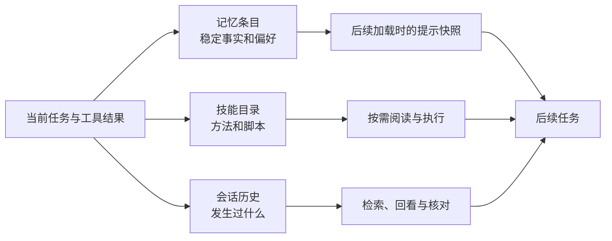

# 前言

<!-- block: hermes-front.b-opening -->
昨天已经说过项目用 unittest，今天又推荐 pytest；上周修过的发布步骤，这周还要重新解释。我们希望一个长期使用的 Agent 记得这些事。但“记得”至少有三种意思：把一句事实放进下一次提示词，把操作方法写成技能，或者从旧会话中找到当时的证据。Hermes 把这几条路放进同一个工作环境，这也是本书选择它的原因。

## 读完以后要能做什么

本书围绕一个小项目展开：维护名为 Aurora 的资料仓库。你会把稳定偏好写入用户档案，把项目事实写入记忆，把检查资料的方法整理成技能，再逐步接入工具、历史检索和定时任务。这个项目不需要贵重设备，规模也小，文件、请求和状态的变化都能逐项查看。

前八章处理“下一次会话怎样得到正确知识”。第九至十四章处理扩展、外部服务和长期运行。最后四章把这些部件接成可维护的工作流：可以备份、排错、修正，也能判断所谓自我改进到底改变了什么。插件专题从目录发现讲到注册句柄、卸载、数据归属和失败路径，接着写一个只读资料清单工具。

第一次读，可以先到[第 1 章第 1.6 节](ch01.md)建立 Aurora，再到[第 17 章第 17.1–17.2 节](ch17.md)运行八步流程，看一次改名怎样造成断链、修复后报告怎样变化。这两处只需要本书仓库与 Python，不必先安装 Hermes 或配置模型。回到第 2–6 章时，你手头已有具体文件，可以将工具、会话、记忆与技能逐一放进去。

想先研究存储，可以按[附录 C](appendix-c.md)准备上游源码，运行第 4 章的组件实验；想写插件，可以从[第 9 章](ch09.md)的完整随书实现与离线测试开始。完整宿主与模型实验各有额外前提，相关章节会说明。源码阅读也不必从整个 Python 项目的第一行开始，每章都给出当前问题对应的入口。

## 这本书固定了哪一版

全书写作基线为 Hermes Agent v0.23.0，实际提交是 `2bd378ed1b8d6bf2192cb26e0a55ff3091e6bd19`。上游许可证为 MIT，本书是独立编写的中文分析与教程。正文引用固定提交；官网后来增加的能力，需要另查版本。

本版已经实际运行上游 MemoryStore、威胁模式扫描器、原子文件写入器和技能元数据函数，覆盖冻结快照、重复添加、局部修订、预算拒绝、歧义删除、批处理失败、重新加载以及损坏编码。它们在 Windows 的隔离目录中运行，没有调用外部模型。驱动只对必要的导入环境作了适配，没有启动 CLI 和工具注册系统。附录 C 列出了这些改动与实验范围；完整 Hermes 的端到端运行尚未验证。

## 先画出三条知识路径

以 Aurora 为例，记忆可以只留一句“检查范围由项目根目录 rules.json 决定”；技能说明怎样运行检查器、怎样解释退出码；历史则保留“这次发布为什么把归档纳入范围”的讨论。记忆加载后还会形成一份提示快照，即这次加载时交给系统提示的内容。文件后来更新了，这份快照仍可能保持原样，第 4 章会直接比较它们。

这几种材料各有用途。十页错误日志会挤占 MEMORY.md 的常驻空间，私人信息放进可共享技能会扩大传播范围；只靠历史检索，又可能反复重建已经明确的操作步骤。

## 关于命令和安全范围

书中的实验默认使用单独的 Hermes home、临时项目与虚构数据。这里隔离的是应用的数据目录，并不是操作系统沙箱。工具和插件拥有的实际能力，还取决于运行账号、终端后端、挂载、网络与凭据。因此，数据放在哪里与程序能访问什么，需要分别配置。

涉及安装的命令由读者在自己的机器执行；本书的组件实验不会启动 gateway，不会创建会发送到真实聊天平台的 cron 任务，也不会读取个人模型凭据。你可以在没有 API key 的情况下先理解并验证知识存储。接入真实模型后，还要观察这些知识有没有改善任务结果，以及费用和外部服务的表现。文件写入成功只回答了存储问题。

## 怎样使用随书项目

手工跟做使用第 1 章创建的 .scratch/aurora-lab，它包含三份当前文档、一份归档和一份规则文件。后面会改名、改变扫描范围、写错配置，再观察记忆、技能和工具怎样参与恢复。第 17 章的八步驱动则每次另建项目，不会接管这份手工练习目录；它适合随时重看完整过程。

随书的另外两组实验也可以独立运行：原创插件测试检查处理器与注册入口，Aurora 驱动运行本地命令行。它们和上面的 MemoryStore 实验各有命令与记录。完整模型对话、插件宿主、调度和平台消息，则留作读者在自己的测试环境中继续观察。

阅读源码时可以先抓住状态变化：旧内容在哪里，哪个函数得到修改权，什么时候写磁盘，失败后谁负责恢复。书中的时序图围绕这些问题展开，图后的源码链接可用于逐步跟读。
