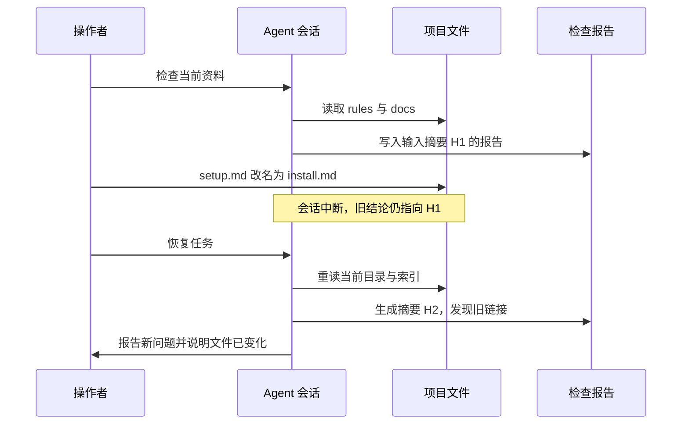

# 第 3 章：会话状态与恢复

<!-- block: hermes-ch03.b-opening -->
恢复昨天的会话后，Agent 记得修改计划，文件却已经被你手动改过。此时旧消息是真实历史，磁盘也是当前事实；问题在于两者不再描述同一个状态。会话恢复负责延续对话，不会自动把工作目录恢复到历史时刻。

## 3.1 历史不是一个聊天字符串

Hermes 的 SessionDB 使用 SQLite 保存会话与消息，并把标题、使用量、搜索、压缩、网关关系等能力拆在多个模块中。`hermes_state.py` 是进入这套存储的入口。会话还可能有父子关系、来源和结束原因，这些信息决定哪些记录被检索、恢复或当成新的开始。

可以把状态分成四层：原始持久记录，供模型使用的当前历史表示，本轮工具的运行状态，以及项目文件。前三者有联系，但没有任何一层天然成为第四层的事务日志。一个工具已经写入文件后，消息保存失败，也不意味着那次写入消失。


虚线提醒我们：恢复后常需要重新读取项目文件。旧消息里的“检查通过”可能已经失去前提，发布前还需核对当前文件。

## 3.2 Session ID、来源与路由键

session_id 标识一次持久会话；gateway 的路由键回答某条外部消息应进入哪个会话。后者可能结合平台、聊天位置、参与者、线程或 profile。相同用户名不一定对应同一个身份，不同平台的同名群也不应共享一份上下文。

本书所用版本的 gateway/session.py 提供 SessionSource、SessionContext、SessionEntry 和 build_session_key 等结构。它对外部标识做规范化，并在构造上下文文字时处理不可信值。这说明“显示出来的聊天名称”和“存储使用的路由身份”有不同职责。用聊天标题当数据库主键，会在改名、同名和多平台接入时留下隐患。

故障排查时记录 session_id、profile 和来源即可满足很多需求；公开报告不必附上真实用户或聊天平台 ID。想观察路由，可以用虚构 ID 做单元输入，没必要为了测试而给别人发送真实消息。

## 3.3 压缩改变的是哪些历史

长对话无法把全部内容永远放进有限的模型窗口。压缩模块会整理上下文，保留后续所需材料。压缩摘要是另一份表示，不能当成原始对话的逐字副本：它可能省略失败尝试、细小约束和工具输出的尾部。

该版本的会话存储和压缩代码有恢复上限、压缩状态与消息内容表示等专门处理。因此，数据库中的记录可能没有全部进入下一次请求；模型没提到的内容也可能仍在数据库里。追查某项事实时，可以依次查看存储、恢复过程和最终请求。

当重要约束只存在于一次长工具输出中，可以把它提炼成带出处的项目记忆，或者写入项目文档。这样的持久化应由明确的规则驱动；不能把压缩过程中随手生成的推测直接升级为长期事实。

## 3.4 中断后先查副作用

想象一个任务顺序执行：生成文件、跑测试、上传报告。程序在第二步被中断。恢复会话时，第一步的文件可能已经存在，测试进程可能仍在运行，第三步可能根本未开始。重试整个任务容易重复生成或重复投递。

更稳妥的恢复输入是：列出当前存在的产物，检查相关进程和日志，再从最后一个可证明的状态继续。给工具动作设计可重复的标识，也比依赖模型记忆可靠。例如生成报告使用确定文件名和内容校验，投递前保存发送标识；这些是业务工作流设计，Hermes 的会话 ID 不会替你自动完成。

对于只读任务，恢复成本小得多。重复读取临时文件不会产生同类业务副作用，因此本书先用只读例子建立观察方法，再讨论持续任务。发邮件、部署或付款会留下不同的副作用，需要各自设计重试规则。

## 3.5 一个可以核对的恢复记录

```text
任务：检查 Aurora 资料清单
最后确认：inventory.json 已写入，SHA-256 已记录
未确认：链接检查是否结束
当前文件：源文档在中断后有两处人工修改
恢复动作：先重新生成清单，再决定是否复用旧检查结果
```

这份记录交代了下一步要核对什么，也保留了尚不清楚的中间状态。恢复后重新读取相关文件，可以及时发现旧计划与当前磁盘的差异。

本书的 MemoryStore 实验会创建新的存储对象证明记忆文件能重新加载；那不是 SessionDB 恢复实验。完整会话恢复、崩溃恢复和数据库迁移仍需要独立环境验证。附录 C 分别列出了这些实验的状态。

## 3.6 一次中断留下了两种时间
沿用第 1 章的 .scratch/aurora-lab，先运行检查器并保存 reports/latest.json。以下命令仍从本书仓库根目录执行：把 docs/setup.md 改名为 install.md，但暂时不修改 index.md。这模拟了一个常见现场：前半步文件改动完成，后一半引用修复还没有做，终端或 Agent 就中断了。

```powershell
Rename-Item -LiteralPath .scratch/aurora-lab/docs/setup.md -NewName install.md
python hermes/examples/aurora_lab.py check .scratch/aurora-lab
$LASTEXITCODE
```

现在检查器返回 needs-review，退出码为 1，问题指向 index.md 中仍然引用的 setup.md。会话里之前那句“没有断链”描述的是改名前的输入；新报告描述的是改名后的输入。两句话并不必然矛盾，关键在于它们对应的文件状态不同。恢复会话时若只续写最后一句话，而不重读文件，就容易沿着旧状态继续工作。

报告的 input_digest 可以帮助分辨这两个时间点。它与会话 ID 不同：同一个会话可以检查多个输入，同一个输入也可以被多个会话检查。用会话 ID 充当文件版本，会在人工编辑、其他 Agent 或定时任务加入之后失效。

## 3.7 会话数据库不替项目保存事务
在固定源码的 hermes_state.py 中，先定位 SessionDB，再看它如何选择数据库路径、打开连接和处理读写。默认数据库由 Hermes home 下的 state.db 提供。代码特意在调用时重新解析 home，允许运行时作用域变化；这与某些模块在导入时捕获环境变量的方式不同。排错时应查实际连接路径，不能只凭启动脚本里的一行环境设置判断。

数据库保存会话及其相关记录，项目文件则由工具在另外的路径修改。即使两者都各自可靠，也不存在一个自动包住“写项目文件、记录工具结果、发送回复”的全局事务。进程可能在任何两步之间退出。比如文件已写入但工具结果还没落库，恢复后再次执行同一动作就可能重复；工具调用已记录但底层写入失败，恢复后也不能只凭有这条记录就认定文件存在。

确认动作是否完成，需要回到执行它的系统。资料检查可查输入摘要与报告，发布可查服务端返回的版本号，消息发送可查平台消息 ID。会话记录保存这些关联，具体结果仍以各系统为准。



这张图没有假定 SessionDB 与文件写入的先后细节；它强调的是两个存储位置的状态会独立变化。真正追踪完整宿主时，还要把数据库事件加到图中，以实际日志确定中断发生的位置。

## 3.8 用可重做的步骤修复现场
对这个样本，恢复动作很明确：读取 index.md，把其中的 setup.md 改为 install.md，重新检查。配套测试 test_change_and_recovery_have_distinct_input_digest 实际走过初始、损坏、修复三个状态，并确认三份输入摘要不同，最后恢复为 checked。

这个测试故意没有让程序直接回退改名。恢复有时意味着继续完成用户的改动，有时才意味着撤销。若用户本来就想把文件改成 install.md，自动把它改回 setup.md 虽然也能让链接检查通过，却偏离任务目的。测试通过只证明当前约束满足；恢复计划还要对照用户为什么改文件。

完成后，手工练习目录里保留的是 docs/install.md，index.md 也指向新名称。后文若仍用 setup.md 说明初始样本，沿着本章跟做的读者应查看 install.md 中的同一段内容，不必把文件改回去。

恢复后的记录应保存修改理由：“安装说明已改名，更新索引中的本地链接。”这比“修复失败”具体，也能解释为什么没有改 release-notes.md。如果输入摘要在修改期间再次变化，先停下基于旧文本的编辑，重新核对差异。尤其是多个编辑者共用工作树时，同一路径仍存在，不代表其中的段落仍是你刚读过的内容。

恢复会话的 UI、会话数据库加载和本节的项目恢复是三个可分别测试的层次。本节已经执行的是项目文件与报告的恢复。你在完整 Hermes 中复做时，可以将同一组操作夹在会话关闭与重新打开之间，观察宿主保存了什么，而不需要另造一套无法比较的演示。

## 3.9 只读查看数据库，避免造出一份空现场
研究实际会话前，先复制或备份到专门的实验位置，再使用只读连接。普通 sqlite3.connect 在路径不存在时可能创建一个新数据库，导致你一边查看空表，一边误以为历史被清空。下面的代码只展示现有实验数据库的表名，不修改内容：

```python
import sqlite3
from pathlib import Path

snapshot = Path("experiment-state.db").resolve(strict=True)
connection = sqlite3.connect(snapshot.as_uri() + "?mode=ro", uri=True)
try:
    rows = connection.execute(
        "SELECT name FROM sqlite_master WHERE type='table' ORDER BY name"
    )
    for (name,) in rows:
        print(name)
finally:
    connection.close()
```

这里只使用 SQLite 的通用结构查询，没有把某一版内部表字段当成稳定导出 API。接下来可以对照本书所用版本的 SessionDB 与各个 mixin 阅读 schema，确认消息、会话和压缩关系，再决定查询哪些列。公开排错时保留结构和合成记录即可，不要把整个数据库作为最小复现附件。

SessionDB 的类定义列出了消息、搜索、压缩、迁移、网关等多组 mixin。它采用多读者与单写者相关的 WAL 路径，并区分普通写入、会话文本写入和活动观察写入的等待预算。这个设计说明“更新一条活动时间失败”与“保存用户消息失败”不能粗暴视为相同错误。读日志时应先辨认写入目的，再看重试是否合理。

## 3.10 工具调用记录应当能对应一个结果
模型提出工具调用后，历史需要保留调用与返回之间的关联。仅存一段“运行了检查器”的文字，会在重放时丢失输入参数和错误结果。观察完整宿主时，核对工具名、调用标识、参数和返回是否仍能配对，尤其是在压缩、取消或异常之后。

对于 Aurora，一次结果可用退出码、input_digest 和报告位置描述。若压缩摘要只剩“检查通过”，后来就无法判断它属于改名前还是改名后。摘要不必包含所有 JSON，却应该保留会影响后续决定的身份信息。恢复时再读取原始证据，就能把有限上下文与完整历史接起来。

源码定位：[SessionDB](https://github.com/NousResearch/hermes-agent/blob/2bd378ed1b8d6bf2192cb26e0a55ff3091e6bd19/hermes_state.py)、[会话压缩](https://github.com/NousResearch/hermes-agent/blob/2bd378ed1b8d6bf2192cb26e0a55ff3091e6bd19/agent/conversation_compression.py)、[网关会话身份](https://github.com/NousResearch/hermes-agent/blob/2bd378ed1b8d6bf2192cb26e0a55ff3091e6bd19/gateway/session.py)。
