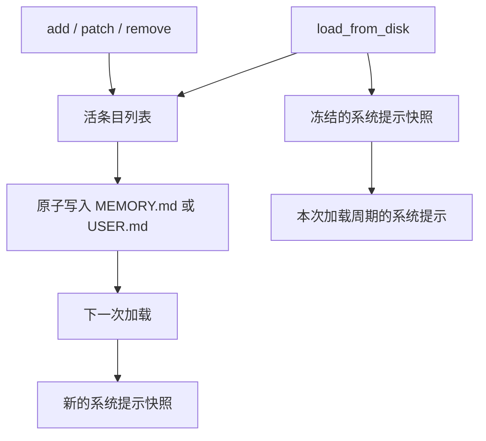
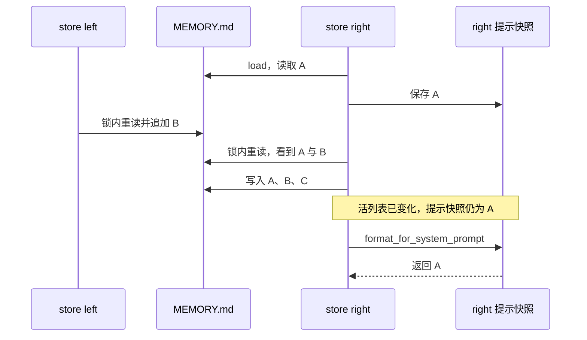

# 第 4 章：Memory 的存储、预算与冻结快照

<!-- block: hermes-ch04.b-opening -->
你让 Hermes 记住“Aurora 使用 unittest”，工具说保存成功，磁盘里也出现了这句话；同一会话的系统提示词却还是旧内容。记忆未必丢了：本书所用版本的 MemoryStore 保留加载时的提示快照，磁盘状态则可以继续变化。本章直接运行上游组件，查看这两份内容何时开始不同。

本章的 MemoryStore 是管理记忆文件的 Python 对象；memory 是模型可以调用的记忆工具，也是其中一个存储目标的名称。下面先看这个目标实际写到哪里，再比较对象内的条目与提示快照。

## 4.1 两个目标，两个字符预算

内置记忆有两个主要目标：`memory` 对应 MEMORY.md，保存 Agent 的持久笔记；`user` 对应 USER.md，保存用户档案。它们位于当前 Hermes home 的 memories 目录。若采用第 1 章的实验 home，位置便是 .scratch/hermes-profile/memories；Aurora 项目里的 docs 和 rules.json 仍留在项目目录中，不会因为写入一条记忆就被改动。构造函数的默认预算分别为 2200 和 1375 个字符，可由配置覆盖；这里的单位是字符，不是 token。

```yaml
memory:
  memory_enabled: true
  user_profile_enabled: true
  memory_char_limit: 2200
  user_char_limit: 1375
```

同样的字符数在不同语言、不同模型的 tokenizer 下会产生不同 token 数。预算还包含条目之间的分隔符；不能只把所有可见句子的长度加起来就假定正好能存下。该版本用换行、`§`、换行连接条目，这个格式也影响匹配和手工编辑。

“Aurora 的测试命令是 python -m unittest”适合放项目笔记；“用户希望回复简短中文”适合放用户档案。一次性调试日志、临时口令和未经确认的猜测都不适合常驻。容量有限迫使我们决定哪些事实值得每次带上，而不是鼓励不断提高上限。

## 4.2 保存成功为什么没有改系统提示

`load_from_disk()` 读取文件、去重，并产生 `_system_prompt_snapshot`。后续 add、patch、remove 改的是活的条目列表和磁盘文件；`format_for_system_prompt()` 返回加载时保存的快照。这里的“活列表”是对象当前持有的条目，“提示快照”则是加载时留下的那一份文字。这样会话中的前缀保持稳定，有利于缓存复用。

例如，首次加载时只有“Aurora 使用 unittest”，后来又保存了“规则在项目根目录 rules.json”。写入成功后，文件与活列表已有两条，当前提示快照仍只有第一条。重新加载才会得到含两条内容的新快照。第 1 章报告里的 snapshot 是被检查文件的摘要清单，与这里用于系统提示的记忆快照是两种对象。



因此，“工具写入成功”“当前模型通过工具结果知道这件事”“系统提示快照包含这件事”是三种证据。模型仍可能从本轮工具返回或对话内容获知新事实，但这不代表被冻结的系统提示已就地刷新。实验中需要把重新调用 load 单独记录，它会开始新的加载周期。

## 4.3 从八项基础检查开始

准备好第 1.2 节检出的 hermes-source 后，从本书仓库根目录执行组件驱动。首次阅读可先看表中的前两项：同一次写入之后，文件与提示快照怎样不同；其他场景再对应后面各节：

```powershell
python hermes/examples/check_memory_components.py --upstream hermes-source --without-yaml
```

其中 hermes-source 必须是本书固定提交的源码目录，准备方式见附录 C。驱动使用真实 MemoryStore、威胁模式扫描器、原子写入函数与 home 解析器；只适配了 memory_tool 的路径和操作系统文件锁入口，避免启动整套工具注册系统。`--without-yaml` 表示不加载这组实验用不到的 YAML 依赖，技能头部只检查真实解析器的降级路径。

| 输入或动作 | 本机观察 |
| --- | --- |
| 空 store 加入一条事实 | 文件立即出现，当前提示快照仍为空 |
| 新 store 重新加载 | 提示快照出现已保存事实 |
| 重复添加完全相同条目 | 返回成功，条目数仍为一 |
| 把 pytest 局部改为 unittest | 条目其余内容保留，旧提示快照不变 |
| 向 100 字符实验预算加入 101 字符 | 拒绝，文件字节不变 |
| 两条记忆都含 unittest，以该词删除 | 因匹配歧义拒绝，文件不变 |
| 批处理中先添加，再修改不存在文本 | 整批失败，前面的添加也没有提交 |
| 写入损坏 UTF-8 后尝试添加 | 拒绝覆盖，没有把坏文件当成空文件抹掉 |

驱动为每次运行建立 .scratch/agent-series/hermes-memory-* 目录，实验中的记忆与结果都在那里，独立于你的手工 Hermes home 和 Aurora 项目。终端会逐项打印结果，报告记录来源摘要与场景；文件位置和导入适配详见[附录 C](appendix-c.md)。

100 和 70 是本书实验使用的小预算，方便触发边界，不是上游默认值。基础检查与本章后半的实验共 17 项，脱敏记录在 facts 中。这里没有调用外部模型，不能据此评价模型是否会选择正确的记忆内容。

## 4.4 patch 与 replace 不是同一种修改

该版本的存储层仍有 replace 方法，用 old_text 找到条目后替换整条内容；patch 则只替换匹配到的文本片段，保留其余部分。当前 memory 工具主要暴露 add、patch、remove 或 operations 批处理；存储层的 replace 并不因此成为当前工具 schema 中必然可用的动作。

假设条目是“Aurora 使用 pytest，文档位于 docs”。把 pytest patch 成 unittest，会保留文档位置。若用整条 replace，只给出“使用 unittest”，就可能丢掉另一项事实。修订前先读完整条目，再选择操作，不能只看一个关键词。

匹配规则也值得认真对待。完整条目相等优先于子串匹配；子串命中多个不同条目时拒绝。实现还会处理引号、破折号和空白的常见差异，但这种宽容不意味着可以随意改写 old_text。最稳妥的做法仍是从当前条目复制一个唯一片段。

## 4.5 锁和原子替换各保护什么

修改路径先获取单独锁文件，重新读取磁盘，再运行变更并保存。重新读取能减少两个 store 先后写入时覆盖对方新增条目的风险；临时文件加原子替换则避免读者看到只写了一半的内容。Windows 路径使用 msvcrt，Unix 路径使用 fcntl，具体锁行为仍依赖操作系统和文件系统。

这两个机制不能保证所有写入者都合作。你用编辑器或外部脚本直接改 MEMORY.md，可能没有使用同一把锁。该版本对超长、无法正常往返的外部内容有漂移检测和备份保护，目的是避免一次整理悄悄丢掉原文。看到这种拒绝，应先检查备份和文件结构，而不是持续要求模型重试。

## 4.6 满了以后先整理，别把错误写成成功

超预算时应合并重复事实、删除失效事实，或者把长方法搬到技能与项目文档。删除之前保留来源，尤其是可能影响真实业务的偏好或约束。自动整理失败也有成本：该版本对每轮连续整理失败设了上限，超过后返回终止性结果，避免模型为了“记住”一件事把整轮回复耗尽。

一条更好的最终回复是“这次没能写入，原因是预算不足；当前回答仍按你的新要求执行”。把保存失败坦白出来，比无依据地说“已经记住”更有用。下次会话是否真正带上这条要求，可以通过新建 store 或新启动会话检查，而不是凭当前对话里恰好出现过它判断。

## 4.7 逐行看一次 add 怎样落盘
打开 memory_tool_store.py，先看 add，再跟入 _mutate。add 对传入文本作必要检查，构造一个“给当前条目列表追加内容”的局部操作，然后交给 _mutate。真正处理持久化的关键顺序在后者：取锁、读磁盘、解析当前条目、运行操作、更新对象中的活列表、写文件、构造成功返回。

下面是为讲解压缩过的伪代码，省略了扫描、漂移和错误分类，不可替换上游实现：

```python
with file_lock(path):
    raw, readable = read_raw_checked(path)
    if not readable:
        return read_error()
    current = parse_and_deduplicate(raw)
    result = apply_operation(current)
    if isinstance(result, dict):
        return result
    self.live_entries = result.entries
    atomic_write(path, result.entries)
    return success()
```

这里最容易略过的是“重新读磁盘”。store 对象中可能还保留一分钟前的列表；锁只能安排谁先进入临界区，不能让旧列表自动变新。如果拿到锁后仍直接保存自己的旧列表，后一个写入者照样可能覆盖前一个人的新条目。重读与锁必须一起看，才说明这种读改写路径如何减少丢失更新。

随书的确定性交错实验这样安排：left 和 right 两个 store 都先读取同一文件；left 加入“Aurora docs are under docs/.”；right 随后加入“Aurora archives are excluded.”。最终磁盘里两条都在。right 的提示快照却没有 left 新增的 docs 事实，因为它仍是 right 最早加载时的快照。这一次结果同时说明了磁盘合并和提示冻结，两种行为并不冲突。

## 4.8 三个位置放在同一张时间表里
用 A 表示原来的“使用 unittest”，B 表示后来加入的“文档位于 docs”。下面三列分别属于磁盘、对象活列表和提示快照：

| 时刻 | 磁盘内容 | right 活列表 | right 提示快照 |
| --- | --- | --- | --- |
| right 首次加载 | A | A | A |
| left 添加 B | A、B | A | A |
| right 再添加 C | A、B、C | A、B、C | A |
| 新对象重新加载 | A、B、C | 新对象为 A、B、C | 新对象为 A、B、C |



调试时若只打印 memory_entries，你会认为模型马上应该看到 B；若只打印 format_for_system_prompt，又会误以为写入丢了。把两者连同磁盘内容一起记录，才知道差异来自设计中的生命周期，还是来自实际失败。

## 4.9 审批过的条目也可能已经过期
设想模型准备将“Aurora uses unittest.”改成新说明，工具先展示这条旧内容供用户审阅。等待期间，另一会话已把 unittest 改成 pytest。如果审批回来后仍只拿“Aurora uses”这个子串重新搜索，就可能修改一条用户根本没审过的新记录。

存储类为这种情况提供 resolve_entry 和 matched_entry。resolve_entry 在锁内返回当时完整命中的条目；后续 patch 或 remove 可以带上这个完整值。_locate 看到 matched_entry 后，要求当前列表仍包含那一整条内容，否则返回 stale_entry 类错误。它检查的是被审阅对象是否仍然存在，不仅是关键词是否仍然命中。

扩展实验实际走了这个顺序：right 解析旧条目，left 修改它，right 带旧 matched_entry 尝试 patch。写入被拒绝，磁盘字节不变。这样的失败应让上层重新读取并重新决定，不能通过去掉 matched_entry 来“解决”报错；去掉它等于放弃原先保护的条件。

批处理也需要考虑同样的问题。先解析一批旧目标，再隔一段时间执行，期间的修改可能使原计划失效。该版本也提供批量解析路径；读源码时既要看 operations 的顺序，也要看它们基于哪一次磁盘视图。不能把单个锁内批处理的原子性推广成跨多个用户决定的长事务。

## 4.10 写入异常暴露出一个重要分界
故障注入实验替换 atomic_write_text，让它在触碰磁盘之前抛出 OSError。上游 _write_file 将其转换成 RuntimeError，磁盘仍是旧条目。可是 _mutate 已经把新列表放进对象，所以 fault.memory_entries 包含那条尚未保存的新内容。重新调用 load_from_disk 后，对象才与磁盘重新一致。

这不是断电实验，也没有声称原子替换本身失效。它说明调用者不能在捕获写入异常后继续把对象列表当作“已经持久化”的状态。故障处理应明确选择重新加载或丢弃该对象，随后再决定是否重试。报告保留了这个差异，未为消除它而修改上游存储实现。

原子写入通常解决“读者看到半个文件”的问题；锁解决合作写入者之间的顺序；审批条目固定的是待修改的内容；重新加载解决异常后内存视图的恢复。四者保护的对象不同，组合使用才构成较可靠的存储路径。它们仍不覆盖不遵守锁的外部编辑器，也不能替网络磁盘提供它没有的本地文件系统语义。

## 4.11 超长外部内容与反复整理
再把 MEMORY.md 手工写成 120 个字符，用 100 字符预算加载。加载会保留条目并发出超限提示，不会擅自截断。尝试把这个超长条目 replace 成短句时，漂移保护拒绝重写并保存备份；明确删除整条时，也先保留备份再删除。测试核对了备份字节，确认它确实包含原内容。

这里的“漂移”有具体含义：单条内容长于整个目标预算，可能来自外部文本被粘在条目尾部，也可能来自预算后来调低。普通空白、条目周围的空行不会被一律视为危险漂移。源码的 _has_oversized_entry 体现了这个判断，不能把它描述成任何手工编辑都会触发拒绝。

另一个实验连续四次 patch 不存在的文本。前三次给出可纠正的失败，第四次出现 done，要求停止本轮记忆整理。reset_consolidation_failures 模拟下一轮重新开始后，普通失败响应恢复。成功写入也会重置连续失败计数。这个设计防止附带的记忆整理拖住用户真正要完成的任务；错误恢复应回到当前工作，而不是无限尝试把一句话塞进存储。

## 4.12 批处理为什么只检查最终预算
假设已有一条旧说明，准备换成 90 字符的新说明，而目标预算只有 100。若先单独 add，再 remove，第一步可能因为临时总量超限失败；若先 remove，再 add，第二步失败又可能让旧说明已经消失。把两步放进一次 batch，可以让它们在同一当前视图上决定最终结果。

组件实验使用下面的真实调用形状：

```python
result = store.apply_batch("memory", [
    {"action": "add", "content": "N" * 90},
    {"action": "remove", "old_text": "Old project note has thirty chars"},
])
```

测试先写入那条旧说明，再执行批处理。最终磁盘只有 90 个 N，返回成功。中间列表曾经比 100 字符更长，但预算在批处理结果上判断。它与前面“后一个操作找不到目标时，前面的新增也不提交”的失败样本组合，说明了批处理的两个方面：允许合理的中间状态，同时要求整批能得到有效终态。

这次批处理的原子性限于一个目标：调用接受一个 target，测试也只覆盖同一目标内的 operations。它不能跨 memory 与 user 一起提交；业务若要同时修改两者，还需处理其中一个成功、另一个失败时的恢复。

## 4.13 从返回内容判断上层下一步
_success_response 包含 success、done、target、usage、entry_count 等信息，某些修改还会返回被替换或被删除的旧内容。普通成功不会回显整份条目列表，以免模型把写入结果又当成一轮“还有什么可整理”的邀请。成功写入也重置连续整理失败计数。

这使工具结果本身参与控制后续行为。done 告诉上层本次写入已经完成，usage 帮助理解预算，旧内容字段帮助发现意外覆盖。对照这些字段检查最终回复，比只匹配字符串“成功”更可靠。特别是替换动作，如果返回的旧条目包含你原本不想丢掉的另一项事实，应及时修复，而不是等下次会话才发现知识消失。

源码定位：[真实存储实现](https://github.com/NousResearch/hermes-agent/blob/2bd378ed1b8d6bf2192cb26e0a55ff3091e6bd19/tools/memory_tool_store.py)、[工具动作与写入门控](https://github.com/NousResearch/hermes-agent/blob/2bd378ed1b8d6bf2192cb26e0a55ff3091e6bd19/tools/memory_tool.py)、[原子文件写入](https://github.com/NousResearch/hermes-agent/blob/2bd378ed1b8d6bf2192cb26e0a55ff3091e6bd19/utils.py)。
