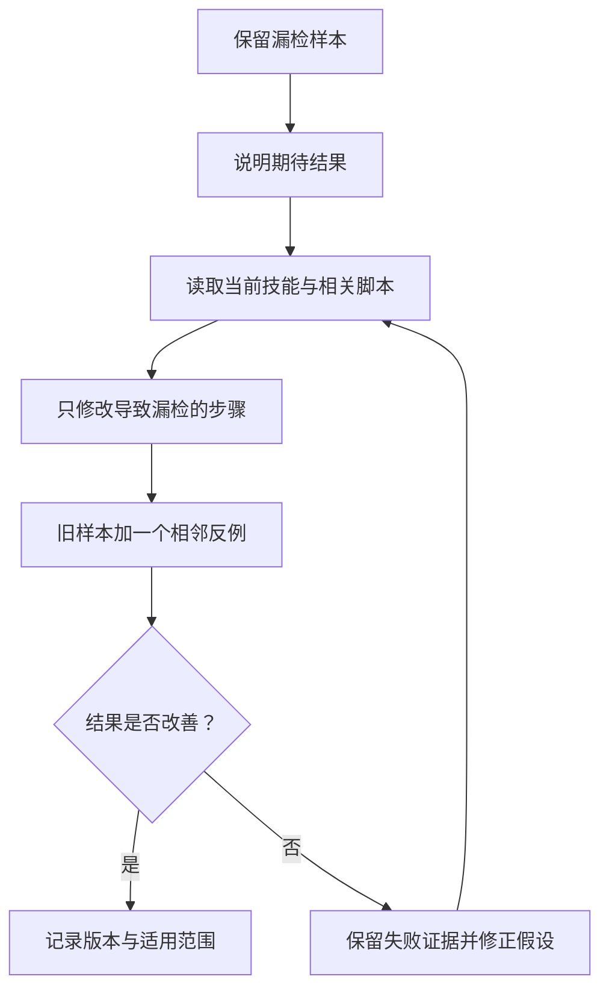

# 第 6 章：从任务经验到技能修订

<!-- block: hermes-ch06.b-opening -->
设想一次资料检查连续漏掉代码块里的链接，你准备给旧技能增加“扫描代码块”这一步。但若没有保留漏检样本，下一次又可能为了减少误报把它删掉。本章用 Aurora 中已有的占位地址观察这次需求变化：先改规则让检查器提取它，再判断技能该怎样解释结果。

## 6.1 把一次失败整理成小样本

先保留能重现问题的最小输入，同时注明哪条是正文引用、哪条是代码块里的示例。记录旧流程检查了什么、漏了什么，以及用户需要哪种结果，再决定是否纳入代码块。下面的短片段只说明这两类材料的区别；实际跟做使用第 6.6 节的 Aurora 文件，其中已有带占位 URL 的代码围栏。

```markdown
资料引用：https://example.invalid/reference

示例命令里也有一个 URL，但它可能只是说明用的占位值。
```

对于出版资料，读者可能会照抄示例 URL，因此应标记占位地址；对于源码说明，代码中的地址未必要求在线可访问。技能要写清这层区别。把所有 URL 都当成失效链接，会产生大量噪声，最后让使用者忽略真正的问题。

## 6.2 改的是方法，还是某次任务的例外

“本次忽略 archived 目录”可能只是临时范围；“默认检查前先确认归档目录是否在范围内”才是可以复用的方法。把临时例外直接写成永久规则，会让下一个项目继承并不适合它的假设。

可以把修订拆成三部分：触发条件、操作步骤、可观察结果。比如“输入含归档目录时，先读取项目范围说明；输出中注明是否扫描了该目录”。这比“注意特殊情况”具体，也不会强迫所有项目采用同一处理方式。

稳定的项目事实留在项目文档或 memory；普遍适用的检查步骤留在 skill；这次为什么做出决定留在会话证据。三者可相互链接，各自保存需要的部分。

## 6.3 skill_manage 提供写入能力，不替你判断好坏

本书所用版本的 skill_manager_tool.py 支持创建和编辑技能文件，维护路径检查、保护规则以及相应批处理能力。修订写到磁盘后，还需用样本对照检查效果；写入成功本身不说明方法有所改善。

现有技能可能来自内置、用户目录或其他安装来源。代码会处理实际修改位置，不能假设“编辑某技能”一定是在个人目录中新建副本。如果你希望保留上游版本，应先明确副本策略，避免下一次同步时覆盖自己的改动，或者无意改坏其他项目共用的技能。

修改前读取当前正文尤其重要。一个长期运行进程看到的材料可能落后于磁盘；另一个会话也可能刚写过同一文件。相对于“重写整个 SKILL.md”，基于当前文本的局部修订更容易审阅。它仍不自动解决语义冲突，所以重要变化应保留 diff。

## 6.4 一次可重复的修订流程



相邻反例指看起来相似、实际上不应触发同样规则的情况。例如正文中的真实引用和代码块里的示例地址。只验证原来的漏检样本，容易得到“见到 URL 就报错”这种过度修复；增加反例才有机会看出规则是否过宽。

输出中还应保存执行命令、样本版本和错误解释。如果模型使用了新版依赖，旧结论可能不再有效。日志中可以直接写明哪个输入从失败变为正确，哪些情况还未处理。

## 6.5 自动维护也要有触发和停止条件

Hermes 的 Agent 入口包含后台 review 相关逻辑，并区分用户明确发起与自动触发的情形。后台维护可以减少重复劳动，但它也会增加并发和状态变化：用户还在当前任务中，技能文件却可能在另一条路径上被更新。

后台维护先限于一个明确的技能目录，并保留差异和原版本。是否需要修改，仍要看失败是否确实来自技能。错误可能来自网络、权限、模型不遵从或工具实现，而这些问题并不总能靠多写一条提示修好。

当没有足够证据时，记录候选改进而不立刻覆盖正文也是合理结果。只在需要时修改，有助于减少未来的重复错误，也避免无效改动。第 18 章会进一步讨论怎样用对照实验评价这种变化。

## 6.6 一次可观察的修订：补上示例 URL
先打开手工项目中的安装说明。初始文件叫 setup.md；若已完成第 3 章的改名与索引修复，当前文件叫 install.md，以下操作使用这个新名称，内容无需还原。

Aurora 的 setup.md 中有一个代码围栏，里面写着 https://example.invalid/demo。这个地址是故意放入的占位示例，不应被当作已经上线的服务。旧规则 scan_examples=false，检查器会跳过围栏内容，因此 observations 为空。若用户现在要求“把读者可能照抄的占位地址也列出来”，我们有了明确的新需求。

用编辑器修改当前项目 rules.json 中的 scan_examples，将 JSON 布尔值 false 改为 true，保留 include_archive 为 false。然后在本书仓库根目录重跑第 1 章的检查命令。报告会新增一条 example-url observation，path 指向 setup.md（改名后为 install.md），对应行号也会保留，placeholder 为 true。它不会因此进入 issues，退出码仍可为 0。原因是观察到一个说明用地址，与发现一个断开的项目文件引用，需要不同的后续处理。

配套测试 test_example_url_is_an_observation_not_a_broken_link 实际比较了开关前后的结果。测试没有要求工具把所有 URL 判为失败，也没有伪造外网可达性。这个小样本为技能修订提供了具体目标：模型要解释占位用途，不能把它写成“线上地址失效”。

## 6.7 修订应该改哪里
现在有三处可能修改。rules.json 决定项目是否要求扫描示例；检查器决定怎样识别与分类；SKILL.md 决定 Agent 怎样使用和解释结果。把同一段判断复制进三处会制造不一致。我们的做法是：项目开关留在 rules，确定性提取留在 Python，技能只解释执行顺序和 observation 的含义。

如果旧检查器根本无法识别代码围栏，单改技能要求“检查代码块”会让 Agent 每次手工扫描，结果可能不稳定。相反，若 Python 已经返回了正确 observation，模型却把它当成业务失败，问题主要在结果解释；继续改正则表达式反而可能损坏已经正确的提取。从结果定位到出错的环节，就能决定这次应改规则、Python，还是技能中的说明。

一次合理的修订记录可以写成：

```text
输入：setup.md 代码围栏中的 example.invalid 地址
旧结果：未提取；旧规则关闭示例扫描
新增要求：提取并说明占位用途，不访问外网
程序变化：通过 scan_examples 开关产生 observation
技能变化：区分示例观察与失效的项目引用
回归：普通本地断链仍进入 issues
```

这份记录同时交代需求和实现的变化：旧规则要求跳过示例，新要求才将它们纳入。比较两次结果时应保留这个前提，否则旧程序按要求工作的行为，也可能被误记为缺陷。

## 6.8 根据当前文件生成小差异
随书的 aurora-review 已包含本章讨论后的分类要求：对 example-url 解释是否为占位示例，不将它们全部判为失效链接。直接使用这份文件时，改扫描开关便可观察新结果，无需再重复追加这句话。只有你自己的旧技能尚未区分这两类结果时，才需要做下面的局部修订。

skill_manage 提供 patch 等写入入口，实际使用前应读当前技能正文。源码里的路径解析、支持文件检查和技能锁说明了编辑动作怎样被约束，但它们不代替内容审查。

如果项目原本已有自定义术语或执行方式，整篇替换 SKILL.md 很可能把这些内容抹掉。先保存文件摘要，再基于唯一片段生成局部修改，会更容易看出是否覆盖了别人刚写的段落。修改后回读文件，核对预期差异；若匹配片段已经消失，重新读取后再编辑，不要放宽到一个随处可见的短词。

本书所用版本的 guard_agent_created 默认为 false，是可选门控。skill_manage 创建的程序并非全部经过强制安全审查；它们能读写哪些文件、调用哪些外部服务，仍由执行环境和具体实现决定。

## 6.9 保留一个会让新方法出错的反例
为了检查修订没有过头，再在正文放入一个指向 missing.md 的普通 Markdown 链接。这次应进入 issues，退出码为 1。占位 URL 仍然只是 observation，两类结果同时出现时，最终回复要分别说明：一个需要决定是否保留示例，另一个需要修复文件引用。

完成这个反例后，移除自己为练习加上的 missing.md 链接并重新检查，保留 scan_examples=true。此时资料仍可通过有限检查，同时 reports/latest.json 中保留占位 URL 的 observation；后续章节可以从这个状态继续。

如果新技能只会说“示例地址可以忽略”，它可能误把正文中的真实断链也忽略。反例的价值就在这里：它使“减少误报”必须保留检测真实问题的能力。长期维护时可把这种最小样本留在 tests，技能修订记录链接到测试，而不是把越来越长的失败故事全部粘进 SKILL.md。

源码定位：[技能编辑与保护入口](https://github.com/NousResearch/hermes-agent/blob/2bd378ed1b8d6bf2192cb26e0a55ff3091e6bd19/tools/skill_manager_tool.py)、[技能定位与读取](https://github.com/NousResearch/hermes-agent/blob/2bd378ed1b8d6bf2192cb26e0a55ff3091e6bd19/tools/skills_tool.py)、[后台 review 入口](https://github.com/NousResearch/hermes-agent/blob/2bd378ed1b8d6bf2192cb26e0a55ff3091e6bd19/run_agent.py)。
