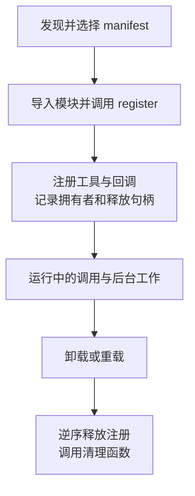
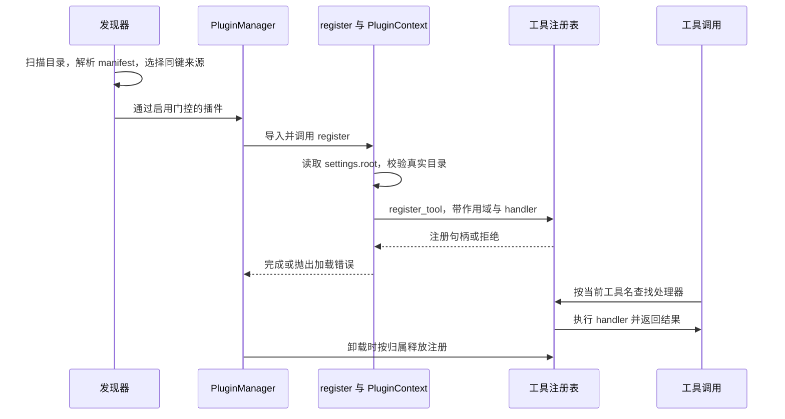

# 第 9 章：工具与插件扩展

<!-- block: hermes-ch09.b-opening -->
技能能教 Agent 怎样检查资料，但它不能凭空提供读取目录的程序能力。要增加一个确定的动作，需要工具；要让工具随 Hermes 启动、受配置管理并在卸载时释放注册，需要插件。本章用一个资料清单插件把这些步骤接起来。

## 9.1 工具、技能和插件各做什么

工具包括模型可见的 schema 和实际执行的 handler。技能是可阅读的方法说明及配套材料。插件则是装入宿主的程序单元，可以注册工具、Hook、命令或其他能力。一个插件可以带工具，一个技能可以调用工具；二者不是同义词。

在本书所用版本中，通用目录插件使用 plugin.yaml 与暴露 `register(ctx)` 的 Python 模块。发现还可能涉及内置目录、用户目录、项目目录和 Python entry point。配置是否允许加载、依赖是否满足、同名来源如何选择，都发生在工具调用之前。项目插件还需满足启用条件，文件放进仓库后未必会执行。

```text
plugins/
  book-inventory/
    plugin.yaml
    __init__.py
```

```yaml
name: book-inventory
version: 0.1.0
description: 列出指定资料目录中的 Markdown 文件
provides_tools:
  - book_inventory
```

完整插件由 [plugin.yaml](examples/book-inventory/plugin.yaml) 和 [__init__.py](examples/book-inventory/__init__.py) 两个文件组成。前者说明名称与提供的工具，后者包含 SCHEMA、目录校验、清单处理器和 register。跟读时打开这两个文件；正文中的片段只抽出当前要讲的部分，不能单独拼成安装包。

这里有两个相似的名称：book-inventory 是插件目录与配置中的键，book_inventory 是注册给模型的工具名。第 5 章的 aurora-review 则是另一份技能，负责说明检查步骤。插件提供列出文件的动作，不会自动替换技能或运行 Aurora 链接检查器。

想先看到结果，可到第 9.13 节运行离线测试，再回来跟读加载过程。这组检查不要求模型凭据，也不发送外部请求；在完整宿主中安装插件的准备见第 9.6 节。

## 9.2 register 不是一次工具调用

插件加载时，register 接收 PluginContext。可以先把 ctx 理解为宿主交给插件的接口对象：本例从它读取 root 配置，再把工具交给它注册。下面抽出注册核心；SCHEMA 与 make_inventory_handler 的完整定义在随书 __init__.py 中，注册拒绝的处理见第 9.9 节：

```python
def register(ctx):
    root = ctx.get_config("root", "")
    handler = make_inventory_handler(root)
    ctx.register_tool(
        name="book_inventory",
        toolset="book_inventory",
        schema=SCHEMA,
        handler=handler,
    )
```

这里先读取 root，make_inventory_handler 随后校验目录，并返回一个记住该目录的函数。这个函数就是 handler；直到模型调用 book_inventory 时，它才遍历资料。读取配置、构造处理器、注册和执行因此是不同步骤，工具注册成功后还要检查它是否进入本次模型请求。调试时可分别记录发现、register 和调用；导入顶部的一行 print 只能确认模块已经执行到那里。

本例工具不接收任意路径，只列举操作者配置的根目录。handler 拒绝缺失目录与链接目录，限制返回条目数量，并输出相对路径。这样可以减少误读其他目录的机会；它仍在宿主进程中运行，不构成对恶意插件代码的沙箱。

## 9.3 注册句柄与卸载账本

该版本的 PluginContext 会追踪许多注册，保存归属和释放动作。`on_unload(callback)` 注册清理函数，按获取的逆序与注册拆除交错执行；清理异常被记录。`spawn_task(coro)` 创建受监督的异步任务，卸载或强制重载会请求取消，但协程仍应正确处理自己的 finally。



没有通过宿主跟踪的线程、文件句柄或远程连接，不会因为注册表清空就自动消失。插件自行开了资源，应尽早登记对应清理动作；初始化失败之前已经写入的文件也不会自动回滚。明确每项资源由谁持有，也就容易找到卸载时该调用的清理函数。

本书核对了这些源码路径，尚未在完整 PluginManager 中运行卸载实验。原创插件的离线处理器检查能验证输入与结果，但不能代替宿主发现、作用域或卸载时序的实验。

## 9.4 同名覆盖必须是有意行为

一个插件把自己的工具命名为 write_file，可能遮住原来的实现。该版本的注册逻辑对跨工具集覆盖有拒绝路径；通用插件显式 override 还需要操作者配置允许。模型仍按原工具名称调用，实际得到的能力却可能已经改变。

最好给原创工具使用可辨识的名称，并让描述准确说明范围。确实要替换时，把版本、输入兼容性、返回形状和卸载后的恢复行为一起测试。只验证新工具能返回文本，不足以证明旧调用方仍正确工作。

## 9.5 Hook 不应默认当作拦截器

Hook 的含义取决于具体触发点和返回值消费方式。观察型回调适合记录阶段、计时或统计；能否改参数、能否拒绝动作，要看该 Hook 的契约。例如 pre_tool_call 中抛出的异常是否阻止工具执行，必须看调用方如何处理。

通用插件源码区分普通 Hook、异步调用与中间件等接口。阅读时从注册函数追到 invoke 的调用方，检查错误如何处理、返回值是否被使用、回调是否按当前 profile 路由。这些细节决定了回调出错后宿主会继续还是停止。

## 9.6 把示例放进一个独立 profile
先运行第 9.13 节或[附录 C](appendix-c.md)中的离线检查，确认处理器在当前 Python 上能列出临时资料、拒绝错误输入，再准备完整宿主。将本书 hermes/examples/book-inventory 整个目录复制到当前 Hermes home 的 plugins 下，保留 plugin.yaml 与 __init__.py。采用第 1 章路径时，目标是 .scratch/hermes-profile/plugins/book-inventory。配置使用下面的形状：

```yaml
plugins:
  enabled:
    - book-inventory
  entries:
    book-inventory:
      settings:
        root: D:/agent-labs/aurora
```

示例中的 D:/agent-labs/aurora 是占位目录，换成你当前 Aurora 项目中 docs 目录的绝对路径。若从第 1 章连续跟做，这个目录位于本书仓库的 .scratch/aurora-lab/docs。指向 docs 后，返回清单只覆盖该目录；rules.json 位于上一级，仍由别的读取工具处理。

get_config("root", "") 读取的是这个插件 settings 中的 root，不是配置文件顶层的 root。有效插件键还取决于目录分类：把相同 manifest 放进多层目录后，配置命名空间可能随之变化。初次实验保持示例的扁平布局，等加载与调用都看清楚后再移动。

enabled 是允许名单，disabled 是优先的拒绝名单；两边都有同一个名字时，应先修正这份矛盾配置。项目内 .hermes/plugins 还要检查 HERMES_ENABLE_PROJECT_PLUGINS。按该版本选择来源的顺序，后扫描的项目或用户副本可能遮住同键的内置副本，所以遇到“改了代码却没变化”，可先查实际加载路径。

示例在 register 时校验目录，不接受空路径，也不自动退回当前目录。处理器只收空对象，模型不能通过参数请求扫描任意磁盘位置。它最多返回 100 条 Markdown 相对路径；超过时保留前面的结果并设置 truncated。扫描目录项也有独立上限，避免一个文件很少却带着大量无关目录的树消耗过久。这个上限属于原创示例，不是 Hermes 的全局默认值。

符号链接和 Windows junction 都会被排除。这样的检查适合操作者控制的静态资料库，不能保证抵御其他进程在检查与遍历之间恶意替换目录。需要抵御这类替换时，还需配置操作系统的目录权限和进程隔离；示例的路径判断不构成完整沙箱。

## 9.7 从一次错误走到可重复的排查
假设工具一直没出现。第一步看宿主是否发现了 manifest；没有发现就查目录与项目门控。发现但没启用时查允许名单、拒绝名单与有效键。启用了却注册失败时，检查错误根目录、Python 导入和 manifest 依赖。注册成功后仍未进入当前模型请求，再查本次工具集与会话装配。按这几步检查，可以将故障缩小到具体的加载阶段。

发现工具后故意将测试目录改名。示例的 handler 会返回明确错误，而不会返回空清单冒充成功。恢复目录后再试，确认错误没有让插件持有永久失效的状态。本次离线检查实际覆盖了这个情况，也覆盖了清单上限、非法参数和链接路径，加上注册拒绝与缺配置检查，总计 9 项通过。FakeContext 只检查注册参数，宿主生命周期仍未运行验证。

升级插件时，先保存旧代码、配置和一个稳定样本，然后观察同样的输入是否得到相同路径与错误形状。若新增后台观察线程，应加入卸载后线程停止的证据；若新增远程连接，应验证连接关闭与失败恢复。当前示例没有后台资源，也就无需清理回调。

## 9.8 读 manifest 时先分清声明和运行结果
plugin.yaml 的 provides_tools 声明插件打算提供哪些工具，真正把处理器交给宿主的仍然是 register(ctx)。在 YAML 里多写一个名字，不会自动生成函数；Python 中注册一个工具，也不能假定所有管理界面都会从代码反推完整元数据。发布插件时应让两份信息一致，便于操作者在执行代码之前判断用途。

该版本的 manifest 解析器认识 manifest_version、api_version、requires_plugins、python_dependencies、config_schema 等字段，最高支持的 manifest schema 版本为 2。版本需求、可选依赖和配置类型各有解析入口，含义要从相应函数确认。解析器还会兼容部分未知字段，因此“解析没有报错”并不说明宿主已执行自定义约束。

本书插件只使用必要的 name、version、description、provides_tools，避免让入门例子依赖未展示的安装机制。升级时先记录宿主版本、插件版本和两个文件的哈希。如果要引入新的 manifest 字段，先查看对应版本的解析函数如何消费它，再补对应失败样本：缺少依赖、类型错误、宿主版本不满足时分别会发生什么。

目录名与 manifest.name 也不是永远等价。分类目录会形成有效插件键，配置命名空间和启用操作可能使用这个键。你复制别人的配置片段时，应把它放回自己的实际目录结构检查。否则看起来有正确的 enabled 名称，实际加载的却可能是另一个来源，或者根本没有匹配到这份插件。

## 9.9 从 register_tool 的返回值判断注册是否被接受
该版本的 register_tool 先检查 override 权限，再读取当前作用域里同名工具的注册快照，随后调用 registry.register。成功后，它还会核对实际注册项及 handler 归属，才创建被宿主跟踪的句柄。返回类型是 Optional[PluginRegistration]，这意味着调用返回并不总能用来宣称注册成功。

因此，本书完整示例在核心片段之外增加了一个检查：

```python
def register(ctx):
    handler = make_inventory_handler(ctx.get_config("root", ""))
    registration = ctx.register_tool(
        name="book_inventory",
        toolset="book_inventory",
        schema=SCHEMA,
        handler=handler,
    )
    if registration is None:
        raise RuntimeError("book_inventory registration was not accepted by the host.")
```

这样，缺少 root 会在注册之前失败；注册被拒绝则会在插件加载阶段报错，两者都能在模型第一次调用之前发现。测试中的 RejectingContext 返回 None，检查插件是否把拒绝变成可见异常；另一个 MissingConfig 确认缺少目录时根本没有调用 register_tool。

这两项测试验证原创插件如何处理接口返回，没有覆盖真实注册表中的同名冲突。后者仍需在宿主中同时观察旧工具、作用域和卸载后的恢复，尤其是多个 profile 共处一个进程时，仅查看全局字典中的名称还不够。

## 9.10 一张加载时序图里的五个故障位置


manifest 解析失败发生在 Python 插件执行之前；root 无效发生在 register 内；同名工具拒绝发生在注册表附近；目录在运行中消失发生在 handler 内；清理失败发生在卸载阶段。把它们写进一份“无法使用”的错误信息，会让使用者来回重装，却没有改到真正的故障条件。

调试输出不需要打印整个配置。保存插件键、来源路径、版本、阶段和错误类别已经能回答很多问题。root 可能包含私人目录，公开问题报告时可替换成合成路径；保留“目录不存在”与“目录是链接”的区别，比保留真实用户名更有用。

## 9.11 能力声明、操作者授权与进程权限
替换内置工具是一个具体的敏感入口。普通外部插件即使显式传入 override=True，也要通过宿主的能力检查；该版本的 _tool_override_allowed 通过 plugin_capability_granted 查询 tools.override，并兼容旧 allow_tool_override 配置。内置 bundled 插件有维护者设定的信任分支。把这些条件简化成“所有插件都必须开同一个布尔值”会漏掉版本兼容和来源差异。

另一个入口是 ctx.call_mcp。它读取当前插件的 mcp_allowlist，默认不给任意服务器访问权，并复用宿主已有的 MCP 客户端路径。这个门控保护的是通过该宿主 API 发起的调用。因为插件本身是进程内 Python，恶意代码若直接导入网络库，仍可能使用操作系统赋予进程的网络能力。能力 API 与进程沙箱不能相互替代。

book-inventory 不请求覆盖工具，不调用 MCP，不读取模型凭据。它把可读范围固定在操作者给定的 root，模型参数只能是空对象。此举减少了模型把路径改成其他目录的机会，但目录校验仍只是这段程序自愿遵守的规则。安装者仍需审查或信任插件代码，manifest 中的“只读”声明不会强制限制它。

如果将来增加“生成报告”的工具，应另起明确名称，说明写入目录和覆盖条件。若在原本只列文件的 book_inventory 内增加自动修复，已有技能仍会把它当只读动作，实际副作用却已经改变。工具 schema 的兼容性不只有参数形状，还包含动作的范围。

## 9.12 清理的逆序为什么有用
考虑一个真正拥有资源的扩展：先建立连接，再注册工具，最后启动观察任务。卸载应先停止新任务，再拆工具注册，最后关闭连接，否则工具可能在连接已关闭后仍被调用。PluginContext 跟踪注册与 on_unload 回调，把释放动作按获得资源的逆序交错执行，有助于维持这种依赖关系。

spawn_task 创建的任务也会被跟踪，卸载或强制重载会请求取消。取消不是远程操作回滚；协程需要在 finally 释放自己的临时资源，外部服务里已经提交的动作要由业务协议处理。清理回调异常会记录而不向外传播，这能让其他清理继续，但也意味着操作者必须查看错误记录，不能只凭卸载命令返回就断言所有资源都结束了。

回到 book-inventory，它只在调用期间遍历文件，没有需要 on_unload 收尾的长期句柄或后台任务。增加缓存或观察线程后，才需要相应的清理设计。

升级测试可以从同一个合成资料库开始：旧版返回三条路径，新版仍返回同样路径，超限标志与错误形状也保持兼容。若新版本引入缓存，要额外验证新增文件何时可见、卸载是否清掉缓存、不同 root 是否意外共用结果。version 从 0.1.0 改成 0.2.0 时，这些行为也应一并核对。

## 9.13 怎样阅读九项离线测试
在本书仓库根目录执行以下命令，和[示例说明](examples/README.md)中的命令相同：

```powershell
python -m unittest discover -s hermes/examples -p "test_*.py" -v
```

它会一起运行 9 项插件测试与 6 项 Aurora 检查器测试，共 15 项。[test_book_inventory.py](examples/test_book_inventory.py) 对应本节插件，[test_aurora_lab.py](examples/test_aurora_lab.py) 对应资料检查器；测试各自在临时目录准备样本，不会读取或改动你的 .scratch/aurora-lab。读测试结果时按文件中的类和用例区分两组，15 项通过并不表示完整 Hermes 宿主已经启动。

正常清单测试检查相对路径、扩展名大小写和非 Markdown 文件排除。上限测试同时检查返回条数与扫描目录项预算，避免只限制输出却仍无限遍历。链接测试真实创建符号链接，确认链接文件和目录都不进入结果；系统不允许创建时会显式跳过，这次本机实际运行通过。

参数测试传入 root 字段、列表和 None，确认模型无法通过输入扩大目录范围。消失目录测试先构造 handler，再删除目录，检查运行阶段的错误。最后三项围绕注册：正常参数、宿主拒绝、缺少配置。它们分别回答“传入了什么”“拒绝有没有被忽略”“错误配置是否仍暴露工具”。

这些测试可以随代码修改重复执行，适合作为插件升级时的第一道检查。接下来才是完整宿主中观察发现、工具可见性、真实调用与卸载。两层结果分开保存，出了问题才能知道是处理器本身变了，还是接入宿主的条件发生了变化。

源码定位：[PluginContext、注册与清理](https://github.com/NousResearch/hermes-agent/blob/2bd378ed1b8d6bf2192cb26e0a55ff3091e6bd19/hermes_cli/plugins.py)、[manifest 与依赖次序](https://github.com/NousResearch/hermes-agent/blob/2bd378ed1b8d6bf2192cb26e0a55ff3091e6bd19/hermes_cli/plugins_manifest.py)、[发现与启用门控](https://github.com/NousResearch/hermes-agent/blob/2bd378ed1b8d6bf2192cb26e0a55ff3091e6bd19/hermes_cli/plugins_discovery.py)、[工具注册表](https://github.com/NousResearch/hermes-agent/blob/2bd378ed1b8d6bf2192cb26e0a55ff3091e6bd19/tools/registry.py)。
