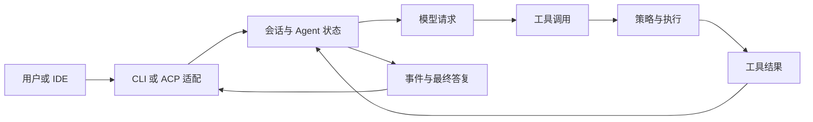

# 第 2 章：一条请求经过哪些层

<!-- block: kimi-ch02.b-opening -->
Kimi Code 的客户端负责交互，核心引擎负责会话和工具；沿请求与结果的往返路径阅读源码更容易定位问题。

“助手没有回答”可能是界面没显示、模型请求没完成、工具仍在等待，也可能是回合已经失败。若把整个程序看成一个聊天窗口，这些状态很容易混在一起。

## 2.1 从入口到执行

固定源码是一个多包仓库。`apps/kimi-code` 包含 CLI 与终端界面；`packages/agent-core-v2` 承担引擎；`packages/acp-server` 提供 ACP 适配；`packages/kap-server` 服务其他客户端；`packages/transcript` 组织通信记录。这些目录说明职责，不能仅凭目录名推断某个入口实际经过了全部组件。

本书对 ACP 的调用链有直接落点：`apps/kimi-code/src/cli/sub/acp.ts` 注册 `kimi acp`，动态导入 `@moonshot-ai/acp-server`，再调用 `runAcpServer`。因此 ACP 不是把终端界面的文字输出包成 JSON，而是一个专门的协议入口。



图中省略了缓存、日志和并发细节，目的是跟踪“哪一层拥有当前事实”。模型提出读取文件，不等于读取已经成功；只有工具结果返回，后续推理才有实际内容。

## 2.2 状态按生命周期归属

引擎目录区分 `app`、`workspace`、`session` 和 `agent`。这四层可以帮助判断一个对象应活多久：安装插件需要应用范围的管理；项目发现依赖工作区；会话保留恢复信息；一个 Agent 有自己的执行状态和上下文。

例如插件清单位于 `app/plugin/manifest.ts`，Agent 文件发现位于 `workspace/workspaceAgentProfileLoader/`，而工具策略还要在会话和 Agent 范围内消费。一次安装改变目录，不代表当前请求立刻使用新提示词。第 11 章的重载问题正来自这些生命周期不同。

读源码时可以先写下三个问题：对象在哪里创建，谁持有它，何时释放或重建。若一个修改只触及磁盘文件，就继续寻找运行时如何重新读取文件；若只是刷新界面，就检查引擎状态是否同步改变。

## 2.3 用库存审查追一次往返

用户让助手审查 `inventory.py`。模型可能先要求 `Read`，宿主检查该 Agent 是否能用这个工具，再执行读取。工具结果把文本放回上下文，模型据此指出比较符号的问题。

这一轮有四种不同证据：用户请求说明目标；工具调用说明模型想做什么；工具结果说明实际拿到了什么；最终答复说明模型怎样解释材料。审查结论是否正确，还得回到业务规则和可复现输入。

如果工具结果写着文件不存在，助手却引用了具体行号，应先查它引用的来源。它可能看到了旧上下文，也可能推测了文件内容。重新发同一句请求通常无法区分这两种情况，保留完整往返记录才可以。

## 2.4 客户端会影响观察方式

交互终端会展示审批、工具进度和折叠内容；`-p` 让外部脚本消费输出；ACP 通过请求、响应与通知协调 IDE。三种入口共享不少机制，但展示与控制方式不同。

因此，重现一个故障要记录入口，而不是只写“Kimi 失败”。命令行报告里保留完整参数；ACP 报告里保留请求 ID、方法名和返回错误；终端交互问题则记录当时的模式与提示。把这些信息补齐后，才能判断应该读 CLI、适配层还是核心引擎。

## 2.5 读代码时怎样缩小范围

在固定源码根目录可以搜索：

```bash
rg -n "registerAcpCommand|runAcpServer" apps/kimi-code/src packages/acp-server/src
rg -n "parseManifest" packages/agent-core-v2/src/app/plugin
rg -n "parseAgentFileText" packages/agent-core-v2/src/workspace
```

先定位入口，再读调用者与返回值消费者。一个函数名里出现 `validate`，不能直接推断它会拒绝整个插件：它可能只返回诊断，最后由调用者决定处理方式。第 11 章会用实际解析器验证这一点。

源码落点：[ACP 命令入口](https://github.com/MoonshotAI/kimi-code/blob/1c142a007c10e881602690def96057c23a2baa12/apps/kimi-code/src/cli/sub/acp.ts)、[引擎包定义](https://github.com/MoonshotAI/kimi-code/blob/1c142a007c10e881602690def96057c23a2baa12/packages/agent-core-v2/package.json)。
