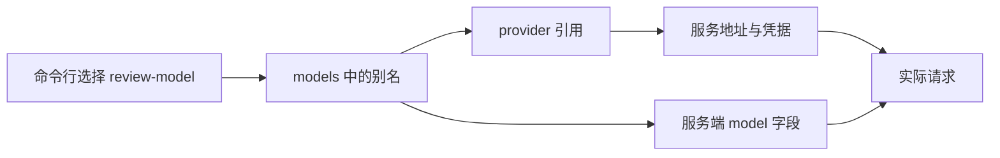

# 第 3 章：配置、模型别名与实验数据目录

<!-- block: kimi-ch03.b-opening -->
KIMI_CODE_HOME 决定 Kimi 专用配置与会话的位置，模型别名再把用户选择连接到具体服务。

配置错误常表现为模型不可用，但根因可能是读错文件、别名不存在，或凭据并未进入程序实际读取的字段。先把这条映射画出来，再处理网络问题，会少走很多弯路。

## 3.1 分开运行设置与界面偏好

默认数据根是 `~/.kimi-code/`。`config.toml` 保存模型、权限、Hook 等运行设置，`tui.toml` 保存终端界面偏好。会话、凭据、日志和插件目录也在数据根下。

实验时使用新的专用路径。在书籍仓库根目录、一个专门用于练习的 PowerShell 窗口中设置：

```powershell
$env:KIMI_CODE_HOME = Join-Path (Get-Location) '.scratch/kimi-study-data'
$env:KIMI_DISABLE_TELEMETRY = '1'
New-Item -ItemType Directory -Path $env:KIMI_CODE_HOME -Force | Out-Null
```

这里改变的是当前进程环境，随后从该窗口启动的 Kimi 会继承它。关掉窗口不会删除实验目录。不要把系统的 `HOME` 或用户目录改成练习路径，其他工具也可能依赖它们。

`KIMI_CODE_HOME` 并不隔离所有可见资源。通用的 `~/.agents/skills/` 和 `~/.agents/agents/` 仍位于真实用户目录。第 9、10 章会分别说明发现规则；若实验要求完全控制技能集合，应使用该功能提供的显式选择入口。

## 3.2 别名与服务端模型名

如果使用 Kimi 官方服务，先完成上一节的数据目录设置，再在练习目录运行 `kimi`，进入界面后输入 `/login`。按平台选择器使用 Kimi Code OAuth 或 Kimi Platform API key；登录流程会写入相应配置与凭据。第 1 章的离线库存检查不需要登录，后续模型审查练习才需要。下面的手工配置用于解释别名与提供者的关系，也适用于有兼容接口的其他服务。

配置中一条模型记录有两个关键关系：`provider` 指向提供者，`model` 是发给服务端的模型标识。`-m` 选择的是配置中的别名。三者恰好同名时很省事，不同名时也完全合法。

下面仅展示配置形状，端点与模型名需要替换成你有权使用的真实服务：

```toml
default_model = "review-model"

[providers.review-service]
type = "openai"
base_url = "https://api.example.com/v1"
api_key_env = "REVIEW_MODEL_KEY"

[models.review-model]
provider = "review-service"
model = "replace-with-service-model-id"
max_context_size = 32768
```

示例的上下文数值不是任何线上模型的能力承诺。它必须与服务端支持范围一致；配置填得更大，不会让模型接受更长的请求。



## 3.3 环境变量不总是自动生效

在这个版本中，常见的 `KIMI_API_KEY`、`OPENAI_API_KEY` 和 `ANTHROPIC_API_KEY` 不会仅因出现在 shell 环境中，就自动成为任意 provider 的凭据。配置可以使用明确的 `api_key_env`，或按文档填写 provider 的字段。`KIMI_MODEL_*` 临时模型机制则是另一条显式入口。

`api_key_env` 保存的是变量名，不是密钥本身。它与 `api_key`、`oauth` 互斥。若变量为空，应检查运行 Kimi 的那个进程实际继承了什么，而不是把密钥复制进更多地方试错。

这也解释了为什么从终端能用、IDE 却不能用：IDE 进程可能早于环境变量修改启动，或者使用另一个 `KIMI_CODE_HOME`。先对齐启动环境，再比较配置内容。

## 3.4 用配置诊断缩小故障

运行 `kimi doctor` 可检查配置。它不是模型服务的完整连通性与效果测试。字段通过解析之后，还可能遇到别名引用缺失、凭据失效、端点协议不一致或服务端限流。

按顺序核对：数据根、配置语法、别名关系、凭据来源、协议类型，最后才是服务端响应。一个网关提供 OpenAI 风格接口，不代表它支持所有扩展字段；上下文、思考参数和工具调用能力都需要以实际接口为准。

## 3.5 给升级留下可比较的配置

记录非敏感设置、CLI 版本与出错时间即可，不必把整个配置文件放进工单。本书的实验结果只保留版本、能力与摘要，不收录现有账号信息。

如果修改后行为仍旧，检查是否恢复了一个已有会话：启动默认值和会话保存的状态可能承担不同职责。明确是在新会话中比较配置，还是在旧会话中恢复现场，才能解释差异。

源码落点：[配置字段](https://github.com/MoonshotAI/kimi-code/blob/1c142a007c10e881602690def96057c23a2baa12/docs/en/configuration/config-files.md)、[环境变量](https://github.com/MoonshotAI/kimi-code/blob/1c142a007c10e881602690def96057c23a2baa12/docs/en/configuration/env-vars.md)。
