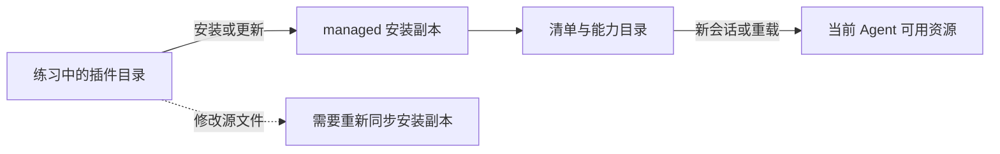

# 第 11 章：把技能、角色和命令装成插件

<!-- block: kimi-ch11.b-opening -->
插件清单把 Skill、Agent、命令和 Hook 组织成一个安装单元，安装副本与当前会话的生效状态需要分别检查。

前两章分别启动了 Skill 和 Agent。团队分发时，更方便的方式是把相关资源放进一个插件目录，统一安装、启用和升级。插件管理解决的是资源组织问题，不应被理解为任意代码都能通过一个字段自动变成工具。

## 11.1 看清完整清单

随书 `review-plugin/kimi.plugin.json` 包含这些入口：

```json
{
  "name": "chengming-review",
  "version": "1.0.0",
  "description": "A read-only review workflow for the Chengming inventory exercise",
  "skills": "./skills/",
  "agents": "./agents/",
  "commands": "./commands/",
  "sessionStart": {"skill": "review-inventory"},
  "hooks": [{
    "event": "PreToolUse",
    "matcher": "^(Write|Edit|Bash)$",
    "command": "python ./hooks/review_only.py",
    "timeout": 5
  }]
}
```

`name` 是插件 ID。技能、Agent 和命令分别从各自目录发现。`sessionStart.skill` 使用插件内部的技能名，不加 `chengming-review:` 前缀；它在会话开始时注入技能文本，不执行 Python 程序。真正的 Hook 程序只在匹配事件发生时运行。

固定解析器还接受 `.kimi-plugin/plugin.json`。如果两个清单同时存在，根目录的 `kimi.plugin.json` 优先。维护时最好只保留一个，避免编辑了被遮蔽的文件还以为配置已经变化。

## 11.2 路径先解析，再检查归属

`skills` 等字段使用 `./` 开头的路径。解析器会计算实际路径，并检查它是否仍在插件根目录内；不仅看字符串是否包含 `..`，还会考虑实际路径解析。

随书源码实验用 `./../` 构造越界技能目录，真实解析器返回错误诊断。这里应准确理解结果：解析函数提供诊断与已解析内容，调用者还要决定如何处理这个插件。不能把“某个字段有诊断”简单等同于任何入口都立即终止进程。

缺少目录也有独立诊断。复制插件时漏掉 `skills/`，可能比 JSON 语法错误更难察觉：清单能读，实际能力却缺了一块。

## 11.3 安装的是副本

在练习目录启动 Kimi 后，输入：

```text
/plugins install ./review-plugin
/plugins info chengming-review
/reload
```

按界面提示检查并完成安装。固定文档说明，本地路径和 ZIP 来源会复制到数据根下的 `plugins/managed/<id>/`，状态写进 `plugins/installed.json`。因此修改练习目录中的原始文件，不会自动改到已安装副本。

开发时可以重新安装更新后的本地目录，再检查插件信息；已有安装副本的修改则需要对应重载。不要把“源目录文件已保存”和“当前 Agent 已经使用新定义”当作同一件事。



## 11.4 三种入口分别做什么

安装后可以调用 `/chengming-review:review inventory.py`。它来自 `commands/review.md`，命令正文中的 `$ARGUMENTS` 会替换为用户传入的目标。命令是可复用提示词，不是绕过工具策略的脚本执行入口。

`/skill:chengming-review:review-inventory` 则加载技能。插件里的 `inventory-reviewer` 是角色定义，可以作为发现到的自定义 Agent 使用。三者都围绕库存审查，但分别负责启动意图、组织工作步骤和限制角色能力。

名字相同并不代表行为相同。若报告没有按预期格式输出，先确认调用的是命令还是技能，再检查该资源是否来自当前安装版本。

## 11.5 重载有多个层次

`/plugins reload` 重读安装状态与清单，并刷新插件技能等能力；当前 v2 引擎还会请求活跃 Agent 重建提示词。正在进行的请求仍持有它原来的系统提示词，不能指望修改在半个请求中途替换已发送内容。

新会话和新建 Agent 从当前启用插件读取贡献。恢复会话则先使用保存的提示词，后续重建再遵循引擎行为。为了教学实验清楚，本书修改插件后采用显式重载或新会话，并记录所用版本。

## 11.6 插件不是任意工具注册器

固定解析器列出了不支持的运行字段，例如 `tools`、`bootstrap` 和 `configFile`。在清单里写这些字段，不会因此获得另一套插件系统的扩展能力。若要暴露程序能力，使用当前支持的 MCP 等入口，并说明它的协议与执行环境。

本章真实组件实验通过了随书清单、路径诊断与清单优先级检查。交互安装、当前会话重载与模型实际调用仍需读者按上面的步骤观察，不能由解析成功推断全部宿主行为已验证。

源码落点：[清单解析器](https://github.com/MoonshotAI/kimi-code/blob/1c142a007c10e881602690def96057c23a2baa12/packages/agent-core-v2/src/app/plugin/manifest.ts)、[插件文档](https://github.com/MoonshotAI/kimi-code/blob/1c142a007c10e881602690def96057c23a2baa12/docs/en/customization/plugins.md)。
