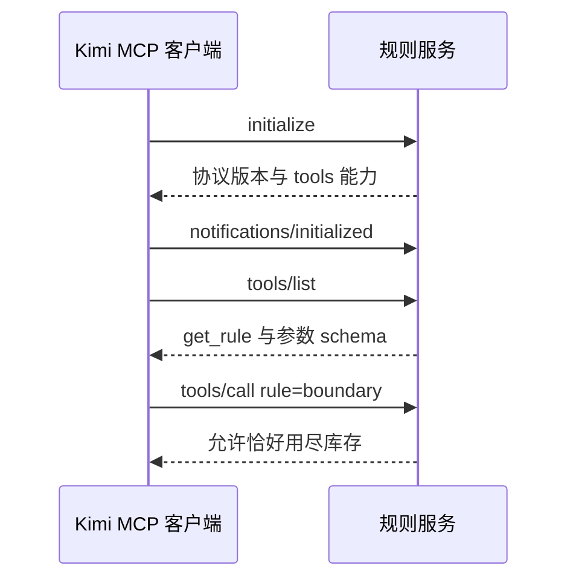

# 第 13 章：用 MCP 查询业务规则

<!-- block: kimi-ch13.b-opening -->
MCP 把外部程序提供的能力接成工具，连接配置、工具发现和 Agent 可用列表是三个不同环节。

库存规则最初是一份 Markdown。真实团队可能把规则存放在数据库、内部服务或需求系统中。MCP 提供了一条把程序能力交给模型调用的通路，本章用一个只读规则服务解释通信过程。

## 13.1 先做一个没有外部依赖的服务

随书 `review-plugin/rules_server.py` 仅使用 Python 标准库，提供 `get_rule` 工具。参数 `rule` 可选 `stock`、`quantity` 或 `boundary`，返回对应文字。服务不访问文件、网络或真实库存，便于读者观察协议而不混入账号问题。

它处理 `initialize`、`tools/list`、`tools/call` 和 `ping`，忽略不需要回复的通知。未知方法返回 JSON-RPC 错误，未知规则则作为工具调用错误返回。这是教学所需的最小协议子集，不是可直接替代通用 MCP SDK 的生产服务器。



## 13.2 直接检查进程通信

第 1 章的 unittest 会启动真实 Python 子进程，按顺序发送握手、工具列表和两次规则查询，再检查响应 ID、成功结果和错误结果。通知不会产生额外响应，stdout 上也没有启动横幅。

stdio 服务器的 stdout 是协议通道。若为了调试在程序开头打印“服务启动成功”，客户端可能把这行当成损坏的 JSON。调试信息应写到 stderr。

这组检查证明原创服务能按预期通信，没有证明 Kimi 已发现该工具或模型会正确使用它。接入宿主需要下一步配置。

## 13.3 在练习副本生成配置

在第 4 章的练习目录运行：

```powershell
python configure_mcp.py
```

脚本创建 `.kimi-code/mcp.json`，写入当前 Python 的绝对路径、规则服务的绝对路径和工作目录。如果文件已经存在，它会停止而不覆盖。这样既避免依赖另一个窗口中的 PATH，也避免把相对路径误解成数据目录下的路径。

生成后的结构包含 `mcpServers.chengming-rules`。该配置是项目级配置，启动新会话后需要按界面检查并信任该项目的服务定义。使用 `/mcp` 查看连接状态，再检查工具列表。

项目级同名服务覆盖用户级定义。删除配置中的服务也不等于立刻销毁所有活跃会话里的工具：固定文档描述了旧会话中的 removed 状态；新增服务则应在新会话中观察其注册结果。

## 13.4 角色还需要允许这个工具

固定命名规则是 `mcp__<server>__<tool>`，因此本例项目服务对应 `mcp__chengming-rules__get_rule`。第 10 章的只读角色只允许三个内置工具，所以不会仅因 MCP 连接成功就自动获得它。

若要做接入练习，可在副本里的 Agent 文件允许列表中增加这个完整名称，然后创建新会话。保留其他限制。不要为了让一个只读工具可见，直接将所有 MCP 工具都加入允许范围。

请求可以写成“查询 boundary 规则，再解释库存 10、预留 10 的预期结果”。观察轨迹里是否真的出现该工具调用，而不是只从之前的文件内容回答。

## 13.5 插件也可以携带 MCP 声明

插件清单支持 `mcpServers`，适合把规则服务和技能一起分发。插件中的 stdio 服务有自己的路径约束，`cwd` 必须落在插件允许的范围内。安装、启用和重载也应结合当前会话的资源生命周期判断。

本书默认清单没有自动启用规则服务，让读者先理解普通 Skill 与 Agent，再按本章显式接入。服务文件已经随插件提供；以后要改成团队插件，应同时维护服务协议、工具 schema 和版本说明。

## 13.6 返回结果也需要业务解释

`get_rule` 返回规则文本，不能替代库存函数的实际测试。工具成功只说明服务完成查询；模型还要把规则应用到代码，最后由具体输入检查结论。

如果将来服务改成真实库存查询，还要重新设计身份、数据范围、失败重试和陈旧结果处理。本例的纯文本字典没有模拟这些行为，因此不能据此推断生产数据库的一致性。

源码落点：[MCP 配置与命名](https://github.com/MoonshotAI/kimi-code/blob/1c142a007c10e881602690def96057c23a2baa12/docs/en/customization/mcp.md)、[MCP 配置 schema](https://github.com/MoonshotAI/kimi-code/blob/1c142a007c10e881602690def96057c23a2baa12/packages/agent-core-v2/src/mcpCore/config-schema.ts)。
