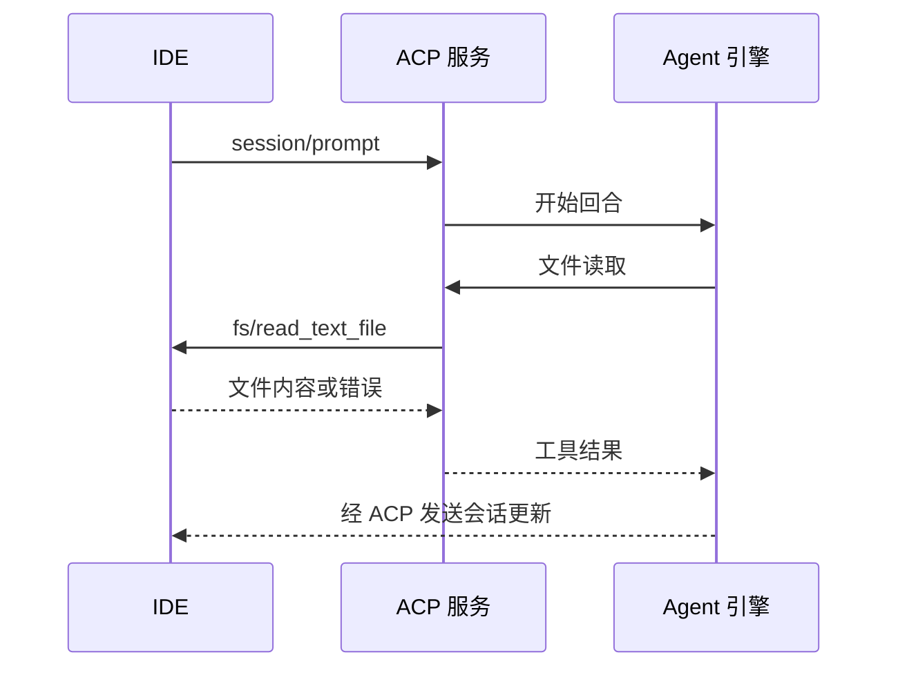

# 第 14 章：通过 ACP 与客户端握手

<!-- block: kimi-ch14.b-opening -->
ACP 让客户端驱动 Kimi 会话，初始化返回能力声明；文件和终端操作还涉及客户端反向调用。

MCP 通常把外部能力提供给 Agent，ACP 则让编辑器等客户端驱动 Agent。两者都会交换结构化消息，但通信角色和任务不同。

## 14.1 启动专门的协议入口

`kimi acp` 在 stdin/stdout 上等待 JSON-RPC 消息。日志写到 stderr，stdout 不输出终端欢迎界面。固定源码的命令入口直接加载 ACP 服务，而不是解析 TUI 屏幕。

第一条请求可以是：

```json
{
  "jsonrpc": "2.0",
  "id": 1,
  "method": "initialize",
  "params": {
    "protocolVersion": 1,
    "clientCapabilities": {},
    "clientInfo": {"name": "kimi-book-probe", "version": "1.0.0"}
  }
}
```

JSON-RPC 的 `id` 用于把响应与请求对应。通知没有同样的请求响应配对，客户端不能把收到的每一行都当成某个等待请求的最终答案。

## 14.2 运行真实握手实验

在书籍仓库根目录运行：

```powershell
python kimi/examples/probe_cli.py --output .scratch/kimi-acp-result.json
```

若 `kimi` 不在 PATH，使用 `--binary` 指定可执行文件。脚本创建临时数据根与空工作区，关闭遥测，启动真实 CLI，发送 `initialize` 和一个不存在的方法，然后终止自己创建的进程并清理临时目录。

本机 2.5.2 返回了协议版本 `1`，Agent 名称 `Kimi Code CLI`，版本 `2.5.2`；未知方法返回 `-32601`。记录位于 `facts/cli-2.5.2.json`，包含发布程序的 SHA-256。

实验没有发送 `session/prompt`，没有调用模型，也没有连接 IDE。它验证协议入口与能力声明，不把这些结果延伸成完整编辑器集成已通过。

## 14.3 能力声明用于协商

本机返回的能力包括会话加载、列举、恢复、关闭、删除与分叉；提示支持图像和嵌入上下文，不支持音频提示。客户端应读取实际返回值，而不是根据版本号硬编码全部能力。

| 方法 | 主要含义 |
| --- | --- |
| `session/new` | 创建会话，提供工作目录等信息 |
| `session/load` | 恢复会话并重放历史 |
| `session/resume` | 恢复连接，跳过历史重放 |
| `session/prompt` | 提交提示并接收更新 |
| `session/cancel` | 中断当前回合 |

`load` 与 `resume` 的区别影响界面数据。若客户端已经保留完整历史，又无条件追加重放内容，可能显示重复消息；若只调用 resume 却期待旧消息自动送来，又可能出现空白会话。

## 14.4 文件操作可能反向请求客户端

当客户端声明相应能力时，引擎文件读取可以走 `fs/read_text_file`，写入走 `fs/write_text_file`；终端命令也可能通过 `terminal/create`、`output`、`wait_for_exit` 等方法返回客户端执行。

因此，ACP 集成中的“工具完成”可能跨过两次进程边界。Agent 发起动作，适配层请求 IDE，IDE 执行后返回结果，Agent 才继续推理。任何一端只记录了请求而没有返回结果，都会留下未完成状态。



## 14.5 审批不是普通文本通知

`session/request_permission` 为工具审批和部分提问提供交互通道。客户端需要按协议返回决定，不能只在日志里显示“需要批准”就认为流程已完成。

同样，取消请求也不是删除聊天气泡。它要进入服务端取消路径，再等待相关动作停止或回报状态。遇到网络断开时，先确认会话与工具的真实状态，再决定重新发送请求。

## 14.6 从握手走向完整客户端

下一阶段可以逐项测试新建会话、历史重放、审批、取消、文件反向调用和终端退出。每项都保留请求与观察结果，避免只靠“界面能聊天”判断集成完整。

源码落点：[ACP 命令](https://github.com/MoonshotAI/kimi-code/blob/1c142a007c10e881602690def96057c23a2baa12/apps/kimi-code/src/cli/sub/acp.ts)、[ACP 方法与能力](https://github.com/MoonshotAI/kimi-code/blob/1c142a007c10e881602690def96057c23a2baa12/docs/en/reference/kimi-acp.md)。
