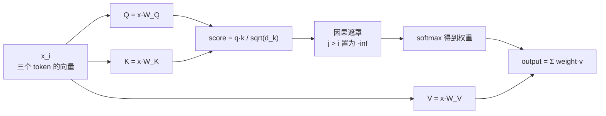

# 第 3 章：注意力在算什么

<!-- block: llm-ch03.b-opening -->
一个客服 Agent 把三份工具回执拼进上下文：第一份是订单，第二份是地址，第三份是改约记录。模型却在回答里把第二份的地址安到了第一份的订单上。三份回执都还在窗口里，字面距离也不远。问题不在“有没有读到”，而在“读的时候把哪些位置混在了一起”。

注意力就在做这件事：每个位置发出一组查询，和所有可见位置的键比较，按相似度分配权重，再把对应的值加权求和。三个 token、两个维度，就够把这套算术手算一遍；再往外看多头、参数和 KV cache 的关系。代码只用 Python 标准库。

## 3.1 每个 token 带着三个角色

同一层里，每个输入向量 `x_i` 通过三个投影矩阵变成三个向量：

```text
q_i = x_i · W_Q     查询：我在找什么
k_j = x_j · W_K     键：  我能提供什么
v_j = x_j · W_V     值：  如果被选中，我交出什么
```

位置 `i` 对位置 `j` 的分数是查询与键的点积，除以 `sqrt(d_k)` 防止维度变大时点积过大、softmax 过尖：

```text
score(i, j) = (q_i · k_j) / sqrt(d_k)
weight(i, j) = softmax_j(score(i, j))      # 只对允许的 j 归一化
output_i = Σ_j weight(i, j) · v_j
```

自回归模型还要加因果遮罩：位置 `i` 只能看 `j <= i`，不能看未来。训练时遮住未来，推理时逐 token 生成，两者的可见集合才一致。这套结构来自 [Attention Is All You Need](https://arxiv.org/abs/1706.03762)，这里只保留推理需要的最小部分。



`W_Q`、`W_K`、`W_V` 是学出来的，不是人工规则。为了手算可读，这里把三个矩阵都设成单位矩阵，于是 `Q = K = V = x`；这只能演示混合方式，不能代表真实模型学到的模式。

## 3.2 三个 token 的手算

取三个 token，每个是二维向量：

| token | `x_i` |
| --- | --- |
| 青禾 | `[1.0, 0.0]` |
| 工作坊 | `[0.8, 0.6]` |
| 报名 | `[0.0, 1.0]` |

投影取单位矩阵，`d_k = 2`，缩放因子是 `sqrt(2) ≈ 1.414`。`llm/examples/attention_demo.py` 算出的因果权重如下（行是查询位置，列是键位置）：

| 查询 \ 键 | 青禾 | 工作坊 | 报名 |
| --- | ---: | ---: | ---: |
| 青禾 | 1.000 | 0.000 | 0.000 |
| 工作坊 | 0.465 | 0.535 | 0.000 |
| 报名 | 0.219 | 0.335 | 0.445 |

第一行只能看自己，权重全给自己。第二行在“青禾”和“工作坊”之间分配，两个向量更接近，权重接近一半一半。第三行的查询是 `[0.0, 1.0]`，和“报名”自己最像，所以自己拿到的权重最大，但仍会分一部分给前两个位置。

加权求和得到的输出：

| token | 输出 |
| --- | --- |
| 青禾 | `[1.000, 0.000]` |
| 工作坊 | `[0.893, 0.321]` |
| 报名 | `[0.488, 0.646]` |

输出是所有可见位置按权重混合后的新向量，不是选中某一个 token。所谓“模型把地址安错了订单”，在机制上就是订单位置的查询把地址位置的值混了进来。

去掉因果遮罩，第一行会变成：

```text
weights [0.424, 0.368, 0.209] -> output [0.718, 0.429]
```

同一个 token，因为能看见未来，输出从 `[1.000, 0.000]` 变成了 `[0.718, 0.429]`。这就是训练时遮罩必须和推理时一致的原因；遮罩写错，模型会学到“偷看答案”的表示。

## 3.3 多头：同一层里的几组视角

一个头只能学一种“怎么比较”。多头让同一层并行跑几组不同的 `W_Q`、`W_K`、`W_V`，每组的维度是 `d_head = d_model / heads`，最后把各头输出拼起来，再过一次输出投影 `W_O`。

示例用两个一维头：一个只看第一维，一个只看第二维。因果权重与拼接结果如下：

| 头 | 青禾 | 工作坊 | 报名 |
| --- | --- | --- | --- |
| 维度 0 的权重 | `[1.000, 0.000, 0.000]` | `[0.540, 0.460, 0.000]` | `[0.333, 0.333, 0.333]` |
| 维度 1 的权重 | `[1.000, 0.000, 0.000]` | `[0.411, 0.589, 0.000]` | `[0.180, 0.329, 0.491]` |
| 拼接输出 | `[1.000, 0.000]` | `[0.908, 0.353]` | `[0.600, 0.688]` |

“报名”在第一维上的查询是 0，所有键的分数也都是 0，softmax 退化成均匀分布，于是这一头输出前两个位置第一维的平均值 0.6。第二维的查询是 1，能区分三个键，输出就更集中。这个对比说明：不同头看到的是不同的相似度结构，拼接后模型可以同时保留多种混合方式。

<!-- block: llm-ch03.b-params -->
多头的参数账要按 `d_head` 算，不能把 `d_model` 当成每头维度。忽略 bias、LayerNorm 和前馈层，每层注意力的四个投影是：

```text
MHA（kv_heads = heads）:
  Q = O = d_model²
  K = V = d_model × kv_heads × d_head = d_model²
  合计 = 4 × d_model²

GQA / MQA（kv_heads < heads）:
  Q = O = d_model²
  K = V = d_model × kv_heads × d_head
  合计 = 2 × d_model² + 2 × d_model × kv_heads × d_head
```

脚本按 `d_model = 4096`、`heads = 32`、`d_head = 128` 算出的每层参数：

| 配置 | KV 头数 | Q | K | V | O | 合计 | 每 token KV cache（32 层，fp16） |
| --- | ---: | ---: | ---: | ---: | ---: | ---: | ---: |
| MHA | 32 | 16 777 216 | 16 777 216 | 16 777 216 | 16 777 216 | 67 108 864 | 512 KiB |
| GQA | 8 | 16 777 216 | 4 194 304 | 4 194 304 | 16 777 216 | 41 943 040 | 128 KiB |
| MQA | 1 | 16 777 216 | 524 288 | 524 288 | 16 777 216 | 34 603 008 | 16 KiB |

GQA 的动机、训练与转换方法见 [GQA 论文](https://arxiv.org/abs/2305.13245)；把 KV 头直接降到 1 的版本见 [MQA 论文](https://arxiv.org/abs/1911.02150)。GQA 把 KV 头从 32 降到 8，注意力参数约降到原来的 62.5%；MQA 再降到约 51.6%。Q 和 O 没有变小，因为每个查询位置仍要保留完整的输出宽度。真实模型还会在前馈层上花更多参数，这张表只算注意力内部。

## 3.4 KV cache 为什么存在

生成第 `t` 个 token 时，前面位置的键和值没有变。与其每步把整段历史重新投影一遍，不如把每层的 K、V 缓存下来，这就是 KV cache。它的大小按 token 线性增长：

```text
每 token 字节数 = 2 × 层数 × KV 头数 × 每头维度 × 每个数值字节数
```

`2` 是 Key 和 Value 各一份。上面的 GQA 配置（32 层、8 个 KV 头、128 维、fp16）就是每 token 128 KiB；128K token 的序列约 16 GiB。这个数字在[第 6 章](ch06.md)会完整展开。这里先记住因果关系：GQA/MQA 省的是 KV cache 和 decode 时的显存带宽，不是注意力的全部计算量。

推理还分两段：prefill 把整段输入并行送进模型，计算量随输入长度增长；decode 每次生成一个 token，要读取已有 cache。输入长，prefill 慢；输出长，decode 每步都要带着更长的 cache。

## 3.5 全注意力的二次代价

完整的 self-attention 要让每个位置和每个位置比较，分数矩阵有 `n²` 项；因果模型只看当前及之前，所以是 `n × (n + 1) / 2`。序列从 4K 到 32K，长度变 8 倍，pair 数约变 64 倍；具体数字见[第 6 章](ch06.md)的预算表。

FlashAttention（[论文](https://arxiv.org/abs/2205.14135)）一类实现通过分块和重计算，避免把完整的 `n²` 矩阵写进显存；它减少的是显存读写，不是把算术量变成线性。也有一些模型采用滑窗注意力、线性注意力或混合结构，长上下文的成本要按具体实现看，不能一句“注意力都是 O(n²)”概括所有模型。

## 3.6 Agent 工程落点

<!-- block: llm-ch03.b-agent -->
| 现象 | 注意力层面的解释 | 工程做法 |
| --- | --- | --- |
| 长材料中间的关键句被忽略 | 位置效应、权重被大量片段摊薄 | 关键事实放开头或结尾，检索后重排 |
| 工具回执互相污染 | 所有 token 在同一个 softmax 里竞争 | 结构化分隔，只留关键字段，失败再取详情 |
| 上下文越长越慢越贵 | 分数矩阵 `n²`，KV cache 线性增长 | 预算、截断、缓存、GQA/量化 |
| 多轮后旧指令仍生效 | 旧 token 仍在可见集合里 | 按阶段压缩，删除过期消息 |
| 把 attention 当数据库 | 权重是软选择，不是精确查找 | 加校验、引用、工具回执 |

注意力权重不是解释。单层、单头的热力图不能证明“模型是因为看了这个词才回答”，它只是那个头在那个输入上的混合比例。要做归因，得做输入替换、消融或对照实验，而不是盯着一张热力图讲故事。

## 3.7 常见翻车

| 常见翻车 | 后果 | 正确做法 |
| --- | --- | --- |
| 把注意力权重当因果解释 | 用单头热力图编故事 | 做消融/替换实验，权重只作线索 |
| 忘记因果遮罩或遮罩写错 | 训练看到未来，指标虚高 | 自回归任务遮住 `j > i` |
| 把 `d_model` 当每头维度 | 参数和显存算错 | `d_head = d_model / heads` |
| 认为所有模型都是 `O(n²)` | 误判长上下文成本 | 查模型卡的注意力实现 |
| 只加长窗口不做重排 | 关键信息被稀释 | 检索、去重、排序、引用 |

## 3.8 本章小实验

在仓库根目录运行：

```bash
python llm/examples/attention_demo.py
```

然后试三组改动：

1. 把 `X` 换成 `[[0.0, 1.0], [1.0, 0.0], [0.5, 0.5]]`，先手算第一行的权重，再运行对照；因果遮罩下第一行永远只看自己。
2. 把 `causal=True` 改成 `False`，观察第一行输出怎样被未来位置改变。
3. 给 `HEADS` 增加一个二维头（`d_head = 2`），看拼接后的维度怎样变成 4；再改 `attention_params` 的 `d_model` 和 `heads`，核对 `d_head` 与参数总数。

这些权重是手设的，证明的是算术和形状，不是某个真实模型的注意力模式。[第 4 章](ch04.md)把这些层堆成 Transformer，看残差流、LayerNorm 和 RoPE 怎样让深层网络可训练；想复习 token 回[第 1 章](ch01.md)，想看采样读[第 5 章](ch05.md)。
