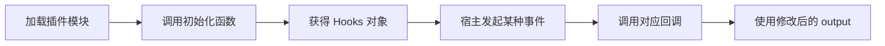
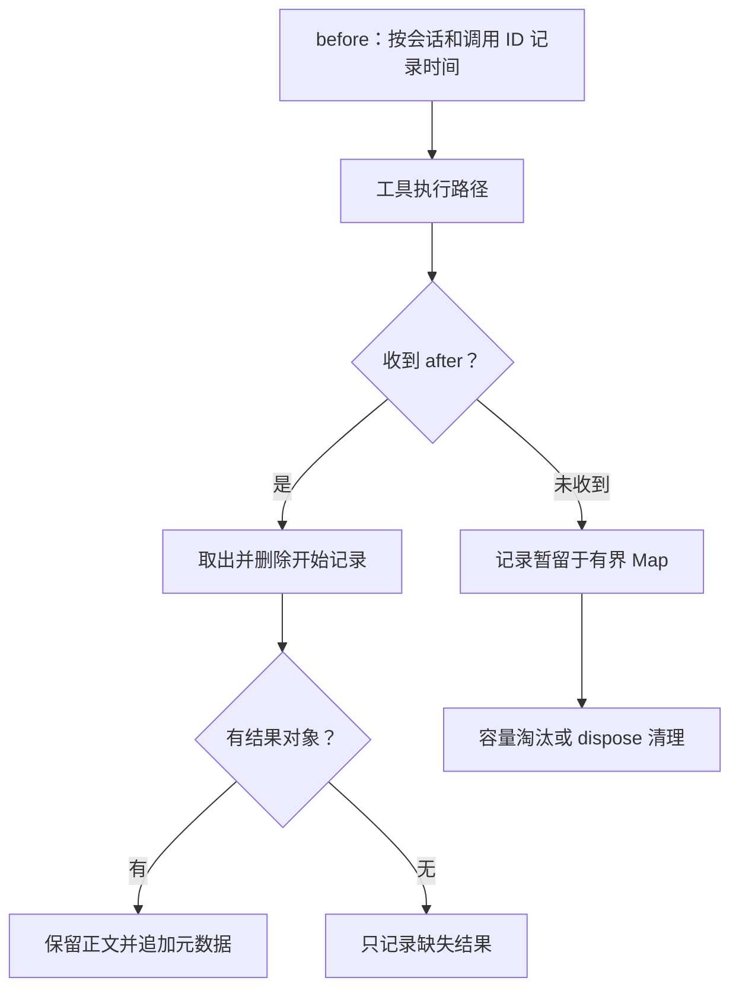
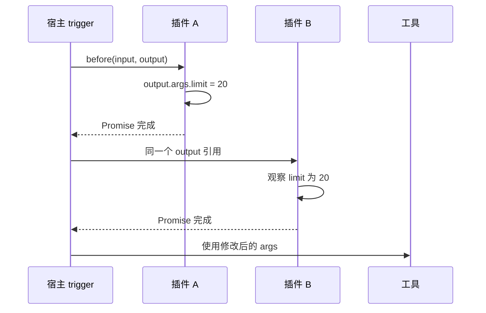

# 第 8 章：插件 Hook——从返回对象到实际调用

<!-- block: opencode-ch08.b-opening -->
本章写一个代码审查插件：给系统提示词加一句提醒，再记录工具调用和耗时。沿着这个例子，可以看到宿主何时调用插件、回调可以修改哪些字段，以及错误怎样影响后续执行。

本章固定 OpenCode v1.19.5，提交 `810c0eba1a7348036f8bdf61e6632d0c36c6876c`。讲的是 V1 Plugin/Hooks；同一个仓库已包含 V2，不能看到新版文档里的接口就直接换进来。完整样例在 [review-trace.ts](examples/review-trace.ts)，实验范围见 [VERIFY](VERIFY.md)。

第六章的工具负责读取文件，本章的 Hook 是宿主在调用前后执行的回调，负责观察这次读取。先沿 8.1–8.3 节看一次调用，再到 8.6 节运行测试；需要对照完整文件时读 8.8 节。缺失结果、日志失败和清理的细节可以带着测试结果回看。

## 8.1 一个插件先返回一组能力

V1 的 Plugin 是异步初始化函数。宿主把 client、项目目录、工作树、serverUrl 和 shell 等上下文传给它，函数返回 Hooks 对象。这个对象既能含事件回调，也能提供自定义工具、认证等能力。[来源 1](#source-1)

因此，“插件已经加载”与“某个回调已经执行”是两个时刻。初始化阶段创建的变量可以活过多次工具调用；而工具调用的信息是在回调发生时才出现的。



图 8-1：V1 插件从初始化到回调的两个阶段。流程表达调用关系，不表示每种 Hook 都走同一条执行路径。

本例只做三件事：给系统提示词追加审查要求，在工具调用前记下时间，在收到结果回调后写一条摘要。插件不请求新工具，也不改变权限规则。

## 8.2 返回一个新对象，为什么没有生效

V1 的 `experimental.chat.system.transform` 接收两个参数。第一个包含 sessionID 和 model，第二个含 `system: string[]`。宿主希望你修改第二个参数。[来源 1](#source-1)

```typescript
// 教学片段：output 就是宿主传进来的可变对象。
"experimental.chat.system.transform": async (_input, output) => {
  const note = "Review correctness first.";
  if (!output.system.includes(note)) {
    output.system.push(note);
  }
}
```

这里不能改成 `return { system: [note] }`。固定版本的 trigger 按顺序调用各插件的处理器，等待它们结束，最后返回原来的 output；它没有接住各处理器的返回值。公开类型也把返回值写成 `Promise<void>`。[来源 2](#source-2)

两个插件拿到的是同一个 output。后一个能看到前一个的修改，也能覆盖它。如果两个插件都把整个 system 数组重建一遍，最后的结果就取决于调用顺序。只有在需要替换全部宿主内容时才考虑这种操作，并逐项检查会丢掉什么。

本例使用 push，保留已有内容；同一份数组重复经过回调时不会重复追加完全相同的句子。这个去重范围很窄：别的插件若改写或合并了该句，includes 无法判断语义重复。它也不是跨会话记忆。

请求准备代码先组装 system，再触发此 Hook；随后可能把额外片段合并。因此数组位置适合说明回调时的结构，不能当作最终请求必然保留的布局。[来源 3](#source-3)

## 8.3 工具前后事件分别给了什么

| Hook | input | 可修改的 output | 本例的动作 |
| --- | --- | --- | --- |
| tool.execute.before | tool、sessionID、callID | args | 记录调用开始时间，保持参数原样 |
| tool.execute.after | 前述身份及 args | title、output、metadata | 保留正文，追加 reviewTrace 元数据 |
| dispose | 无 | 无 | 清理内存，并停止后续观察 |

表中的 output 是回调第二参数；其中名为 output 的字段又是工具结果正文。读源码时要分清这两层，避免把结果对象和结果文字混为一谈。

例如，读取返回的一行文件内容放在结果对象的 output 字段，显示标题放在 title，观察器的计时信息放在 metadata。本例只向 metadata 加入 reviewTrace，所以既能留下观察结果，也能保留原来的文件正文。8.8 节的完整代码正是沿这三个字段处理结果。

要关联前后调用，不能只用工具名。同一个 read 可以并发读取两个文件；两个会话也可能出现相同的 callID。本例把 sessionID 与 callID 编成一个联合键，存在初始化函数内的 Map 里。



图 8-2：本例观察器如何处理未配对调用。Map 只属于当前插件实例，没有写入会话数据库。

Map 最多保留 128 条待配对记录，超过时淘汰最早插入的一条。这个数字是教学样例的容量选择，不是 OpenCode 限制。超过容量的长任务即使后来收到结果，也会标成 correlated=false、durationMs=null；不要把 null 换成 0，零耗时和缺失数据是不同情况。

计时包含两次回调之间经过的全部时间，可能还包括其他插件和调度开销。它适合关联排错，不是工具性能基准。遇到未收到 after 的情况，本例也不能据此判定工具已经取消或执行失败。

## 8.4 类型声明没有覆盖的失败路径

发布包把 after 的第二参数写成结果对象。继续看固定提交的子任务执行代码，会看到一个更具体的情况：执行失败被 catchCause 捕获并记录后，代码继续把 result 传给 after；这时 result 可能没有值。[来源 4](#source-4)

所以直接执行 `output.metadata = ...` 可能在原有失败之外再抛一个错误。本例先检查 output 是否存在。没有结果时清掉配对记录，写一条“回调没有结果”的摘要，不伪造成功正文。

这是特定子任务路径的源码观察，不代表所有工具失败都按同样方式通知插件，也不代表 after 是一个必达的 finally。实验显式传入 undefined 来验证本例防护；第 9 章虽已运行真实宿主，仍未重现这条子任务失败链。

另一类失败来自日志。客户端的 app.log 用来写服务端日志。记录器只提交工具名、会话/调用 ID 和计时信息，不把 args、提示词或工具正文原样复制过去。日志请求抛错时，本例捕获它，保留已完成的工具结果；SDK 返回错误响应时同样按尽力记录处理。

这个记录器允许丢日志，因此不适合要求完整记录的审计系统。它还没有解决请求迟迟不返回的问题：await 会继续等待并拖慢回调。部署时需要另设传输超时或有界队列。

## 8.5 清理属于谁

宿主 V1 初始化代码注册了两个清理动作：取消事件订阅，以及调用插件的 dispose。dispose 出错会被记录并忽略。[来源 2](#source-2)

本例在 dispose 中设置关闭标记并清空 Map。重复调用不会出错，之后到达的回调也不再新增记录。这个标记处理的是本例生命周期，不会撤销已发出的日志请求、已经执行的工具或磁盘修改。

本章处理器实验显式调用 dispose。[第 9 章](ch09.md)进一步向真实宿主请求实例清理，观察到了插件的 dispose，并比较了同进程重建实例和重启进程。两者对模块状态的影响不同；自动热重载和退出时序仍未验证。

## 8.6 现在就能运行的实验

在书仓根目录，使用 Node.js 22.19.0 或更新版：

```bash
node --test opencode/examples/check-review-trace.mjs
```

它导入真实的原创样例，把 SDK client 换成一个只记录参数的对象。无需模型凭据，也不会写个人 OpenCode 配置。

实验覆盖八类情况：保留宿主提示词、保持工具参数与正文、跨会话关联、缺失回调的容量控制、日志拒绝、缺失结果对象、重复清理，以及共享 output 的调用顺序。最后一项使用教学调度器演示从源码读到的语义，并没有运行上游的整个 Effect 服务。

可以把样例与测试一起复制到临时目录，保留相对位置，再做两个改动：把 push 改成 return 新对象，观察测试传入的共享对象；再去掉 output 存在性判断，看缺失结果时怎样抛出 TypeError。每次修改后，进入副本目录运行 `node --test check-review-trace.mjs`，让测试读到刚改过的文件。前一个改动解释为什么返回值没有改变共享输出，后一个展示原有工具失败后又产生异常的路径。这里仍由测试直接调用处理器，真实宿主接入在下一章完成。

严格类型核对命令见 [examples/README](examples/README.md)。它使用真实发布包的声明检查样例；类型通过与运行时防护都需要，前者没有覆盖本章发现的 undefined 路径。

## 8.7 把处理器放回宿主

第 9 章使用固定版本的 Windows 发布程序，验证了项目插件发现、顺序调用、初始化失败和实例清理，并检查提示词与真实 read 的结果是否进入模型请求。模型协议仍由本地替身提供；本章的八项处理器测试保留为更快的排错入口。

这次宿主实验走通了 V1 的 serve 路径。V2 与其他客户端的默认选择仍需独立核对，不能仅凭两个目录共存就判断用户启动的是哪套系统。

自定义工具、MCP 与权限各有不同入口。本章给系统提示词追加审查要求，不会撤销写文件工具，也不会替代权限检查。只读审查模式需要同时检查工具能力和执行规则，后续章节会沿着这两条线继续。

## 8.8 把观察器完整读一遍

下面保留完整实现，便于你沿一次调用检查每个变量。文件可直接在 `opencode/examples/review-trace.ts` 中找到。它没有用全局单例保存 pending，而是在每次初始化时创建一张 Map；这决定了状态的归属。

```typescript
import type { Plugin } from "@opencode-ai/plugin";

const REVIEW_NOTE = "Review correctness first. Cite files and explain unresolved assumptions.";
const MAX_PENDING = 128;

export const ReviewTrace: Plugin = async ({ client }) => {
  const pending = new Map<string, number>();
  let disposed = false;
  const key = (session: string, call: string) => JSON.stringify([session, call]);

  return {
    "experimental.chat.system.transform": async (_input, output) => {
      if (!disposed && !output.system.includes(REVIEW_NOTE)) {
        output.system.push(REVIEW_NOTE);
      }
    },
    "tool.execute.before": async (input, _output) => {
      if (disposed) return;
      const id = key(input.sessionID, input.callID);
      if (!pending.has(id) && pending.size >= MAX_PENDING) {
        pending.delete(pending.keys().next().value!);
      }
      pending.set(id, performance.now());
    },
    "tool.execute.after": async (input, output) => {
      if (disposed) return;
      const id = key(input.sessionID, input.callID);
      const started = pending.get(id);
      pending.delete(id);
      const trace = {
        correlated: started !== undefined,
        durationMs: started === undefined ? null : Math.max(0, performance.now() - started),
      };
      if (output) output.metadata = { ...output.metadata, reviewTrace: trace };
      try {
        await client.app.log({
          body: {
            service: "book-review-trace",
            level: output ? "info" : "warn",
            message: output ? "Tool result observed" : "Tool callback has no result",
            extra: { tool: input.tool, sessionID: input.sessionID, callID: input.callID, ...trace },
          },
        });
      } catch {
        // 本观察器允许丢日志，业务工具结果不因遥测失败而改变。
      }
    },
    dispose: async () => {
      disposed = true;
      pending.clear();
    },
  };
};
```

`JSON.stringify([session, call])` 保留了两个字段各自的边界。若写成 `${session}:${call}`，就需要额外约定 ID 不能包含分隔符。callID 来自宿主，跨会话仍可能重复，因此这里使用联合键，避免相互覆盖。

`started !== undefined` 用于判断是否找到记录。时间值可以是零，`if (started)` 会把它误判为没有记录。耗时也一样：缺失用 null，极短调用可以为 0；混用这两个值，会让未配对调用拉低平均耗时。

从 Map 取出开始时间后，代码先删除记录，再发日志。这样即使等待日志期间发生 dispose，或日志请求抛错，Map 里也不会残留这次调用。

容量控制只限制未配对记录的数量，不是完整 TTL。一个很早的调用可能一直没有 after，只要后续总量没有超过 128，它仍留在 Map 中。这对小型教学观察器足够；若用于长驻宿主，可增加按时间淘汰，但应使用同一时钟，并在 dispose 停止定时器。否则修了 Map 的内存积累，又引入一个永不结束的后台任务。

## 8.9 两个插件共用 output，会怎样互相影响

假设插件 A 在 before 中把 `args.limit` 从 100 改成 20，插件 B 记录参数。顺序是 A → B 时，B 记录 20；顺序是 B → A 时，日志记录 100，实际执行却用 20。差别来自记录发生的时刻。



图 8-3：顺序调用并不创建独立副本。后一个插件看到前一个插件已做的修改；没有自动合并冲突或撤销机制。

对 system transform 也一样。A 追加一句审查要求，B 随后把数组整体替换成自己的提示词，A 的文字就消失了。你会看到 A 的日志确实执行过，但最终请求没有它的内容。排错时在回调前后分别记录结构摘要，最后再观察模型请求，才知道改变在哪一步被覆盖。

因此，写“保留已有内容”的插件，需要明确使用原地追加或字段级合并。`output.metadata = { reviewTrace: trace }` 会丢掉工具和其他插件已经写入的字段；`{ ...output.metadata, reviewTrace: trace }` 保留了其他命名空间。不过它仍可能覆盖另一个也叫 reviewTrace 的字段，这就是给扩展字段取独立名称的理由。

如果你的功能本来就要求替换全部内容，应把这个约束写进配置说明，并测试与其他插件共存时的行为。没有一种对象合并写法能自动推断两个插件的意图是否冲突。

## 8.10 失败策略由回调的职责决定

本例的日志只用于观察，写入失败后允许工具继续返回结果。如果插件负责输出脱敏，忽略错误却可能让未处理的原文直接返回。是否继续执行，取决于回调承担的职责。

可以对照三个具体设计。审查计时器丢一条日志，工具结果仍可用，允许继续。参数改写器无法完成必需的规范化，继续执行旧参数会偏离用户要求，应明确失败。输出脱敏器发现结果结构无法解析，默默把原文返回可能泄露本应去掉的内容，需要按应用约定拒绝或返回明确不可用状态。

不同职责也决定测试位置。计时器应检查日志故障不改变正文；改写器应检查异常时工具有没有被调用；脱敏器应检查输出和持久记录里是否还残留标记。只断言 `catch` 执行过，无法证明失败策略真的成立。

异步回调还有一种不抛错的失败：Promise 一直不结束。宿主按顺序 await 回调，后面的插件和工具就都被拖住了。你可以给外部日志请求设置传输超时，但 `Promise.race` 本身只让等待者先返回，不会取消底层网络操作；需要把 AbortSignal 交给实际支持它的调用。否则每次超时都留下一个后台请求，运行久了仍可能耗尽资源。

## 8.11 从快速实验走向宿主证据

八项处理器检查里，“跨会话同 callID”检查联合键，“缺失结果对象”检查运行时防护，“重复 dispose”检查清理可重复。它们直接调用原创函数，能迅速定位算法错误，但没有模拟配置发现、动态 import 或依赖解析。第九章宿主实验正好补上后一部分。

维护插件时可以保留一张失败矩阵：变更参数处理，先跑处理器；变更模块入口，跑真实加载；变更状态归属，做同实例新会话、dispose 重建与进程重启；变更权限，把拒绝场景里的真实文件或操作结果纳入断言。这些层互相补足，不能只留下耗时最长的一组，然后每次失败都从头猜。

再做一组练习：在临时副本中删除 `pending.delete(id)`，检查测试能否发现记录残留；然后把联合键改成 callID，查看跨会话用例的结果。如果错误版本仍然通过，就需要增加相应断言。

## 来源

<a id="source-1"></a>
1. [V1 PluginInput、Plugin 与 Hooks 类型](https://github.com/anomalyco/opencode/blob/810c0eba1a7348036f8bdf61e6632d0c36c6876c/packages/plugin/src/index.ts)。

<a id="source-2"></a>
2. [V1 插件初始化、trigger 与 finalizer](https://github.com/anomalyco/opencode/blob/810c0eba1a7348036f8bdf61e6632d0c36c6876c/packages/opencode/src/plugin/index.ts)。

<a id="source-3"></a>
3. [模型请求准备与 system transform](https://github.com/anomalyco/opencode/blob/810c0eba1a7348036f8bdf61e6632d0c36c6876c/packages/opencode/src/session/llm/request.ts)。

<a id="source-4"></a>
4. [子任务 taskTool.execute、catchCause 与 after](https://github.com/anomalyco/opencode/blob/810c0eba1a7348036f8bdf61e6632d0c36c6876c/packages/opencode/src/session/prompt.ts)。
