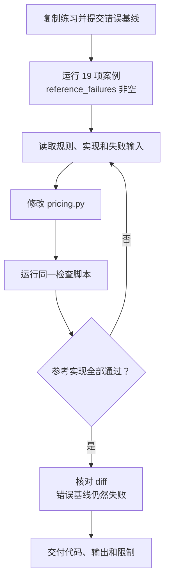

# 第 17 章：把一次修复做成可审阅的结果

<!-- block: opencode-ch17.b-opening -->
两件单价 19.99 元的商品，账单却算出 39 元。问题出在计算末尾的 `int()`，但去掉它后，还要检查零数量、全额减免、非法输入和半分舍入。本章使用 `examples/pricing-lab/` 做一次完整练习：重现错误，交给 Agent 修复，再核对代码和检查结果。

前面章节用固定响应驱动宿主，这里开始处理真正需要修改代码的问题。你可以先只用 Python 跑通错误版与参考版，理解业务规则；准备好自己的模型后，再按 17.3 节把同一错误交给 OpenCode。观察器只是可选的调试帮助，不是运行金额练习的前提。

## 17.1 五个文件组成一个可以带走的项目

练习不需要 API 密钥或第三方 Python 包。`pricing_broken.py` 保留原始错误，`pricing.py` 是待修改实现，`check_pricing.py` 对两者运行同一组行为案例。`AGENTS.md` 写业务约束，`README.md` 写启动方法。把整个目录复制到自己的临时目录，就能独立使用。

先在书仓根目录运行一次随书样例：

```bash
python opencode/examples/pricing-lab/check_pricing.py
```

随书的 `pricing.py` 已是参考修复，所以这条命令应以 0 退出。JSON 中 `cases` 为 19，`broken_failures` 有 18 条，`reference_failures` 为空。这里检查的是“已知错误仍能被发现、参考实现满足这些案例”。它没有调用模型，也不表示错误函数通过了测试。

准备让 Agent 动手时，在副本里执行下面的 PowerShell 命令。当前目录必须是刚复制出来的 `pricing-lab`，不要在书仓原样例中覆盖参考答案。

```powershell
Copy-Item -LiteralPath .\pricing_broken.py -Destination .\pricing.py
git init
git add AGENTS.md README.md pricing.py pricing_broken.py check_pricing.py
git commit -m "test: preserve failing pricing baseline"
python check_pricing.py
```

此时两个实现都含同一个错误，`reference_failures` 也应有 18 条，退出码为 1。保存这份输出后再打开 OpenCode，后面就能比较修复前后的变化。

## 17.2 先把“金额算对”写成明确规则

函数签名保持为 `total(unit_price: str, quantity: int, discount: str = "0") -> Decimal`。折扣参数表示减免比例：`"0.1"` 是减去 10%，`"1"` 是全部减免。它不是中文口语里“打一折”的倍率。

| 对象 | 本练习的契约 | 容易遗漏的情况 |
| --- | --- | --- |
| 单价 | 十进制字符串，0 到 1000000，含端点 | 不能用浮点数偷偷替代字符串 |
| 数量 | 整数，0 到 1000000，含端点 | `True` 在 Python 中也是 `int` 的子类 |
| 折扣 | 十进制字符串，0 到 1，含端点 | 负值和大于 1 都不合法 |
| 非有限数 | 拒绝 NaN、Infinity 等值 | `Decimal` 能构造这些对象 |
| 错误输入 | 抛出 `ValueError` | 随机泄漏转换或算术异常不算符合契约 |
| 输出 | `Decimal`，保留两位小数 | `Decimal("0")` 与 `Decimal("0.00")` 数值相等，表示不同 |
| 舍入 | 最后一步用 `ROUND_HALF_UP` | 中途取整、提前舍入都会丢信息 |

数量上限与价格上限共同把最大未折扣金额限制为一万亿元。代码、规则和案例必须对同一范围达成一致。`isinstance(True, int)` 是真；如果用它接受数量，`True` 会按一件商品参与运算。这里用 `type(quantity) is int`，明确只接受内置整数。对价格和折扣则先检查字符串类型，再交给 `Decimal` 解析。类型标注本身不会执行这些检查。

## 17.3 给 Agent 一项有边界的任务

进入练习副本后，可以把以下文本作为任务。它限定要改的文件，又保留了让模型自己定位原因的空间。

```text
读取 AGENTS.md、pricing.py 和 check_pricing.py。
先运行 python check_pricing.py，解释至少一个金额错误和一个输入校验错误。
按 AGENTS.md 的规则修复 pricing.py，保持 total 的签名。
不修改 pricing_broken.py，不删除案例，不放宽检查脚本的断言。
本任务没有联网或安装依赖的需要。
完成后重新运行检查，查看 git diff，说明修复结果。
```

第一轮观察它是否读到了实际文件，是否在正确目录运行脚本。只说“看起来是浮点精度问题”还不够：这里原本已经用 `Decimal`，丢失金额的是后面的 `int()`。诊断应能对应 `19.99 × 2 → 39.98 → int(...) → 39` 这条具体路径。

这项任务需要读取文件、运行本地检查并修改 `pricing.py`，可按第七章的方法开放这些操作。只读权限不足以保存修复；与任务无关的联网和全盘搜索则无需开放。

## 17.4 看懂失败报告，别只数红色行

六个合法输入同时检查数值、返回类型和两位小数表示。预期值是业务给出的字面量，没有在测试中再抄一遍实现公式。

| 输入：单价、数量、折扣 | 预期 | 错误版结果 | 这个案例检查什么 |
| --- | --- | --- | --- |
| `"19.99", 2` | `39.98` | `39` | 分币不能被取整丢掉 |
| `"0.05", 1, "0.5"` | `0.03` | `0.0` | 半分按 HALF_UP 舍入 |
| `"2.50", 3, "0.1"` | `6.75` | `6.3` | 折扣作用于完整小计 |
| `"19.99", 0` | `0.00` | `0` | 零也保留两位小数 |
| `"19.99", 2, "1"` | `0.00` | `0` | 全额减免的输出形式 |
| `"1000000", 1000000` | `1000000000000.00` | `1000000000000` | 两个上限同时取到 |

另外 13 个输入检查拒绝行为：负单价、负数量、布尔数量、小数数量、超上限数量、超上限单价、两个越界折扣、NaN 单价、Infinity 单价、NaN 折扣、浮点单价和无法解析的字符串。它们都应抛出 `ValueError`。

报告中的 `missing_error` 表示函数接受了非法输入，`wrong_error` 表示异常类型不符，`unexpected_error` 表示合法输入发生异常。例如错误版遇到 Infinity 会抛出 `OverflowError`，遇到 `"invalid"` 会抛出 `InvalidOperation`。调用方若只捕获约定的 `ValueError`，就处理不了这两种错误。

错误版有一个非法案例恰好符合要求：NaN 单价经过 `int()` 会抛出 `ValueError`。所以它失败 18 项，而非 19 项。这个偶然通过解释了为什么不能只看某个异常案例就断言函数已有完整校验。

## 17.5 参考修复逐段做了什么

随书参考实现如下。可以在自己的修改完成后对照阅读，不必让 Agent 逐行照抄；任何满足同一契约、逻辑清楚的实现都可以讨论。

```python
from decimal import Decimal, InvalidOperation, ROUND_HALF_UP


def total(unit_price: str, quantity: int, discount: str = "0") -> Decimal:
    if type(quantity) is not int or not 0 <= quantity <= 1_000_000:
        raise ValueError("quantity must be an integer between 0 and 1000000")
    if not isinstance(unit_price, str) or not isinstance(discount, str):
        raise ValueError("price and discount must be decimal strings")
    try:
        price, rate = Decimal(unit_price), Decimal(discount)
    except InvalidOperation as exc:
        raise ValueError("price and discount must be decimal strings") from exc
    if not price.is_finite() or not rate.is_finite():
        raise ValueError("price and discount must be finite")
    if not Decimal("0") <= price <= Decimal("1000000"):
        raise ValueError("price must be between 0 and 1000000")
    if not Decimal("0") <= rate <= Decimal("1"):
        raise ValueError("discount must be between 0 and 1")
    return (price * quantity * (Decimal("1") - rate)).quantize(
        Decimal("0.01"), rounding=ROUND_HALF_UP,
    )
```

类型和范围检查放在计算之前。尤其是有限性检查，要先于与上下限的比较；NaN 不适合沿普通实数的大小关系处理。字符串转换失败后保留原异常作为原因，同时给外部调用方一致的 `ValueError`。

计算中没有整数转换，也没有先把单价量化到两位。最后的 `quantize(Decimal("0.01"))` 才确定输出指数，并显式指定舍入方式。`"0.05" × 1 × (1 − "0.5")` 得到 `0.025`，最终成为 `0.03`，恰好覆盖只换掉 `int()` 仍可能忽略的舍入规则。

如果模型提出“先把所有单价统一保留两位”，可以用一个额外的手算反例讨论：单价 `"0.335"`，数量 3，无折扣，完整小计是 `1.005`，按本练习规则最后得到 `1.01`；先把单价舍入成 `0.34`，再相乘就成为 `1.02`。这不是现有 19 项中的案例，但能说明计算顺序本身属于业务契约。若实际业务要求先定单价、再按行舍入，就应修改规则和预期，而不能一面沿用“最后只舍入一次”，一面接受另一种算法。

金额显示也应与运算区分。此处刻意要求返回两位小数的 Decimal，检查器才会比较字符串表示。以后接入 HTTP 接口时，JSON 本身没有 Decimal 类型，需要另定义序列化规则，例如以字符串传输金额。直接把返回值转成 float，会把已经明确的十进制边界重新变得含糊；这个接口扩展不属于当前修复范围。

这里使用 Python 默认 Decimal 上下文精度。19 项案例覆盖了列出的日常金额和边界，没有证明任意长度的小数字符串在任何上下文设置下都能精确计算。生产接口若要接受很长的小数或调用方修改过的上下文，还需要明确输入精度、资源上限和 `localcontext` 策略；应先补业务规则，再加对应检查。

## 17.6 红到绿的过程如何与工具事件对上



如果在 OpenCode 中加载了 `review-trace`，可以把读取、修改和执行检查的工具调用与会话 ID、调用 ID 关联。观察器记录的工具完成，只能证明那次调用返回了；还要从检查输出确认是否修复成功。一次命令成功退出，也可能只是正确打印了一份失败报告，退出码的业务含义必须读脚本才知道。

本练习的门禁有意使用 `broken and not fixed`：错误基线必须至少失败一项，参考实现必须没有失败。若 Agent 为了“全绿”把两个实现都改好，`broken` 为空，脚本反而退出 1。这保护了练习的对照作用，也提醒审阅者不要只检查当前被测函数。

## 17.7 最后检查的是工作目录里的结果

在练习副本运行：

```bash
python check_pricing.py
git diff --check
git diff --stat
git diff -- pricing.py check_pricing.py pricing_broken.py AGENTS.md
```

重点看 `pricing.py` 的差异是否解释了失败，检查脚本和错误基线是否保持原意。若新增了测试，逐项读新增预期是否来自规则。把字符串比较改成宽松数值比较会掩盖 `0` 与 `0.00` 的差异；把异常捕获统一改成 `except Exception` 会掩盖错误异常类型，二者都可能制造表面的成功。

最终说明可以很短：“原实现过早取整，导致 39.98 变成 39；现保留十进制计算到最后，并校验类型、范围和非有限值。19 项参考案例通过，已知错误基线仍失败 18 项。”只有自己的实际输出相符时，才使用这些数字。无需把每次文件读取重新讲一遍。

## 17.8 用这项练习评价一次真实修复

本书已人工运行错误版和参考版，记录中的 `external_model_used` 为 false。前面的替身实验运行了 OpenCode 执行链，这项练习检查了价格函数的参考实现；真实模型能否自动修复，仍需按本章步骤另行运行。

运行自己的模型时，保存初始提交、模型标识、权限设置、任务文本、最终 diff 和检查输出。比较另一模型前恢复同一基线，并保留相同的 19 项案例。之后可以另加非法折扣类型等案例，检查是否还有遗漏；新增案例单独记录，以便区分两次运行的比较结果和后续发现。

来源：[练习说明](examples/pricing-lab/README.md)、[业务规则](examples/pricing-lab/AGENTS.md)、[行为检查](examples/pricing-lab/check_pricing.py)、[参考实现](examples/pricing-lab/pricing.py)、[工具执行衔接](https://github.com/anomalyco/opencode/blob/810c0eba1a7348036f8bdf61e6632d0c36c6876c/packages/opencode/src/session/tools.ts)。价格计算代码为本书原创教学示例。
