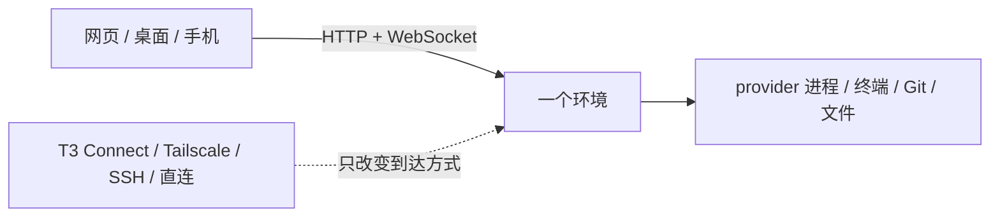

# 第 11 章：远程访问：手机、Tailscale 与 T3 Connect
<!-- block: t3code-ch11.b-opening -->

远程连接会把客户端接到一个具体环境。直连、局域网、Tailscale、SSH 和 T3 Connect 改变到达服务器的方式，任务仍在环境机器上执行。本章分别说明身份、路由、鉴权与预览隧道，便于连接失败时定位问题。

先确认要连接哪个环境，再选择访问路径。路由信息只能作为连接提示，不能代替鉴权；桌面预览的 loopback 隧道也有单独的适用范围。

## 11.1 一条连接就是一个环境

每条连接通过 HTTP 与 WebSocket 把一个客户端接到一个环境。Direct、Tailscale、SSH 和 T3 Connect 改变的是客户端怎样到达服务器，不会引入另一种执行模型：provider 进程、终端、Git、项目文件仍然在环境一侧。环境 ID 跨重启和端点变化保持稳定；仓库身份可以用来关联跨环境的克隆（PR 功能优先用 `upstream`，fork 按 `origin` 分组），但工作永远不会悄悄跨环境。服务端初始化环境 ID 时会原子发布结果并保留修复状态，让并发初始化选出同一个赢家，不能把这份恢复状态当临时垃圾清掉。



托管网页版本身也是一个客户端：它把连接目录存在浏览器里，直接连到各环境，不代理流量。托管配对 URL 把后端目标放在查询串、把配对密钥放在 URL 片段里，于是密钥不会到达托管站点，随后还会从历史记录中抹掉。可以这么理解：换网络、换设备都不换“谁在执行”。

## 11.2 直连与局域网

当另一台设备能到达主机网络地址时，用直连即可。桌面主机在 **Settings → Sharing & access** 打开 **Network access**，再用对端可达的地址创建配对链接；改动这项设置会重启桌面应用。命令行主机可以在 `t3 up` 里选本地网络，或直接运行：

```sh
t3 up --lan
t3 serve --lan
t3 pair
t3 status --json
```

`t3 pair` 在服务器已运行时生成新链接，不必重启。手机扫码配对链接，或把 URL 粘进接收端的 **Add environment**；网页和桌面在 **Settings → Environments** 管理连接。`127.0.0.1` 这类 loopback 地址只到达打开链接的设备自己。配对授权的是该设备以后的连接：每台新设备用一次性新链接；设备持续使用就保持登录，直到在主机 **Settings → Sharing & access** 撤销；闲置 30 天或与过旧主机配对过的设备要重新配对。也可限定令牌权限：`t3 pair --scope orchestration:read --scope relay:read`，所选 scope 会替换默认权限；改变已有客户端权限需要新建配对链接，仅重连不会改变权限；要换权限必须重新配对一次。

## 11.3 Tailscale HTTPS

Tailscale HTTPS 适合两台设备已在同一 tailnet 的情形。桌面端在 **Settings → Sharing & access** 打开 **Tailscale HTTPS**；tailnet 需要启用 MagicDNS 与 HTTPS 证书，Linux 上还要给 T3 Code 管理 Tailscale 的权限。缺任何一项，T3 Code 仍会启动，只是加不上 HTTPS 路由。命令行上，新服务器与已有服务器分别用：

```sh
t3 serve --tailscale-serve
t3 pair --tailscale
```

配对链接形如 `https://machine.tailnet.ts.net/`，`pair --tailscale` 创建的映射跨重启保留；要移除默认端口映射，运行 `tailscale serve --https=443 --set-path=/ off`，端口被占用时用 `--tailscale-serve-port` 另选。架构文档特别强调：Tailscale 只提供端点，鉴权仍归环境负责。也就是说，能解析出 tailnet 地址并不等于能调用 RPC；配对与 scope 检查照旧。另一条硬规则是 HTTPS 配对的令牌不得降级到明文 HTTP——路由变化不能换取更弱的凭据。托管网页 app.t3.codes 本身需要 HTTPS 端点：托管配对链接既不会让不可达的后端变得可达，也不会把 HTTP 变成 HTTPS。移动端若输入不带协议的 IP，会按 HTTP 处理，HTTPS 服务器要显式写 `https://`；自签 CA 则需在 Android 安全设置里作为 CA 证书安装。

## 11.4 T3 Connect

T3 Connect 让主机无需配置路由器转发即可被其他设备发现。桌面主机在 **Settings → Sharing & access** 登录并为本环境启用 T3 Connect；命令行用 `t3 up`，按提示选择 T3 Connect、局域网或两者，它随后以 background service 运行。`t3 connect` 等价于 `t3 up --connect`，`t3 up` 再次运行可改选择，`t3 status` 查看状态。仅保存登录不会启动服务器，也不会让机器可达；关掉桌面应用最后一个窗口会停掉它的本地服务器。

新设备默认可直连，主机可打开 **Require approval for new devices**：待批准设备显示诸如 `K7QM-2XFD` 的代码，已连接设备用 **Settings → Sharing & access** 批准，无头主机用 `t3 auth connect-device list` 与 `t3 auth connect-device approve K7QM-2XFD`；请求 10 分钟后过期。

| 故障位置 | 典型线索 | 处理 |
| --- | --- | --- |
| 本机到 T3 Connect | Wi-Fi 陷阱、VPN、DNS 过滤 | 换网络或加直连路由 |
| 主机隧道 | 主机离线、端口 7844 被阻断 | `t3 connect status`，放行 TCP/UDP 7844 |
| 隧道到 T3 Code | 服务器换了端口或只绑一个地址 | `t3 service restart` |
| 登录/账号 | 主机连到别的账号、设备待批准 | `t3 connect logout` 后重连；批准代码 |

一个 T3 Connect 账号默认可链接 3 台机器；T3 Chat Pro 提高到 10 台、Premier 到 100 台。凭据会按需续期且不断开健康连接；续期失败只影响当次请求。

## 11.5 SSH 与远程服务器

桌面端在 **Settings → Environments → Add environment** 选 **SSH**，填主机或别名如 `user@example.com`；T3 Code 启动或复用远端服务器并打开端口转发，项目、provider 凭据与 agent 工作都留在远端。远端必须是 Linux 或 Apple Silicon Mac，并有 `curl`/`wget`、`tar`、`sha256sum`/`shasum` 以及 provider 配置；首次启动会把服务端下载到远端的 `~/.t3/runtime`，所以更慢。provider CLI 必须在非交互登录 shell 的 `PATH` 上，可以这样核对：

```sh
ssh user@example.com 'sh -lc "command -v claude codex"'
```

T3 Code 无法回答二次验证提示（如 Duo code）；macOS 与 Linux 可复用终端里已登录的连接，在 `~/.ssh/config` 为该主机打开连接共享：

```sshconfig
Host <alias>
  ControlMaster auto
  ControlPath ~/.ssh/cm-%C
  ControlPersist 8h
```

连接关闭后需在终端重新登录再试。清理边界很明确：移除连接只停止 T3 Code 自己启动的服务器，发现时已在运行的服务器会保留。每个桌面应用在该主机保留一个会话，可在主机 **Settings → Sharing & access** 撤销，或用 `t3 auth session list` / `t3 auth session revoke <id>`。若更新后 SSH 重连失败，先重试一次启动；远程 Antigravity 的 Google 回调另有专门的远程登录步骤。远端主目录里的凭据与项目不会被客户端复制过来。

## 11.6 路由是不可信提示

架构文档把路由定性为不可信提示：只有发起连接的客户端能证明可达性。因此可分享端点不可用时不能回退到 loopback——loopback 指向的是客户端自己的机器；验证直连或学到的路由确实以预期环境应答之后，才发送凭据；通过 HTTPS 配对的令牌不得降级到明文 HTTP。PR 路由信任覆盖已保存的路由集合：新增或改动路由会撤销信任，仅重排顺序不会。添加路由用机器路由列表或 T3 Connect 列表里的 **Add route**；对一台机器尚无的地址发来的配对链接会被拒绝，要先添加该地址。连接期间 T3 Code 还会学习主机的局域网与 Tailscale 地址并作为路由加入，但主机必须允许网络访问；学到的路由可重排、不可直接删除，会随原路由消失。连接按第一条能应答的路由走，网络切换、回到应用和每分钟都会复检更早的路由并尽快切回。被主机拒绝登录的路由标记为 **Sign-in refused**，需对该地址重新配对。权限只对标记为 **In use** 的路由有效，直接配对与 T3 Connect 是不同会话，可能授予不同权限。

## 11.7 桌面预览的 loopback 隧道

远程环境的桌面 webview 仍使用 `localhost` URL，但 loopback 连接通过环境自己源站上的 `/api/preview/tunnel` 打通。实现上有两条硬约束。第一，Chromium 对 loopback 主机忽略 PAC 脚本，所以必须用固定 SOCKS5 代理，只把 loopback（排除 link-local 地址）送进隧道，且永不直连回退：隧道失败或关闭时必须报错，不能悄悄加载审阅者自己机器上的 localhost。第二，桌面主进程不持有环境凭据，因此渲染进程为每条连接提供 media ticket（并跟踪路由切换）；由于 Chromium 无法向 SOCKS5 认证，本地监听者要按平台能力限制为当前 OS 用户，Linux 上通过 `/proc/net/tcp` 检查。

浏览器标签属于环境：其他设备看到的是同一批标签，`localhost` 指向主机而不是手机；主机上的 **Settings → Sharing & access → Preview tunnel** 关掉后，端口转发与 **Open on this device** 消失，已开的隧道关闭，但标签仍以流方式从主机播放。第一次打开标签会下载约 120 MB 的无头 Chrome 到 T3 home，与 HTML 预览共用；若 Linux 主机缺少依赖，服务器会提示 `sudo t3 browser setup`。

## 11.8 本章要点与来源

要点有四。第一，连接的目标是环境而非机器上的临时进程：环境 ID 跨重启稳定，路径只改变到达方式，仓库身份也不能让工作跨环境。第二，配对与路由分离：局域网用 `t3 up --lan` / `t3 pair`，Tailscale 只给 HTTPS 端点、鉴权仍归环境，T3 Connect 管隧道与设备批准，SSH 只清理自己启动的服务器。第三，路由是不可信提示：不回退 loopback、不把 HTTPS 令牌降级为 HTTP、改动路由会撤销 PR 路由信任，权限只看 **In use** 的那条。第四，桌面预览用固定 SOCKS5 经 `/api/preview/tunnel` 转发 loopback，失败即报错；media ticket 与本地用户限制防止误连本机服务。按上述命令与诊断顺序，可以逐段定位连接问题。排障时先看 **Settings > Environments** 中该环境的 **Details**，第一个标为失败的部分就是原因；主机侧另用 `t3 connect status` 自证，但它测不到另一台设备的网络；`auth_invalid`、`environment_link_limit_exceeded` 等错误还要按排障表逐项处理。

来源：[远程架构](https://github.com/pingdotgg/t3code/blob/3b3b662f3c601ba6ce3f2435c7b5e20e9d6841f1/docs/internals/05_remote.md)、[远程访问](https://github.com/pingdotgg/t3code/blob/3b3b662f3c601ba6ce3f2435c7b5e20e9d6841f1/docs/user/remote-access.md)、[T3 Connect 排障](https://github.com/pingdotgg/t3code/blob/3b3b662f3c601ba6ce3f2435c7b5e20e9d6841f1/docs/user/t3-connect-troubleshooting.md)。
