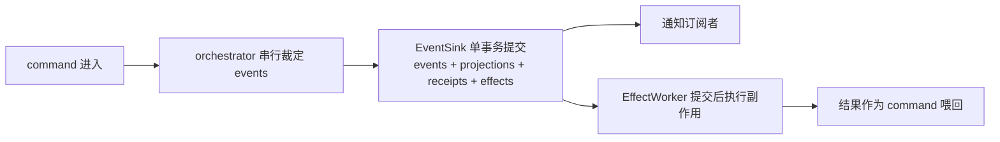

# 第 16 章：事件溯源：一条 command 的旅程
<!-- block: t3code-ch16.b-opening -->

界面上的一次操作会成为 command，由服务端串行裁定为事件，随后与投影等记录一起提交到数据库。调用 provider、捕获检查点等副作用在提交后才执行。因此，“已确认”与“工作完成”是两个不同的时刻。

本章沿这条路径说明 orchestrator、EventSink 和 EffectWorker 的职责，再讨论投影、事件保留窗口和升级兼容。最后用 turn 结束与 settlement 的时序，检查前面的区别如何影响后续操作。

## 16.1 一条 command 的旅程

术语表把这条链路上的词固定了下来：command 是改变领域状态的请求；event 是它产生的、被持久化的事实；orchestrator 是串行化 command 并根据当前状态裁定事件的服务；projection（也叫 read model）是持久化的当前状态视图；command receipt 是让重试幂等的结果记录；outbox effect 是随事件一起提交的副作用意图；effect worker 负责提交后执行并把结果作为 command 喂回。



术语表还提醒，一个 turn 是一次 user-to-agent 周期（a run）；provider 的工作可能在检查点与 diff 结算之前就结束，这正是后面要区分两个里程碑的原因。

command 获得确认时，意图已经提交；provider 执行、检查点捕获或后续工作仍可能没有完成。判断进度时，需要继续查看副作用执行和结果回传后的状态。

## 16.2 orchestrator 只做决定

`apps/server/src/orchestration-v2/Orchestrator.ts` 串行化 command，从当前状态决定事件，自己不做 I/O。文档把这条写得很硬：外部 I/O 既不进 command 的裁定，也不进数据库事务；掉线 provider 进程关联的 effect 在恢复时退役（retire），而不是重放。

所有权边界解释了为什么能做到这一点。server 拥有 provider 进程、终端、Git、检查点、持久状态和项目文件；client-runtime 只拥有跨 web/desktop/mobile 的连接与领域状态；`packages/contracts` 是独立版本客户端与服务器之间的类型化线协议，订阅只发送客户端需要的状态。socket 鉴权不等于该 socket 上每个方法都被授权——这是 environment auth 的独立边界。

订阅只发送客户端需要的状态，因此裁定事件时也不必为每个客户端分别裁剪数据。

按职责划分，可以把 orchestrator 理解为只依据当前状态作决定的调度器。需要外部 I/O 的动作记录为 outbox effect，交给事务提交后的 worker 执行。

## 16.3 EventSink 的一次事务

`apps/server/src/orchestration-v2/EventSink.ts` 在一个数据库事务里提交四样东西：事件、持久化的投影、command receipt、outbox effect；提交之后才通知订阅者。事务边界是这份设计的核心——投影与改变它的事件同生共死，不存在「事件写进去了但视图没更新」的中间态。

```ill
t3code-ch16-command-outbox
```

事件、投影、receipt 和 effect 在同一事务里提交；worker 在提交后才执行外部副作用。确认因此不等于工作完成。

| 产物 | 文档定义中的作用 |
|---|---|
| Event | command 产生的、被持久化的事实 |
| Projection / read model | 当前状态的持久化视图，与事件同事务提交 |
| Command receipt | command 结果的持久记录，用于让重试幂等 |
| Outbox effect | 随事件提交的副作用意图，例如启动 provider turn 或捕获检查点 |

四个产物由同一个事务写入，也意味着订阅者收到的通知对应的是一个完整投影版本，而不是半成品。

```text
EventSink 单事务：
  events
  persisted projections
  command receipts
  outbox effects
→ 提交后通知订阅者
```

投影一旦被应用，就是真相源。receipt 的存在则回答了另一个实际问题：客户端或 effect worker 重发同一条 command 时，服务端可以依据持久记录判断结果，而不是把副作用再做一遍。

## 16.4 EffectWorker 与副作用

`apps/server/src/orchestration-v2/EffectWorker.ts` 在提交之后运行 outbox effect，并把结果作为 command 喂回系统。启动一次 provider turn、捕获一个 turn 结束检查点，都是文档点名的 effect 例子——注意它们都是「副作用意图先落盘、后执行」。

因此，command 确认不能作为完成信号。一次 turn 中，provider 回合可能已经结束，检查点、diff 与 PR 同步却仍在结算。文档要求这些收尾工作不能让客户端继续将 provider 显示为 active，也不能计入 provider 时长。

effect 执行结果作为新的 command 返回，再次经过串行裁定、事务提交和通知。这使执行结果也遵循同一套状态更新流程。

还有一条恢复规则：与丢失的 provider 进程绑定的 effect，在恢复时退役而不是重放。重放一个已经作用到外部世界的副作用是危险的，宁可让它失效，也不要在恢复路径上重复执行。

## 16.5 投影是真相源

应用后的持久化投影是状态真相源，客户端渲染的是服务端保存的结算状态，而不是用本地时钟或 PR 缓存自己推导。设置也遵守同样的所有权：客户端偏好留在当前客户端，环境默认值与项目覆盖留在各自的服务端；不可用的设置目标绝不能回退到另一个环境。**All environments** 只是对当前已连接服务器的一次显式批量编辑，不是持久的全局默认或同步承诺。

客户端缓存处在从属位置。离线时缓存投影仍可读，但不能暗示连接还活着，也不能在重连时覆盖更新的实时数据。线程详情把订阅生命周期与缓存生命周期分开：挂载的消费者共享一条实时流（最后一个卸载时停止），短生命周期缓存保留状态和 replay cursor 以便快速回退。

这里有一个并发边界值得记住：只有在更新完成后，才能一起提交缓存状态与 replay cursor。取消不能把 cursor 推过已经应用的数据，旧作用域也不能覆盖新作用域的缓存。

## 16.6 重放窗口与升级

事件日志只保留有界的重放窗口，因此不能从日志从头重建投影。这是与「事件溯源」这个名字容易产生的误解相区分的地方：事件是事实记录，但事实记录有保留期限，真正的当前状态由已应用的投影承载。

schema 升级还需兼容数据库中保留的旧事件。新版本在启动时会读取这段历史，因此既要解析新的 RPC 请求，也要能解码重放窗口内的旧记录。

command receipt 在这里也有价值：跨版本、跨重连的重试要幂等，靠的是持久记录，而不是「这次请求看起来像上次」。这段历史在启动时就要能被读懂。

## 16.7 turn 结束与 settlement

Provider 回合结束与后续收尾（检查点、diff、PR 同步）是两个独立里程碑。文档明确：run 在 provider turn 结束时就是 `completed`；turn-end 检查点随后作为 outbox effect 捕获到线程的 effect lane 上。在捕获提交之前，读者把缺失的检查点当作 pending，而 command 裁定仍把这个 run 视为 `waiting`——于是 steer、排队 turn、回滚和恢复都排在捕获之后，不会插队。

检查点使用隐藏 Git ref，所以工作区快照不会给用户分支添加 commit。回滚还要求工作区状态与 provider 对话协调：如果 provider 无法回滚它自己的对话，必须在碰文件系统之前拒绝这次 revert。

这里的 `waiting` 不是界面上的加载动画，而是 command 裁定所依据的状态：它决定 steer、排队 turn、回滚与恢复能否进入。状态没到，操作就排在捕获之后。

结算由服务器拥有。客户端不做「我觉得它已经结束了」的推断，而是渲染持久化的结算状态。这条规则与前文的投影真相源是同一件事在不同层面的表达。

## 16.8 本章要点与来源

一条 command 依次经过：串行裁定事件 → 在同一事务中提交事件、投影、receipt 与 effect → 执行副作用 → 回传结果。确认对应事务提交，后续工作是否完成要另查状态。

- 不做 I/O 的 orchestrator、单事务的 EventSink、提交后执行的 EffectWorker，三者职责不可互换。
- 投影是真相源；缓存、本地时钟和 PR 缓存都只是渲染辅助。
- 事件日志只有有界重放窗口，保留的事件必须跨升级可解码。
- turn 完成与 settlement 分离：检查点是 effect lane 上的 effect，未提交前 run 仍是 `waiting`。

排查恢复问题时，先确认事务记录与投影，再查看 EffectWorker 和结算状态。这样才能区分意图已经保存、操作仍未执行，以及执行结束但收尾尚未完成这几种情况。

来源：[01_architecture.md](https://github.com/pingdotgg/t3code/blob/3b3b662f3c601ba6ce3f2435c7b5e20e9d6841f1/docs/internals/01_architecture.md)、[00_glossary.md](https://github.com/pingdotgg/t3code/blob/3b3b662f3c601ba6ce3f2435c7b5e20e9d6841f1/docs/internals/00_glossary.md)。
