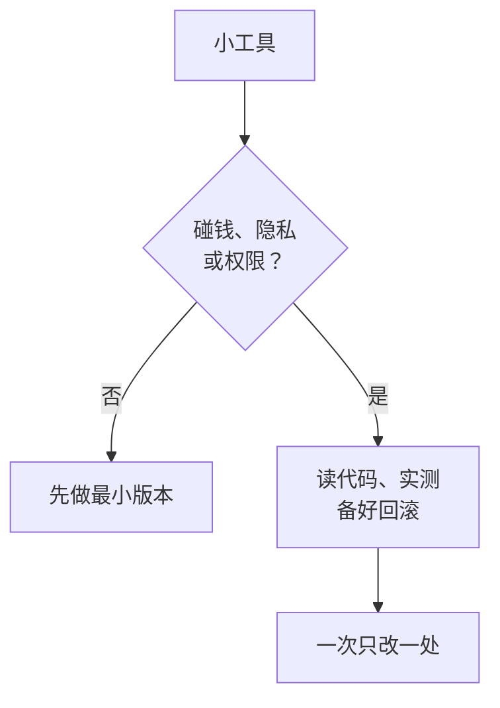

# 第 1 章：Vibe coding 是什么，不是什么

<!-- block: vibe-ch01.b-opening -->
周六上午，市集组织者发来一份 `books.csv`：几十行记录，列有书名、作者、品相、摊主和联系方式。她想要一个能发到群里的书架页面，最好下午就能用。为了在一屏内看清，第 3 章会从这份表里截出八行做样例。

你把文件丢给 AI，说：“帮我做一个旧书交换网站。” 几分钟后，一个带渐变背景和搜索框的页面出现了。你点了两下，觉得很像样；再往下滚，发现所有书都显示“未知作者”，联系方式大喇喇地列在卡片底部，内容为空的行变成了一张白卡。

这就是 vibe coding 的典型时刻：生成速度远超检查速度。问题不在模型不会写页面，而在“网站”这个词没有说明数据从哪来、什么算空行、哪些字段可以公开。

## 一句话的由来

2025 年 2 月，Andrej Karpathy 在 X 上把这种写法称为 “vibe coding”：完全顺着感觉走，接受指数级的变化，甚至不去看代码是否存在。原话更像一种姿态，不是一套方法。后来媒体、工具厂商和课程各自延伸，词义变得很宽：有人指“用自然语言生成整个应用”，有人指“让 IDE 自动补全并接受建议”，也有人指“不读代码就上线”。

这些用法共享一个动作：把一部分实现判断交给模型。差别在于，剩下的判断由谁做、在什么时候做。本书采用一个窄定义：

> Vibe coding 是用自然语言和运行结果驱动实现，允许作者暂时不逐行读代码；但交付前仍要有人对数据、权限、失败路径和可维护性负责。

这个定义保留了它的效率，也把责任放回人这边。你可以不读每一行，但不能不知道程序会碰什么。

## 模型补实现，判断仍由人做

模型最擅长的是把常见结构快速铺出来：读 CSV、生成 HTML、加一个排序、写一段命令行参数。这些代码有大量公开样例，生成质量通常够用。它不擅长的是你环境里的隐含条件：CSV 是不是带 BOM，书名里有没有逗号和引号，联系方式能不能出现在公开页面，市集结束后这份页面还要不要维护。

把“生成”与“判断”分开，很多争论会清楚一些：

| 环节 | 可以更多交给模型 | 必须由你决定 |
| --- | --- | --- |
| 结构 | 目录、函数、样板代码 | 数据从哪来、存到哪里 |
| 样式 | 布局、配色、响应式细节 | 哪些字段可以公开 |
| 逻辑 | 排序、格式化、去重实现 | 重复怎样算、空值怎样算 |
| 运行 | 安装依赖、启动命令 | 失败时是否可回滚 |
| 维护 | 注释、测试草稿 | 谁接手、多久复查一次 |

右列每一项都要由人写成可检查的条件，模型无法代替这项判断。第 2 章会把它们收进一张任务卡。

```ill
vibe-ch01-split
```

## 适合先试的任务

Vibe coding 在低风险、可回退、结果肉眼可查的场景里最顺手：

- 一次性数据整理：把表格转成 Markdown、批量改文件名、抓一页公开资料。
- 个人或内部原型：先验证流程是否值得做，再决定要不要工程化。
- 有现成样例的界面：照着截图或设计稿复刻，差异可以直接看出来。
- 学习与探索：让模型先搭一个能跑的最小版本，再逐段理解。

## 必须先停的任务

以下场景不适合“先跑起来再说”：

- 会动真实资金、库存或订单状态的操作。
- 处理他人的隐私数据、凭证、医疗或财务记录。
- 需要长期维护的生产服务，尤其是多人协作的代码库。
- 安全边界本身：登录、权限、加密、沙箱、支付回调。

后四种也可以借助模型，但不能只靠“感觉对了”来判断。第 8 章给出停下来读代码的具体信号；第 9 章给出验收与回滚。



高风险分支不经过“先做最小版本”：读得懂、测得出、退得回，才让模型动第一行；缺一项就先停下补验收与评审。

## 把感觉变成可检查的条件

“做一个旧书交换网站”不是任务，是愿望。把它变成可执行的一步，需要四个空位：

1. **输入**：哪份文件，哪些列，缺失值怎么处理。
2. **输出**：给谁看，长什么样，放在哪里。
3. **规则**：重复怎么合并，排序按什么，哪些字段不公开。
4. **验收**：用什么命令运行，看到什么算通过，失败时退回哪一版。

以旧书市集为例，最小版本可以缩成一句话：

> 读取 `books.csv`，跳过缺少书名或摊主的行，按品相从新到旧排序，生成一个不包含联系方式的 `shelf.html`；同一书名与作者只保留一条，并在终端打印重复组数量。

这句话仍然不完整，但已经能开始。它明确了输入、输出、公开边界和一条可观察结果。剩下的细节，用例子补。

## 动手做

找一件你最近想让 AI 做的小事，写下三行：

- 它读取什么，写到哪里。
- 哪一条结果错了我立刻能看出来。
- 如果它把现有文件弄坏了，我怎么退回去。

如果第三行写不出来，先别开始生成。先复制一份目录，或者初始化一个 Git 仓库；开始生成前要有一个可恢复的版本。

## 关键要点

- Vibe coding 是一种以自然语言和运行结果驱动的写法，不是“不用负责”的同义词。
- 模型补实现，人定边界；边界要写成输入、输出、规则和验收。
- 低风险、可回退、结果可肉眼检查的任务最适合先试。
- 碰钱、隐私、权限和长期维护时，读代码和测试不能省。

下一章把上面那三行扩成一张能反复使用的任务卡。
