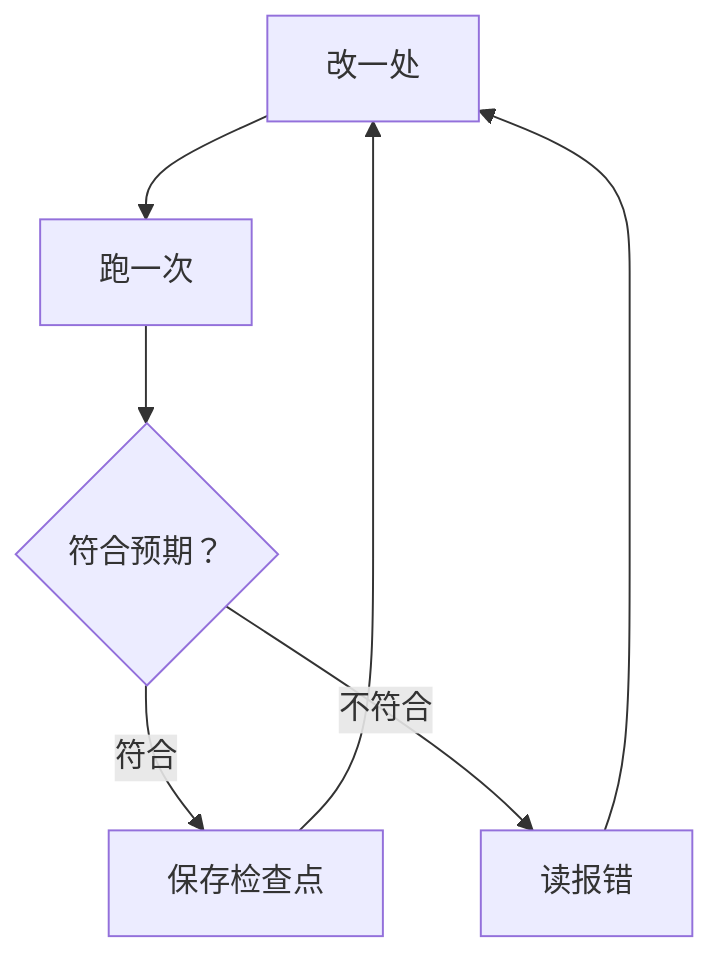

# 第 5 章：十分钟一圈

<!-- block: vibe-ch05.b-opening -->
任务卡和样例都齐了，最容易犯的错是“一次让模型改完所有东西”。需求里同时有去重、排序、脱敏和错误处理，模型一次生成两百行，运行报错时你分不清是 CSV 读错了，还是排序键写错了。

把循环缩小：一次只改一个可观察的行为，跑一次，看一眼输出，保存一版。十分钟足够走一圈。

## 一圈的四个动作



“写下一处改动”要具体到一句可验证的话，例如“空书名行跳过并打印行号”，而不是“完善异常处理”。“运行一条命令”最好固定，例如：

```bash
python shelf.py fixtures/books.csv -o shelf.html
```

固定命令让你能比较两次输出。每次换命令，变量就多一个。

## 先让最小版本跑起来

第一圈不追求功能齐全。先让程序能读文件、打印行数，再逐步加规则。下面这版覆盖了样例里的核心行为，可以整体交给模型生成，也可以自己敲。它仍有一个去重假设没有被样例检验，第 7 章会让它暴露出来：

```python
#!/usr/bin/env python3
"""Build a public shelf page from a book-fair CSV."""
from __future__ import annotations

import argparse
import csv
import html
import sys
from pathlib import Path

RANK = {"new": 0, "good": 1, "worn": 2, "unknown": 3}


def clean(value: str | None) -> str:
    return " ".join((value or "").split())


def condition(value: str | None) -> str:
    value = clean(value).lower()
    return value if value in RANK else "unknown"


def read_books(path: Path) -> tuple[list[dict], list[int]]:
    books: list[dict] = []
    skipped: list[int] = []
    with path.open(newline="", encoding="utf-8-sig") as handle:
        for line, row in enumerate(csv.DictReader(handle), start=2):
            title = clean(row.get("title"))
            owner = clean(row.get("owner"))
            if not title or not owner:
                skipped.append(line)
                continue
            books.append({"title": title, "author": clean(row.get("author")),
                          "condition": condition(row.get("condition")),
                          "owner": owner})
    return books, skipped


def merge(books: list[dict]) -> tuple[list[dict], int]:
    groups: dict[tuple[str, ...], dict] = {}
    duplicated: set[tuple[str, ...]] = set()
    for book in books:
        key = (book["title"].casefold(),)
        seen = groups.get(key)
        if seen is None:
            groups[key] = {**book, "owners": [book["owner"]]}
            continue
        duplicated.add(key)
        if RANK[book["condition"]] < RANK[seen["condition"]]:
            seen["condition"] = book["condition"]
        if book["owner"] not in seen["owners"]:
            seen["owners"].append(book["owner"])
    merged = sorted(groups.values(),
                    key=lambda b: (RANK[b["condition"]], b["title"].casefold()))
    return merged, len(duplicated)


def render(books: list[dict]) -> str:
    cards = []
    for book in books:
        owners = "、".join(html.escape(o) for o in book["owners"])
        cards.append(
            '<li class="book">'
            f'<h2>{html.escape(book["title"])}</h2>'
            f'<p>{html.escape(book["author"])} · {book["condition"]}</p>'
            f'<p class="owner">{owners}</p></li>')
    return ('<!doctype html><html lang="zh"><meta charset="utf-8">'
            '<meta name="viewport" content="width=device-width,initial-scale=1">'
            '<title>旧书市集</title><style>'
            'body{max-width:42rem;margin:2rem auto;padding:0 1rem;'
            'font:16px/1.7 system-ui,sans-serif}'
            '.shelf{list-style:none;padding:0;display:grid;gap:.8rem}'
            '.book{border:1px solid #bbb;border-radius:.4rem;padding:.8rem}'
            '.book h2{font-size:1.1rem;margin:0}.owner{color:#555;margin:0}'
            '</style><h1>旧书市集</h1><ul class="shelf">'
            + "".join(cards) + "</ul></html>")


def main(argv: list[str] | None = None) -> int:
    parser = argparse.ArgumentParser(description=__doc__)
    parser.add_argument("source", type=Path)
    parser.add_argument("-o", "--output", type=Path, default=Path("shelf.html"))
    args = parser.parse_args(argv)
    try:
        books, skipped = read_books(args.source)
    except OSError as exc:
        print(f"无法读取 {args.source}: {exc}", file=sys.stderr)
        return 2
    merged, duplicate_groups = merge(books)
    temporary = args.output.with_suffix(args.output.suffix + ".tmp")
    temporary.write_text(render(merged), encoding="utf-8")
    temporary.replace(args.output)
    print(f"卡片：{len(merged)}")
    print(f"重复组：{duplicate_groups}")
    print("跳过行：" + ("、".join(map(str, skipped)) or "0"))
    return 0


if __name__ == "__main__":
    raise SystemExit(main())
```

运行后应看到：

```text
卡片：4
重复组：2
跳过行：5、9
```

如果看到的是“卡片：6”或“跳过行：0”，先查 CSV 的列名与空值处理，不要急着改页面样式。数据层出错时，页面样式无法弥补。

## 一次只改一件事

有了能跑的最小版本，后续每圈只碰一个规则。比如“中文品相映射”：

1. 在 fixtures 里加一行 `九成新`。
2. 在 `condition()` 里加映射：`九成新 -> good`。
3. 运行同一条命令，确认这一行从 `unknown` 变成 `good`，其他卡片顺序没变。
4. 保存。

不要在同一圈里顺手改颜色、改排序、加搜索框。三个改动混在一起，输出变化时无法归因。模型常会顺手改其他部分，你要明确说：这轮只改这一处，其他行为保持不变。

## 检查点怎么留

最轻的检查点是把当前文件复制成 `shelf.v1.py`、`shelf.v2.py`。最稳的是 Git：

```bash
git init
git add shelf.py fixtures task-card.md
git commit -m "shelf: read, merge, render"
```

之后每圈通过验收再提交。提交信息写“这圈改了什么行为”，不要写“update”。回退时，你能从历史里找到最后一个可用版本，而不是凭记忆重写。

如果项目已经在 Git 里，改之前先 `git status` 看清楚工作区。别把别人未提交的改动一起卷进检查点。

## 动手做

用第 3 章的 fixtures 跑通上面的脚本，然后完成两圈：

- 第一圈只加“中文品相映射”，保留其他行为。
- 第二圈只加“同一摊主出现两次时只显示一次”，保留其他行为。

每圈结束记录：改了什么、运行命令、实际输出、是否提交。四行就够。

## 关键要点

- 一圈只改一个可观察行为，命令固定，输出对比。
- 先让最小版本跑通，再逐个加规则。
- 检查点要能退回，复制文件或 Git 都行。
- 模型顺手改了范围外的内容时，退回或放到下一圈。
