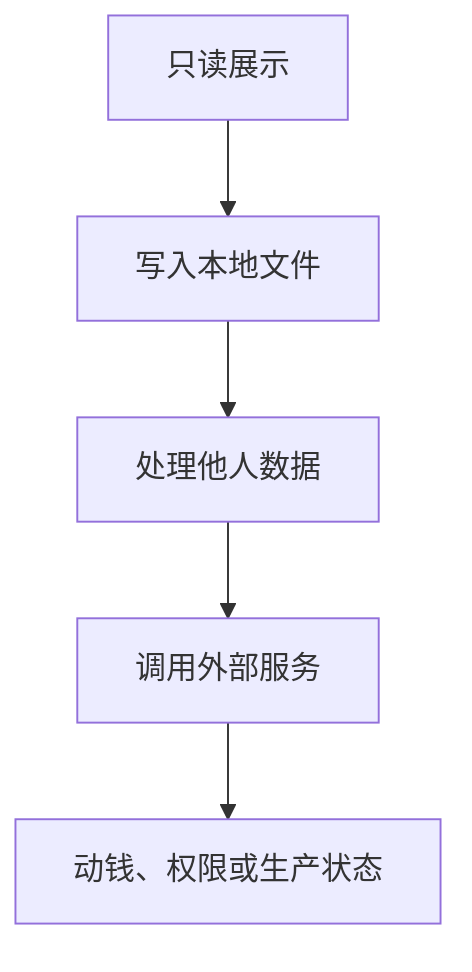

# 第 6 章：什么时候必须停下来读代码

<!-- block: vibe-ch06.b-opening -->
旧书页面跑起来了，组织者很满意。有人提议再加一个“导入往届表格”的按钮，顺手把文件上传也做了。模型给出一个能用的版本：选择文件、读取内容、覆盖当前 `books.csv`、刷新页面。

你点了两次，都正常。第三次，一个摊主上传了同名文件，把上午刚整理好的数据覆盖了。没有备份，没有确认框，也没有“撤销”。

这类事故不是模型“坏”，而是任务从“生成一个静态页面”变成了“接收文件并写入磁盘”。风险等级变了，读代码的义务也跟着变。

## 一条风险梯子

越往下，越不能只看页面效果。每一级需要的最低检查也不同：

| 级别 | 例子 | 至少要确认 |
| --- | --- | --- |
| 只读展示 | 静态书架页 | 输出转义、空值、排序 |
| 写本地文件 | 生成 `shelf.html` | 不覆盖源文件、失败不留半成品 |
| 处理他人数据 | 上传 CSV、合并名单 | 路径校验、隐私字段、覆盖确认 |
| 调用外部服务 | 发通知、同步网盘 | 凭证存放、失败重试、超时 |
| 动钱/权限/生产 | 下单、改权限、部署 | 人工审查、审计日志、回滚演练 |

同一本书里，`shelf.py` 只到第二级；加上上传按钮就到第三级；如果它自动把名单发到群，就到第四级。级别不是按代码行数分的，是按“最坏情况下会损失什么”分的。

## 五个必须停手的信号

看到下面任何一条，先别继续“感觉循环”，打开代码或让模型解释：

1. **出现凭证**：API key、token、密码、私钥被写进代码或前端。哪怕只是示例，也要先删掉并轮换。
2. **拼接命令或 SQL**：`shell=True`、字符串拼 `rm`、`eval`、`exec`、未经参数化的 SQL。确认输入来源和转义方式。
3. **文件路径来自用户**：上传文件名、查询参数直接拼进路径。确认是否做了基目录限制。
4. **删除、覆盖、批量写入**：没有备份、没有确认、没有 dry-run。先加“只打印不执行”模式。
5. **权限判断在前端**：页面隐藏了按钮，但后端没有检查。隐藏不等于禁止。

这些信号不需要你读懂整个项目，只需要定位到相关函数。让模型给出“文件、函数、调用链、最坏结果”四行说明，再自己核对关键一行。

## 读什么，不读什么

“读代码”不等于从第一行读到最后一行。对 vibe coding，优先读五处：

- **入口**：程序从哪开始，接收哪些参数。
- **数据边界**：读文件、收上传、调 API 的地方，输入有没有校验。
- **写边界**：写文件、发请求、改数据库的地方，失败会不会留下半成品。
- **权限与凭证**：谁能调用，密钥从哪来，是否进了日志。
- **依赖**：新加了什么包， license 是否可接受，是否有安装脚本。

其余部分可以按需读。一个 300 行的脚本，真正决定风险的往往不到 50 行。

## 让模型做一次“反向审查”

生成完成后，追加一条指令：

> 不要改代码。列出这个程序最可能造成数据丢失、隐私泄露或越权访问的三个点，每点给出文件、函数、触发条件和最小修复建议。

模型的回答不一定对，但它会把注意力拉到边界上。你拿这份清单逐条核对，比漫无目的地读更有效。

如果模型说“没有风险”，不要接受这个结论。让它逐项回答：输入是否可信、输出是否转义、路径是否受限、失败是否可恢复、凭证是否可能进日志。

## 读完之后做什么

发现风险，不一定立刻重写。按代价排序：

1. 能删的功能先删。上传按钮不是任务卡里的需求，移除比加固更快。
2. 能加确认的加确认。覆盖文件前要求二次确认，并自动备份。
3. 能限制范围的限制。上传只接受 CSV，路径固定在项目目录内。
4. 需要工程改造的，记进待办，不要假装已经解决。

每次修复都补一条反例测试。比如“上传文件名包含 `../` 时拒绝”，比“已加路径校验”更能证明修复有效。

## 本章动作

给你的工具画一条风险梯子，标出当前停在哪个级别。然后选一个最高风险点，写下：

- 最坏会发生什么。
- 哪个函数负责这件事。
- 一个能在本地复现的失败输入。
- 最小修复或删除方案。

如果当前级别在“处理他人数据”以上，找一个人复核你的结论。

## 关键要点

- 风险按最坏损失分级，不按代码量分级。
- 凭证、命令拼接、用户路径、覆盖写入、前端权限，是五个停手信号。
- 只读入口、数据边界、写边界、权限和依赖，不必通读全部。
- 修复优先删功能、加确认、限范围，再考虑工程改造。
